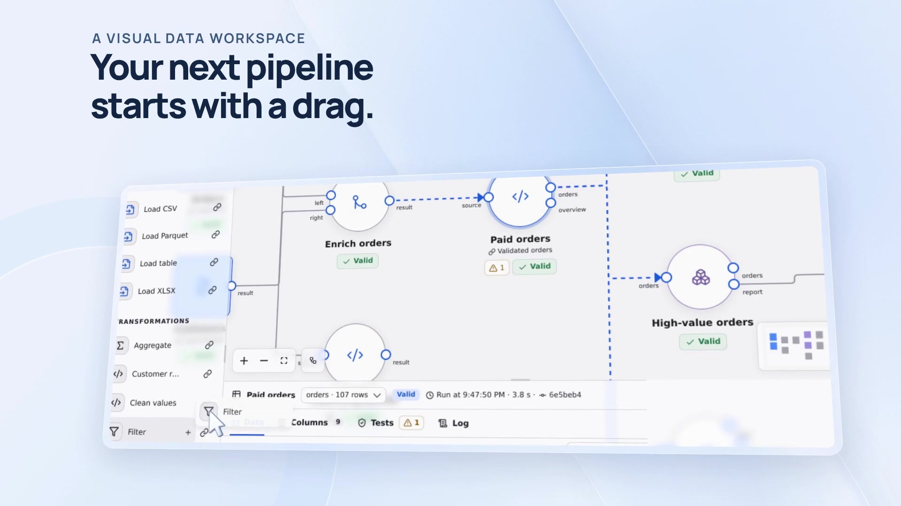

# Duckpad

[](https://github.com/hugues31/duckpad/actions/workflows/ci.yml)
[](https://pypi.org/project/duckpad/)
[](https://pypi.org/project/duckpad/)
[](LICENSE)

### See the flow. Trust the result.

An open-source SQL workspace powered by **DuckDB 2.0**. Turn scattered data into
visual pipelines, explore the results and trace a number all the way back to its
source.

[](https://hugues31.github.io/duckpad/)

[](https://hugues31.github.io/duckpad/#demo)

- **Compose visually.** Connect sources, joins and reusable components. Use guided
  forms to prepare columns and values, or write your own SQL nodes.
- **Explore and check your data.** Sample and filter results, save views, compute
  column statistics, and keep data tests and execution messages next to your SQL.
- **Explain a number.** Follow a result cell back to its contributing source
  values, with [explicit lineage coverage](docs/LINEAGE.md).
- **Review changes.** Saves create Git commits. Work on separate branches, compare
  changes visually and review a merge before applying it.
- **Run repeatable work.** Share typed variables across nodes and environments,
  then launch Jobs against reviewed versions from the interface, CLI or a scheduler.
- **Ask for help in context.** Use the AI assistant to explain a flow, inspect
  its edits and confirm executions with your existing project permissions.
- **Keep control.** Run on your infrastructure, configure connections per
  environment, manage team access and import extensions for offline use.

## Try it

On a supported host with Python 3.11+ and Git installed (see
[platform requirements](docs/INSTALLATION.md#start)):

```sh
pip install duckpad
duckpad start
```

Your browser opens Duckpad: choose the administrator password, and you are in.
Follow **[Duckpad in 15 minutes](docs/QUICKSTART.md)** to build your first
pipeline from scratch, write SQL and explain a result. Lost the password later?
Run `duckpad reset-password`.

Prefer a ready-made project? Choose **New project → Start from an example**,
enter a name, then **Create → Run all** to explore Northstar.
See [installation](docs/INSTALLATION.md) for platform requirements and setup options.

## Find the right guide

| I want to… | Guide |
| --- | --- |
| Install Duckpad or join a team instance | [Installation and accounts](docs/INSTALLATION.md) |
| Learn the basics with a small example | [Duckpad in 15 minutes](docs/QUICKSTART.md) |
| Upload my data and download a result | [Use your own data](docs/YOUR_DATA.md) |
| Navigate, save and run a pipeline | [Workspace](docs/WORKSPACE.md) |
| Write SQL or prepare data with forms | [SQL syntax](docs/SQL.md) · [Data preparation](docs/DATA_PREPARATION.md) |
| Check or explain a result | [Results](docs/RESULTS.md) · [Data tests](docs/TESTS.md) · [Lineage](docs/LINEAGE.md) |
| Review changes and automate a version | [Git](docs/GIT.md) · [Jobs](docs/JOBS.md) · [CLI and automation](docs/AUTOMATION.md) |
| Fix a startup, source or execution problem | [Troubleshooting](docs/TROUBLESHOOTING.md) |

The [documentation index](https://hugues31.github.io/duckpad/docs/) also covers
connections, variables, components, Python, the assistant and instance administration.
Reference material includes [project files](docs/AUTHORING.md),
[architecture](docs/ARCHITECTURE.md), [validation](docs/VALIDATION.md),
[releases](docs/RELEASING.md) and [security](SECURITY.md).

Want to contribute? Start with [CONTRIBUTING.md](CONTRIBUTING.md).
