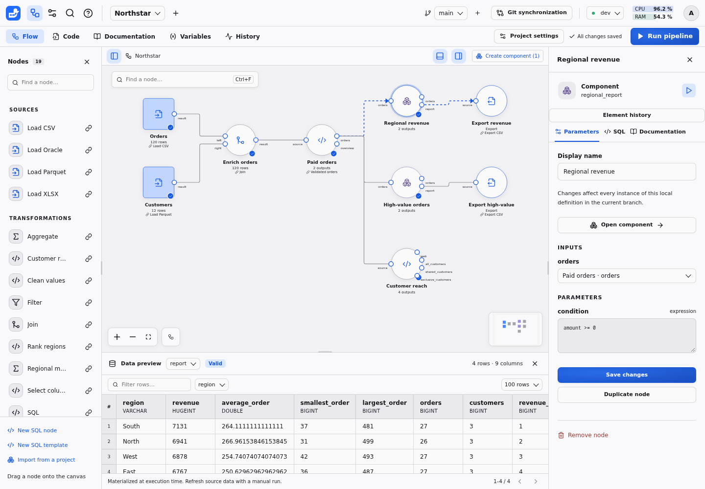

# Duckpad

Build local DuckDB pipelines on a visual canvas, inspect their results, and explain individual values back to their source cells. Duckpad combines a React/TypeScript interface with a Python/FastAPI execution service.

## Start

Requires **Python 3.11+ and Git** on `PATH`. Release wheels include the frontend, Monaco and its workers; Node.js is not needed to run the installed application.

```sh
pip install ./dist/duckpad-0.1.0-py3-none-any.whl
duckpad start
```

The distribution is named `duckpad`. Once published to a package index, the same package can be installed with `pip install duckpad`; this repository does not publish releases automatically.

Open the localhost address printed in the terminal. Sign in as `admin` using the password printed **once** on the first launch. The same password remains valid after a restart. The default instance directory is `$XDG_DATA_HOME/duckpad`, or `~/.local/share/duckpad`. Authentication, connection settings and execution history are kept there, outside project repositories.

```sh
duckpad start --home /path/to/my-instance --port 8765 --no-browser
```

Only one backend may own an instance directory at a time. Use separate `--home` directories for independent instances. The default address is `127.0.0.1`.

## Try the complete example

Choose **Open example project** and **Run pipeline**. The Northstar example creates CSV and Parquet inputs, joins customers to orders, computes ordered outputs, uses nested reusable components twice with separate parameters, computes aggregates, distinct counts, set operations and window ranks, and exports two CSV reports. Its `dev` and `prod` data are deliberately different.

Select **Regional revenue**, choose the `report` output, then click a revenue cell. Follow a contribution into the nested aggregate and page through its source amounts. No external accounts are required for this example. See the [example tour](docs/EXAMPLE.md).



## Included workflows

- Drag templates onto the canvas, connect ports, configure typed parameters, and edit shared SQL definitions in Monaco.
- Use guided filter, join-key and aggregate forms, or edit their generated SQL expressions.
- Preview, filter and sort results; explain valid cells with five contributions per page and complete counts.
- Group nodes into nested components, expose parameters, and import independent copies between projects.
- Save automatically to Git, inspect diffs, open isolated branches or historical revisions, and explicitly merge changes.
- Detect concurrent UI/file edits and resolve recoverable conflicts without losing either proposal.
- Recompute manually, stop active SQL, retain stale previews after failure, and inspect durable execution history.
- Configure reusable connections and environments outside project Git, with local, S3 and Oracle presets.
- Switch English/French and light/dark themes without changing the project.
- Monitor Duckpad server CPU and RAM as percentages with subtle background bars;
  click for two minutes of history and RAM used / total in MiB or GiB. Samples
  refresh every two seconds while the workspace is open; history resets on reload
  or sign-out. Process memory comes from [psutil](https://psutil.io/platform/),
  supporting Linux, macOS, and Windows. CPU includes all server threads, normalized
  to the available CPU capacity (100% means fully used); RAM is current resident
  memory divided by total capacity. CPU affinity and visible Linux cgroup v1/v2
  limits constrain those capacities; otherwise system totals apply. Measurements
  cover the Duckpad server process. Missing measurements are shown as unavailable.

Language defaults to the first supported language in your browser preferences
(English or French, with English as the fallback), and the theme defaults to your
system color scheme. Manual choices are saved in this browser and take priority
on subsequent visits.

Results live in memory per worktree and environment. After a backend restart, history remains available but previews and lineage require another manual run. Editing or changing an external source does not launch a run automatically.

## Develop and verify

```sh
bash scripts/setup.sh
uv run duckpad start --home .duckpad-dev --no-browser
```

For frontend development, `npm run dev --prefix frontend` proxies `/api` to the backend on port 8765.

```sh
uv run ruff check src tests scripts
uv run ruff format --check src tests scripts
uv run pytest -q
npm run check --prefix frontend
npm exec --prefix frontend -- playwright install chromium
npm run build --prefix frontend
npm run test:e2e --prefix frontend
uv build
```

The Playwright suite starts a disposable instance on port 8766. `DUCKPAD_CHROMIUM_EXECUTABLE` can point to an already installed Chromium executable. Building a release without compiled assets fails with an actionable message; editable installation permits building them afterward.

## Documentation

- [Multica issue workflow and preview deployment](docs/MULTICA.md)
- [Architecture and execution invariants](docs/ARCHITECTURE.md)
- [Project files, templates and components](docs/AUTHORING.md)
- [Lineage coverage and limitations](docs/LINEAGE.md)
- [Connector setup and validated compatibility](docs/CONNECTORS.md)
- [Execution-service prototype and scheduling decision](docs/EXECUTION_SERVICE.md)
- [Validation results and performance reference](docs/VALIDATION.md)

The required dependency is `duckdb>=2.0`; the recorded validation uses **DuckDB 2.0.0 on Linux x86_64**. Oracle needs a matching OraDuck extension and Oracle Instant Client. S3 validation uses a local S3 emulator; live AWS IAM, TLS and deployment-specific behavior need their own integration checks. Details and reproducible commands are in the connector guide.
