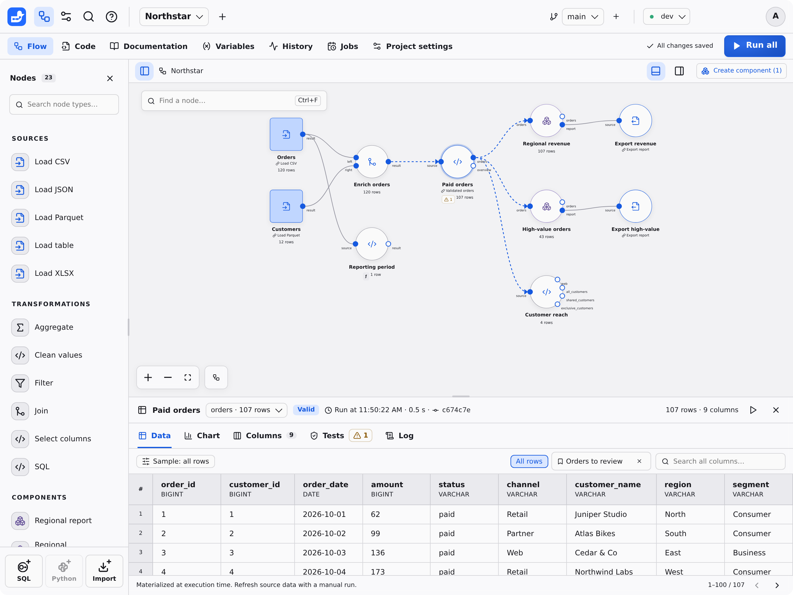
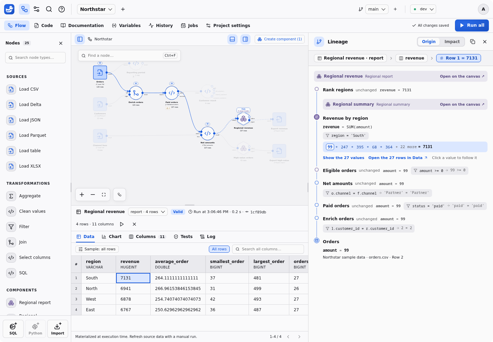
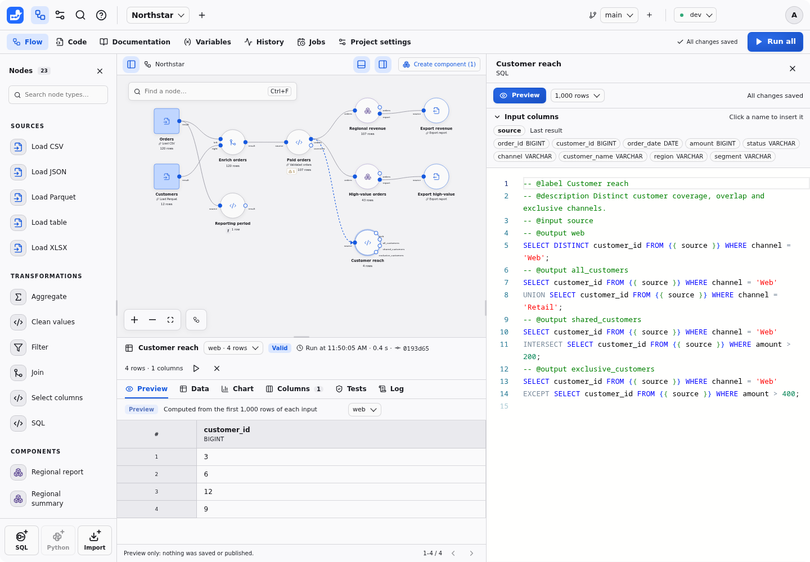
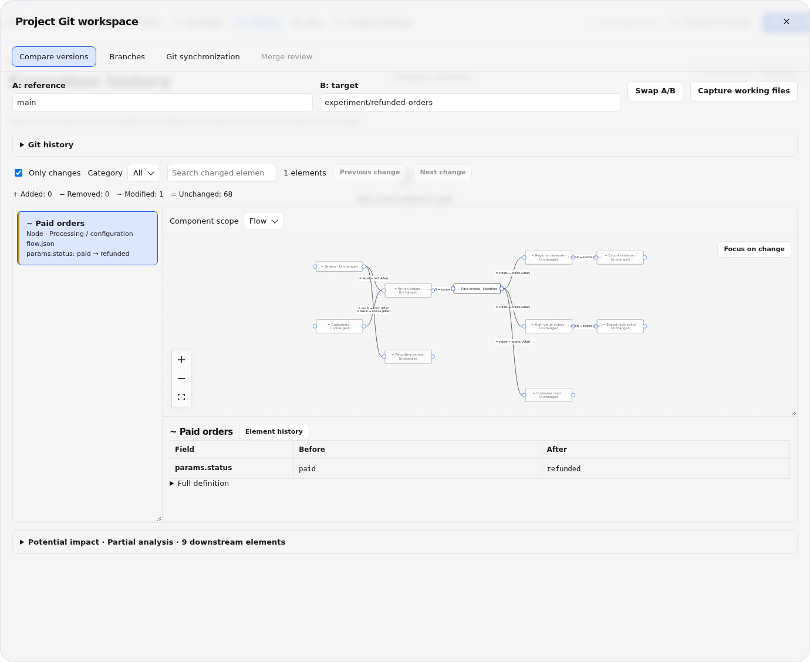
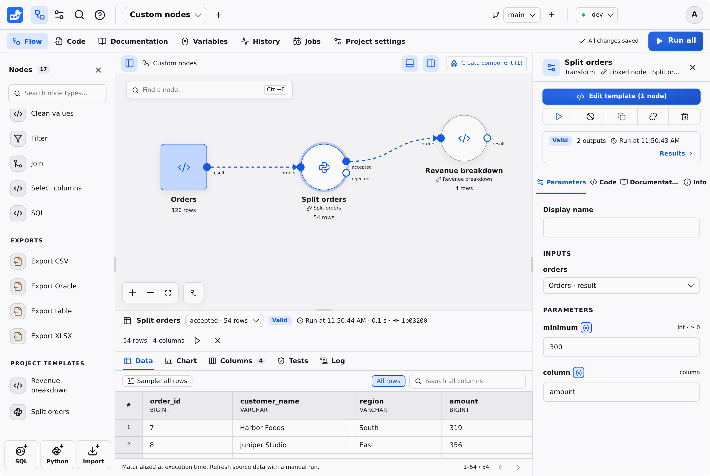

<div align="center">


# Duckpad

**See the flow. Trust the result.**

Duckpad is a free, open-source visual tool for building data pipelines.<br>
Connect steps on a canvas, write SQL or Python where you need it,
and see the data at every step. Powered by [DuckDB](https://duckdb.org/).

[](https://github.com/hugues31/duckpad/actions/workflows/ci.yml)
[](https://pypi.org/project/duckpad/)
[](https://pypi.org/project/duckpad/)
[](LICENSE)

[Website](https://hugues31.github.io/duckpad/) ·
[Quickstart](docs/QUICKSTART.md) ·
[Documentation](https://hugues31.github.io/duckpad/docs/) ·
[Releases](https://github.com/hugues31/duckpad/releases)

</div>

<picture>
  <source media="(prefers-color-scheme: dark)" srcset="docs/images/readme-workspace-dark.png">
  
</picture>

<p align="center">
  <a href="https://hugues31.github.io/duckpad/#demo"><b>▶ Watch Duckpad in one minute</b></a>
</p>

## What is Duckpad?

Duckpad is a workspace for preparing and transforming data. You build a pipeline
by connecting steps on a canvas: load files or database tables, join, filter,
aggregate, export. Each step is a SQL query or a Python class that you can read
and edit, and each step keeps its result. You can open any table along the way
instead of guessing what the pipeline did.

It runs on your laptop or on a server your team shares. There is no cloud
service, no sign-up and no paid edition.

Use it to:

- **Prepare data.** Combine CSV, Parquet and JSON files with PostgreSQL, Oracle
  or S3 data, using guided forms or your own SQL. DuckDB extensions add
  [more formats](docs/CONNECTORS.md#file-formats-and-extensions), such as Excel.
- **Build results people can trust.** Data tests block a result that contains
  bad rows before it is published or exported, and you can trace a number back
  to the source values behind it.
- **Run it again tomorrow.** Every save is a Git commit. Review a change, then
  run the approved version from the interface, the command line or your
  scheduler.

## Try it

You need Python 3.11+ and Git.

```sh
pip install duckpad
duckpad start
```

Your browser opens Duckpad: choose the administrator password, and you are in.

On macOS or Windows, run `duckpad start --trusted-local` instead, for your own
projects on your own machine. The default mode confines pipelines to the files
they are allowed to read, which requires Linux with Landlock; see the
[platform requirements](docs/INSTALLATION.md#platform-requirements).

Then choose **New project → Start from an example** and **Run all** to explore
a finished pipeline, or follow **[Duckpad in 15 minutes](docs/QUICKSTART.md)**
to build your first one from scratch.

## A closer look

### Trace a number back to its source

Click a cell in a result to see how it was calculated: the rows behind a total,
through joins and aggregates, down to the original source cells. Coverage is
explicit: when a step cannot be explained, Duckpad
[tells you](docs/LINEAGE.md).



### Write SQL and preview it on real rows

Guided forms cover the common steps: select and rename columns, clean values,
filter, join, aggregate. When you need more, open the code. It is plain DuckDB
SQL, with the input columns one click away, and you can
[preview](docs/SQL.md#preview-while-you-edit) the query you are typing on real
rows.



### Review changes before they run

Work on a branch, compare two versions node by node, check the impact on the
data and merge after review. Projects are ordinary Git repositories, so you can
also [push and pull](docs/GIT.md#origin-fetch-pull-and-push) them.



### And also

- **[Data tests](docs/TESTS.md) and [messages](docs/MESSAGES.md)** next to the
  SQL they check, with the failing rows one click away.
- **[Variables](docs/VARIABLES.md) and [environments](docs/ENVIRONMENTS.md)**:
  define a value once and adapt it for development and production.
- **[Charts](docs/CHARTS.md)** of any result, declared with Vega-Lite and
  versioned with the project.
- **[Jobs](docs/JOBS.md)** that run a reviewed version, launched from the
  interface, `duckpad run` or the [automation API](docs/AUTOMATION.md).
- **An [AI assistant](docs/ASSISTANT.md)** that explains a flow, makes edits
  you can undo and asks before running anything. It is off until you connect a
  provider of your choice, including a local model.
- **Team features**: accounts, project roles, API tokens and
  [single sign-on](docs/SSO.md).

## Build your own nodes

The built-in nodes are a starting point. A node is a file: a SQL query with a
few comment directives, or a Python class. Duckpad reads the declarations and
turns them into ports, a parameter form and a palette entry. There is nothing
to compile or register.

A SQL node declares its inputs, typed parameters, outputs and tests in comments:

```sql
-- @label Revenue breakdown
-- @description Total revenue for each value of the column you choose.
-- @input orders
-- @param dimension: column(orders) = "region"
-- @param minimum: number = 100
-- @output result
SELECT {{ dimension }}, SUM(amount) AS revenue
FROM {{ orders }}
WHERE amount >= {{ minimum }}
GROUP BY ALL
ORDER BY revenue DESC;
-- @test revenue_is_positive
SELECT * FROM {{ result }} WHERE revenue <= 0;
```

A Python node is a class with typed attributes. It receives and returns DuckDB
relations, and can use the packages your project declares:

```python
import duckpad as dp
from duckdb import col


# @label Split orders
class Split(dp.Node):
    minimum: int = dp.param(default=300, ge=0)
    column: dp.Column = dp.param(default="amount", input="orders")

    class Outputs(dp.Outputs):
        accepted: dp.Relation
        rejected: dp.Relation

    def run(self, orders: dp.Relation) -> Outputs:
        return self.Outputs(
            accepted=orders.filter(col(self.column) >= self.minimum),
            rejected=orders.filter(col(self.column) < self.minimum),
        )
```

Click **SQL** or **Python** at the bottom of the palette, paste the code, and
the node is ready to drop into a pipeline. Python nodes are available once an
administrator enables Python for the project.



More ways to extend Duckpad:

- **[Components](docs/COMPONENTS.md)**: group several steps into one reusable
  node with its own parameters, and import it into other projects.
- **[Connectors](docs/CONNECTORS.md#add-another-connector)**: describe another
  database or storage system in a short JSON definition.
- **[DuckDB extensions](docs/OFFLINE_EXTENSIONS.md)**: enable core and community
  extensions per project, even on a server without Internet access.
- **[Python packages](docs/PYTHON.md#dependencies-and-helper-modules)**: declare
  dependencies in the project's `pyproject.toml`; Duckpad locks and installs
  them.

See the [SQL syntax](docs/SQL.md) and [Python nodes](docs/PYTHON.md) guides for
the full contracts.

## How Duckpad compares

Duckpad sits between visual data preparation tools and SQL frameworks.

| If you come from | You will recognize | What Duckpad does differently |
| --- | --- | --- |
| Visual data preparation tools such as Alteryx Designer, Dataiku DSS or KNIME | A canvas of connected steps, with a result to inspect at each one | Every step, including the guided ones, is SQL or Python you can read, edit and diff. See the [vocabulary map](docs/COMPARISON.md) for Dataiku and Alteryx users. |
| SQL frameworks such as dbt or SQLMesh | SQL files in Git, tests and environments | A visual canvas, with a result to inspect at each step and cell-level lineage through SQL. Duckpad computes in DuckDB, not inside your warehouse. |
| Notebooks and scripts | SQL and Python, quick iterations on real data | A dependency graph instead of cell order, a form for each step's parameters, and runs you can review and repeat. |

Duckpad is probably not what you need for:

- **Data that requires a cluster.** DuckDB computes on a single machine.
- **Streaming.** Pipelines run as batches.
- **Dashboards.** Charts illustrate a result; Duckpad is not a BI tool.
- **Scheduling.** There is no built-in scheduler: cron, Airflow or another
  orchestrator [starts the Jobs](docs/AUTOMATION.md).

Duckpad is young and moves fast. Releases are frequent, and a breaking one can
require a fresh instance: read the
[release notes](https://github.com/hugues31/duckpad/releases) before upgrading.

## Free and open source

Duckpad is released under the [MIT license](LICENSE) and has nothing to sell.

- **Everything is in the package.** There is no paid edition, no hosted plan and
  no feature kept back for one: single sign-on, roles and Jobs come with
  `pip install duckpad`.
- **It runs where you decide.** No license key and no telemetry. Nothing leaves
  your machine or your server unless you connect it to something: a database,
  a Git remote or an AI provider.
- **Your work stays yours.** A project is a Git repository of plain-text files
  (SQL, Python, JSON) that you can read, diff and move.

If Duckpad is useful to you, star the repository and tell a colleague: that is
how other people find it.

## Find the right guide

| I want to… | Guide |
| --- | --- |
| Install Duckpad or join a team instance | [Installation and accounts](docs/INSTALLATION.md) |
| Learn the basics with a small example | [Duckpad in 15 minutes](docs/QUICKSTART.md) |
| Upload my data and download a result | [Use your own data](docs/YOUR_DATA.md) |
| Navigate, save and run a pipeline | [Workspace](docs/WORKSPACE.md) |
| Write SQL or prepare data with forms | [SQL syntax](docs/SQL.md) · [Data preparation](docs/DATA_PREPARATION.md) |
| Create my own nodes and reuse them | [SQL syntax](docs/SQL.md) · [Python nodes](docs/PYTHON.md) · [Components](docs/COMPONENTS.md) |
| Read from S3 or a database | [Connections](docs/CONNECTORS.md) |
| Check or explain a result | [Results](docs/RESULTS.md) · [Data tests](docs/TESTS.md) · [Lineage](docs/LINEAGE.md) |
| Review changes and automate a version | [Git](docs/GIT.md) · [Jobs](docs/JOBS.md) · [CLI and automation](docs/AUTOMATION.md) |
| Fix a startup, source or execution problem | [Troubleshooting](docs/TROUBLESHOOTING.md) |

The [documentation index](https://hugues31.github.io/duckpad/docs/) also covers
variables, the assistant and instance administration. Reference material
includes [project files](docs/AUTHORING.md), [architecture](docs/ARCHITECTURE.md),
[validation](docs/VALIDATION.md), [releases](docs/RELEASING.md) and
[security](SECURITY.md).

## Contributing

Bug reports, ideas and pull requests are welcome. Open an
[issue](https://github.com/hugues31/duckpad/issues) or start with
[CONTRIBUTING.md](CONTRIBUTING.md).
