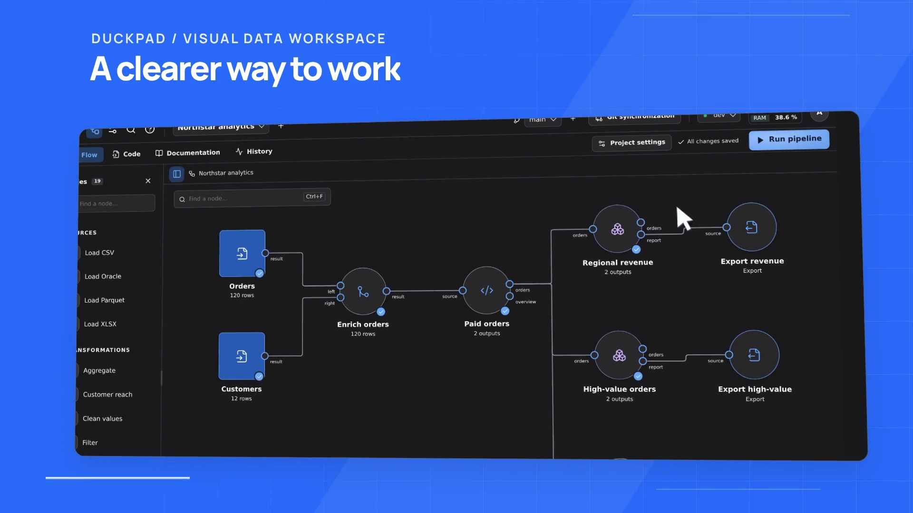

# Duckpad

[](https://github.com/hugues31/duckpad/actions/workflows/ci.yml)
[](https://pypi.org/project/duckpad/)
[](https://pypi.org/project/duckpad/)
[](LICENSE)

### See the flow. Trust the result.

An open-source SQL workspace powered by **DuckDB 2.0**. Turn scattered data into
visual pipelines, explore the results and trace a number all the way back to its
source.

[Website & docs](https://hugues31.github.io/duckpad/) ·
[**Get started →**](https://hugues31.github.io/duckpad/docs/quickstart/)

[](https://hugues31.github.io/duckpad/#demo)

[**Watch the one-minute overview →**](https://hugues31.github.io/duckpad/#demo)
English narration, captions and transcript.

- **Compose visually.** Connect sources, joins and reusable components. Use guided
  forms or write SQL in the integrated editor.
- **Understand the result.** Click a valid cell to explore its contributing source
  values, with [explicit lineage coverage](docs/LINEAGE.md).
- **Iterate with confidence.** Save to Git, branch independently, compare changes
  visually and review a merge before applying it.
- **Keep control.** Run on your infrastructure, configure connections per
  environment and manage project access for your team.

## Try it

With Python 3.11+ and Git installed:

```sh
pip install duckpad
duckpad start
```

The default isolated SQL mode requires Linux with Landlock ABI 2+ (Linux 5.19+
with Landlock enabled). For trusted, single-user use on Windows, start with
`duckpad start --trusted-local`. This explicit mode runs SQL with your operating
system's permissions and only allows a loopback bind; use trusted projects and
do not share the instance. See [installation](docs/INSTALLATION.md#trusted-local-mode).

Open the printed local address and sign in with the initial admin
password from the terminal. Choose **New project**, enter a name, then choose
**Start from an example → Create** and **Run pipeline**.

The package includes the interface; Node.js is only needed for development.
See the [quickstart](docs/QUICKSTART.md) for the complete first-run walkthrough.

## Go further

[Installation & accounts](docs/INSTALLATION.md) · [Pipelines & SQL](docs/AUTHORING.md) ·
[Single sign-on](docs/SSO.md) · [Version control](docs/GIT.md) · [Connections](docs/CONNECTORS.md) ·
[Offline extensions](docs/OFFLINE_EXTENSIONS.md) ·
[Architecture](docs/ARCHITECTURE.md) · [Validation](docs/VALIDATION.md) ·
[Releases](docs/RELEASING.md) · [Security](SECURITY.md)

The [website and documentation guide](docs/WEBSITE.md) explains local preview,
Playwright demo recording and GitHub Pages publishing. Developer checks live in
[CONTRIBUTING.md](CONTRIBUTING.md). Private issue workflows and preview tooling
are maintained in operator-owned configuration outside Git.

**MIT licensed.** Built for the open-source community.
