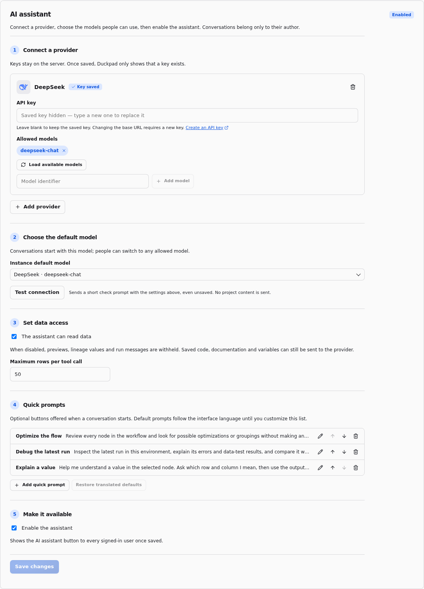
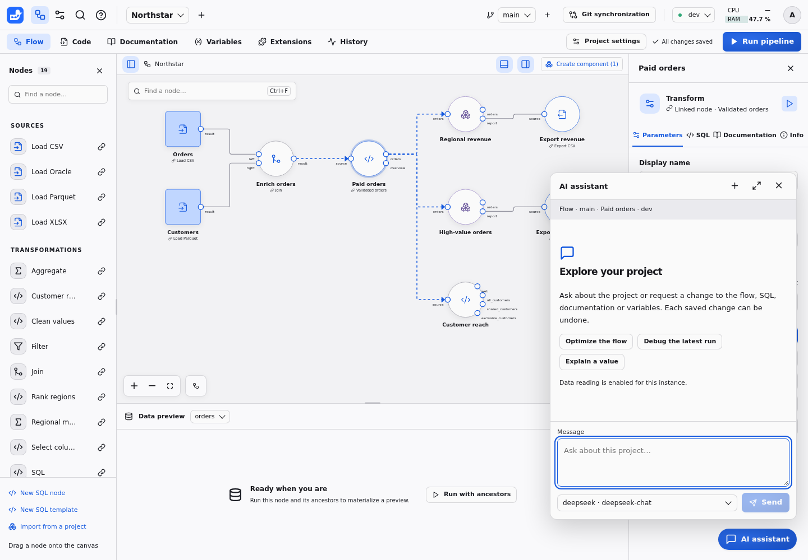

# AI assistant

The assistant answers questions about the saved project: the flow, SQL,
documentation, variables, execution history and, when enabled, existing output
values and their lineage. Project editors and administrators can also ask it to
change the open branch, with an Undo button for each saved change, and propose a
run for your explicit approval. It cannot execute arbitrary SQL or change
instance settings. Responses can be mistaken; inspect the cited
nodes and tool results before relying on an explanation.

## Configure a provider

An instance administrator opens **Instance settings → AI assistant**. The
assistant starts disabled. Choose **Add provider**, select OpenAI, Anthropic,
Google, Mistral, DeepSeek, Ollama or an OpenAI-compatible endpoint, and enter its
API key. Ollama and custom endpoints can work without a key. For those providers,
set the API base URL, including `/v1` when the server requires it. Ollama defaults
to `http://localhost:11434/v1`; that address is relative to the Duckpad server,
not the browser.

Enter allowed model identifiers, one per line. **Save and discover models**
queries the provider's model list; select entries to add them to the allowed
list. Servers without a model-list endpoint still accept manually entered model
identifiers. Choose the **Instance default model**, enable the assistant and
select **Save and test**. The test sends only a short connection-check prompt.
It does not read any project content. All users share the instance's configured
providers; they choose an allowed model and never enter personal keys.

A saved key is write-only: the browser receives only its presence. Leaving the
field blank keeps it. Changing the provider type or API base URL clears the old
key; enter it again if the new endpoint needs authentication. Removing a provider
removes its saved key. Configuration and conversations live in the private
instance database and never enter project Git history or ZIP exports.

## Ask about the current page

Open a project branch and choose the **AI assistant** button at the bottom right.
The button also appears on other signed-in pages when the assistant is enabled.
The context strip shows the current page, branch, selected node or Code file,
and execution environment. Before sending a message, Duckpad saves pending editor
changes. A failed save stops the message so you can resolve it first. The server
validates the context and reads saved content. On pages without an open working branch,
the assistant can answer general questions but has no project-reading tools.

For Northstar, try “How do paid orders reach the regional report?” or, after
running the flow yourself, “Why does this region have this revenue?” The
assistant reads bounded pages of project content as needed. Expand a tool card
to inspect what was read. Data tools inspect existing materialized results;
missing or stale results may require a run, which you can request in the chat.

Choose a model in the composer, type a message and press **Send** or Enter.
Shift+Enter inserts a line break. **Stop** cancels the current provider request.
Responses stream into the chat as safe Markdown, with formatted code blocks.
Raw HTML and remote images are not rendered. Each turn is limited to 12 provider
requests, 30 tool calls and two minutes.

## Request a change

For example, ask “Add a normal SQL node that returns the number 1”, “Rename this
node to Paid orders”, or “Document the regional revenue output”. The assistant
can add, remove, move, rename, connect and configure nodes, group them into a
component, edit normal node SQL or project templates, update README and
node/output/column descriptions, and create, update or rename variables. Variable
renames update their references. A shared template edit reports how many linked
node instances it affects.

Each successful writing tool call is one commit on the open branch, authored by
your Git identity. History adds **via the assistant** to the author. Its chat
card lists the changes, includes a SQL diff when relevant, and opens **Compare
versions** for the commit. The canvas and open editors update without a page
reload; unsaved edits retain their original revision for normal merging.
Readers have no writing tools and see a read-only notice.

Choose **Undo** on an action, or **Undo these N changes** to reverse the remaining
actions of a turn from newest to oldest. Undo makes new commits and preserves
independent changes made afterwards. If a later edit touches the same content,
the action shows **Resolve conflict**: both versions remain available in the
normal conflict dialog, and no conflicting content is overwritten. A batch
undo stops at the first conflict; resolve it, then undo the remaining actions.
Choosing to keep the current version leaves that action available to undo again.

Undo remains available when you resume a conversation, as long as its original
branch exists and you still have editing rights. Stopping a response or a
provider failure does not roll back actions already saved; their cards still
offer Undo. Deleting the conversation removes its cards, but does not delete
its commits or undo its changes.

## Run with confirmation

Ask, for example, “Run the regional report node in dev” or “Run this whole flow
in prod”. The assistant proposes a run; it does not start it yet. Its confirmation
card names the environment and scope, includes the required upstream nodes,
shows the variables used, and highlights exports and external writes. Those
external effects cannot be undone. Protected environments show their additional
confirmation notice in the same card.

Choose **Confirm and run** or **Decline run**. A refusal goes back to the model.
Pending confirmations survive a page reload: maximize the assistant and reopen
the conversation to answer. Each request can be answered only once. If the flow
or connection configuration changes after the proposal, ask for a fresh run and
review its new confirmation. Runs require the same project editing rights as
running from the workspace; Readers cannot launch or cancel them.

The card follows execution status and offers **Cancel run** while it is active.
The assistant can wait up to 15 seconds per tool call and then inspect the result;
it reports a still-running execution honestly when that wait expires. **Stop**
stops the assistant response, while **Cancel run** stops execution. Neither action
reverses completed external writes. History records the entry point as
`assistant`, together with the requesting user.

## Debug an execution

Choose **Ask the assistant** from an error in a node's **Log** or a failed run
in History. The chat opens with the run, node and environment as context. Send
the prepared question to inspect run/node errors, the SQL actually executed,
`-- @message` messages and `-- @test` data-test results. You can also ask for a
comparison with the preceding successful run in the same environment and scope.
Historical SQL is taken from the run, so later edits do not change that evidence.

For “why this value?”, identify the output row and column. The assistant uses
the existing output preview, follows lineage contributions and reads upstream
SQL to explain the calculation. With data reading disabled, error/message text,
test values and executed SQL are withheld; the assistant can still discuss code
and execution status metadata.

## Quick prompts

New conversations offer buttons such as **Optimize the flow**, **Debug the latest
run** and **Explain a value**. Clicking one sends its full prompt. The default
buttons and prompts follow the interface language.

Instance administrators manage **Quick prompts** in **Instance settings → AI
assistant**. Edit each button label and full prompt, add or delete entries, and
use **Move up** or **Move down** to reorder them. **Save changes** applies the list
to everyone on the instance. A customized list keeps its authored language;
**Restore translated defaults** restores language-aware defaults. Saving an empty
list hides the buttons. These settings are not stored in project Git files.

## Conversations

**Maximize assistant** opens a larger view with your conversations on the left,
ordered by recent activity. Select one to reopen its original branch and resume
with its Pydantic AI message history, including tool exchanges. Use the title
field to rename it, **Delete conversation** to remove it, or **New conversation**
to begin another. Escape closes the panel and returns focus to its launcher.
The expanded panel supports keyboard focus cycling, light and dark themes,
and English, French and Portuguese interface labels.

Conversations are private to their author, including against other instance
administrators. They belong to the project and branch where they began. Sending
a message after navigating to another project or branch starts a new
conversation. Losing project access prevents further project-reading turns.
Deleting the author or the project removes its conversations from SQLite.

## Control what leaves the instance

**The assistant can read data** is enabled by default. With it enabled, the model
can inspect previews and lineage values up to **Maximum rows per tool call**
(default 50), and execution messages and errors. Turn it off to remove preview
and value-lineage tools entirely; run message text and error text are also
withheld because they can contain values. A conversation created with data
reading enabled cannot resume while the option is disabled: start a new one so
its previous values are not resent.

Even with data reading disabled, your questions, saved code and its literal
values, documentation, variable declarations and values, flow parameters,
output schemas, status metadata and branch commit metadata can reach the
selected provider. This is a data-result policy, not a secret scanner for
user-authored project text. Keep credentials in instance connections. Provider
keys and resolved connection secrets are never offered to the model. See the
[exact provider data contract](https://github.com/hugues31/duckpad/blob/main/docs/SPEC.md#ai-assistant) for the full list.
