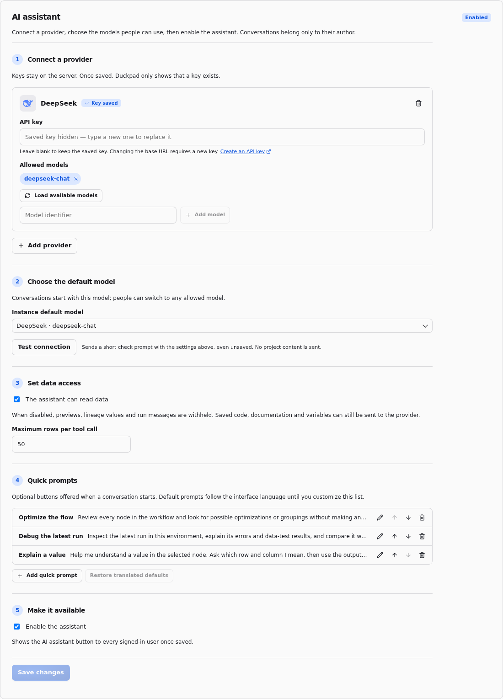
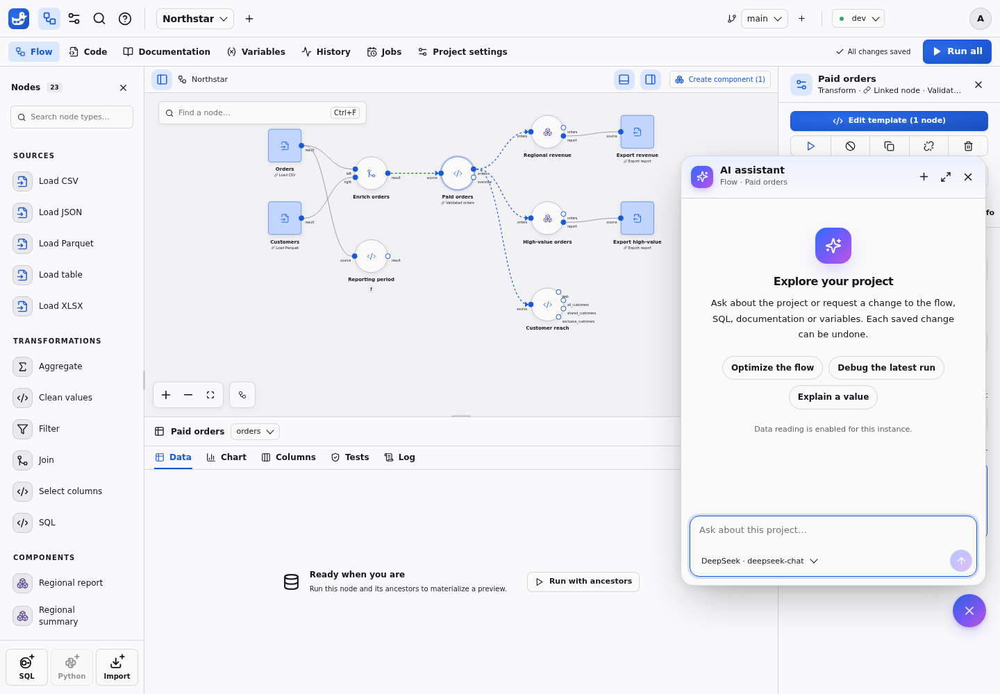

# AI assistant

The assistant answers questions about the saved project: the flow, SQL,
documentation, variables, execution history and, when enabled, existing output
values and their lineage. From any page, it can also read the other projects
you can open and the instance's connections, with your own rights. Project
editors and administrators can ask it to change the open branch, with an Undo
button for each saved change, and propose a run for your explicit approval. It
cannot execute arbitrary SQL or change instance settings. Responses can be
mistaken; inspect the cited nodes and tool results before relying on an
explanation.

The assistant stays on topic: Duckpad, your projects and their data, and data or
software development questions such as SQL, DuckDB, data modeling, Python or
Git. It briefly declines unrelated requests, such as a cooking recipe, and
suggests a related question instead. Questions about your project's data are in
scope whatever that data describes. The rule is part of the model's
instructions, not a filter: a model can still misjudge a borderline request.

## Configure a provider

An instance administrator opens **Instance settings → AI assistant**. The
assistant starts disabled; the badge next to the title shows the saved state.

1. **Connect a provider**: choose OpenAI, Anthropic, Google, Mistral, DeepSeek,
   Ollama or an OpenAI-compatible server, then enter its API key. Hosted
   providers link to the page where you create one. Ollama and custom servers
   can work without a key; set their API base URL, including `/v1` when the
   server requires it. Ollama defaults to `http://localhost:11434/v1`; that
   address is relative to the Duckpad server, not the browser. Use **Add
   provider** to connect another one.
2. Under **Allowed models**, **Load available models** lists the provider's chat
   models without saving anything first; check those people can use and filter
   long lists. Add identifiers the provider does not list by typing them in
   **Model identifier**.
3. **Choose the default model**: the first allowed model is preselected.
   **Test connection** sends a short connection-check prompt with the settings
   on screen, saved or not. It does not read any project content.
4. **Set data access** and, optionally, adjust the **Quick prompts**.
5. **Make it available**: check **Enable the assistant**, which requires a
   default model, then choose **Save changes** in the bar at the bottom of the
   page.

All users share the instance's configured providers; they choose an allowed model
and never enter personal keys.

A saved key is write-only: the browser receives only its presence, shown as
**Key saved** on the provider, and the empty field keeps it. Typing a new key
replaces it when you save. Changing the API base URL clears the old key; enter
it again if the new endpoint needs authentication. Model discovery and the test
reuse a saved key under the same rule. Removing a provider removes its saved
key. Keys and conversations stay in instance storage, outside project Git and
ZIPs.

## OpenAI-compatible gateways

For a gateway that requires OAuth2, choose **OAuth2 client credentials** under
**Authentication**. Enter its **Token URL**, **Client ID**, **Client secret** and,
if required, **Scope**. Duckpad obtains a bearer token using HTTP Basic client
authentication ([RFC 6749 section 2.3.1](https://www.rfc-editor.org/rfc/rfc6749#section-2.3.1)).
Token requests have a ten-second timeout and never follow redirects. Tokens stay
in memory, are shared across requests and turns, and renew 30 seconds before
expiry. A rejected token is renewed once before the request fails. If the token
endpoint omits `expires_in`, Duckpad obtains a fresh token for each request.

The client secret is encrypted in instance storage and is write-only, like API
keys. The browser receives only **Secret saved**. A blank field keeps the saved
secret only while the provider, base URL, token URL and client ID stay the same.
Changing any of these requires re-entering it. Switching authentication methods
clears the inactive credential. Discovery and connection tests use these same
rules. If the gateway has no compatible model catalog, enter model IDs manually.

**Streaming** is enabled by default. Streaming requests to custom providers send
`Accept: text/event-stream`. Disable the option if a gateway returns complete
JSON responses: text appears when generation finishes, while tools and run
confirmations still work. **Test connection** exercises the same response mode
as chat and suggests disabling Streaming if the gateway does not support it.
Custom gateway reads can wait up to 120 seconds, including buffered SSE; the
whole turn and connection test are still limited to 120 seconds. A server error
is reported separately from an unreachable provider, without exposing its body.

Some gateways split one answer across several `choices`: text in one choice and
tool calls in the others. With Streaming disabled, Duckpad combines these choices
in index order, joins text paragraphs and keeps every tool call, including run
requests that need approval. This compatibility behavior applies only to custom
providers and complete JSON responses; split choices in streamed responses are
not supported.

## Troubleshoot provider failures

An unreadable provider response displays **The provider returned a response the
assistant could not read. Check the server logs.**

The `duckpad.assistant` logger writes a WARNING for failed turns, connection tests
and model discovery. It includes the provider identifier, model (when applicable)
and exception class chain, without exception messages or response bodies.

Start Duckpad with `duckpad start --log-level debug` to also log the complete
exception traceback and messages. Configured API keys, OAuth2 client secrets,
credentials from unsaved connection settings and cached OAuth2 tokens are masked.
Debug logs can still contain excerpts of prompts, responses and project data.
Keep them private, review them before sharing and return to the default log level
after troubleshooting.

## Ask about the current page

Open a project branch and choose the **AI assistant** bubble at the bottom right.
The bubble also appears on other signed-in pages when the assistant is enabled.
Drag it to another height or to the left edge if it covers something you need;
with the keyboard, focus it and press Alt with an arrow key. This browser
remembers its place, and the chat opens next to it.

Under the chat title, Duckpad shows the context sent with each message: the
current page and the selected node or Code file. The branch and environment are
those of the top bar; the title names the environment only when it differs, for
example after **Ask the assistant** on a prod run. Before sending a message,
Duckpad saves pending editor changes. A failed save stops the message so you can
resolve it first. The server validates the context and reads saved content.

The assistant receives Duckpad's SQL and parameter rules, including the difference
between `-- @param` declarations and project variables. It can consult every
Duckpad guide of this documentation, even without an open project. These guides
match the installed version and are separate from your project's README and
descriptions. Try “How does @param work?” or “How do I bind a project variable to
a node?”.

For Northstar, try “How do paid orders reach the regional report?” or, after
running the flow yourself, “Why does this region have this revenue?” Data tools
inspect retained results; missing or stale data may require a run.

Choose a model, type a message and press Enter to send; Shift+Enter adds a line
break. **Stop** cancels the provider request. Closing and reopening the chat
preserves the conversation. Expand tool cards to inspect results.

Each turn is limited to 12 provider requests, 30 tool calls and two minutes.

## Ask about other projects and connections

The page you are on is the assistant's starting point, not its limit. On every
page, including **Instance settings**, it can list the projects you can open
and read any of their branches: flow, code, documentation, variables, Git
history, execution history and, when data reading is enabled, existing results.
Name the project in your question, for example “Which nodes of Sales use the
Warehouse connection?” from the **Connections** settings, or “Compare this flow
with the Finance project” from a branch. The card of a tool call that reads
another project names that project and branch.

It can also read the instance's connections from any page:

- Everyone gets the name, family and capabilities of the connections granted
  to the projects they can open, and which of those projects each one is
  granted to.
- An instance administrator sees every connection and can ask for its
  details, for example “Which host does Warehouse use in prod?”: the connector
  type and the parameter values by environment. Secrets are masked exactly as
  in **Instance settings → Connections**.

The assistant never has more rights than you: every tool call rechecks your
session and your access to the project it reads, and results of another project
follow that project's connection grants. A project you cannot open is reported
as not found. Results of another branch are read in the page's environment, or
in the first configured environment on a page that selects none.

Changes and runs stay on the open branch. From another page or about another
project, the assistant asks you to open the branch first.

Once a conversation has read the content of another project, or connection
details, each edit waits for your confirmation: its card shows every file
change in full, with **Apply change** and **Decline**. Only the lock file that
Duckpad resolves when a first Python node is added is not shown. A change the
project would refuse is reported instead of being offered. Project content is
not trusted as instructions, but a model can be misled by text planted in what
it reads; the confirmation lets you check that no content of another project,
or connection setting, is written into a branch whose members could not
otherwise read it. Nothing is saved before you answer. If the branch changed
meanwhile in a way that alters the change, nothing is saved either: ask for it
again. A change too large to show in full is refused, so the assistant makes it
in smaller steps. Reading another branch of the same project, or the names of
projects and connections, needs no confirmation.

## Request a change

For example, ask “Add a normal SQL node that returns the number 1”, “Rename this
node to Paid orders”, or “Document the regional revenue output”. It can edit the
flow, node/template SQL, documentation, variables and charts. Shared template
edits report how many linked instances they affect.

For variables, it can inspect declarations, values by environment and usages;
create, update, rename and delete; remove a default or environment override; and
switch between ordinary and computed values. Updating an environment preserves
the other overrides. Deletion refuses variables still used by node bindings,
expressions, paths or saved result views. Ask it to inspect those usages first.
Computed-value inspection does not execute the source node or read its retained data.

For [charts](CHARTS.md), ask for example “Chart revenue by region” or “Make this
a line chart”. It can create, update, rename and delete a named chart on any
node output, including outputs of component instances. An update replaces the
whole spec, and a rename keeps the chart on its output. The assistant is told
to shape rows in SQL, since a chart draws at most 5,000 rows. An invalid spec is
refused with the same diagnostic as `charts.json` validation, leaving the files
unchanged. When a saved chart encodes a field that the output's retained result
in the current environment lacks, the tool result names it so the assistant can
fix the chart or the SQL in the same turn; the warning never blocks the save,
and an output without a result is not checked. Chart editing reads no row
values and requires the same editing rights as the other writing tools. Each
change has an Undo button; see the result in the output's **Chart** tab.

Each successful writing tool call is one commit on the open branch, authored by
your Git identity, with a `Duckpad-Assistant: <conversation>` trailer that
pushes keep. History shows it as **via the assistant**. Its chat card lists the
changes, includes a SQL diff when relevant, and opens **Compare versions** for
the commit. The canvas and open editors update without a page reload; unsaved
edits retain their original revision for normal merging. Readers have no writing
tools and see a read-only notice.

Choose **Undo** on an action, or **Undo these N changes** to reverse the remaining
actions of a turn from newest to oldest. Undo makes new commits and preserves
independent changes made afterwards. If a later edit touches the same content,
the action shows **Resolve conflict**: both versions remain available in the
normal conflict dialog, and no conflicting content is overwritten. A batch
undo stops at the first conflict; resolve it, then undo the remaining actions.
Choosing to keep the current version leaves that action available to undo again.

Undo remains available when you resume a conversation, while the branch of the
change is open and you still have editing rights. Stopping a response or a
provider failure does not roll back actions already saved; their cards still
offer Undo. Deleting the conversation removes its cards, but does not delete
its commits or undo its changes.

## Run with confirmation

Ask, for example, “Run the regional report node in dev” or “Run this whole flow
in prod”. The assistant proposes a run; it does not start it yet. Its confirmation
card names the environment and scope, includes the required upstream nodes,
shows the variables used, and highlights exports and external writes. Those
external effects cannot be undone. Protected environments show their additional
confirmation notice in the same card.

Choose **Confirm and run** or **Decline run**. A refusal goes back to the model.
If the request can no longer resume, for example because an administrator removed
its model, declining closes it without a response and the conversation continues
with your next message. Pending confirmations survive a page reload: maximize the
assistant and reopen the conversation to answer. Each request can be answered only
once. If the flow or connection configuration changes after the proposal, ask for
a fresh run and review its new confirmation. Runs require the same project editing
rights as running from the workspace; Readers cannot launch or cancel them.

The card follows execution status and offers **Cancel run** while it is active.
**Stop** stops the assistant response, while **Cancel run** stops execution.
Neither action reverses completed external writes. History records the entry
point as `assistant`, together with the requesting user.

## Debug an execution

Choose **Ask the assistant** from an error in a node's **Log** or a failed run
in History. The chat opens with the run, node and environment as context. Send
the prepared question to inspect run/node errors, the SQL actually executed,
`-- @message` messages and `-- @test` data-test results. You can also ask for a
comparison with the preceding successful run in the same environment and scope.
Historical SQL is taken from the run, so later edits do not change that evidence.

For “why this value?”, identify the output row and column. The assistant uses
the existing output preview, follows lineage contributions and reads upstream
SQL to explain the calculation. With data reading disabled, error/message text,
test values and executed SQL are withheld; the assistant can still discuss code
and execution status metadata.

## Quick prompts

New conversations offer buttons such as **Optimize the flow**, **Debug the latest
run** and **Explain a value**. Clicking one sends its full prompt. The default
buttons and prompts follow the interface language; they are about the open
branch, so they appear only on a page with one.

Instance administrators manage **Quick prompts** in **Instance settings → AI
assistant**; the list applies to everyone on the instance. A customized list keeps its authored language;
**Restore translated defaults** restores language-aware defaults. Saving an empty
list hides the buttons. These settings are not stored in project Git files.

## Conversations

**Maximize assistant** opens a larger view with your conversations on the left,
ordered by recent activity. Select one to resume it on the page you are on.
The first message names a conversation unless you renamed it first.

A conversation is not tied to a project or a branch: it follows you from page
to page. Each message carries the page it is sent from, which tells the
assistant what “this node” or “this project” means and which branch it may
change. The changes of a turn belong to the branch its message was sent from:
open that branch to undo or compare them, or to confirm a run or an edit the
turn is waiting for. From another page, the turn links to that branch and a
pending request can only be declined.

Conversations are private to their author, including against other instance
administrators. A conversation continues while the project files have errors,
so you can ask for help fixing them. It cannot continue once you lose access to
a project whose content it read, the connection grant behind results it read,
or the instance administrator role after it read connection details: that
content does not return to a provider; start a new conversation. Names of
projects, branches and connections are not rechecked.
Deleting the author removes their conversations from SQLite. A conversation
keeps the answers it gave about a deleted project but cannot continue.

## Control what leaves the instance

**The assistant can read data** is enabled by default. With it enabled, the model
can inspect previews and lineage values up to **Maximum rows per tool call**
(default 50), and execution messages and errors. Turn it off to remove preview
and value-lineage tools entirely; run message text and error text are also
withheld because they can contain values. A conversation created with data
reading enabled cannot resume while the option is disabled: start a new one so
its previous values are not resent.

Even with data reading disabled, your questions, saved code and its literal
values, documentation, variable declarations and values, flow parameters, output
schemas, status metadata and branch commit metadata can reach the selected
provider, for the open branch and for any other branch the assistant reads at
your request. So can the names of your projects and connections and, when an
instance administrator asks for connection details, their non-secret parameter
values, such as hosts, database names and folder paths. This is a data-result
policy, not a secret scanner for user-authored project text. Keep credentials
in instance connections. Provider keys, OAuth2 client secrets and resolved
connection secrets are never offered to the model.
See the [provider data contract](../docs/SPEC.md#ai-assistant) for the full
list.
