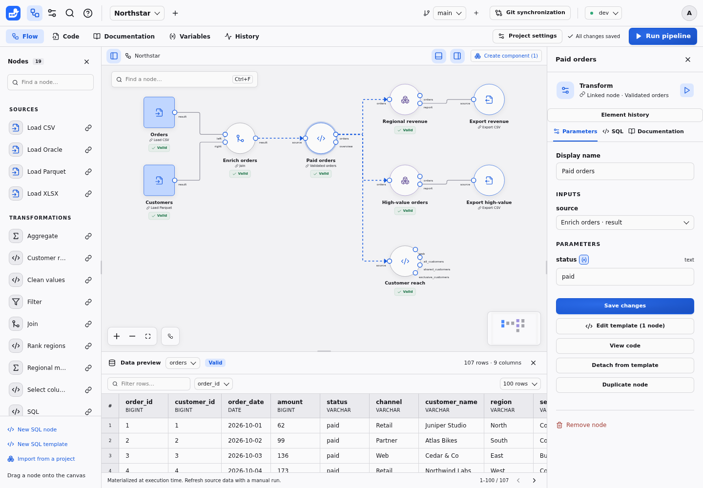
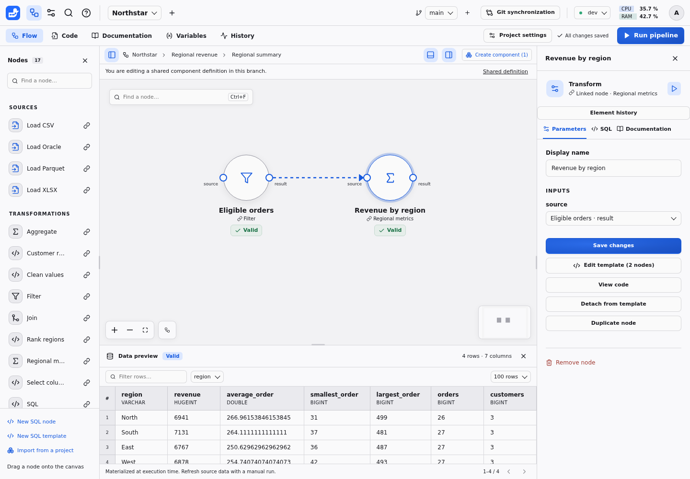
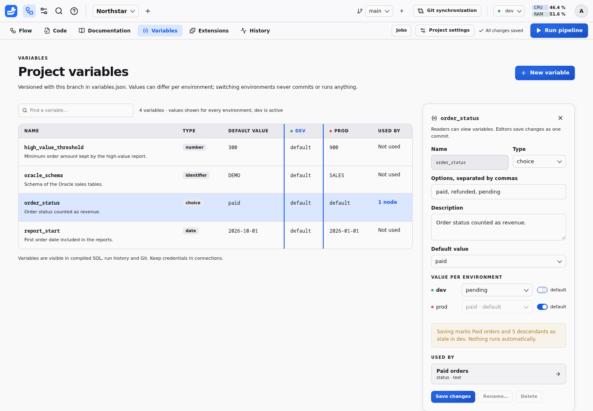
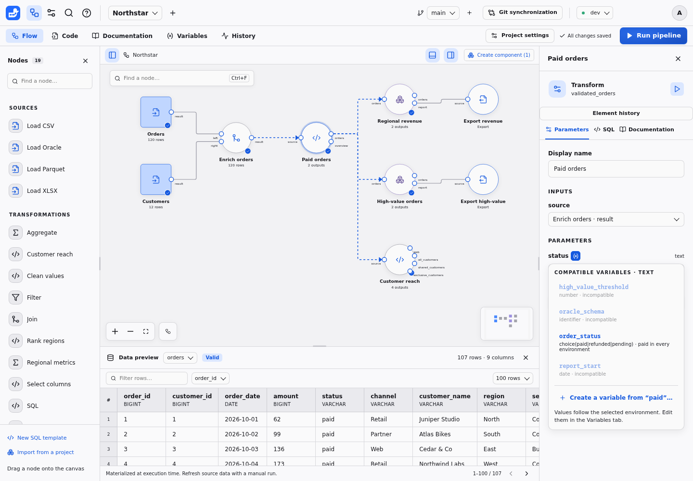
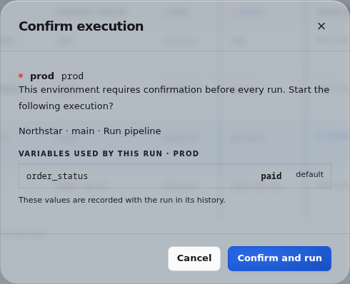
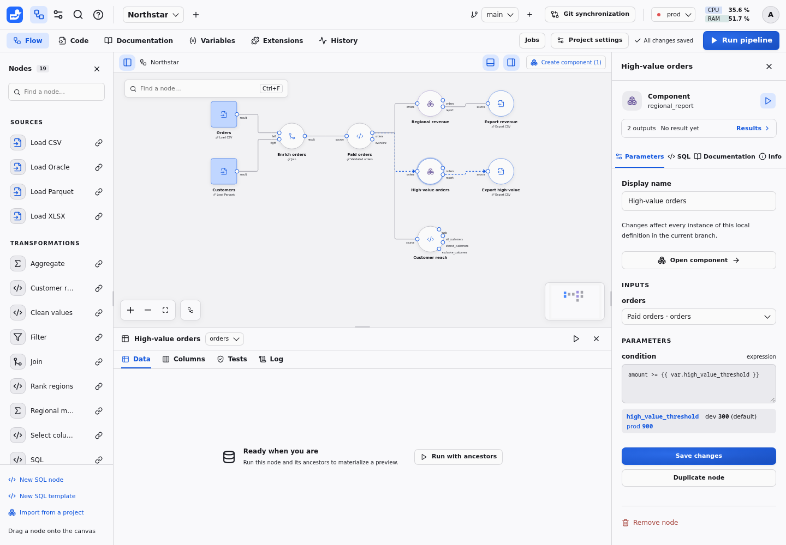

# Authoring projects

The **Code** tab, between **Flow** and **Documentation**, displays the worktree's declarative files in a folder tree beside the Monaco editor. Select a file to edit its SQL, JSON, Markdown or TOML, then choose **Save changes**. Drafts are retained when switching files or workspace tabs. Editing files in an external editor is also supported. Every completed save is versioned, including invalid content. Corrections create later commits. Inspect errors and fix the current files; Duckpad never runs an earlier valid graph silently.

Choose **Download project ZIP** in the Code tab to export the selected branch's saved `README.md`, `pyproject.toml`, `flow.json`, `documentation.json`, `variables.json`, node SQL, SQL templates and component definitions, preserving their relative paths. Save or discard pending edits before downloading. The archive excludes Git history, datasets, execution results, virtual environments and instance connection settings. Project readers can browse and download these files; editing requires an editor or administrator role.

To recreate a project from such an archive, choose **New project**, then **Import a project ZIP**, and select the file. Leave the name empty to keep the name stored in `flow.json`. Archives whose files sit in a single top-level folder, such as a repository download from a Git host, are accepted. Only the declarative files above are read; Git metadata, data and other entries are ignored. The imported project starts its own Git history, makes you its administrator and can use only the **Local files** connection until an instance administrator grants others. Because the archive contains no connection settings or data, Duckpad then lists the connections the pipeline references that are unavailable to the new project, and the nodes that read uploaded files or other absolute paths, including Windows and network paths. Grant or create those connections, and upload the files again. Archives over 16 MiB (64 MiB once extracted), without `flow.json`, or with invalid JSON or non-UTF-8 files are rejected without creating a project.

After running **Export CSV**, **Export XLSX**, or another export template whose single `COPY ... TO` statement writes CSV or XLSX to a `destination` parameter, select the export node and choose **Download exported data** in its inspector. The file contains the entire executed export, including its delimiter, headers and worksheet name. The inspector identifies the execution and environment. Changing inputs or settings, rerunning upstream nodes, or a failed execution requires another successful export before downloading. Missing files also require a rerun. Downloads are private to project members, survive a backend restart, and use a saved copy of the exported bytes so later writes to the destination cannot replace that execution's result. Oracle and remote-storage destinations do not offer this action.


## Project layout and Python dependencies

```text
README.md              Project documentation in Markdown
pyproject.toml         Python version and project dependencies
flow.json              Pipeline graph
documentation.json     Node, output and column documentation
variables.json         Project variables (optional)
templates/*.sql        Shared SQL templates
nodes/*.sql            Code owned by normal nodes
components/*.json      Reusable sub-flows
components/<id>/*.sql   Code owned by nodes inside a component
```

The **Documentation** tab edits the same `README.md` shown in **Code**. Project
text is not duplicated in `documentation.json`. Older projects with a `project`
entry in that JSON file remain readable; the next bundle save moves that text
to `README.md` and adds the dependency manifest. When both sources exist,
`README.md` takes precedence, including when it is empty.

New projects include a standard `[project]` table in `pyproject.toml`, with a
normalized name, Python `>=3.11`, and `duckpad` pinned to the creating instance's
version. Edit `project.dependencies` in **Code** to add Python packages, for
example `"pandas>=2"`. Comments and custom TOML tables survive other UI saves.
The file is versioned, compared and exported with the rest of the project.
Malformed TOML produces a file diagnostic and remains editable.

On another machine with Python and [uv](https://docs.astral.sh/uv/), extract the
ZIP and run `uv sync` from its directory to install the declared dependencies
into `.venv`. The manifest sets `tool.uv.package = false`: this directory holds
a pipeline, rather than a Python package to build. `uv` creates its local lockfile;
Duckpad does not yet manage or export that lockfile, so transitive dependencies
are not frozen by the ZIP.

This manifest prepares project-specific Python environments. Duckpad currently
executes SQL pipelines; saving this file does not install packages, create an
environment or run Python scripts. The CLI does not yet open an extracted ZIP
as a project automatically; import the ZIP from the interface instead.
Connections, credentials and input data must also be configured separately on
another instance.

## Editing node code

The palette and **Add a connected node** create normal nodes by copying the selected entry's SQL. **Duplicate node** also creates independent code. Choose **New SQL node** for a minimal `source` input and `result` output without naming a template. **Edit code** in the inspector changes only that node. Its `-- @param` declarations generate the parameter form; guided forms remain available while their supporting parameters are present.

Use **Add linked** next to a palette entry to share a template deliberately. A linked node shows a link badge and template name. **View code** is read-only; **Edit template (N nodes)** edits the shared definition and displays the number of placed nodes affected. **Detach from template** copies the current SQL while keeping parameters and connections.

For a normal node, **Convert to template** asks for a name and links the node to the new shared definition. If its origin still exists, **Link to original template** asks before discarding local code. Detaching and converting preserve valid results. Relinking to changed executable code makes results stale; incompatible definitions must be corrected before execution. There are no partial overrides on linked code.

The **Code** tab exposes the same files, and **Compare versions** shows their changes. SQL files are versioned, merged and checked for conflicts, and included in project ZIPs. Deleting a node deletes its file. Northstar's Customer reach node owns its code, while Paid orders uses a linked template; Rank regions owns code inside the Regional report component.


## SQL template contract



```sql
-- @label Paid orders
-- @description Keep paid orders and summarize that newly computed output.
-- @input source
-- @param status: text = "paid"
-- @output orders
SELECT * FROM {{ source }} WHERE status = {{ status }};
-- @output summary
SELECT COUNT(*) AS orders, SUM(amount) AS revenue FROM {{ orders }};
```

Inputs, parameters and outputs have one shared namespace. Identifiers must be unique. Each output names exactly one query ending with a semicolon. Later output blocks may read earlier outputs; self and forward references fail validation. Both outputs above are published together, or neither replaces the previous result set.

### Execution messages

Add `-- @message` in a normal node's code to report information about that node,
or in a template to apply it to every linked node. There is no separate Message
node or inspector field. Each block contains one read-only query:

```sql
-- @input source
-- @param status: text = "paid"
-- @output orders
SELECT * FROM {{ source }} WHERE status = {{ status }};
-- @message
SELECT 'warning' AS level, count(*) || ' orders without an amount' AS message
FROM {{ orders }} WHERE amount IS NULL HAVING count(*) > 0;
```

The query must return unique `level` and `message` columns. Every row emits one
message; zero rows emit none. Levels are exactly `info`, `warning`, or `error`;
messages must be non-null text. Missing columns, unknown levels and invalid
messages fail the node with an explicit error. Additional columns are ignored.

All output blocks run first. Message blocks then run in declaration order and
can reference declared inputs, parameters and any of the newly computed outputs,
even if that output is declared later in the file. They obey the node's declared
data access contract and cannot write data or introduce side effects. A source
can use its declared connections and resources. On an export, message queries
read its inputs and run **before any external write**, even though the `COPY` or
`INSERT` statement is written before `-- @message` in the file.

An `error` result prevents publication of every new output, retains the previous
successful outputs as stale, and blocks descendants. All message blocks are
checked before publication or export; warnings alone leave the run in `success`.
Changing a message block invalidates results just like changing other SQL.

The inspector shows messages belonging to its displayed result; a stale retained
preview keeps its original messages alongside the latest failure. The canvas
shows a warning badge and count. History retains messages and warning totals for
each run, including failures and exports, after a restart. A node outside the
scope of a later launch keeps its previous result's messages.

Each node execution retains the first **100 messages**, followed by “... and N
more”. All additional rows are still validated and counted: an error beyond the
limit still fails the node. Server logs emit one JSON line per actual message,
including run, project, branch, environment, node, level, message and origin.
Multiline text is escaped within that line. Connection secrets are redacted in
messages, errors, saved history and logs. User-authored message text is displayed
as written; interface labels are translated into English, French and Portuguese.

### Parameter values

Numeric and list fields preserve the text you type until you leave the field or
save. Clearing a numeric field removes its override, so the template, component,
or connector default applies. Without a default, the parameter remains required.
Comma-separated lists trim spaces around each item and preserve spaces within
items: `New York, Paris` becomes `["New York", "Paris"]`.

| Parameter declaration | Value contract |
| --- | --- |
| `text`, `number`, `boolean` | Scalar DuckDB bindings; do not quote the placeholder |
| `date` | A `YYYY-MM-DD` value bound as a DuckDB `DATE` |
| `choice(a\|b)` | Enumerated scalar binding |
| `keyword(inner\|left\|right\|full)` | Validated SQL keyword, for structural choices |
| `file(connection)`, `destination(connection)` | Explicit path or URI; relative local paths resolve against the connection root or worktree/environment export directory |
| `connection` | Logical instance connection ID; resolves to a collision-free runtime alias |
| `secret(connection)` | Runtime secret name, for extension options; never a password |
| `identifier`, `column(source)` | Quoted identifiers; input column suggestions use resolved schemas |
| `expression(source)` | Parsed scalar SQL expression; queries and side effects are rejected |
| `expressions` | Comma-separated or array expression list, for projections and aggregates |
| `list<text>`, `list<number>`, `list<column>` | A typed list emitted as literals or identifiers |
| `schema` | JSON mapping of column names to DuckDB types, used for CSV overrides |

Transformations may read only declared inputs, earlier outputs, local CTEs and subqueries. External table functions and undeclared tables are rejected. A source uses `-- @kind source` and explicitly declared resource parameters. Each file reader such as `read_csv` takes one declared file parameter, or a list of them, as its only positional argument; its other arguments must be named options such as `delim = ';'`. Exports use `-- @kind export`, declared tabular inputs and explicit `COPY ... TO` or `INSERT` statements. They have no tabular output. Connector setup is separate from those data operations.

Compilation is available without executing the flow. The SQL inspector distinguishes the current compiled query from the actual statement sequence of the displayed result. Actual materialization statements include private storage/view setup and bound values; generated credentials are masked.

## Graph and components

`flow.json` holds `nodes` and `edges`. Normal nodes own `nodes/<node-id>.sql` and have no `template` field. Linked nodes reference a local `template`; component instances reference a local `component`. All own their parameters and position. An optional `origin` records where normal code came from without linking it. An optional `preset` retains the palette icon and guided form after conversions or imports; it never selects executable code. Edges use stable `source`, `sourceHandle`, `target` and `targetHandle` IDs. Selecting an input in the inspector edits the same edge as dragging a port connection. An input has at most one source; an output can feed many inputs.

Drag an input or output connection onto empty canvas space to open **Add a connected node**. Search the local templates and components, then choose a port to create the node at the drop position and connect it in one save. The list only offers nodes with ports in the required direction. Use the arrow keys and Enter, or click a result; Escape or a click outside cancels without changing the graph. Starting from an occupied input replaces its previous connection when the new node is added.

Select nodes using Shift, then choose **Group into component**. Node-owned code moves to `components/<component-id>/<node-id>.sql`. Incoming and outgoing edges are preserved as named boundary ports; terminal outputs remain inspectable. Double-click the resulting node to open the sub-flow. Breadcrumbs identify the instance path. Definition edits affect every usage in this project branch, while parameters belong to the selected instance.



Exposed component parameters have the following structure:

```json
{
  "minimum": {
    "type": "number",
    "default": 100,
    "targets": [{"node": "filter_node", "param": "threshold"}]
  }
}
```

The shared library reads projects' main branches. Importing creates new destination-owned IDs for the component, nested components and templates. Node-owned SQL, definitions and documentation are copied; data, results and secrets are not. Imports never resolve executable code through the original project. Subsequent edits are independent.

## Project variables

A project variable is a named, typed and documented value declared once, bound
to node parameters or referenced inside SQL expressions, with an optional value
per environment. Variables are declared in `variables.json` at the project root,
next to `flow.json`, and change through the usual save and commit cycle. The
[design proposal](../docs/design/PROJECT_VARIABLES.md) explains the choices
behind them.



The **Variables** tab, between **Documentation** and **History**, lists each
variable with its type, default, value in every environment and the number of
nodes using it. The selected environment's column is highlighted, and *default*
marks an environment that inherits the default. Select a variable to edit its
type, description, default and environment values: turn off **Default** for an
environment to give it its own value. Before you save, a note names the nodes
that the change makes stale and in which environments; nothing runs
automatically. **Used by** lists the bound parameters and the expressions that
reference the variable, and opens each node in the flow. **Rename…** changes the
declaration and every reference in one commit, including `{{ var.name }}` in
expressions, and **Delete** stays disabled while a parameter or an expression
uses the variable. Readers can browse the tab; editors and project
administrators change it.



In the inspector, each root flow parameter that a variable can feed has a
variable button next to its name. It lists the compatible variables with their
values, says which ones are incompatible, and offers **Create a variable from
"…"…**. That action declares a variable holding the current value and binds the
parameter in one save, so results stay valid. A bound parameter shows the
variable and its value in the selected environment; the cross restores a fixed
value initialized with that value. Parameters of an opened component definition
have no variable button: expose them, then bind the instance.

When a variable change makes a result stale, the data preview names the
variable, the environment, and its previous and current values. The **SQL** tab
lists each bound variable with its value. An environment that requires
confirmation lists the variables of the requested scope, with their values and
whether each comes from the default or the environment. The run details in
**History** keep the same list.



**Code** shows `variables.json` and can create it. You can also edit the file in
an external editor, a project ZIP or through the API. Saves follow the usual
batching, validation and conflict rules.

```json
{
  "high_value_threshold": {
    "type": "number",
    "description": "Minimum order amount kept by the high-value report.",
    "default": 300,
    "environments": {"prod": 900}
  },
  "report_start": {"type": "date", "default": "2026-10-01"}
}
```

Names use lowercase letters, digits and underscores, starting with a letter. A
declaration accepts `type`, `description`, `default` and `environments`, and
nothing else. In an environment, a variable takes its value for that
environment if set, otherwise its default.

| Variable type | JSON value | Binds to parameters of type | Inside an expression |
| --- | --- | --- | --- |
| `text` | string | `text`, `file`, `destination` | `VARCHAR` parameter |
| `number` | finite number | `number` | numeric parameter |
| `boolean` | `true` or `false` | `boolean` | `BOOLEAN` parameter |
| `date` | `"YYYY-MM-DD"` | `date` | `DATE` parameter |
| `choice(a\|b)` | one of the options | `text`, and `choice` or `keyword` parameters offering every option | `VARCHAR` parameter |
| `identifier` | non-empty string | `identifier`, `column` | not allowed |
| `list<text>`, `list<number>` | array | the same list type | not allowed |

Bind a whole parameter by replacing its value with a reference in `flow.json`,
including the value of an exposed parameter on a component instance. The
variable type must suit the template parameter and every typed exposed
parameter that carries the value to it:

```json
{"id": "large", "template": "filter_amount", "params": {"threshold": {"$var": "high_value_threshold"}}}
```

An expression references a variable with `{{ var.name }}` in its text, as
described in [Variables in expressions](#variables-in-expressions):

```json
{"id": "recent", "template": "filter", "params": {"condition": "order_date >= {{ var.report_start }}"}}
```

References are allowed only in the root flow. A template, a template parameter
default or a component definition that references a variable is an error on
that definition, and blocks the nodes built from it: expose the parameter
instead, then bind it or write the expression on the instance. **Group into
component** does this for you. Each bound parameter of the grouped nodes, and
each expression that references variables, becomes an exposed parameter of the
new instance, which keeps the same binding or expression, in one save.

Problems never block more than the nodes concerned:

| Problem | Effect |
| --- | --- |
| Malformed `variables.json`, invalid name, unknown type or field | File diagnostic; nodes that reference variables are blocked |
| Default or environment value not matching the type | Diagnostic on the variable; nodes using it are blocked where that value applies |
| Reference to an undeclared variable, or to an incompatible type | Diagnostic on the node, which is blocked with its descendants |
| `identifier` or list variable inside an expression, reference inside a parameter that is not an expression | Diagnostic on the node, which is blocked with its descendants |
| Reference inside quotes or a comment of an expression | Compilation error on the node |
| No value in the selected environment | The nodes using it are blocked in that environment only |
| Value for an environment this instance lacks, name suggesting a credential | Warning only |

The **Variables** tab shows these diagnostics on the file or the variable
concerned, and the inspector shows them on the bound parameter. An unused
variable never blocks anything. Values reach DuckDB as bound parameters, quoted
identifiers or escaped paths, never as SQL text, including inside expressions.

A launch resolves the variables of its scope from the committed files and the
selected environment. The run record lists each variable used with its type,
value and source (`default` or `environment`), and the compiled and executed
SQL list the bound value next to the variable name. Results depend on the
resolved values only. Changing the `prod` value makes the `prod` results of the
nodes that use it and of their descendants stale. Other environments and
unrelated nodes stay valid. Renaming a variable, editing its description, or
binding a parameter to a variable that holds its current value leaves results
valid. Replacing a literal with a reference inside an expression changes the
compiled SQL, so it makes the node's results stale.

**Compare versions** lists changed variables with the nodes using them, and their
potential impact reaches the nodes bound to them or referencing them in
expressions. Three-way merges work per variable and per field: a `prod` value
changed on one side and a description on the other merge cleanly, while two
different `prod` values are a conflict that the merge review names after the
variable and its field. Two branches that
both create `variables.json` also merge variable by variable. Variables are not
secrets. Their values are stored in Git, shown in SQL and history, and exported
in ZIP archives; keep credentials in connections.

The API exposes what the interface needs:

- `GET /api/worktrees/{worktree}` returns the declarations in `bundle.variables`.
  `variables` lists each variable's values per environment, the root flow
  parameters bound to it or referencing it (`"expression": true`), diagnostics
  and warnings.
- `POST /api/worktrees/{worktree}/variables/{name}/rename` with `revision` and
  the new `name` renames the declaration and every reference in one commit.
- `GET /api/worktrees/{worktree}/variables/scope?environment=prod&node=…` lists
  the variables a launch would use. The environment confirmation error of a UI
  launch includes the same list.
- Run records, `compile/{node}` and the executed SQL of previews include the
  variables used.

### Variables in expressions

An `expression` or `expressions` parameter of the root flow, such as the
condition of a **Filter**, can reference a variable inside its SQL text:

```sql
order_date >= {{ var.report_start }} AND amount >= {{ var.high_value_threshold }}
```



Typing `{{ var.` in an expression field suggests the variables an expression can
use, with their value in the selected environment; arrow keys choose one, and
Enter or Tab inserts it. Below the field, each referenced variable shows its
value in every environment, the selected one highlighted. The guided **Filter**
form offers the same variables in its **Value source** list: choose one instead
of a fixed value to write the reference for you.

The compiler replaces each reference with a named DuckDB parameter, such as
`$var_report_start`, before validating the expression, and DuckDB receives the
value with its type: it is never inserted into the SQL text. Text and choices
become `VARCHAR` values, numbers numeric values, booleans `BOOLEAN` values, and
dates `DATE` values. `identifier` and list variables cannot be used inside an
expression: bind a whole `column`, `identifier` or list parameter instead. Write
a reference as a value, outside quotes and comments; `'{{ var.name }}'` is an
error rather than a text containing the value. Other parameter types cannot
contain references: bind the whole parameter instead.

A variable referenced in an expression counts like a bound parameter: the run
records it, fingerprints include its type and value in each environment, and a
rename keeps results valid. The **SQL** tab lists the named parameter next to the
variable and its value. Lineage explanations show the value that was used,
labeled with its variable, for example `amount >= 900 (high_value_threshold)`.
**Group into component** exposes each expression that references variables, so
the new instance keeps the references.

## Documentation and branches


Business documentation is separate from SQL and covers the project, node instances, outputs and columns. Grouping preserves the documented instance paths; imports carry component documentation. Successfully confirmed schema removals prune missing column documentation in a versioned save. Renames start undocumented. Invalid SQL, failed runs and backend restarts do not imply deletion.

Create a working branch to compare a change. Branches have isolated worktrees and memory contexts, and use the same instance connections. **Compare & merge** performs three-way merging and validates the graph/interfaces before acceptance. Git history can open a chosen revision in a new working branch. Recompute manually there to explore its code against current resources and connection settings.

## Select columns and Clean values

New projects include two form-driven transformation templates. Connect their
`source` input and run the upstream node to load column choices and types.

- **Select columns** keeps only the listed columns, in their displayed order.
  Use **Use all columns** to add any unlisted inputs, **Drop column** to exclude
  one, and **Move up / Move down** to reorder. Each row can rename its output or
  select a target type. Names must be nonempty, free of control characters, and
  unique under DuckDB's case-insensitive identifier rules. Spaces, dots and
  quotes are supported. Type changes use strict `CAST`, with DuckDB's native
  conversion semantics (including rounding when converting to integers).
- **Clean values** configures selected columns and preserves all other columns.
  Each row applies **Trim text**, then **Parse date**, then **Replace nulls**.
  Trim and date parsing require `VARCHAR`; convert another source type with
  Select columns first. Parsing uses a DuckDB date format such as `%d/%m/%Y`
  and produces `DATE`. Invalid dates and formats fail the run. Null replacement
  uses the resulting column type, so parsed dates take `YYYY-MM-DD` replacements.
  Empty replacement text is an empty string, and `NULL` is literal text.

Save changes before running. The forms store structured `columns` parameters in
`flow.json`, so selections and operations survive reloads and replacement input
files. A missing source column fails with a message asking you to update the
selection. Conversion failures retain previous results as stale and block
dependent nodes; they do not substitute nulls for invalid data.

For example, load `id,amount,day` as `VARCHAR,BIGINT,VARCHAR`. In Clean values,
trim `id`, replace null `amount` with `0`, and parse `day` with `%d/%m/%Y`. In
Select columns, keep `day`, `id`, `amount` in that order and rename them to `date`,
`key`, `total`. An input row ` 001 ,NULL,31/12/2026` produces
`2026-12-31,001,0` with types `DATE,VARCHAR,BIGINT`.

The reusable parameter types are `column_selection(input_port)` and
`value_cleaning(input_port)`. Selection rows contain `source` and optional
`name` / `type`. Cleaning rows contain `source` and optional `trim`,
`date_format`, and `replacement`; omitting a setting disables that operation.
The **SQL** tab shows the generated query. **Edit code** (or **Edit template** for a linked node) remains available
for custom SQL, including replacing a structured parameter with `expressions`
when a free-form projection is needed.
