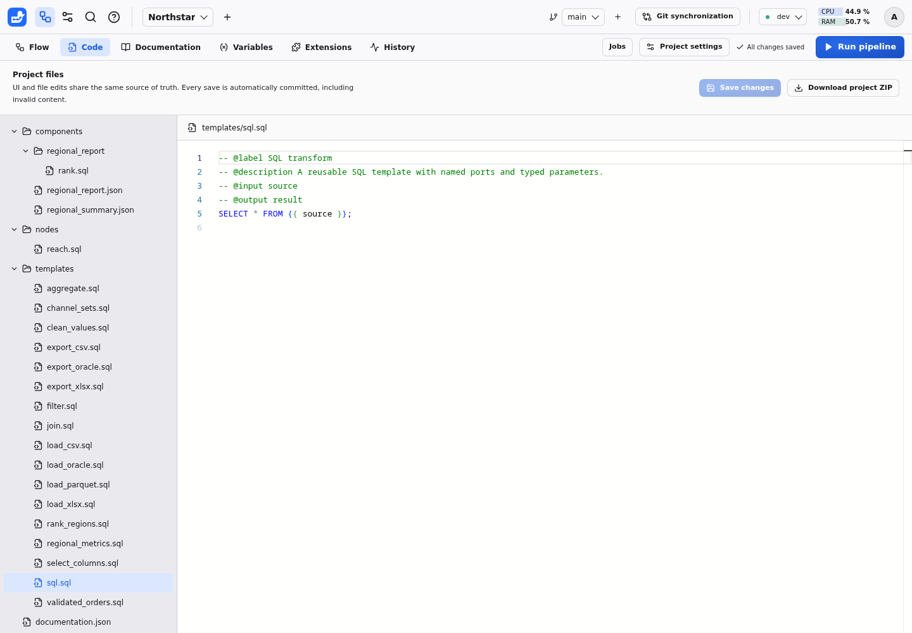
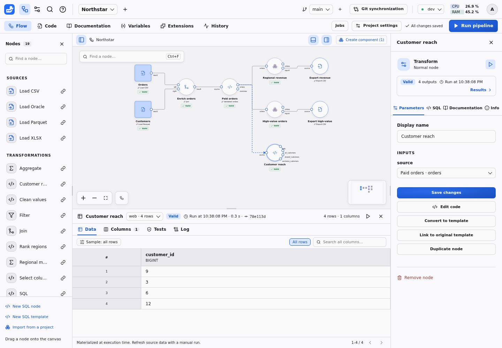

# Authoring projects

A project holds a graph of connected nodes, their SQL, reusable components and
documentation. Start with the [15-minute quickstart](QUICKSTART.md), then use this
guide to manage the files and decide which nodes share code.

The **Code** tab, between **Flow** and **Documentation**, displays the worktree's declarative files in a folder tree beside the Monaco editor. Select a file to edit its SQL, JSON, Markdown or TOML, then choose **Save changes**. Drafts are retained when switching files or workspace tabs. Editing files in an external editor is also supported. Every completed save is versioned, including invalid content. Corrections create later commits. Inspect errors and fix the current files; Duckpad never runs an earlier valid graph silently.

Choose **Download project ZIP** in the Code tab to export the selected branch's saved `README.md`, `pyproject.toml`, `flow.json`, `documentation.json`, `variables.json`, `extensions.json`, `views.json`, node SQL, SQL templates and component definitions, preserving their relative paths. Save or discard pending edits before downloading. The archive excludes Git history, datasets, execution results, virtual environments and instance connection settings. Project readers can browse and download these files; editing requires an editor or administrator role.

Use the project's **Extensions** tab to activate installed DuckDB capabilities
directly in SQL models. Requirements and origins are versioned in `extensions.json`;
no connection parameter is needed. Binaries remain on the instance. See the
[project activation and offline import guide](OFFLINE_EXTENSIONS.md).

To recreate a project from such an archive, choose **New project**, then **Import a project ZIP**, and select the file. Leave the name empty to keep the name stored in `flow.json`. Archives whose files sit in a single top-level folder, such as a repository download from a Git host, are accepted. Only the declarative files above are read; Git metadata, data and other entries are ignored. The imported project starts its own Git history, makes you its administrator and can use only the **Local files** connection until an instance administrator grants others. Because the archive contains no connection settings or data, Duckpad then lists the connections the pipeline references that are unavailable to the new project, and the nodes that read uploaded files or other absolute paths, including Windows and network paths. Grant or create those connections, and upload the files again. Archives over 16 MiB (64 MiB once extracted), without `flow.json`, or with invalid JSON or non-UTF-8 files are rejected without creating a project.

After running **Export CSV**, **Export XLSX**, or another export template whose single `COPY ... TO` statement writes CSV or XLSX to a `destination` parameter, select the export node: its [results panel](#node-results) opens on **Log**, where **Download exported data** fetches the file. The file contains the entire executed export, including its delimiter, headers and worksheet name. The Log identifies the run that wrote it. Changing inputs or settings, rerunning upstream nodes, or a failed execution requires another successful export before downloading. Missing files also require a rerun. Downloads are private to project members, survive a backend restart, and use a saved copy of the exported bytes so later writes to the destination cannot replace that execution's result. Oracle and remote-storage destinations do not offer this action.



## Project layout and Python dependencies

```text
README.md              Project documentation in Markdown
pyproject.toml         Python version and project dependencies
flow.json              Pipeline graph
documentation.json     Node, output and column documentation
variables.json         Project variables (optional)
templates/*.sql        Shared SQL templates
nodes/*.sql            Code owned by normal nodes
components/*.json      Reusable sub-flows
components/<id>/*.sql   Code owned by nodes inside a component
```

The **Documentation** tab edits the same `README.md` shown in **Code**. Project
text is not duplicated in `documentation.json`. Older projects with a `project`
entry in that JSON file remain readable; the next bundle save moves that text
to `README.md` and adds the dependency manifest. When both sources exist,
`README.md` takes precedence, including when it is empty.

New projects include a standard `[project]` table in `pyproject.toml`, with a
normalized name, Python `>=3.11`, and `duckpad` pinned to the creating instance's
version. Edit `project.dependencies` in **Code** to add Python packages, for
example `"pandas>=2"`. Comments and custom TOML tables survive other UI saves.
The file is versioned, compared and exported with the rest of the project.
Malformed TOML produces a file diagnostic and remains editable.

On another machine with Python and [uv](https://docs.astral.sh/uv/), extract the
ZIP and run `uv sync` from its directory to install the declared dependencies
into `.venv`. The manifest sets `tool.uv.package = false`: this directory holds
a pipeline, rather than a Python package to build. `uv` creates its local lockfile;
Duckpad does not yet manage or export that lockfile, so transitive dependencies
are not frozen by the ZIP.

This manifest prepares project-specific Python environments. Duckpad currently
executes SQL pipelines; saving this file does not install packages, create an
environment or run Python scripts. The CLI does not yet open an extracted ZIP
as a project automatically; import the ZIP from the interface instead.
Connections, credentials and input data must also be configured separately on
another instance.

## Jobs

Create a versioned execution target, run it and review its history in the
[Jobs guide](JOBS.md). Use [automation](AUTOMATION.md) to launch it from a scheduler.

## Editing node code

The palette and **Add a connected node** create normal nodes by copying the selected entry's SQL. **Duplicate node** also creates independent code. Choose **New SQL node** for a minimal `source` input and `result` output without naming a template. **Edit code** in the inspector changes only that node. Its `-- @param` declarations generate the parameter form; guided forms remain available while their supporting parameters are present.

Use **Add linked** next to a palette entry to share a template deliberately. A linked node shows a link badge and template name. **View code** is read-only; **Edit template (N nodes)** edits the shared definition and displays the number of placed nodes affected. **Detach from template** copies the current SQL while keeping parameters and connections.

For a normal node, **Convert to template** asks for a name and links the node to the new shared definition. If its origin still exists, **Link to original template** asks before discarding local code. Detaching and converting preserve valid results. Relinking to changed executable code makes results stale; incompatible definitions must be corrected before execution. There are no partial overrides on linked code.

The **Code** tab exposes the same files, and **Compare versions** shows their changes. SQL files are versioned, merged and checked for conflicts, and included in project ZIPs. Deleting a node deletes its file. Northstar's Customer reach node owns its code, while Paid orders uses a linked template; Rank regions owns code inside the Regional report component.



The inspector's **Info** tab tells who changed a node. **Last modified** shows
when and by whom the latest commit changed it, with the commit message and
whether that change touched processing, documentation or the canvas layout.
**Created**, **Revisions** and **Contributors** summarize the rest of its Git
history; a linked node also shows the last change to its template. A merge that
only brings another branch's edit leaves the credit to the commit that made it.
The tab also gives the node's ID and the file holding its code, template or
component definition. **View change history** opens the node's element history
in the Git workspace.

## SQL template contract

Learn declarations, typed parameters, source nodes, transformations and exports
in the [SQL syntax guide](SQL.md). The [15-minute quickstart](QUICKSTART.md)
walks through two custom nodes from a blank project.

### Execution messages

Emit information, warnings or blocking errors with [`-- @message`](MESSAGES.md).

### Data tests

Write queries that return failing rows with [`-- @test`](TESTS.md).

### Parameter values

See the [parameter type reference](SQL.md#parameter-values) and
[project variables](VARIABLES.md) for shared values.

## Node results

Explore data, samples, saved views, column statistics, test outcomes and execution
logs in the [results panel guide](RESULTS.md).

### Data and samples

[Filter and sample data, then save a shared view](RESULTS.md#data-and-samples).

### Columns and statistics

[Inspect schemas, document columns and compute statistics](RESULTS.md#columns-and-statistics).

### Tests

[Inspect test outcomes and recompute failing rows](RESULTS.md#tests).

### Log

[Read the timeline and SQL of an execution](RESULTS.md#log).

### API

[Query previews, statistics and failing rows programmatically](RESULTS.md#api).

## Graph and components

Connect ports, group nodes, expose parameters and import reusable logic in the
[components guide](COMPONENTS.md).

## Project variables

Define typed values once, bind node parameters and override values per environment
in the [variables guide](VARIABLES.md).

### Variables in expressions

See [variables in SQL expressions](VARIABLES.md#variables-in-expressions).

## Documentation and branches

[Document your project, nodes, outputs and columns](DOCUMENTATION.md), then
[compare and merge versions](GIT.md) with their explanations intact.

## Select columns and Clean values

Use the [data preparation guide](DATA_PREPARATION.md) to select, rename, reorder
and cast columns, trim text, parse dates and replace nulls with guided forms.

## Ask the assistant

When enabled by an instance administrator, the floating [AI assistant](ASSISTANT.md)
can explain the current flow, saved SQL, documentation and existing results. It
uses your project access, saves edits with an Undo action and asks for confirmation
before running a pipeline or Job.
