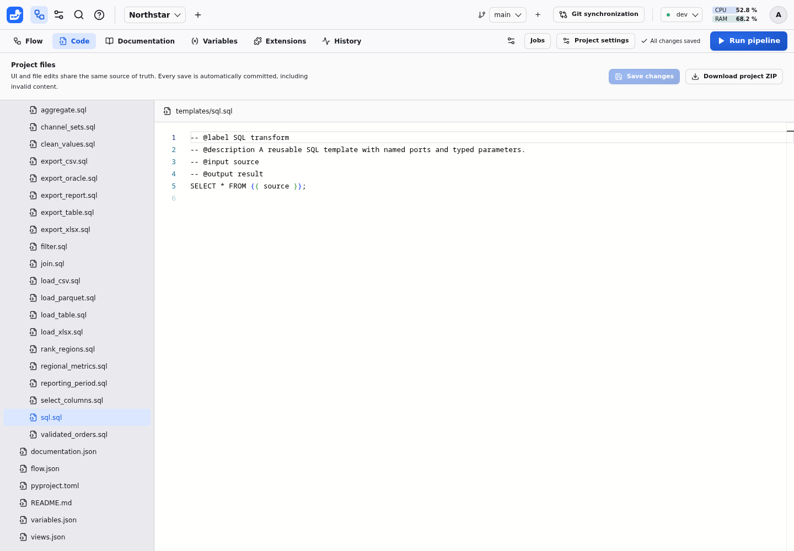
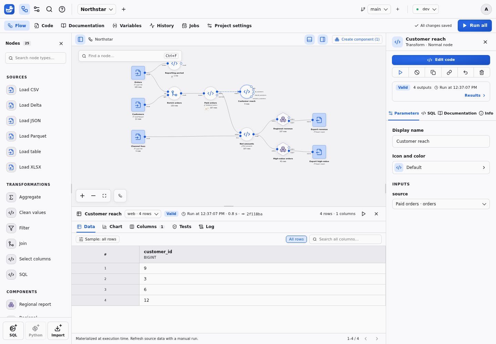

# Authoring projects

A project holds a graph, SQL, reusable components and documentation. Start with
the [quickstart](QUICKSTART.md) to build a pipeline; this guide covers its files
and code ownership.

## Edit and share project files

The **Code** tab displays the worktree's files beside an editor. Choose a file,
edit it, then **Save changes**. Drafts survive switching files or workspace tabs.
External editors are also supported. Every completed save is committed, including
invalid content; fix the reported errors before running affected nodes.

**Download project ZIP** exports the saved declarative files below. Save or
discard pending edits first. Readers can download; editing requires Editor access.
The archive excludes Git history, source data, results, virtual environments and
instance connection settings.

To import, choose **New project → Import a project ZIP**. Leave the name empty to
use the one in `flow.json`. A single enclosing folder, as in a Git repository
download, is accepted. The import creates a new project and Git history, with you
as administrator. Upload source files again and ask an instance administrator to
grant any required connections. The import reports missing connections and
absolute source paths that need attention.

Archives over 16 MiB (64 MiB extracted), without `flow.json`, or containing invalid
JSON or non-UTF-8 declarative files are rejected. Non-project entries are ignored.



## Project layout and Python dependencies

```text
README.md              Project overview
pyproject.toml         Python version and dependencies
flow.json              Pipeline graph and partition declarations
documentation.json     Node, output and column descriptions
variables.json         Ordinary and computed variable declarations (optional)
extensions.json        Project extension requirements (optional)
views.json             Shared result views (optional)
templates/*.sql        Shared SQL templates
nodes/*.sql            Code owned by normal nodes
components/*.json      Reusable sub-flows
components/<id>/*.sql   Code owned by nodes inside a component
```

Project prose belongs in `README.md`; `documentation.json` rejects a `project`
entry. A missing or empty README means no project overview.

New projects declare Python `>=3.11` and the creating instance's Duckpad version
in `pyproject.toml`. Edit `project.dependencies` to add packages; comments and
custom TOML tables survive UI saves. Malformed TOML remains editable with a
diagnostic.

After extracting a ZIP, `uv sync` installs its declared dependencies into `.venv`.
The manifest sets `tool.uv.package = false` because the project is a pipeline,
not a Python package. Duckpad does not export uv's lockfile, so the archive does
not freeze transitive dependencies.

Saving this manifest does not install packages or execute Python: Duckpad runs
SQL pipelines. To open an extracted project in Duckpad, import its ZIP through
the interface. Configure connections, extension binaries and source data on the
destination instance separately.

## Editing node code

Palette entries, **Add a connected node** and **Duplicate node** copy SQL into
independent nodes. The **SQL** entry in the palette list starts with a `source`
input and `result` output. **Edit code** changes only that node. Its `-- @param`
declarations generate the form; guided controls remain while their supporting
parameters are present.

The **SQL** button under **Add to palette** creates a reusable template instead.
Save its SQL to make it available in the palette, then click or drag the entry
to create independent nodes. **Import** copies a reusable definition from another
project into this palette.

Use **Add linked** to share a template. Linked nodes show a badge and template
name. **View code** is read-only; **Edit template (N nodes)** edits every linked
instance in the branch. **Detach from template** copies the SQL while retaining
parameters and connections.

**Convert to template** names a new shared definition and links the node to it.
**Link to original template** asks before discarding local code. Detaching or
converting preserves valid results; relinking to different executable SQL makes
results stale. Linked code has no partial overrides.



The inspector's **Info** tab shows the node's ID, code file, creator, contributors
and last change, including whether it touched processing, documentation or layout.
Linked nodes also show the template's last change. **View change history** opens
its element history in the [Git workspace](GIT.md).

## Node results

Use the [results guide](RESULTS.md) for data, samples, column statistics, tests
and logs. After a successful CSV or XLSX export, **Log → Download exported data**
retrieves the entire exported file, including its format options.

Downloads apply to a single `COPY ... TO` statement using a `destination`
parameter and a local CSV/XLSX target. They use a saved copy of the exported
bytes, remain private to project members and survive a backend restart. Changed
inputs/settings, upstream reruns, a failed export or a missing download copy
require another successful export. A new export replaces the previous download.
Oracle and remote-storage destinations do not offer downloads.

## Related guides

- [SQL syntax](SQL.md): declarations, parameters, sources and exports.
- [Components](COMPONENTS.md): grouping and sharing multiple steps.
- [Variables](VARIABLES.md) and [partitions](PARTITIONS.md): shared values and batches.
- [Data preparation](DATA_PREPARATION.md): guided column and value operations.
- [Documentation](DOCUMENTATION.md), [Git](GIT.md) and [Jobs](JOBS.md): explain,
  review and run saved versions.
