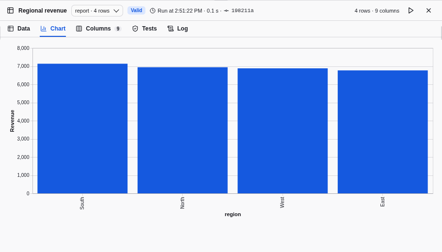

# Charts

Draw a node output as a bar, line, point or other Vega-Lite chart in the
**Chart** tab of the [results panel](RESULTS.md#chart). Charts are presentation:
they read the retained result, never start a run and never make a result stale.
Aggregate, bin and filter in SQL nodes, so that every plotted value is a cell of
a node output and can be [explained](LINEAGE.md).



## Add a chart

Charts are declared in `charts.json`, at the root of the project. For an output
without a chart, the Chart tab offers **Add a chart** to editors and
administrators: it saves a starter bar chart of the first two columns, with
tooltips, creating `charts.json` when the project has none, and opens the file
in the [Code tab](AUTHORING.md#edit-and-share-project-files). Edit the spec
there, or in an external editor, then save. Readers, operators and read-only
branches such as Job results see the charts without this action.

Adding a chart is a normal save: one commit, refused without the save permission,
and a conflict to resolve when someone else saved first. The Northstar
[example](EXAMPLE.md) includes a chart on Regional revenue.

## File format

`charts.json` maps a node output to a list of named charts:

```json
{
  "report::rank:result": [
    {
      "name": "Revenue by region",
      "spec": {
        "$schema": "https://vega.github.io/schema/vega-lite/v6.json",
        "mark": {"type": "circle", "size": 200, "tooltip": true},
        "height": 200,
        "encoding": {
          "x": {
            "field": "revenue",
            "type": "quantitative",
            "title": "Revenue",
            "format": ",",
            "scale": {"zero": false}
          },
          "y": {"field": "region", "type": "nominal", "sort": "-x", "title": "Region"},
          "color": {
            "field": "region",
            "type": "nominal",
            "title": "Region",
            "legend": null
          }
        }
      }
    }
  ]
}
```

- **Keys** name the output that stores the rows, as in `views.json`: `node:port`,
  or `instance::node:port` inside a component instance. Above, `report` is the
  Regional revenue instance and `rank` its inner node. Selecting the instance or
  the inner node shows the same charts.
- **Entries** have exactly a `name`, 1 to 100 characters and unique for the
  output, and a `spec`, a [Vega-Lite 6](https://vega.github.io/vega-lite/docs/)
  view of at most 64 KiB serialized. Duckpad metadata stays beside the spec, never
  inside it.
- **`$schema`** is optional. When present, it is a Vega-Lite 6 schema URL:
  `v6.json` or a `v6.x.y.json` variant.
- **`data`** is optional. When present, it is exactly `{"name": "data"}`: Duckpad
  always supplies the rows of the output.

A `field` is a column name exactly as the output spells it, dots and brackets
included: write `"field": "a.b"` or `"field": "x[0]"`, without Vega-Lite's
`\\.` path escapes. Axes, legends and tooltips show the name as written.

With several charts, a selector above the chart switches between them by name.
A chart without `width` takes the width of the panel.

The example plots points on a revenue axis that starts near the smallest value
(`"scale": {"zero": false}`): bars always start at 0, which hides differences of
a few percent. `"tooltip": true` on the mark shows the encoded values on hover;
a `tooltip` channel picks other columns.

## Allowed specs

A spec must pass an allowlist. Anything outside it is reported as a diagnostic
naming the chart, its output and the first construct refused, such as
`charts.json: chart Revenue by region of report::rank:result: encoding.x.aggregate is not allowed`.

| Level | Allowed |
| --- | --- |
| Top level | `$schema`, `data`, `mark`, `encoding`, `layer`, `title`, `description`, `width`, `height` |
| Layer, in `layer` | `mark`, `encoding`, `title`, `description` |
| Mark types | `bar`, `line`, `area`, `point`, `circle`, `square`, `tick`, `rect`, `rule`, `text`, `arc` |
| Mark object | `type` and the literals `color`, `opacity`, `filled`, `size`, `strokeWidth`, `interpolate`, `point`, `orient`, `tooltip`, `innerRadius`, `outerRadius`, `cornerRadius` |
| Channels | `x`, `y`, `x2`, `y2`, `xOffset`, `yOffset`, `theta`, `radius`, `color`, `fill`, `stroke`, `opacity`, `size`, `shape`, `strokeDash`, `text`, `tooltip`, `detail`, `order` |
| Channel definition | `field`, `type`, `title`, `format`, `formatType`, `value`, `scale`, `axis`, `legend`, `sort`, `stack` |
| `scale` | `type`, `domain`, `range`, `scheme`, `zero`, `nice`, `reverse` |
| `axis` | `title`, `format`, `formatType`, `labelAngle`, `grid`, `orient`, `tickCount` |
| `legend` | `title`, `format`, `formatType`, `orient` |

Values follow these rules:

- A spec has a `mark` or a `layer`, and every layer has a `mark`.
- `width` and `height` are a positive number or `"container"`. A `title` is a
  string or an object with `text` and `subtitle` strings.
- `type` is `quantitative`, `temporal`, `ordinal` or `nominal`; `formatType` is
  `number` or `time`. A `format` is a d3 number or time format without quotes or
  backslashes. A channel `title` is a string, or `null` to hide it.
- `tooltip` may be a list of channel definitions.
- `sort` is `"ascending"`, `"descending"`, `null`, a channel name with an
  optional `-` prefix (`"-y"`), a list of literals, or
  `{"encoding": "y", "order": "descending"}`.
- `stack` is `true`, `false`, `null`, `"zero"` or `"center"`.
- `axis` and `legend` may be `null` to hide them.
- Mark properties, `value`, and the `scale`, `axis` and `legend` properties are
  **literals**: a string, a number, a boolean or `null`. `domain` and `range` are
  lists of literals.

An object or a list where a literal is expected is refused, so `{"expr": …}` and
other expressions never reach the browser. Transforms, `aggregate`, `bin`,
`timeUnit`, `impute`, composite marks such as `boxplot`, `sort` by `field` or
`op`, `stack: "normalize"`, `datum`, `condition`, `params`, `href`, `url`,
`datasets`, inline data, `config`, and facet, repeat or concatenated views are
not allowed. Compute in SQL what they would compute.

`charts.json` is checked when the project is validated. An invalid file is still
saved and committed, and its diagnostics appear with the other project problems.
Keys are only checked to be well formed: a chart of an output that no longer
exists is not reported, and deleting a node deletes its charts.

## Rows and states

A chart plots the whole output, never a sample, and only outputs of at most
**5,000 rows**. Above that, the tab shows the row count and asks you to
aggregate upstream: a truncated series would look complete. The Data tab's
sample, filter, search and sort do not apply; its partition selection does.

The tab follows the dataset shown in the results panel, inputs included, and
the selected environment. It shows the same states as the Data tab: **Stale**
with its reason, **Run** when there is no result, and the failure of the last
run. It also reports a spec that Vega-Lite cannot compile and fields that the
result has no column for, which Vega-Lite would otherwise draw as empty marks.

Axes and tooltips use the number and date formats of the interface language,
and the chart takes the colors of the light or dark theme. The draft
**Preview** of the code editor has no chart.

## Values and dates

The tab converts each column by its type before drawing:

| Column type | Chart value |
| --- | --- |
| Integers, floating point, `DECIMAL`, `HUGEINT` | Number. Very large integers and decimals can lose precision; infinity and NaN become `null`. |
| `DATE` | Date at local midnight of that day. |
| `TIMESTAMP` and its `_S`, `_MS`, `_NS` variants | Date with the same local wall-clock time, to the millisecond. |
| `TIMESTAMP WITH TIME ZONE` | Date at that instant, shown in your time zone. |
| `BOOLEAN` | Boolean. |
| Anything else (`TIME`, lists, structs, maps, blobs) | Text; lists and structs as JSON. |

A `DATE` is drawn at local midnight on purpose: Vega would read `2026-10-01` as
midnight UTC, which shows as the previous day west of UTC. Use
`"type": "temporal"` to place dates and timestamps on a time scale.

## Security

Project files reach browsers through branches, Git pulls, ZIP imports and
external editors, so the browser applies its own barriers on top of validation:

- **No chart while `charts.json` is invalid.** The tab lists the diagnostics,
  with a link to the file in the Code tab, and draws nothing.
- **No network or file access.** Charts use a Vega loader that refuses every
  request; a chart only draws the rows Duckpad supplies.
- **No generated code.** Vega expressions run in `vega-interpreter` rather than
  being compiled to JavaScript, and the actions menu, which could open the spec
  in an online editor, is hidden.
- **Text tooltips.** A tooltip shows its values as escaped text, never as HTML
  or as an image a value points to.
- **Pinned versions.** `vega` 6.4.0, `vega-lite` 6.5.0, `vega-embed` 7.3.0 and
  `vega-interpreter` 2.3.2 are upgraded only deliberately. Vega loads when the
  Chart tab first opens.

## Git, components and comparisons

- **Merge:** charts merge by output and name. Charts added to the same output on
  two branches both survive; a chart is merged as one unit, so different edits
  to the same chart, or a deletion against an edit, are one conflict resolved by
  choosing a side.
- **Comparison and Git review:** each chart is listed as
  "Revenue by region chart of report::rank:result", with a JSON diff.
- **Components:** grouping nodes moves their charts to the new instance, and
  deleting a node or an instance deletes its charts. Charts belong to the
  instance; they are not copied into the component definition.
- **ZIP archives** include `charts.json` with the other project files.
