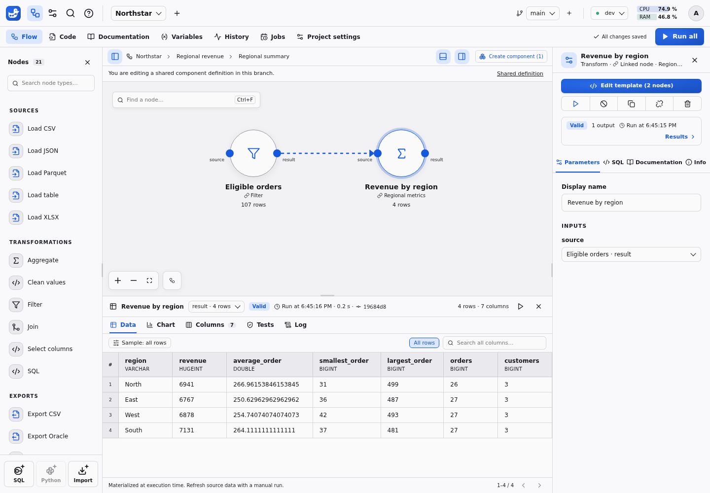

# Reusable components

Package several connected steps as one node, expose their parameters and reuse
the same logic across a project or import an independent copy elsewhere.

## Nodes and connections

Connect ports on the canvas or select an upstream output in the inspector. Each
input has one source; an output can feed many inputs. `flow.json` stores nodes
and edges by stable IDs. A normal node owns `nodes/<node-id>.sql`; a linked node
names a local `template` and a component instance a local `component`. An
optional `origin` records where normal code came from without linking it; an
optional `preset` keeps the palette icon and guided form but never selects
executable code. Edges use `source`, `sourceHandle`, `target` and `targetHandle`.

Drag a port onto empty canvas space to **Add a connected node**. Choose a
compatible template/component and port to create and connect it in one save.
Starting from an occupied input replaces its previous connection.

## Group and open components

Select nodes using Shift, then choose **Create component**. Node-owned code moves to `components/<component-id>/<node-id>.sql`. Incoming and outgoing edges are preserved as named boundary ports; terminal outputs remain inspectable. Double-click the resulting node to open the sub-flow. Breadcrumbs identify the instance path. Definition edits affect every usage in this project branch, while parameters belong to the selected instance.



## Expose parameters

Exposed component parameters have the following structure:

```json
{
  "minimum": {
    "type": "number",
    "default": 100,
    "targets": [{"node": "filter_node", "param": "threshold"}]
  }
}
```

## Import a component

The shared library reads projects' main branches. Importing creates new destination-owned IDs for the component, nested components and templates. Node-owned SQL, definitions and documentation are copied; data, results and secrets are not. Imports never resolve executable code through the original project. Subsequent edits are independent.

See [node code and linked templates](AUTHORING.md#editing-node-code) for reusing
a single SQL definition, or [variables](VARIABLES.md) to configure an instance.
