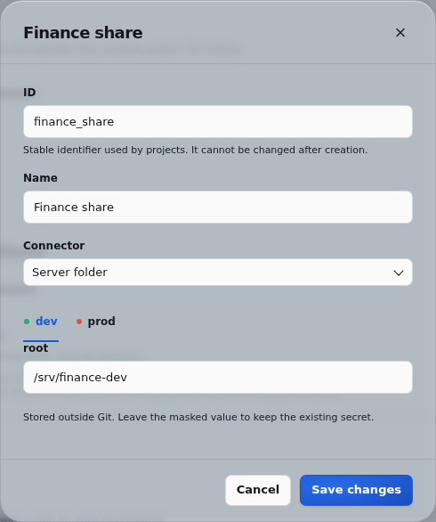
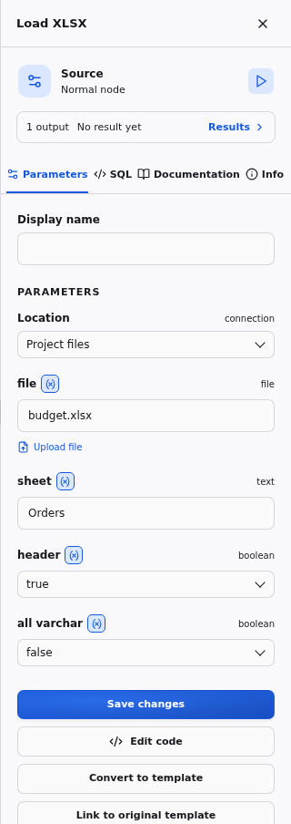

# Connections and connector compatibility

A connector is a declarative setup definition. A connection is a named reusable instance with independent environment values. Both live in the instance catalog, outside Git. Projects store only references. Instance admins configure them from **Instance settings → Connections**; connector definitions have a JSON editor, and their typed parameters generate connection forms.

Fresh instances have no connection. File nodes read uploads and write exports as [project files](#project-files-and-local-folders) without one; connections reach server folders, object storage and databases.

The instance-admin-only `PUT /api/catalog/connector` and `PUT /api/catalog/connection` endpoints accept those same JSON objects, so an administrator can submit declarative files without changing application code. Secret fields are masked in public catalog responses and execution records. Definition snapshots and non-secret settings used by each run remain in its history. Instance admins grant each project access to connections in **Project settings**. Members see only the names and capabilities of granted connections, not the global catalog.

Connection identifiers are fixed after creation; edit the display name to rename
a connection without changing project references. The editor rejects duplicate
identifiers and updates to connections that have been deleted. Changing connectors
keeps only parameters declared by the selected connector, in every environment.

To create a connection, use `PUT /api/catalog/connection?create=true` (409 if the
identifier exists). For updates, use `?create=false` or omit `create` (404 if the
connection does not exist). Masked secrets in an update retain their stored values.



## Environments

Configure labels, colors, connection values and run confirmation in the
[environments guide](ENVIRONMENTS.md). Each branch and environment has its own
results; switching environment never starts a run.

## Validated scope

| Preset | Required operations | Recorded validation |
| --- | --- | --- |
| Local files | CSV and Parquet read; CSV export | DuckDB 2.0.0, Python 3.13.12, Linux x86_64; unit/native-equivalence tests, browser example and million-row benchmark |
| S3 | CSV and Parquet read; CSV export | DuckDB 2.0.0 with matching `httpfs`, Linux x86_64; Moto S3 emulator on localhost; repeated native destination replacement |
| Oracle | Read attached tables; export to an existing table with OraDuck | DuckDB 2.0.0, signed community OraDuck 0.4.0, Oracle 19.3, Oracle Instant Client 19.32, Linux x86_64 |

The table records connector validation of the embedded engine. File formats are not connectors; XLSX has its own [validation record](#xlsx-workbooks). The isolated HTTP worker additionally requires Linux Landlock; local CSV/Parquet execution, exports and lineage are covered by the account/permission tests. Remote S3/Oracle deployments need validation with their extension and network policy in this execution mode.

These are the tested combinations, not claims that every newer DuckDB or operating-system build has been validated. A matching extension build is required for the installed DuckDB version. Other platforms and live AWS deployments need validation in their own environment. Raw results are in `docs/validation/`.

## Project files and local folders

Every file node (Load CSV, Load Parquet, Load XLSX, Export CSV and Export XLSX) has a **Location** field. It defaults to **Project files**: the project's uploads and its exports, available in every environment without a connection or a grant. Upload a file next to the node's `file` field, or enter a path:

- A relative source path resolves under the project's resources, where uploads land.
- A relative destination resolves under `exports/<worktree>/<environment>/`, so each branch and environment writes its own files.
- An absolute path must fall within the project's resources or exports, or within the root of a connection granted to the project. Uploads are scoped to the active project.



To use a folder on the server, an instance admin creates a **Local files** connection with a `root` directory for each environment, then grants it to the project. Members select it as the node's Location; relative paths then resolve against its root. Roots must exclude instance metadata and other projects. A connection that is not granted to the project is refused.

CSV exposes header, delimiter and a JSON type-override map; `{}` retains native inference. Parquet uses native types.

Single-file CSV `COPY` follows DuckDB's native replacement behavior on a second run. Duckpad does not add an overwrite option, rename files, or ask for an existence-based confirmation.

## File formats and extensions

A file format is a node and extension concern, not a connection: every file node
works with project files and with the file connections granted to the project. CSV, Parquet
and JSON are built into every DuckDB build Duckpad supports. XLSX needs DuckDB's
`excel` extension, which Duckpad's runtime links; other formats, such as Avro or
spatial files, need their extension enabled in the project's **Extensions** tab.

The **Extensions** tab is the only way a project loads a format's extension.
Built-in templates do not declare the extensions they need, and execution never
downloads or loads an extension on demand, in embedded or isolated mode. The
project's `extensions.json` therefore lists every extension it needs beyond the
runtime's built-in ones, and a project behaves the same on every instance and in
every execution mode.

A node that uses a format, function or type of an extension that is neither built
into the runtime nor enabled in the project fails with an error naming the
extension to enable:

```text
Catalog Error: Table Function with name "read_xlsx" is not in the catalog, but it exists in the excel extension.
Enable the excel extension in the project's Extensions tab; an instance administrator may need to import it first.
```

Add the extension with origin **DuckDB core** in the **Extensions** tab and tick
**Activate for this project**. If it shows **Import required**, an instance
administrator imports its binary first; see the
[extension activation guide](OFFLINE_EXTENSIONS.md#activate-a-project-capability).
Extensions needed to reach a system, such as `httpfs` for S3 or `oraduck` for
Oracle, stay declared by its connector and load with the connection.

## XLSX workbooks

**Load XLSX** and **Export XLSX** read and write `.xlsx` workbooks with DuckDB's
`excel` extension. Like CSV and Parquet nodes, they use project files by
default: no connection or administrator is needed.

1. In a project, add **Load XLSX**, upload a workbook or enter its path, then
   choose a worksheet with `sheet`. Leave `sheet` blank for the first worksheet.
   `header=true` treats the first row as column names; turn it off for headerless
   sheets. `all_varchar=true` reads mixed columns as text instead of inferring types.
2. Connect a result to **Export XLSX**, choose a destination and sheet name, and
   run the pipeline. `header` controls whether column names are written.

To read or write workbooks in a server folder, select a granted Local files
connection as the Location, as for CSV and Parquet.

New projects include both templates. Existing projects retain their versioned
templates; create equivalent source/export templates through **New SQL template**
or copy `load_xlsx` and `export_xlsx` from a new project's Code workspace.
No Python spreadsheet dependency is needed. Duckpad's runtime, including its
container image, builds DuckDB with `excel`. Other DuckDB builds, such as the
PyPI wheel, need it enabled in the project's **Extensions** tab (see
[File formats and extensions](#file-formats-and-extensions)); for disconnected
deployments, follow the [offline extension guide](OFFLINE_EXTENSIONS.md).
CSV/Parquet-only projects do not load it.

Imports use native DuckDB inference: numbers generally become `DOUBLE`, while
formatted dates, times and booleans retain their inferred types. Inconsistent cells
fail the node; Duckpad does not silently discard conversion errors. Empty cells
become nulls. Without an explicit range, DuckDB infers the table and stops at an
empty row. For sheets with title rows or gaps, edit the source SQL to add options
such as `range='A3:F100'` and `stop_at_empty=false` to `read_xlsx`.

Exports replace the entire destination workbook on every run, including any
existing sheets. They create one sheet of values; formatting, formulas and other
workbook features are not preserved. Excel's numeric representation can lose
precision for large integers and decimals; cast these to text before exporting
when exact digits matter.

Validated with DuckDB 2.0.0 and its matching `excel` on Linux x86_64, in embedded
and isolated execution: project files and server folders, uploads, types, lineage,
repeated export and environment separation. Legacy `.xls`, encrypted workbooks,
formula recalculation and remote XLSX storage are outside the validated scope.

Uploads, local roots, environment-specific destinations and project permissions
follow the same rules as CSV and Parquet project files. Source lineage identifies the imported
dataset row and column, not an Excel cell address. Missing files, missing sheets
and malformed workbooks report execution errors and retain the last result as
stale. See the [DuckDB Excel extension documentation](https://duckdb.org/docs/stable/core_extensions/excel.html)
for native format behavior and limits.

## S3

Configure access key ID, secret access key, region and endpoint per environment. The preset loads `httpfs` and creates a temporary S3 secret. Use `s3://bucket/key.csv` or a Parquet object URI in the ordinary file nodes. `use_ssl` defaults to true and `url_style` to `vhost`; a local S3-compatible endpoint can use false and `path` respectively.

The local integration test validates both read formats, a join, CSV export, connection reuse, lineage and replacement of the same destination. It does not validate real AWS credentials, IAM policies, TLS configuration or every provider's object-storage behavior.

```sh
uv sync --group integration
uv run python scripts/integration.py s3 --output docs/validation/s3.json
```

## Oracle / OraDuck

Install Oracle Instant Client 19 or newer, Basic or Basic Light, compatible with the extension and platform. On Linux, make its shared libraries discoverable and install the platform's `libaio`/`libnsl` prerequisites. The extension build must match the exact DuckDB ABI. The application uses a private extension directory, so an unrelated unsigned developer extension in the user's global DuckDB cache cannot be loaded accidentally.

OraDuck is available signed from the community repository. Leave **Allow unsigned
extensions** disabled for its signed binary. On an offline server, use the
[standard extension import](OFFLINE_EXTENSIONS.md), as for any other extension.

The preset creates a temporary secret with `TYPE oraduck`, `USER`, `PASSWORD` and `DSN`, then uses `ATTACH` for read-only access. Source nodes select a connection, schema and resource. Export nodes emit `COPY (SELECT ...) TO ... (FORMAT oraduck, CONNECTION ...)` targeting an existing Oracle table; the columns expression supports explicit mapping. The destination table must already exist and be compatible with the selected columns.

Before each manual run, relevant attachments are recreated to refresh schema metadata. Materialized Duckpad results remain independent of those attachments. Export behavior is native OraDuck behavior: there is no hidden truncate, table recreation or extra write. The integration test compares native and generated exports, checks repeated appends, adds a source column and row between launches, then verifies refresh and cell lineage through the same logical connection.

```sh
# Supply credentials through the environment; do not put them in project files.
export ORADUCK_ORACLE_USER=...
export ORADUCK_ORACLE_PASSWORD=...
export ORADUCK_ORACLE_DSN=host:1521/service
uv run python scripts/integration.py oracle --output docs/validation/oracle.json
```

The script creates uniquely named disposable test tables and drops only those tables in its cleanup. Credentials are never included in its report. See the [OraDuck documentation](https://raw.githubusercontent.com/hugues31/oraduck/main/README.md) for deployment prerequisites.

## Add another connector

For air-gapped instances, [download and import extensions](OFFLINE_EXTENSIONS.md)
before using connectors that need extensions. This applies to core and community
extensions; the cache belongs to the backend instance, outside project Git.

```json
{
  "id": "warehouse",
  "name": "Attached DuckDB warehouse",
  "description": "An existing DuckDB file",
  "parameters": [{"name": "database", "type": "file"}],
  "extensions": [],
  "capabilities": ["read", "write"],
  "init_sql": "ATTACH {{ database }} AS {{ alias }};",
  "compatibility": "Validate with the installed DuckDB version"
}
```

Create a named connection pointing to different database files in `dev` and `prod`. A source template can read `{{ connection }}.{{ resource }}`; an export template can explicitly `INSERT INTO` a declared attached destination from its input. This exact extension-free scenario is covered by `tests/test_catalog.py`, including reuse and historical project code using current catalog settings.

Connection parameter types are text, file, number, boolean and choice. Secret parameters add `"secret": true`. Setup placeholders use type-aware SQL escaping; `alias` and `secret_name` are reserved runtime identifiers. Setup permits declared extension loading, `CREATE OR REPLACE TEMPORARY SECRET {{ secret_name }}` and `ATTACH ... AS {{ alias }}`. Data queries and writes belong in source/export nodes and are rejected in initialization. Extensions are installed and loaded from the declared repository when needed.
