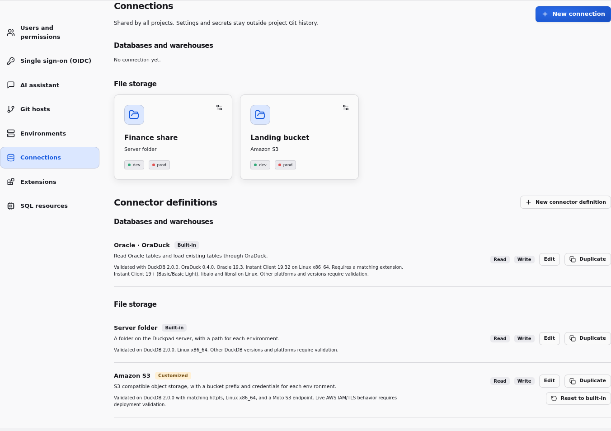
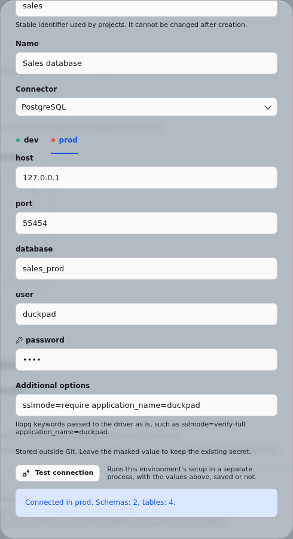
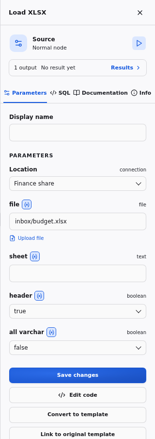
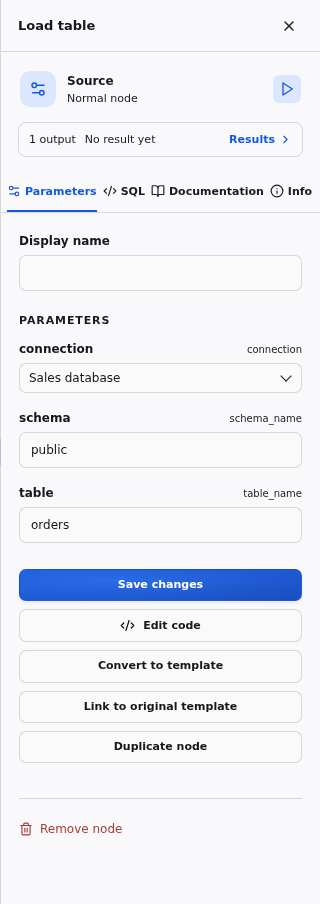

# Connections and connector compatibility

A connector is a declarative setup definition. A connection is a named reusable instance with independent environment values. Both live in the instance catalog, outside Git. Projects store only references. Instance admins configure them from **Instance settings → Connections**; connector definitions have a JSON editor, and their typed parameters generate connection forms.

A connection says where data lives and how to reach it in each environment. Connections fall into two families, which group the Connections page:

- **Databases and warehouses** are attached and read as tables with [Load table and Export table](#database-tables), such as PostgreSQL, Oracle or a database type an administrator declares.
- **File storage** is a location for file nodes: a Server folder, an S3 bucket prefix, or a storage type an administrator declares.

Fresh instances have no connection. File nodes read uploads and write exports as [project files](#project-files-and-storage-locations) without one; connections reach server folders, object storage and databases.



The instance-admin-only `PUT /api/catalog/connector` and `PUT /api/catalog/connection` endpoints accept those same JSON objects, so an administrator can submit declarative files without changing application code. Secret fields are masked in public catalog responses and execution records. Definition snapshots and non-secret settings used by each run remain in its history. Instance admins grant each project access to connections in **Project settings**. Members see only the names and capabilities of granted connections, not the global catalog.

Connection identifiers are fixed after creation; edit the display name to rename
a connection without changing project references. The editor rejects duplicate
identifiers and updates to connections that have been deleted. Changing connectors
keeps only parameters declared by the selected connector, in every environment.

To create a connection, use `PUT /api/catalog/connection?create=true` (409 if the
identifier exists). For updates, use `?create=false` or omit `create` (404 if the
connection does not exist). Masked secrets in an update retain their stored values.


## Test a connection

**Test connection**, in the connection form, runs the setup of the selected environment with the values in the form, saved or not, in a separate process. It reports what would otherwise fail the first run that uses the connection, without stopping the Duckpad server:

- a wrong password, an unknown database or an unreachable host, with the driver's message;
- an extension that cannot load, or that stops its process, such as a binary built for a newer processor;
- a Server folder root that does not exist on the server.

A database connection then lists the schemas and tables it attached; a storage connection reports that its setup succeeded. Masked secrets of a saved connection keep their stored values, and errors never show secret values. A test stops after 30 seconds; add `connect_timeout=5` to a PostgreSQL connection's Additional options to fail sooner on an unreachable host.



Runs get the same protection. Duckpad loads each connector extension once in a separate process before relying on it: in embedded execution before loading it in the server, in isolated execution before starting the worker. An extension that crashes then fails the node, or the start of the isolated session, instead of stopping Duckpad.

## Environments

Configure labels, colors, connection values and run confirmation in the
[environments guide](ENVIRONMENTS.md). Each branch and environment has its own
results; switching environment never starts a run.

## Validated scope

| Preset | Required operations | Recorded validation |
| --- | --- | --- |
| Server folder | CSV and Parquet read; CSV export | DuckDB 2.0.0, Python 3.13.12, Linux x86_64; unit/native-equivalence tests, browser example and million-row benchmark |
| S3 | CSV and Parquet read; CSV export; relative paths under a bucket prefix | DuckDB 2.0.0 with matching `httpfs`, Linux x86_64; Moto S3 emulator on localhost; repeated native destination replacement |
| PostgreSQL | Load table and Export table; Additional options; Test connection | DuckDB 2.0.0 with its `postgres` extension linked statically, PostgreSQL 16, Linux x86_64 without AVX2, in embedded and isolated execution; CI with the PyPI wheel and downloaded extension |
| Oracle | Read attached tables; export to an existing table with OraDuck | DuckDB 2.0.0, signed community OraDuck 0.4.0, Oracle 19.3, Oracle Instant Client 19.32, Linux x86_64 |
| MySQL and SQLite examples | Load table and Export table through [published definitions](#published-examples-mysql-and-sqlite) | DuckDB 2.0.0 with matching `mysql` and `sqlite` extensions, MySQL 8.4, Linux x86_64 (CI) |

The table records connector validation of the embedded engine, and of the isolated worker where stated. File formats are not connectors; XLSX has its own [validation record](#xlsx-workbooks). The isolated HTTP worker additionally requires Linux Landlock; local CSV/Parquet execution, exports and lineage are covered by the account/permission tests. Remote S3/Oracle deployments need validation with their extension and network policy in this execution mode.

These are the tested combinations, not claims that every newer DuckDB or operating-system build has been validated. A matching extension build is required for the installed DuckDB version. Other platforms and live AWS deployments need validation in their own environment. Raw results are in `docs/validation/`.

## Project files and storage locations

Every file node (Load CSV, Load Parquet, Load XLSX, Export CSV and Export XLSX) has a **Location** field. It defaults to **Project files**: the project's uploads and its exports, available in every environment without a connection or a grant. Upload a file next to the node's `file` field, or enter a path:

- A relative source path resolves under the project's resources, where uploads land.
- A relative destination resolves under `exports/<worktree>/<environment>/`, so each branch and environment writes its own files.
- An absolute path must fall within the project's resources or exports, or within the root of a connection granted to the project. Uploads are scoped to the active project.


The Location field also lists every file storage connection granted to the project, custom storage types included. Database connections are not locations. Each storage connection has a `root` per environment, either a folder on the server or a URI prefix:

- A relative path is appended to the root. A URI root is kept as written: with the root `s3://bucket/landing` or `s3://bucket/landing/`, the path `inbox/a.csv` reads `s3://bucket/landing/inbox/a.csv`.
- An absolute path or a full URI is used as is; a local path must still fall within the project files or a granted folder root.
- A connection without a root in the selected environment accepts only absolute paths. Relative paths never fall back to project files once a location is chosen.

To read a shared folder, an instance admin creates a **Server folder** connection, for example *Finance share* with `/srv/finance-dev` in dev and `/srv/finance` in prod, and grants it to the project. A member selects *Finance share* as the Location of Load CSV or Load XLSX and enters `inbox/budget.xlsx`. A dev run reads `/srv/finance-dev/inbox/budget.xlsx`, a prod run `/srv/finance/inbox/budget.xlsx`, without any project change. Folder roots must exclude instance metadata and other projects, and must exist on the server. A connection that is not granted to the project is refused.



CSV exposes header, delimiter and a JSON type-override map; `{}` retains native inference. Parquet uses native types.

Single-file CSV `COPY` follows DuckDB's native replacement behavior on a second run. Duckpad does not add an overwrite option, rename files, or ask for an existence-based confirmation.

## File formats and extensions

A file format is a node and extension concern, not a connection: every file node
works with project files and with the file connections granted to the project. CSV, Parquet
and JSON are built into every DuckDB build Duckpad supports. XLSX needs DuckDB's
`excel` extension, which Duckpad's container image links but the PyPI wheel
installed by `pip install duckpad` does not. Formats whose extension the runtime
does not link, such as XLSX on a `pip` installation, Avro or spatial files, need
their extension enabled in the project's **Extensions** tab.

The **Extensions** tab is the only way a project loads a format's extension.
Built-in templates do not declare the extensions they need, and execution never
downloads or loads an extension on demand, in embedded or isolated mode. The
project's `extensions.json` therefore lists every extension it needs beyond the
runtime's built-in ones, and a project behaves the same on every instance and in
every execution mode.

A node that uses a format, function or type of an extension that is neither built
into the runtime nor enabled in the project fails with an error naming the
extension to enable:

```text
Catalog Error: Table Function with name "read_xlsx" is not in the catalog, but it exists in the excel extension.
Enable the excel extension in the project's Extensions tab; an instance administrator may need to import it first.
```

Add the extension with origin **DuckDB core** in the **Extensions** tab and tick
**Activate for this project**. If it shows **Import required**, an instance
administrator imports its binary first; see the
[extension activation guide](OFFLINE_EXTENSIONS.md#activate-a-project-capability).
Extensions needed to reach a system, such as `httpfs` for S3 or `oraduck` for
Oracle, stay declared by its connector and load with the connection.

## XLSX workbooks

**Load XLSX** and **Export XLSX** read and write `.xlsx` workbooks with DuckDB's
`excel` extension. Like CSV and Parquet nodes, they use project files by
default: no connection or administrator is needed.

1. In a project, add **Load XLSX**, upload a workbook or enter its path, then
   choose a worksheet with `sheet`. Leave `sheet` blank for the first worksheet.
   `header=true` treats the first row as column names; turn it off for headerless
   sheets. `all_varchar=true` reads mixed columns as text instead of inferring types.
2. Connect a result to **Export XLSX**, choose a destination and sheet name, and
   run the pipeline. `header` controls whether column names are written.

To read or write workbooks in a server folder, select a granted Server folder
connection as the Location, as for CSV and Parquet.

New projects include both templates. Existing projects retain their versioned
templates; create equivalent source/export templates through **New SQL template**
or copy `load_xlsx` and `export_xlsx` from a new project's Code workspace.
No Python spreadsheet dependency is needed. Duckpad's container image builds
DuckDB with `excel`. Other DuckDB builds, such as the PyPI wheel installed by
`pip install duckpad`, need it enabled in the project's **Extensions** tab once an
instance administrator has imported its binary (see
[File formats and extensions](#file-formats-and-extensions)); for disconnected
deployments, follow the [offline extension guide](OFFLINE_EXTENSIONS.md).
CSV/Parquet-only projects do not load it.

Imports use native DuckDB inference: numbers generally become `DOUBLE`, while
formatted dates, times and booleans retain their inferred types. Inconsistent cells
fail the node; Duckpad does not silently discard conversion errors. Empty cells
become nulls. Without an explicit range, DuckDB infers the table and stops at an
empty row. For sheets with title rows or gaps, edit the source SQL to add options
such as `range='A3:F100'` and `stop_at_empty=false` to `read_xlsx`.

Exports replace the entire destination workbook on every run, including any
existing sheets. They create one sheet of values; formatting, formulas and other
workbook features are not preserved. Excel's numeric representation can lose
precision for large integers and decimals; cast these to text before exporting
when exact digits matter.

Validated with DuckDB 2.0.0 and its matching `excel` on Linux x86_64, in embedded
and isolated execution: project files and server folders, uploads, types, lineage,
repeated export and environment separation. Legacy `.xls`, encrypted workbooks,
formula recalculation and remote XLSX storage are outside the validated scope.

Uploads, local roots, environment-specific destinations and project permissions
follow the same rules as CSV and Parquet project files. Source lineage identifies the imported
dataset row and column, not an Excel cell address. Missing files, missing sheets
and malformed workbooks report execution errors and retain the last result as
stale. See the [DuckDB Excel extension documentation](https://duckdb.org/docs/stable/core_extensions/excel.html)
for native format behavior and limits.

## S3

Configure a root, access key ID, secret access key, region and endpoint per environment. The preset loads `httpfs` and creates a temporary S3 secret. Set `root` to a bucket prefix such as `s3://landing/raw/` and select the connection as a file node's Location: relative paths are appended to it. Full `s3://bucket/key.csv` URIs also work, with or without a root. `use_ssl` defaults to true and `url_style` to `vhost`; a local S3-compatible endpoint can use false and `path` respectively.

The local integration test reads CSV and Parquet by relative path under a root without a trailing slash, joins them, exports CSV under the same root, and reads through an administrator-declared storage type with its own URI root. It also checks connection reuse, lineage and replacement of the same destination. CI runs it on every pull request. It does not validate real AWS credentials, IAM policies, TLS configuration or every provider's object-storage behavior.

```sh
uv sync --group integration
uv run python scripts/integration.py s3 --output docs/validation/s3.json
```

## Database tables

**Load table** reads a table or view of a database connection granted to the project, built-in or custom, and **Export table** inserts rows into an existing table. Both address the connection's attachment as `{{ connection }}.{{ schema }}.{{ table }}`:

```sql
SELECT * FROM {{ connection }}.{{ schema }}.{{ table }};
INSERT INTO {{ connection }}.{{ schema }}.{{ table }} BY NAME SELECT * FROM {{ source }};
```

Select a connection, then a schema and a table. The inspector suggests those of the selected environment, read from the connection's attachment; typing a name also works, for example for a table created after the list loaded. The schema defaults to `public`, PostgreSQL's default. DuckDB and SQLite files use `main`, and MySQL the database name.



Export table matches columns by name: every input column must exist in the destination, and destination columns absent from the input take their default value, such as `NULL`. Each run appends its rows. Duckpad never truncates, creates or replaces the table; prepare or clear it in the database itself. Oracle keeps **Export Oracle**, whose OraDuck `COPY` is not an `INSERT`; Load table reads Oracle like any other database.

Template authors declare the same fields with the `schema_name(connection)` and `table_name(schema)` parameter types, described in the [SQL templates guide](SQL.md#parameter-values).

## PostgreSQL

Configure a host, port, database, user and password per environment. The built-in definition loads DuckDB's `postgres` extension, creates a temporary secret and attaches the database. Point dev and prod at different databases or servers with the same schemas and tables, and a project reads and writes each environment without any change.

**Additional options** take libpq connection keywords separated by spaces, passed to the driver as written, for each environment. A production server that requires certificate validation gets `sslmode=verify-full sslrootcert=/etc/ssl/certs/company-ca.pem` in its prod values; other common keywords are `connect_timeout=5` and `application_name=duckpad`. The options take precedence over the fields above. Keep the password in its own field, which Duckpad masks: options are displayed and recorded in run history. A setting that libpq does not accept as a keyword needs an edit of the built-in definition, which then shows **Customized**.

Duckpad's container image links `postgres` statically, built for x86-64 processors without AVX2 or BMI2, so nothing is downloaded. Other DuckDB builds, such as the PyPI wheel of `pip install duckpad`, install the extension from DuckDB's core repository on first use; air-gapped instances [import it](OFFLINE_EXTENSIONS.md) like any other extension.

The acceptance test creates a uniquely named schema in a dev and a prod database, then runs Load table, an aggregate and Export table in both environments, in embedded and isolated execution. It checks repeated appends without truncation, cell lineage, Test connection, the inspector's listing, Additional options (`application_name` and TLS on the server side), and the errors for a wrong password, an unreachable host and a refused certificate. It drops only its own schema. CI runs it on every pull request against a PostgreSQL service.

```sh
# Credentials of a disposable test server, never a production one.
export DUCKPAD_POSTGRES_HOST=127.0.0.1 DUCKPAD_POSTGRES_PORT=5432
export DUCKPAD_POSTGRES_USER=... DUCKPAD_POSTGRES_PASSWORD=...
export DUCKPAD_POSTGRES_DEV_DATABASE=sales_dev DUCKPAD_POSTGRES_PROD_DATABASE=sales_prod
export DUCKPAD_POSTGRES_SSL=1  # when the server accepts TLS
uv run python scripts/integration.py postgres --output docs/validation/postgres.json
```

## Oracle / OraDuck

Install Oracle Instant Client 19 or newer, Basic or Basic Light, compatible with the extension and platform. On Linux, make its shared libraries discoverable and install the platform's `libaio`/`libnsl` prerequisites. The extension build must match the exact DuckDB ABI. The application uses a private extension directory, so an unrelated unsigned developer extension in the user's global DuckDB cache cannot be loaded accidentally.

OraDuck is available signed from the community repository. Leave **Allow unsigned
extensions** disabled for its signed binary. On an offline server, use the
[standard extension import](OFFLINE_EXTENSIONS.md), as for any other extension.

The preset creates a temporary secret with `TYPE oraduck`, `USER`, `PASSWORD` and `DSN`, then uses `ATTACH` for read-only access. Load table selects a connection, schema and table. Export Oracle nodes emit `COPY (SELECT ...) TO ... (FORMAT oraduck, CONNECTION ...)` targeting an existing Oracle table; the columns expression supports explicit mapping. The destination table must already exist and be compatible with the selected columns.

Before each manual run, relevant attachments are recreated to refresh schema metadata. Materialized Duckpad results remain independent of those attachments. Export behavior is native OraDuck behavior: there is no hidden truncate, table recreation or extra write. The integration test compares native and generated exports, checks repeated appends, adds a source column and row between launches, then verifies refresh and cell lineage through the same logical connection.

```sh
# Supply credentials through the environment; do not put them in project files.
export ORADUCK_ORACLE_USER=...
export ORADUCK_ORACLE_PASSWORD=...
export ORADUCK_ORACLE_DSN=host:1521/service
uv run python scripts/integration.py oracle --output docs/validation/oracle.json
```

The script creates uniquely named disposable test tables and drops only those tables in its cleanup. Credentials are never included in its report. See the [OraDuck documentation](https://raw.githubusercontent.com/hugues31/oraduck/main/README.md) for deployment prerequisites.

## Built-in and custom connector types

Server folder, Amazon S3, PostgreSQL and Oracle · OraDuck are built in: their definitions come with each Duckpad release and show a **Built-in** badge. An unedited built-in always matches the running release.

- **Edit** opens a built-in's JSON definition. Saving a change stores your version as an override: the definition shows **Customized**, keeps your edit across upgrades, and no longer follows the release. Saving it unchanged keeps it built-in.
- **Reset to built-in** deletes the override. The definition matches the running release again; connections keep their values.
- **Duplicate** opens a copy under a new identifier, `<id>_copy` by default. Saving creates a custom type, which never follows a built-in.
- **New connector definition** creates a custom type. Custom types are grouped, listed and offered as locations exactly like built-in ones.

New definitions and duplicates use `PUT /api/catalog/connector?create=true`, which refuses an existing identifier with 409. Without `create`, the same endpoint creates or replaces a definition. `POST /api/catalog/connector/<id>/reset` resets a built-in, and `DELETE /api/catalog/connector/<id>` deletes a custom type once no connection uses it; built-ins cannot be deleted.

## Add another connector

For air-gapped instances, [download and import extensions](OFFLINE_EXTENSIONS.md)
before using connectors that need extensions. This applies to core and community
extensions; the cache belongs to the backend instance, outside project Git.

Every definition declares its `family`, `database` or `storage`; definitions without one are rejected. A database connector attaches its system as `{{ alias }}`:

```json
{
  "id": "warehouse",
  "name": "Attached DuckDB warehouse",
  "family": "database",
  "description": "An existing DuckDB file",
  "parameters": [{"name": "database", "type": "file"}],
  "extensions": [],
  "capabilities": ["read", "write"],
  "init_sql": "ATTACH {{ database }} AS {{ alias }};",
  "compatibility": "Validate with the installed DuckDB version"
}
```

Create a named connection pointing to different database files in `dev` and `prod`, grant it, and read and write it with [Load table and Export table](#database-tables), schema `main`: no template or code change is needed. Custom source and export templates can also read `{{ connection }}.{{ resource }}` or explicitly `INSERT INTO` a declared attached destination. `tests/test_database_connections.py` and `tests/test_catalog.py` cover this extension-free scenario, including reuse and historical project code using current catalog settings.

The isolated worker opens only project files and the roots of storage connections, so database files such as this one and SQLite work in [trusted local mode](INSTALLATION.md#trusted-local-mode) only. Database servers, such as PostgreSQL and MySQL, work in both modes.

A storage connector declares a `root` parameter, a folder or a URI prefix, and any setup its location needs. This one reaches Google Cloud Storage through `httpfs` with HMAC keys:

```json
{
  "id": "gcs",
  "name": "Google Cloud Storage",
  "family": "storage",
  "description": "A bucket prefix and HMAC keys for each environment",
  "parameters": [
    {"name": "root", "type": "text"},
    {"name": "key_id", "type": "text", "secret": true},
    {"name": "secret", "type": "text", "secret": true}
  ],
  "extensions": [{"name": "httpfs"}],
  "capabilities": ["read", "write"],
  "init_sql": "CREATE OR REPLACE TEMPORARY SECRET {{ secret_name }} (TYPE GCS, KEY_ID {{ key_id }}, SECRET {{ secret }});",
  "compatibility": "Validate with the installed DuckDB version and httpfs"
}
```

A connection with the root `gs://landing/raw/` in dev appears under **File storage** and as a Location of every file node in the projects it is granted to. In isolated execution, the worker may read the URI prefixes of the secret types it creates (`s3://`, `gcs://`, `gs://`, `r2://`) and below the URI roots of granted storage connections. A storage type whose root is `https://data.example.com/landing/` therefore needs no secret, only the `httpfs` extension, and cannot read `https://data.example.com/landing-archive/`.

Connection parameter types are text, file, number, boolean and choice. Secret parameters add `"secret": true`. An optional `label` replaces the name in the connection form and an optional `description` explains the field there, as PostgreSQL's `options` parameter shows **Additional options**; neither changes what setup does or makes results stale. Setup placeholders use type-aware SQL escaping; `alias` and `secret_name` are reserved runtime identifiers. Setup permits declared extension loading, `CREATE OR REPLACE TEMPORARY SECRET {{ secret_name }}` and `ATTACH ... AS {{ alias }}`. Data queries and writes belong in source/export nodes and are rejected in initialization. Extensions are installed and loaded from the declared repository when needed.

## Published examples: MySQL and SQLite

These definitions reach databases that Duckpad does not ship, through DuckDB's `mysql` and `sqlite` extensions. Paste one into **New connector definition**, then create connections and read them with Load table, as you would read PostgreSQL. The files are also in `docs/connectors/`, and their validation records in `docs/validation/`.

A community contribution follows the same shape: a definition plus a validation record produced by `scripts/integration.py`, the evidence the built-ins have.

### MySQL

```json
{
  "id": "mysql",
  "name": "MySQL",
  "family": "database",
  "description": "A MySQL database, with its server and credentials for each environment.",
  "parameters": [
    {"name": "host", "type": "text"},
    {"name": "port", "type": "number", "default": 3306},
    {"name": "database", "type": "text"},
    {"name": "user", "type": "text"},
    {"name": "password", "type": "text", "secret": true},
    {
      "name": "options",
      "type": "text",
      "default": "",
      "label": "Additional options",
      "description": "Connection settings passed to the driver as is, such as ssl_mode=required."
    }
  ],
  "extensions": [{"name": "mysql"}],
  "capabilities": ["read", "write"],
  "init_sql": "CREATE OR REPLACE TEMPORARY SECRET {{ secret_name }} (TYPE mysql, HOST {{ host }}, PORT {{ port }}, DATABASE {{ database }}, USER {{ user }}, PASSWORD {{ password }}); ATTACH {{ options }} AS {{ alias }} (TYPE mysql, SECRET {{ secret_name }});",
  "compatibility": "Validated on DuckDB 2.0.0 with its matching mysql extension, MySQL 8.4, Linux x86_64. Other versions require validation."
}
```

A MySQL schema is a database: Load table's schema is the database name. Keep the same database name in every environment, on a dev and a prod server, so that the project's schema does not change between environments. Validated in CI with two MySQL 8.4 servers, in embedded and isolated execution (`docs/validation/mysql.json`).

### SQLite

```json
{
  "id": "sqlite",
  "name": "SQLite",
  "family": "database",
  "description": "A SQLite database file on the Duckpad server, for each environment.",
  "parameters": [{"name": "path", "type": "file"}],
  "extensions": [{"name": "sqlite"}],
  "capabilities": ["read", "write"],
  "init_sql": "ATTACH {{ path }} AS {{ alias }} (TYPE sqlite);",
  "compatibility": "Validated on DuckDB 2.0.0 with its matching sqlite extension, Linux x86_64, in embedded execution. Other versions require validation."
}
```

Set `path` to a SQLite file per environment, and use the schema `main`. Like other database files, it needs [trusted local mode](INSTALLATION.md#trusted-local-mode). Validated in CI in embedded execution (`docs/validation/sqlite.json`).

On x86-64 processors without AVX2, the `mysql` and `sqlite` binaries published for DuckDB 2.0.0 stop their process when they load. Test connection reports it; such a server needs a compatible build of the extension, as Duckpad's container image provides for `postgres`.
