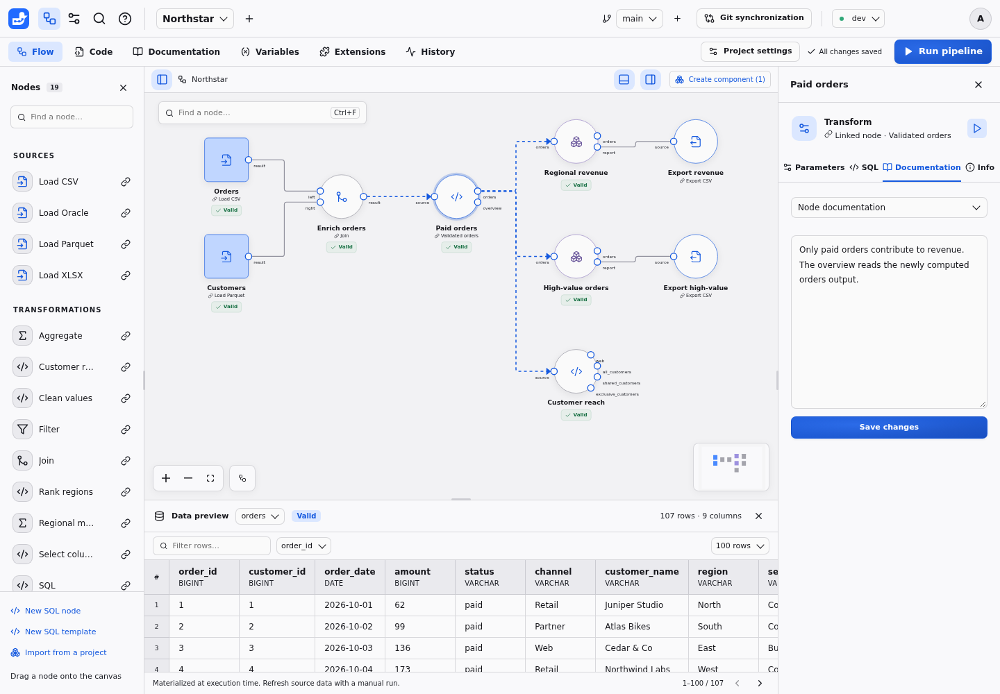

# Document a project

Keep explanations next to the pipeline, from a project overview down to a
single output column. Documentation is versioned with the project.

Business documentation is separate from SQL and covers the project, node instances, outputs and columns. Describe a node in the inspector's **Documentation** tab, and its outputs and columns in the **Columns** tab of the [results panel](RESULTS.md), where the columns are visible. Grouping preserves the documented instance paths; imports carry component documentation. Successfully confirmed schema removals prune missing column documentation in a versioned save. Renames start undocumented. Invalid SQL, failed runs and backend restarts do not imply deletion.

Create a working branch to compare a change. Branches have isolated worktrees and memory contexts, and use the same instance connections. **Compare & merge** performs three-way merging and validates the graph/interfaces before acceptance. Git history can open a chosen revision in a new working branch. Recompute manually there to explore its code against current resources and connection settings.

Write the project overview in **Documentation**; it edits `README.md`, also
available in **Code**. See [project files](AUTHORING.md#project-layout-and-python-dependencies)
for exports and [version control](GIT.md) for branch reviews.
