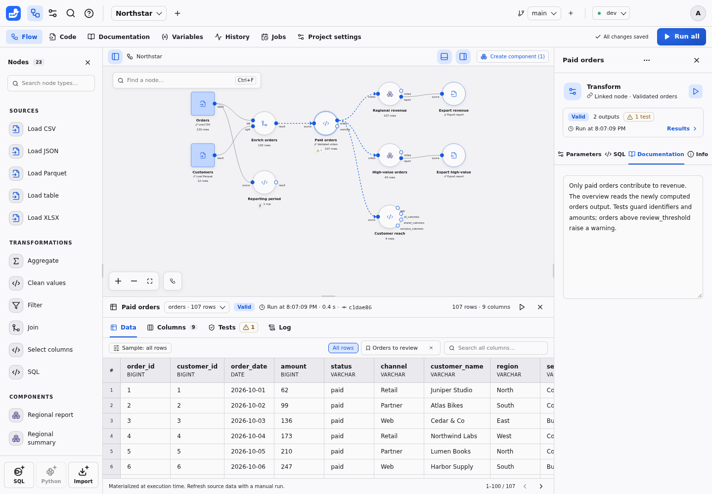

# Document a project

Write the project overview in **Documentation**. It edits `README.md`, also
available in **Code**. Switch between **Edit** and **Markdown preview** to see
formatted headings, lists, links and tables without losing the draft.
The full-width editor includes buttons for headings, bold, italic, links, lists,
quotes and code blocks. Select text before applying a format, or insert a
placeholder at the cursor. Use Ctrl/Cmd+B or Ctrl/Cmd+I for bold and italic.
**Save changes** is available in both edit and preview mode. Documentation is
versioned with the project.

The **Generated project reference** below the overview is read only. Expand a node
to see its outputs, descriptions, columns, types and tests. Columns come from the
latest retained results in the current environment, or from documented columns
before a run. Stale schemas are marked; run an output to discover its schema.
Python checks appear after they have executed.

Describe a node in the inspector's **Documentation** tab. Edit output and column
descriptions in **Results → Columns**, alongside the schema. These descriptions
live in `documentation.json`; component imports carry them to the destination.

A confirmed schema removal deletes the missing column's description in a
versioned save. Renamed columns start undocumented. Invalid SQL, failed runs
and backend restarts do not delete descriptions. Earlier versions remain in
[Git history](GIT.md).
