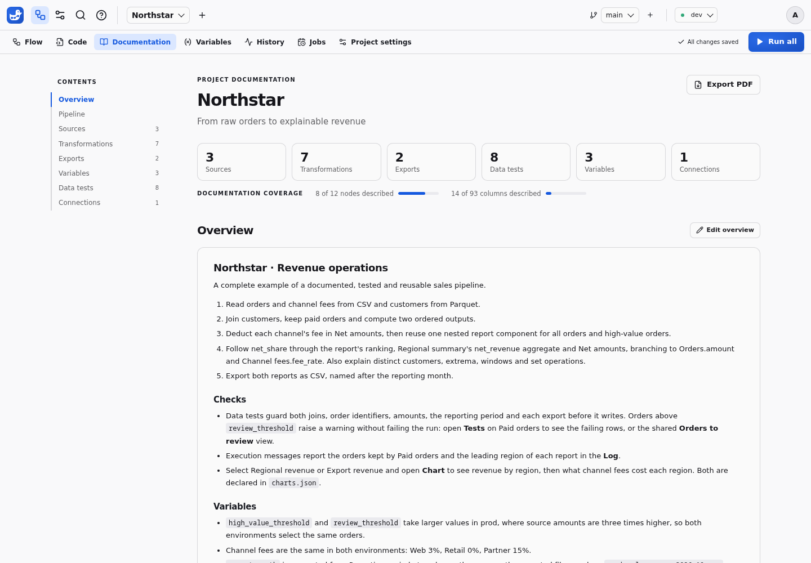
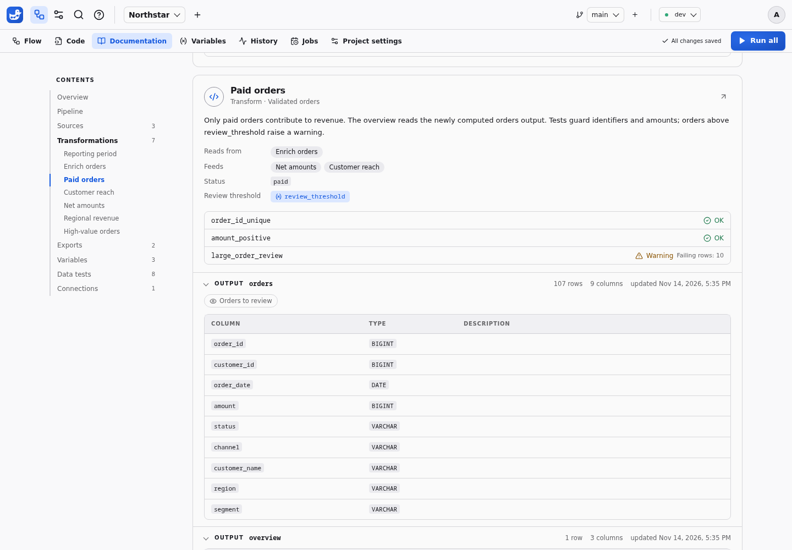

# Document a project

**Documentation** presents the project as one document. Duckpad generates it
from the project files and the latest results in the current environment, so it
stays current without extra work:

- the project name, its description and its key figures;
- the **Overview**, written by you in `README.md`;
- a drawing of the **Pipeline**: select a node to jump to its section;
- **Sources**, **Transformations** and **Exports**, in execution order. Each
  node shows its description, the nodes it reads from and feeds, the parameters
  it sets, its data tests with their latest result, and its outputs with their
  rows, columns, types, descriptions, charts and shared views. A component
  lists the nodes it contains, with the values it gives them;
- reference tables of **Variables**, **Data tests** and **Connections**.

The **Contents** outline follows your reading position. **Open in Flow** on a
node shows it on the canvas.

## Write the overview

Select **Edit overview** to write `README.md`, also available in **Code**. The
editor includes buttons for headings, bold, italic, links, lists, quotes and
code blocks. Select text before applying a format, or insert a placeholder at
the cursor. Use Ctrl/Cmd+B or Ctrl/Cmd+I for bold and italic. **Save changes**
commits the text. **Done** returns to the rendered overview, where unsaved
changes can still be saved. Documentation is versioned with the project.

## Describe nodes, outputs and columns

Describe a node in the inspector's **Documentation** tab. Edit output and column
descriptions in **Results → Columns**, alongside the schema. These descriptions
live in `documentation.json`; component imports carry them to the destination.
A node without a description shows the one of its template or component.

Columns come from the latest retained results in the current environment, or
from documented columns before a run. Stale schemas are marked; run an output to
discover its schema. Python checks appear after they have executed.

**Documentation coverage**, shown to editors, counts the nodes and columns that
have a description of their own.

A confirmed schema removal deletes the missing column's description in a
versioned save. Renamed columns start undocumented. Invalid SQL, failed runs
and backend restarts do not delete descriptions. Earlier versions remain in
[Git history](GIT.md).

## Export as PDF

**Export PDF** opens the browser's print dialog with a layout made for paper:
choose **Save as PDF** as the destination. The PDF holds the whole document,
with every section unfolded and working links between sections. Its first page
states the branch, commit, environment and date; each page carries the project
name and its number. It prints on white in both themes, and printing the tab
from the browser menu gives the same result. Readers can export too.
