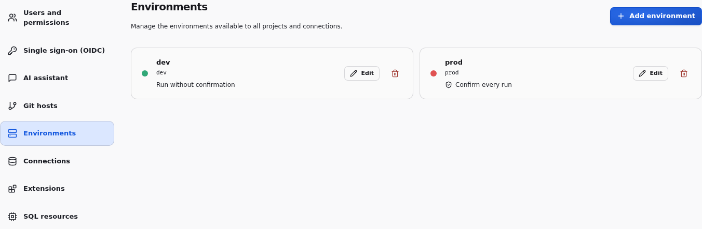

# Environments

Run the same project against different connection settings and variable values.
The environment selector in the top bar chooses the execution context; switching
it never launches a run. Results are separate for each branch and environment.

Instance admins manage environments in **Instance settings → Environments**.
Each has a stable identifier, an editable label, a color, and a **Confirm every
run** option. Fresh instances include `dev` without confirmation and `prod` with
confirmation enabled.
Labels and colors appear in the workspace selector and connection settings.
Changing them does not change project Git history or invalidate results.

New environments start with empty connection values. Configure them in
**Connections** before running. Deleting an environment requires confirmation,
removes its connection values and clears cached results, but preserves execution
history. Active runs must finish or be stopped first. At least one environment
must remain.

The confirmation option applies to workspace pipeline and node launches. The
dialog identifies the environment, project, branch and execution target;
canceling it starts nothing. The server also checks the current option on every
`entry_point: "ui"` launch and requires `confirmed: true` when enabled.
Programmatic API launches remain non-interactive. This is an execution safeguard,
not a replacement for project permissions.

Administrators can create an environment with `POST /api/environments`
(`id`, `label`, `color` as a six-digit hex color, `confirm_before_run` as a boolean),
edit its settings with `PUT /api/environments/{id}`, or delete it with
`DELETE /api/environments/{id}`. `/api/workspace` exposes `catalog.environment_details`
alongside the identifier list.

[Project variables](VARIABLES.md) can override business values per environment.
[Connections](CONNECTORS.md) hold resource settings and credentials outside Git.
