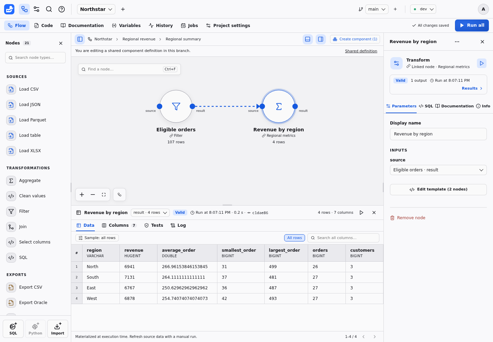
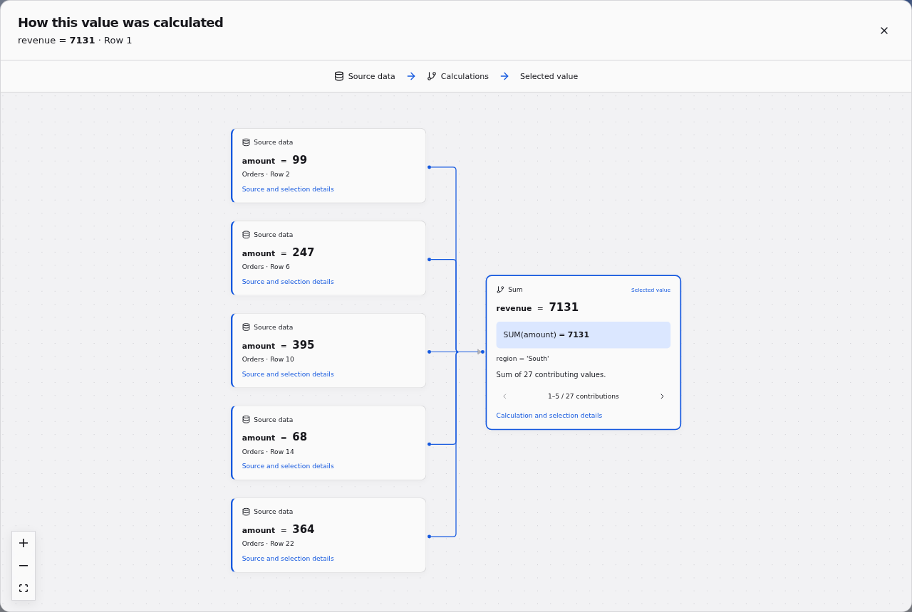
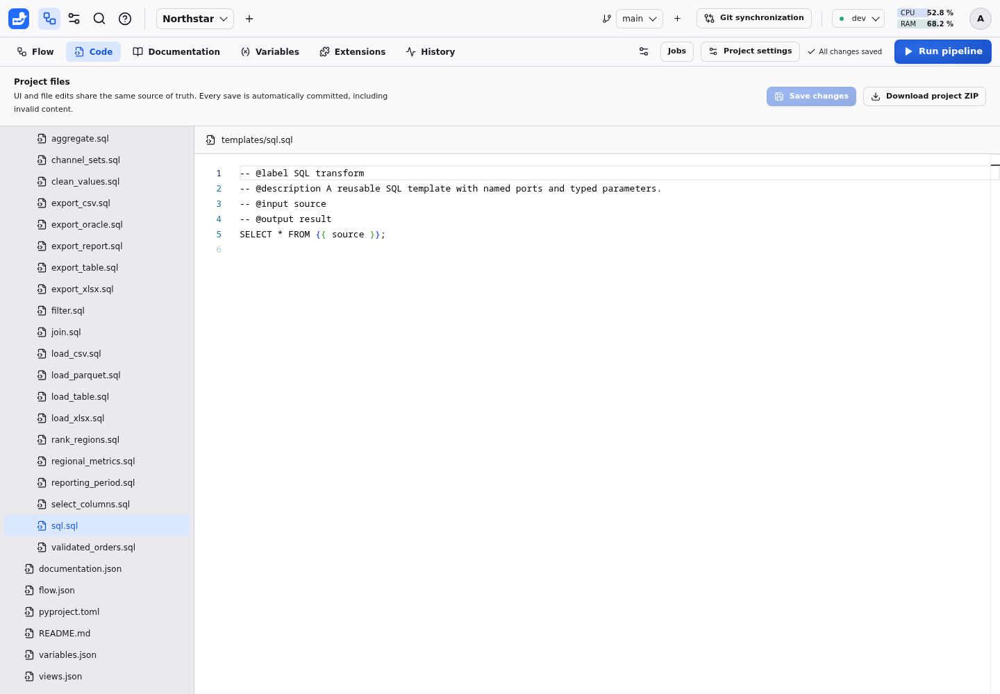

# Northstar example tour

Choose **New project** on the Projects page or beside the active project selector. Enter your project name, then choose **Start from an example → Create**. This creates an independent copy of Northstar under your chosen name, even when other projects already exist. It creates its own local inputs and a connection named Northstar; no credentials or external database are needed. The **Open example project** shortcut is also available when the project list is empty.

New to Duckpad? Follow the [quickstart](QUICKSTART.md) to install it and run your
first pipeline. The website version of this guide includes a captioned recording
of the steps below, regenerated from the application with Playwright.

## Explore the pipeline

1. Run the pipeline in `dev`. Reporting period, marked **ƒ**, runs first: the computed `report_month` variable reads its month before the other nodes run. Orders reads 120 CSV rows and Customers reads 12 Parquet rows. Enrich orders performs a customer join; its `every_order_matched` test fails the node if an order has no customer.
2. Select Paid orders. Its `orders` output contains paid rows, while `overview` reads that newly calculated output in a second SQL block. Switch outputs in the results panel, or show its `source` input to compare the rows before the filter.
3. Open Regional revenue. It is an instance of the shared Regional report component. The High-value orders node uses the same definition with a different exposed filter condition. The **Chart** tab of Regional revenue plots revenue by region, the leading region first, from the chart declared in `charts.json` (see [charts](CHARTS.md)). Hover a point to see its values.
4. Double-click Regional summary inside the report. This second component contains a filter and metrics for `SUM`, `AVG`, `MIN`, `MAX`, `COUNT` and `COUNT(DISTINCT customer_id)`.
5. Return to the report. Rank regions uses a window function over the grouped result. Inspect its current and executed SQL separately.
6. Select Customer reach. Its four ordered outputs use `DISTINCT`, `UNION`, `INTERSECT` and `EXCEPT` to compare customer channels.
7. The two export nodes share the Export report template, whose `report_not_empty` test runs before the write. Their destinations reference `{{ var.report_month }}`, so they write `regional-revenue-2026-10.csv` and `high-value-orders-2026-10.csv`. The resolved paths appear in compiled SQL and run history. Running again replaces the same local files according to native `COPY` behavior.

## Check the data

The run succeeds with one warning, shown as a badge on Paid orders. Select it and
open **Results → Tests**: `order_id_unique` and `amount_positive` pass, while the
`large_order_review` warning counts the 10 orders above `review_threshold`.
**Show the 10 failing rows** lists them. Above the data, the shared **Orders to
review** view shows the same rows with the filter `amount > {{ var.review_threshold }}`.

The **Log** tab adds the message “107 paid orders kept, 13 excluded”. Inside both
reports, Rank regions reports the leading region and its share of revenue. Read
[data tests](TESTS.md), [execution messages](MESSAGES.md) and
[shared views](RESULTS.md#data-and-samples) to write your own.

## Use variables

Open **Variables**. `high_value_threshold` feeds the High-value orders condition
`amount >= {{ var.high_value_threshold }}`, and `review_threshold` is bound to the
review threshold of Paid orders. Both take larger values in `prod`, where source
amounts are three times higher, so both environments select the same orders.
`report_month` is computed from Reporting period at each run; **History →
Variables** shows the run that produced it. See [project variables](VARIABLES.md).

## Explain a value

Select Regional revenue and its `report` output. Click a revenue cell. The calculation modal connects source amounts directly to the aggregate, collapsing the rank projection and other steps that merely carry the value forward. Use Next to display another five inputs; the exact total covers all contributions, regardless of the preview row limit.

For a distinct customer count, value-group cards show the count of original rows. Open a group to see its source cells. Repeated purchases remain separate cells. For a maximum, all tied extrema are shown; calculation details expose the full examined group as row-selection context.

Write project and node descriptions in their **Documentation** tabs; edit
dataset and column descriptions in **Results → Columns**.

## Inspect the SQL

Open the **Code** tab and select `templates/sql.sql` in the project file tree.
The editor gives you access to the SQL and structured files behind the canvas.
Edits to a shared definition affect its instances in the current branch; use an
isolated working branch when experimenting.

## Compare configurations

- Change `high_value_threshold`, or the exposed condition on High-value orders. Its results become stale; the separate Regional revenue instance retains its own parameters. Run manually to publish replacements.
- Switch to `prod`. No computation or commit occurs. Run manually to use the separate source directory; production fixture amounts are three times their development values, and so are the prod values of both thresholds.
- Move a node or edit its business documentation. The change is committed without invalidating results.
- Create a branch, edit a shared template/component, run and compare, then merge explicitly. The main branch changes only after the merge.
- Create a second project and import Regional report from the shared library. The nested definitions are local independent copies. Connect a compatible orders input and run it.
- Introduce invalid SQL in a branch. It is still committed; the old preview remains stale and lineage is disabled. Correct the SQL and run again.
- Stop a running query or restart the backend. History remains inspectable; a restart clears materialized previews and does not replay exports.

Oracle and S3 require environment-specific setup, so their end-to-end demonstrations are separate reproducible integration scripts described in [Connector setup](CONNECTORS.md).
