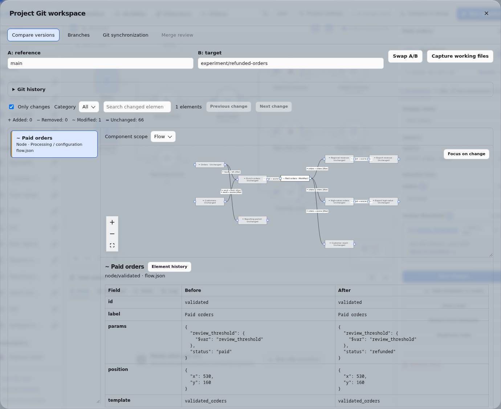
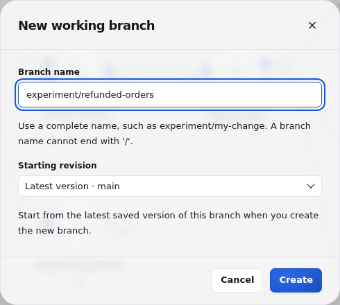
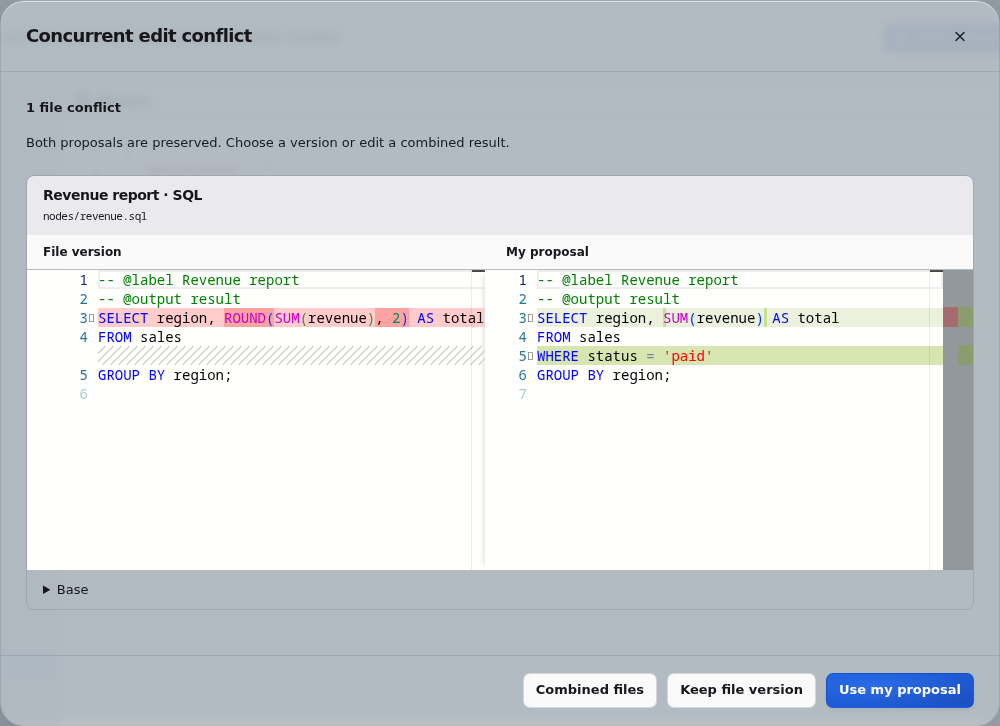

# Project Git history and synchronization

Duckpad versions project definitions automatically. Git synchronization applies to
each project managed inside Duckpad. Results, uploaded source data, connection
credentials, exports and databases remain outside its declarative repository.

## Commit authors

Project creation, saves, imports, conflict resolutions and reviewed merges record
both the Git author and committer from the authenticated account.

Local accounts use their username and a stable technical address,
`<account-id>@users.duckpad.invalid`. SSO accounts use the name (or preferred
username) and verified email from the validated ID token, refreshed on sign-in.
If those claims are missing or invalid, Duckpad falls back to the account's
username and technical address. Provider claims never change account linkage,
which still uses issuer and subject. Git author information is part of the project
history and travels with it when pushed to a remote.

File edits outside Duckpad have no authenticated actor. The watcher and any
pending external edits finalized before a save or run use
`Duckpad external changes <external@duckpad.invalid>`, rather than attributing
them to whichever account happened to make the next request.

## Tags

Tags mark the exact version that passed acceptance testing. Editors and project
admins can select **Create tag** beside any commit in **History → Git history**;
use **Load more** to reach older commits. In an execution's details, **Tag this
run's commit** selects the commit recorded by that run, even if the branch has
changed since it ran. Creating a tag does not save working files or start a run.

Enter a Git tag name, such as `sales/2026.10.31` or `v1.4`, and acceptance notes.
Duckpad creates an annotated tag with the authenticated user's commit identity
as tagger. The commit must be reachable from a project branch, a fetched origin
branch or an existing tag. An unknown or unreachable commit is refused. An
existing tag name returns a conflict (409), as does a name nested with an
existing tag: Git cannot store both `v1` and `v1/rc`. Tags cannot be moved or
deleted in Duckpad; create a new tag to correct a version.

History displays tags beside their commits. Readers can inspect them too. The
internal `GET /api/worktrees/{worktree}/git/tags` route lists all tags in the
worktree's project, across branches, with `name`, `ref`, `commit`, `message`,
`tagger` (name and email) and `date`. Editors create an annotated tag through
`POST` to the same route with `name`, the full `commit` ID and `message`.

**Compare versions** suggests tags for either side, using their explicit
`refs/tags/<name>` references to avoid ambiguity with branch names. The advanced
starting revision in **New working branch** also accepts tags. Tags stay local:
fetch still retrieves only origin branches, and publication still pushes only
the reviewed branch commit.

## Compare versions

Open **Compare versions** in History, or the synchronization status beside the
branch selector when a remote is connected. Choose **A: reference** and
**B: target** from local branches, fetched remote branches, tags, commit IDs or
**Working files**. The resolved commits, author and date appear below each
selection. **Swap A/B** reverses the comparison.

Working files are captured once. **Capture working files** takes a new snapshot;
retrying the same comparison retains the existing capture and resolved commits.
Captures are bounded in memory and expire on server restart. Select Working files
again if an old capture has expired. Selections and filters are remembered per
worktree for the browser session.

The comparison workspace includes a resizable element list, read-only graph and
before/after inspector. Added (`+`), removed (`−`), modified (`~`) and unchanged
(`=`) elements remain distinguishable without color. Deleted nodes and connections
are inspectable. Modified elements show only changed fields, including individual
parameters. Unchanged fields and code remain under **Full definition**; changed
SQL uses Monaco's read-only diff editor. Component definitions, boundary ports,
exposed parameters, node parameters, project variables and documentation have
their own logical entries, identified by stable IDs and component paths. A
variable lists the root flow parameters bound to it.

Use **Only changes**, category filters, search, previous/next and **Focus on
change** to navigate. Processing/configuration, documentation/names and canvas
layout are separate categories. A layout change alone claims no processing impact.

**Potential impact** follows dependencies in both versions, including expanded
nested instance paths and before/after wiring. A changed variable value, in any
environment, affects the nodes bound to it; a renamed variable or a new
description affects none. This is partial, static analysis:
it does not resolve runtime schemas or prove that result values changed. Invalid
or unsupported definitions are reported as partial. Comparing never runs SQL,
reads source data, publishes outputs, switches branches or flushes external edits.

Expand Git history to load older pages. **Element history**, also opened by
**View change history** in the node inspector's **Info** tab, filters by a node,
template or component ID. **Compare with
parent** uses the actual first Git parent; merge commits also offer their other
parents. A root commit compares with an empty tree.

## Branches and reviewed merges

The Branches view lists local and fetched remote identity, head and worktree state.
Create a branch from a chosen commit or branch, or open an existing local branch
in its isolated worktree. Opening it preserves the other worktrees.

In **New working branch**, enter a complete name such as `experiment/my-change`.
Git does not allow names ending in `/`, so `experiment/` alone is incomplete.
An invalid name leaves the form open with an explanation so you can correct it.

The starting revision defaults to the latest saved version of the current branch.
Select **Choose an earlier version** to browse its history by commit message,
author, date, and short commit ID. Search the loaded versions or use **Load more**
to reach older history. The selected version remains visible when filtering, and
the new branch starts at that exact commit. Opening a revision from the History
page preselects it. **Enter a Git reference (advanced)** also accepts an existing
branch name, tag, or commit.

Results belong to each worktree. A new working branch shows **No results on this
branch**, its node count, and **Run all** until execution starts. Results from the
source branch are not copied.

**Compare & merge** opens a review directly into the branch from which the working
branch was created. That origin is recorded locally when creating a branch;
branches without a recorded origin target main. If the origin is no longer open,
use **Branches** to open it or choose another destination. The Branches tab also
supports explicit source/destination selection and **Review merge**.

The review keeps the common base and exact heads under **Details**. Conflicts use
node or component names with the file path underneath. For every conflicting field,
inspect base/current/incoming values and choose one. Changed characters are
highlighted: additions are underlined and removed base characters are struck
through. File conflicts use a syntax-highlighted diff. A conflict in
`variables.json` names its variable and field, such as **Variable order_status ·
prod value**, so each variable is resolved on its own. Each choice recomputes
the proposed changes and validates the combined definitions, references, ports and
graph. Correct invalid definitions on their branch and start a fresh review.

**Apply reviewed merge** requires all conflicts and validation errors to be
resolved. The server rejects changed heads (including same-content commits),
pending external saves, changed fetched state and changed remote configuration.
It never implicitly saves dirty work to make a review succeed. Cancelled or
rejected reviews leave local work intact. Successful integration retains both
parents when the source was not already integrated. Execution remains a separate
manual action; applying never pushes.

After integration, an optional cleanup action removes an integrated source branch
and its worktree. Main, the currently open worktree, the destination, dirty work,
untracked files, active executions and unmerged commits are protected. Cleanup
is explicit; no branch is deleted automatically.

### Data impact

For modified nodes with current, complete results on both local branches,
**Data impact** lists output row counts and column additions, removals and type
changes in the selected environment. **Calculate row changes** reads those stored
outputs only when requested. It compares the destination's output with the source
branch's output; it does not predict the unexecuted merge proposal or run SQL nodes.

Without a comparison key, the diff counts whole rows, including duplicates, as
additions and removals. Select a common, unique, non-null column to distinguish
modified rows from added or deleted keys. Row comparisons use common columns of
matching types and support up to 50,000 rows per output. Column changes remain
available for larger outputs or changed types. Stale, incomplete, partitioned and
remote-only outputs are excluded. Results replaced since the section loaded are
rejected; reload the section before calculating again.

### Concurrent saves

If another tab or user saves incompatible edits, select **Save resolution**.
The dialog summarizes the conflicts and shows only the affected files and fields.
File diffs compare **File version**, the saved file, with **My proposal**, side
by side or inline in a narrow window. Expand **Base** to see the original
content. Field conflicts use the same character highlighting as merge reviews.

Choose **Keep file version**, **Use my proposal**, or **Combined files**. In
**Combined files**, edit the right side of each file diff or the **Combined
value** for an individual field. The initial result uses your proposal for
conflicts and retains independent edits from both versions. Strings accept plain
text; other field values accept JSON. A deletion conflict also offers a checkbox
to keep or remove that content; content your proposal deleted is kept from the
file version. **Save changes** saves the combined result.
If the saved files changed again, review the refreshed evidence before retrying.

## Origin, fetch, pull and push

A project administrator opens **Project settings → General → Connect or configure
a Git repository** to configure one **origin** and an explicit mapping from
the current local branch to its remote branch. Origin is shared across worktrees;
each branch has its own mapping. Settings live in instance metadata and Git's
shared configuration, outside versioned project files. Disconnecting origin keeps
local work and commits. External edits to origin's URL require reviewing and
saving its configuration again in Duckpad.

Use SSH (`git@example.com:team/project.git` or
`ssh://git@example.com/team/project.git`) or HTTPS without credentials (for example
`https://example.com/team/project.git`). Passwords, tokens, URL query strings,
`.` or `..` path segments and unsupported transports are rejected, and the origin
must be allowed by the instance's [Git hosts](#network-credentials). Authentication
errors never echo raw Git output. Each network operation has a 30-second limit.

Without a remote, no synchronization button appears in the top bar. With a remote,
one status button shows incoming and outgoing commit counts, such as **↓2 ↑1**, and
opens the **Pull / Push** actions. Commit IDs, manual Fetch and reload controls,
and synchronization explanations are under **Details**.

1. **Fetch**, including the fetch performed by Pull and Push, updates
   remote-tracking references and the last successful check. It
   does not change local branches or project files. The status distinguishes an
   unverified remote, up-to-date/ahead/behind/diverged branches, a first publication,
   a deleted remote branch and unrelated histories.
2. **Pull** fetches current remote knowledge and opens the same semantic review as
   a local merge. Unrelated or invalid incoming definitions cannot be adopted.
3. **Push** fetches current remote knowledge and shows the definitions that the
   local commit would publish. **Publish reviewed commit** publishes that exact commit to the
   displayed branch. The fetched remote head must be its ancestor. An exact-head
   lease rejects a remote race, including an update between inspection and push.
   This lease never authorizes a non-fast-forward replacement. Fetch and integrate
   incoming commits before retrying a divergence. Recreating a deleted remote
   branch requires an explicit checkbox.

Publication and adoption validate the complete reachable history for allowed
declarative files, regular file modes and the project `.gitignore`. A deleted
non-project file still exists in history and therefore blocks synchronization.
Repositories with more than 10,000 reachable commits require a smaller project
repository. These checks do not inspect data sources or run project SQL.

Readers can inspect authorized comparisons, history and synchronization state.
Project editors can create/open branches, fetch, review/apply integration, publish
and clean up integrated work; they fetch and publish with their own SSH key. Configuring/disconnecting origin or changing its
mapping requires project administrator access. Instance administrators retain their
existing access to projects. All permissions are checked by the server.

## Network credentials

Network Git never uses the credentials of the server account. Fetch, `ls-remote`
and push run with the SSH key of the account that triggers them for SSH origins,
and without any credentials for HTTPS origins, which therefore reach only public
repositories.

**Account SSH keys.** Every account, local or SSO, can generate an ed25519 key pair
in **User settings → SSH key for Git**. Duckpad shows only the public key and its
SHA256 fingerprint: add the public key to your account on the Git host, such as
Bitbucket, GitHub or GitLab. The private key is stored in the instance database
like connection secrets; the API never returns it and Duckpad never logs it.
**Regenerate key** replaces the pair, so the previous key stops working at once,
and **Delete key** removes it. Deactivating an account deletes its key, and a
reactivated account must generate a new one. Duckpad does not import personal
private keys. Without a key, fetching or publishing over SSH reports an error that
links to User settings.

Git and SSH run in an isolated environment, without the server account's keys,
agent, credential helpers or global configuration. Temporary private-key copies
use mode 0600 and are removed after use or at startup following a crash.

**Trusted Git hosts.** In **Instance settings → Git hosts**, instance administrators
list trusted SSH host keys in `known_hosts` format, one `host key-type key` line per
key. Write `[host]:port` for a port other than 22; wildcards, hashed host names and
markers are not supported. Get the keys with `ssh-keyscan` or from your provider,
and compare their fingerprints with the ones that it publishes. Optional allowed
origin prefixes end with `/` or `:`, for example `git@bitbucket.org:my-workspace/`.
An origin is allowed when:

- for SSH, its host and port have a trusted key and, if prefixes exist, the URL
  starts with one of them;
- for HTTPS, the URL starts with an allowed prefix. HTTPS always needs one.

Duckpad refuses to save an origin outside these rules, and refuses to fetch or
publish when the saved origin is no longer allowed.

**Consent bound to the URL.** Before the first use of their key for a project's
origin, and again after every origin change, a user confirms the exact URL that
Duckpad displays. The consent records the account, the project and the URL.
Without it, fetch and push are refused with a 409 response whose
`detail.consent_required.url` lets the interface ask for confirmation. Changing
the origin forgets every consent of the project, even when an earlier URL comes
back. A project administrator therefore cannot point origin to an editor's private
repository and read it through the editor's key without the editor seeing the URL.

Roles are unchanged: project administrators configure origin; editors fetch,
review and publish. Keys, trusted hosts and consents are instance metadata,
outside project files. Per-project read-only deploy keys for automation and
per-user HTTPS tokens are not supported yet. On Bitbucket Cloud, repository access
keys are read-only, so publishing requires the user's key on their own account.

## Automatic commit subjects

Subjects are derived from the actual saved semantic changes. They use English
Conventional Commits: `feat` for processing changes, `docs` for descriptions/names,
`style(canvas)` for movement, and `chore(merge)` for integration. A parameter edit
does not claim to fix a bug. Imports and conflict resolution retain their context;
external batches are marked `[external]`.

Single-element subjects identify the action and readable name. Multi-element
saves report accurate counts and include a bounded body of affected elements,
fields and categories. Parameter values and SQL statements are omitted. Existing
history is not rewritten, no-op saves add no commit, and ordinary edits still
require no commit dialog.
