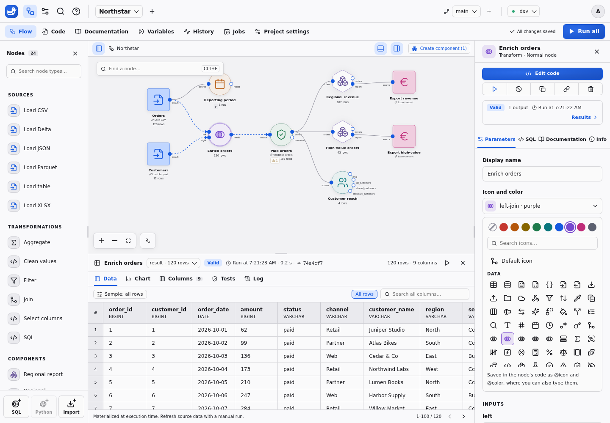
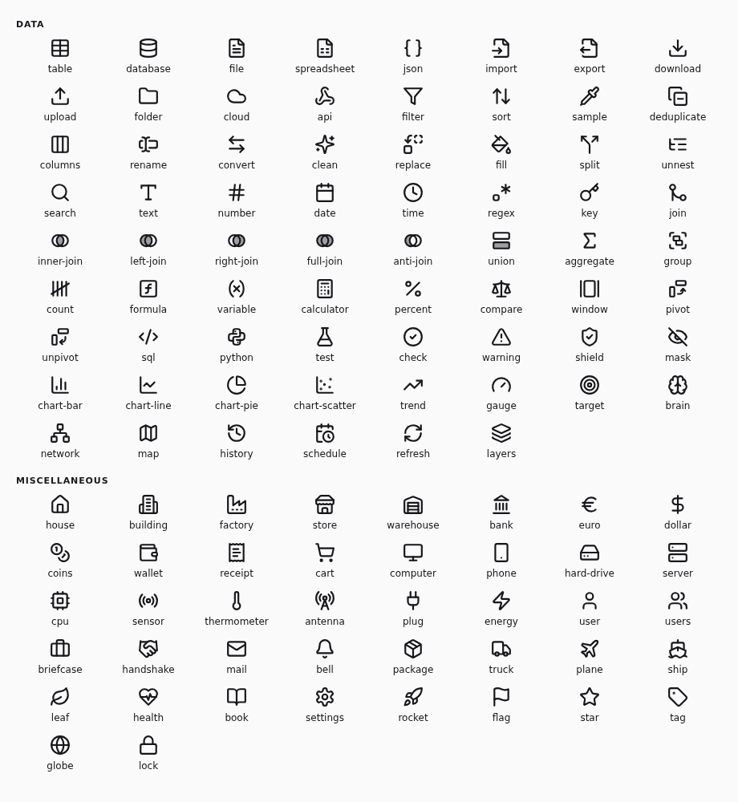

# Node icons and colors

Give a node an icon and a color so that a flow reads at a glance: the sources of
one system in the same color, a funnel on every filter, a euro sign on the
financial exports. Both are optional and only change how the node looks. They
never change what it computes: results stay **Valid**, and a
[Git comparison](GIT.md) lists the change as documentation.



## Choose in the inspector

Select a node and open **Icon and color** in the **Parameters** tab. Pick one of
the nine colors and one of the icons; search the icons by name or by another
word for them, such as `home` for `house`. **Default icon** and **Default
color** return to the look of the node's kind. Each choice is saved right away,
and **Undo** reverts it like any other edit.

The choice is saved in the node's code, as the two directives below. A linked
node saves it in its shared template, so every node linked to that template
changes, and so does its palette entry. A component instance keeps the
component look.

## Declare in code

In SQL, write each directive on its own line, like `-- @label`:

```sql
-- @label Paid orders
-- @icon filter
-- @color green
-- @input source
-- @output result
SELECT * FROM {{ source }} WHERE status = 'paid';
```

In Python, write them as comments, like `# @label`:

```python
# @label Score customers
# @icon brain
# @color purple
import duckpad as dp

class Score(dp.Node):
    def run(self, customers: dp.Relation) -> dp.Relation:
        return customers
```

A template that declares them shows its icon and its color in the palette, and
on every node created from it.

After `@icon` or `@color`, the code editor suggests the names, each with a
preview of its icon or its tone; hover a name to see it again. Names ignore
case. A name Duckpad does not know is underlined, with a quick fix (Ctrl+.)
for the closest one; the node then keeps its default look, and nothing
prevents it from running.

## Colors

`red`, `orange`, `yellow`, `green`, `teal`, `blue`, `purple`, `pink` and
`gray`. Each has a tone for the light theme and one for the dark theme. The
color tints the icon and the shape of the node, its selection ring, its run
progress and its mark on the minimap. Status badges, ports and links keep their
own colors, so a red node is not a failed node.

## Icons



### Data

| Name | Also found by |
| --- | --- |
| `table` | dataset, relation, grid |
| `database` | db, warehouse, storage |
| `file` | document, text |
| `spreadsheet` | excel, csv, xlsx, sheet |
| `json` | object, document, nested |
| `import` | load, read, source, input |
| `export` | write, output, destination |
| `download` | pull, fetch, extract |
| `upload` | push, publish, send |
| `folder` | directory, files |
| `cloud` | bucket, object, storage, remote |
| `api` | http, rest, webhook, service |
| `filter` | where, funnel, condition |
| `sort` | order, rank |
| `sample` | extract, subset, limit |
| `deduplicate` | distinct, unique, duplicates |
| `columns` | select, fields, projection |
| `rename` | alias, name |
| `convert` | cast, type, map |
| `clean` | tidy, quality, prepare |
| `replace` | substitute, values |
| `fill` | nulls, default, coalesce, impute |
| `split` | branch, route, separate |
| `unnest` | explode, flatten, nested, hierarchy |
| `search` | find, lookup, match |
| `text` | string, varchar, characters |
| `number` | numeric, integer, identifier |
| `date` | day, month, year |
| `time` | timestamp, hour, duration |
| `regex` | pattern, extract, match |
| `key` | primary, identifier, secret |
| `join` | merge, combine, lookup |
| `inner-join` | intersect, matching, both |
| `left-join` | outer, lookup, enrich |
| `right-join` | outer |
| `full-join` | outer, all |
| `anti-join` | except, missing, not, exists, difference |
| `union` | append, concatenate, stack, rows |
| `aggregate` | sum, total, measures |
| `group` | group, by, cluster, bucket |
| `count` | tally, total, number |
| `formula` | function, expression, calculation |
| `variable` | parameter, value |
| `calculator` | compute, math, arithmetic |
| `percent` | ratio, share, rate |
| `compare` | balance, difference, reconcile |
| `window` | rolling, moving, over, partition |
| `pivot` | crosstab, wide, reshape |
| `unpivot` | melt, long, reshape |
| `sql` | code, query |
| `python` | code, script |
| `test` | check, experiment, assert, quality |
| `check` | valid, approve, done |
| `warning` | alert, anomaly, error |
| `shield` | security, protect, compliance |
| `mask` | anonymize, hide, privacy |
| `chart-bar` | histogram, report |
| `chart-line` | time, series, curve |
| `chart-pie` | share, breakdown |
| `chart-scatter` | correlation, points |
| `trend` | growth, forecast, increase |
| `gauge` | indicator, metric, speed |
| `target` | goal, objective, score |
| `brain` | model, machine, learning, predict |
| `network` | graph, hierarchy, tree, relations |
| `map` | geography, spatial, location |
| `history` | snapshot, versions, past |
| `schedule` | planned, recurring, job |
| `refresh` | incremental, update, sync |
| `layers` | staging, stack, levels |

### Miscellaneous

| Name | Also found by |
| --- | --- |
| `house` | home, housing |
| `building` | office, company |
| `factory` | plant, industry, production |
| `store` | shop, retail |
| `warehouse` | stock, logistics, inventory |
| `bank` | institution, finance, government |
| `euro` | currency, money, price |
| `dollar` | currency, money, price |
| `coins` | money, cash, revenue |
| `wallet` | budget, payment |
| `receipt` | invoice, bill, ticket |
| `cart` | orders, sales, basket |
| `computer` | desktop, screen |
| `phone` | mobile, device |
| `hard-drive` | disk, storage |
| `server` | host, machine, rack |
| `cpu` | processor, chip, compute |
| `sensor` | probe, signal, measure |
| `thermometer` | temperature, weather |
| `antenna` | telecom, broadcast |
| `plug` | connector, socket |
| `energy` | power, electricity, lightning |
| `user` | person, customer |
| `users` | team, customers, people |
| `briefcase` | business, job, work |
| `handshake` | deal, partner, contract |
| `mail` | email, message |
| `bell` | notification, alert |
| `package` | parcel, product, box |
| `truck` | delivery, shipping, logistics |
| `plane` | flight, travel |
| `ship` | boat, freight, sea |
| `leaf` | environment, sustainability, nature |
| `health` | medical, heart, care |
| `book` | documentation, reference, library |
| `settings` | configuration, gear |
| `rocket` | launch, deploy, fast |
| `flag` | mark, milestone, country |
| `star` | favorite, rating, gold |
| `tag` | label, category |
| `globe` | world, web, international |
| `lock` | secure, private |

The built-in nodes use these names too: without `@icon`, a filter shows
`filter`, a join `join`, an aggregation `aggregate`, a source `import`, an
export `export`, a Python node `python` and any other SQL node `sql`.
