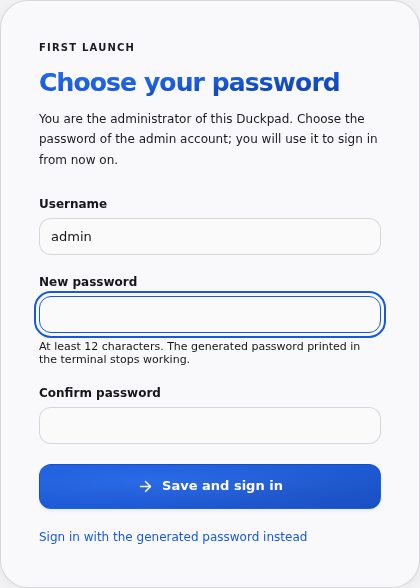
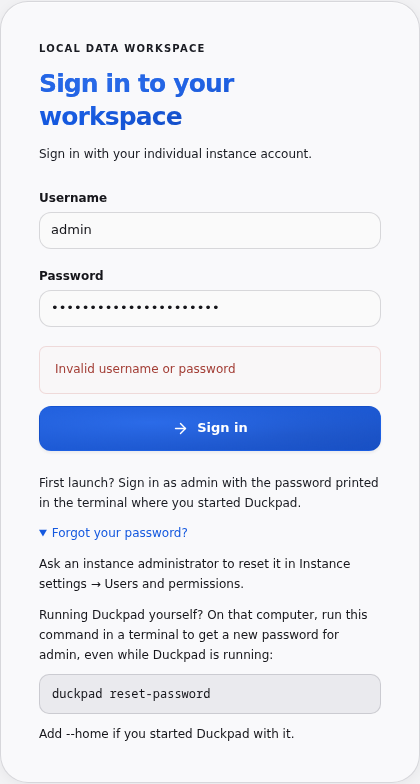
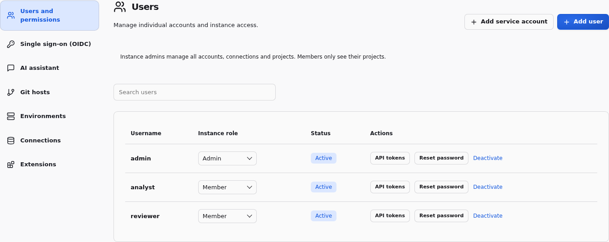
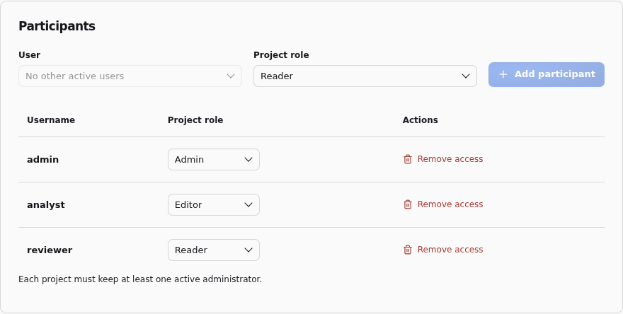

# Installation and accounts

If your team already runs Duckpad, open its address in your browser and ask an
administrator for an account and project access. You do not need to install
Python, Git or Duckpad on your own computer to use that server.

| I want to… | Read next |
| --- | --- |
| Run Duckpad myself | [Start](#start) and [platform requirements](#platform-requirements) |
| Upgrade or keep a backup | [Upgrades and backups](#upgrades-and-backups) |
| Add people or understand a missing action | [Accounts and project access](#accounts-and-project-access) |
| Host a shared instance | [Reverse proxy](#reverse-proxy), [secrets](#secrets-and-the-master-key) and [SQL resources](#sql-resources) |
| Change language or theme | [Workspace preferences](WORKSPACE.md#preferences-and-access) |
| Get back in after losing a password | [Reset a lost password](#reset-a-lost-password) |
| Fix a startup or sign-in error | [Troubleshooting](TROUBLESHOOTING.md#start-and-sign-in) |

## Start

You need **Python 3.11 or later** and **Git**. If you are not on Linux, read the
[platform requirements](#platform-requirements) first.

1. Open a terminal. Create and activate a virtual environment, so that Duckpad
   stays separate from the Python packages of your operating system. On Linux:

   ```sh
   python3 -m venv .venv
   source .venv/bin/activate
   ```

   In Windows PowerShell, run `python -m venv .venv`, then `.venv\Scripts\Activate.ps1`.

2. Install and start Duckpad:

   ```sh
   pip install duckpad
   duckpad start
   ```

3. Your browser opens Duckpad. On the first launch, choose the password of the
   administrator account, `admin`. You are signed in, and this is the password
   you will use from now on.

   

Keep the terminal open while you use Duckpad, and press **Ctrl+C**
there to stop it. Next time, activate the same virtual environment from the same
folder and run `duckpad start` again.

If no browser opens, for example over SSH, open the setup link printed in the
terminal. You can also sign in as `admin` with the generated password printed
below it. The link works once and stops working when Duckpad restarts; the
generated password stays valid until you choose your own. Lost your password?
[Reset it from the terminal](#reset-a-lost-password).

### Platform requirements

Python and Git must be on `PATH`. The default isolated SQL mode also requires **Linux with Landlock ABI 2 or later** (Linux 5.19+ with Landlock enabled); unsupported hosts refuse execution rather than automatically running without isolation. For a trusted Windows workstation, explicitly select [trusted local mode](#trusted-local-mode). Release wheels include the frontend, Monaco and its workers; Node.js is not needed to run the installed application.

The distribution is available on [PyPI](https://pypi.org/project/duckpad/).
Version tags also create a GitHub release with downloadable wheels. To install
a downloaded wheel, use `pip install <wheel-file>`. See the
[release guide](../docs/RELEASING.md) for publishing instructions.

### Instance directory and options

The default instance directory is `$XDG_DATA_HOME/duckpad`, or `~/.local/share/duckpad`. Authentication, connection settings and execution history are kept there, outside project repositories.

```sh
duckpad start --home /path/to/my-instance --port 8765 --no-browser
```

Only one backend may own an instance directory at a time. Use separate `--home` directories for independent instances. The default address is `127.0.0.1`.

For air-gapped deployments, [download extensions on any connected computer and
import them into Duckpad](OFFLINE_EXTENSIONS.md) before running connectors that
need them.

### Reset a lost password

An instance administrator resets other people's passwords in **Instance settings →
Users and permissions**. If you lost the administrator password, run this command
on the computer or container where Duckpad runs. It works while Duckpad is running:

```sh
duckpad reset-password
```

It prints a new generated password for `admin` and signs out that account's
sessions. Sign in with it, then choose your own in **User settings → Change
password**. To reset another local account, name it, and pass the `--home` used
with `duckpad start` if you chose one:

```sh
duckpad reset-password analyst --home /path/to/my-instance
```

In a container built from the repository's `Dockerfile`, run
`docker exec -it <container> duckpad reset-password --home /data/duckpad`.
Single sign-on and service accounts have no Duckpad password, and a deactivated
account must be reactivated first. The command needs access to the instance
directory, which already holds the instance's secrets.

After a failed attempt, the sign-in page shows these steps too:



## Upgrades and backups

Before upgrading, stop the server and keep a private backup of the entire
instance directory, including its project repositories and SQLite database.
Keep the master key too; if it is supplied externally, back it up separately.
Source data in external folders or databases needs its own backup. A project
ZIP excludes data, Git history, accounts, connection settings and run history.

Upgrade Duckpad in the same Python environment with `pip install --upgrade duckpad`,
then start it with the same `--home`. Read the
[release notes](https://github.com/hugues31/duckpad/releases) before changing
versions. To recover the old instance, use its backup with the Duckpad version
that created it.

Duckpad is in v0: a release may reset the storage schema without an upgrade
path. Startup then rejects the existing database without changing it. Keep the
old directory as a backup and start a fresh instance:

```sh
duckpad start --home /path/to/new-instance
```

The new instance creates a new administrator password. Reconfigure accounts and
connections, then import each project as a ZIP downloaded from the previous
version; its files must follow the current [file format](AUTHORING.md).
The old instance's execution history remains in its original database.

## Instance monitoring

Instance administrators can open **Instance settings → Monitoring** to inspect
the available space on the filesystem holding the instance directory, system
memory visible to the backend, backend resident memory, uptime and version.
The disk figure includes other applications on that filesystem; it does not
measure remote connections, separate project mounts or directory sizes. System
memory can reflect the host rather than a container's quota. Backend memory
excludes SQL worker processes. Unavailable counters are reported independently.
A warning appears when at most 10% of the data disk remains available.

Instance admins can monitor server CPU and RAM in the top bar. Click either
indicator for two minutes of history; samples refresh every two seconds. Values
are machine-wide and include other applications. In a container they follow what
its runtime exposes, usually the host rather than the container's limits. Missing
measurements appear as unavailable. History resets on reload or sign-out.

The same page shows recent Duckpad and Uvicorn logs, newest first, with minimum
severity and case-insensitive text filters. While the page is open, it refreshes
every 5 seconds by default; choose another interval or Manual next to the
Refresh button. Capture follows the server's configured log level. Successful
monitoring requests do not enter this history.

This first version keeps up to 1,000 entries in backend memory, truncates each
message to 4,000 characters, and returns up to 200 matches. Restarting clears
the history. It does not read arbitrary server files or capture stdout, the
initial admin password, reverse-proxy logs or historical container logs. Common
credential fields, authorization headers and URL credentials are masked before
retention, and access-log query strings and client addresses are omitted.
Application messages and exception traces may still contain sensitive data;
only instance administrators can access either monitoring endpoint. Use the
deployment's existing log collection for durable history and alerting.

Successful GET requests used for background polling (workspace, resources, worktree
snapshots, status, and generations) are logged at DEBUG. The default INFO level
still shows other requests, including failed polling requests. Use
`duckpad start --log-level debug` to include polling in the server logs.

Debug also logs complete tracebacks of assistant provider failures. Credentials
are masked, but these traces can contain prompts, responses and project data:
keep them private and use debug temporarily. See
[assistant troubleshooting](ASSISTANT.md#troubleshoot-provider-failures).

## Reverse proxy

Behind an HTTPS reverse proxy, set `DUCKPAD_SECURE_COOKIES=1` so the session cookie is only sent over HTTPS.

Sign-in attempts are limited per client address: 12 per minute. Duckpad reads the
client address from the proxy's `X-Forwarded-For` header only when the request comes
from an address listed in `FORWARDED_ALLOW_IPS` (by default, `127.0.0.1`). When the
proxy runs on another host or container, set `FORWARDED_ALLOW_IPS` to the proxy's
address, or a comma-separated list of addresses or networks:

```sh
FORWARDED_ALLOW_IPS=172.18.0.2 duckpad start --host 0.0.0.0 --no-browser
```

Without it, every user appears to come from the proxy and shares one limit, so 12
failed sign-ins within a minute block everyone's sign-in. List only proxies: a client
that can reach Duckpad directly from a trusted address can choose its reported address.
Duckpad prints a reminder at startup when it listens on a non-loopback address and
`FORWARDED_ALLOW_IPS` is not set.

File uploads are limited to 1 GiB per file. Allow request bodies of that size in the
proxy, for example with `client_max_body_size` in nginx. For larger files, an
instance admin can grant a local connection whose root contains them.

## Secrets and the master key

Duckpad encrypts the secrets it stores in `instance.sqlite` with AES-256-GCM:
secret connection parameters, the SSO client secret, assistant provider API keys
and account SSH private keys. A copy of the database alone reveals none of them,
and each value only decrypts in its own field. Passwords, sessions and API tokens
are stored as hashes.

The master key comes from the first of:

- `DUCKPAD_MASTER_KEY_FILE`, the path of a file holding the key, such as a Docker
  or Kubernetes secret;
- `DUCKPAD_MASTER_KEY`, the key itself. Duckpad reads it at startup and removes it
  from its environment, so Git and SQL workers never inherit it;
- `duckpad-master.key` in the instance directory, created with mode 0600 on the
  first start.

Generate a key with `openssl rand -base64 32`. With the default key file, a copy or
backup of the whole instance directory also contains the key. Keep it private, or
provide the key from outside the directory: Duckpad prints a reminder at startup
when it listens on a non-loopback address with the key in the instance directory.
Back the key up separately from the instance. Without it, the secrets are lost:
startup refuses an instance whose secrets were encrypted with a key that is not
provided, names that key's identifier, and never replaces a missing key file.

To rotate the key, put the new key on the first line of the key file and keep the
previous one on a later line, then restart. The first key encrypts; the others
only decrypt. At startup, Duckpad encrypts every secret again with the first key,
then rewrites the database file so that no deleted page keeps a previous value.
Remove the previous key after that restart. `DUCKPAD_MASTER_KEY` accepts several
keys separated by commas. The same startup pass encrypts the secrets of an
instance created before encryption.

Encryption protects copies of the database, not a running server: anyone who
controls the Duckpad process or can read the key can decrypt the secrets. An
instance administrator can also change a connection's host while keeping its
saved password, and so send that password to a server they control.

### Secrets from Docker or Kubernetes

Connections can also [read their secrets from the server](CONNECTORS.md#secrets-from-the-server),
from `DUCKPAD_SECRET_*` environment variables or files in `DUCKPAD_SECRETS_DIR`
(`/run/secrets` by default), instead of storing them. With Docker Compose and the
repository's `Dockerfile`, which runs as UID 10001 with its home in `/data`:

```yaml
services:
  duckpad:
    build: .
    ports: ["8765:8765"]
    volumes: ["duckpad-data:/data"]
    environment:
      DUCKPAD_MASTER_KEY_FILE: /run/secrets/duckpad_master_key
      DUCKPAD_SECRET_PG_DEV_PASSWORD: ${PG_DEV_PASSWORD}
    secrets: [duckpad_master_key, pg_prod_password]
secrets:
  duckpad_master_key:
    file: ./secrets/duckpad-master.key
  pg_prod_password:
    file: ./secrets/pg_prod_password
volumes:
  duckpad-data:
```

A connection then names `{"from": "file", "name": "pg_prod_password"}` or
`{"from": "env", "name": "DUCKPAD_SECRET_PG_DEV_PASSWORD"}`. Connections cannot
read the master key, even when it is in the same directory.

On Kubernetes, mount a Secret and point `DUCKPAD_SECRETS_DIR` at it. Kubernetes
updates mounted files in place, so a rotated password applies at the next run:

```yaml
containers:
  - name: duckpad
    env:
      - name: DUCKPAD_MASTER_KEY_FILE
        value: /run/duckpad-key/duckpad-master.key
      - name: DUCKPAD_SECRETS_DIR
        value: /run/duckpad-secrets
    volumeMounts:
      - { name: master-key, mountPath: /run/duckpad-key, readOnly: true }
      - { name: connection-secrets, mountPath: /run/duckpad-secrets, readOnly: true }
volumes:
  - name: master-key
    secret: { secretName: duckpad-master-key }
  - name: connection-secrets
    secret: { secretName: duckpad-connection-secrets }
```

## Trusted local mode

For your own trusted projects on a single-user Windows workstation, run:

```sh
duckpad start --trusted-local
```

This mode uses DuckDB directly in the application process, without Landlock or
the Linux SQL worker. It supports the normal pipeline, preview, lineage and
export workflow. The terminal prints a notice at startup. The option applies
only to that launch; include it again after restarting.

Authentication, API project permissions and connection grants still apply, but
SQL and extensions run with your operating-system permissions. There is no OS
isolation between SQL, your files, other projects and Duckpad's instance data.
Only run projects and extensions you trust. Do not share this instance or expose
it through a reverse proxy, tunnel or port forwarding.

The CLI accepts only `127.0.0.1` (the default), `localhost` or `::1` as `--host`
with this option. Keep the default isolated mode for shared deployments. A
missing sandbox never enables trusted mode automatically.

## SQL resources

Each branch and environment that runs SQL gets its own DuckDB session: an isolated
worker process by default, or a database inside the application process in trusted
local mode. By default, DuckDB sizes every session from the server: one thread per
available CPU core, and a memory limit of 80% of the server's memory, both within
Linux cgroup limits when they apply. Intermediate results that exceed the memory limit
spill to temporary files on disk.

Instance admins can set explicit limits in **Instance settings → SQL resources**:

- **Threads per session**: from 1 to 1,024. More threads than CPU cores can help
  queries that mostly wait for remote storage.
- **Memory limit per session**: a size such as `16GB` or `512MiB`, or a share of the
  server's memory such as `50%`.

Leave a field empty to keep DuckDB's automatic value, which the page shows. Each session
restarts with new values at its next run, which computes its results again. Running
executions keep their current values, and no server restart is needed.

These limits apply to each session, not to the whole instance. Sessions keep their
results in memory between runs, and several can run at the same time. On a server
shared by several users or projects, choose a memory limit that lets the sessions
likely to run together fit in the server's memory. Otherwise, the operating system
may stop Duckpad processes when memory runs out.

## Develop from source

Follow the [contributing guide](../CONTRIBUTING.md) for source setup, tool
versions and checks. Installed release wheels already include the interface.

## Accounts and project access

The initial `admin` account manages the instance. Open **Instance settings → Users and permissions** to create individual
accounts, reset passwords, change instance roles, or deactivate/reactivate accounts.
Passwords require at least 12 characters. Users can change their own password in
**Account menu → User settings**; resets and deactivations revoke existing sessions.

**API tokens.** Local and SSO users can create named tokens under **User settings → API tokens**.
The form proposes an expiration date 90 days away; clear it for a token without expiration.
Copy the `dpk_` secret when it is created: it is shown only once, and the database stores
only its hash. Send it as `Authorization: Bearer dpk_…` to use the account's current permissions.
Tokens are never accepted from cookies and do not authorize SSH key management or network Git.
Creating, listing, or revoking tokens requires an interactive session. API tokens cannot
manage their own tokens or another account's tokens, even with administrator permissions.
The list shows creation, expiration and last use (updated at most once per minute), and allows revocation.
Changing a password leaves API tokens valid. Deactivation deletes all tokens permanently,
including after reactivation. An SSO account's tokens work only while SSO is enabled.
Instance administrators can list and revoke any account's tokens through its **API tokens** button.

**Service accounts.** Instance administrators use **Add service account** in **Users and permissions**
to supply a name and description. These accounts have no password or SSO identity and cannot
sign in interactively. They are always instance Members, cannot create projects, and may only
be granted Reader or Operator access to existing projects. Administrators create and revoke their tokens
from the account's **API tokens** view. Service Operators can run and cancel Jobs.
Every HTTP-launched run records its requesting account and, when applicable,
the token name; **History** displays this attribution even after the token is revoked.



- **Instance Admin** manages accounts, configuration, connections and every project.
- **Instance Member** sees only their projects and can create private projects.
  The creator becomes the project's admin.

Project roles form a hierarchy: Reader < Operator < Editor < Project Admin.

| Action | Reader | Operator | Editor | Project Admin |
| --- | :-: | :-: | :-: | :-: |
| View flow, SQL, documentation, history, run logs, results and lineage, including Job results | ✓ | ✓ | ✓ | ✓ |
| Run, cancel or rerun a Job | – | ✓ | ✓ | ✓ |
| Run or cancel ad hoc on a branch, for the project or a node | – | – | ✓ | ✓ |
| Edit, create branches, merge, publish and create tags | – | – | ✓ | ✓ |
| Create, edit or delete Jobs, change their version, manage members and the origin, delete the project | – | – | – | ✓ |

Instance administrators have every project right. Job result worktrees remain
read-only for everyone, including instance administrators. Jobs execute a pinned
tag or an acceptance branch in their own worktree; Operators cannot run arbitrary
branch versions directly. See the [Jobs guide](JOBS.md).

Open a project and select **Project settings** to add users, change roles or
remove access. Every instance and project must retain an active admin. Instance
admins choose the connections authorized for each project on this screen. A project
admin cannot grant connections or promote an instance admin. Readers can copy data
they can see; read access is not an extraction restriction.



Memberships, password hashes and connection grants remain in instance SQLite,
outside project Git.
See [authorization and execution isolation](ARCHITECTURE.md#authorization-and-execution-isolation)
for deployment requirements and file access boundaries.

## Python node environments

Installing Duckpad also installs the `uv` executable used for project environments.
An instance administrator enables Python in each project's **Python** settings.
Activation gives Python access to the secrets of that project's authorized
connections because SQL and Python share a worker. Source builds require a
separate opt-in; wheels are the default. See [Python nodes](PYTHON.md) for
operator indexes (including an
[on-premises Artifactory](PYTHON.md#use-an-on-premises-artifactory-index)),
offline wheel caches, runtime compatibility and memory limits.
