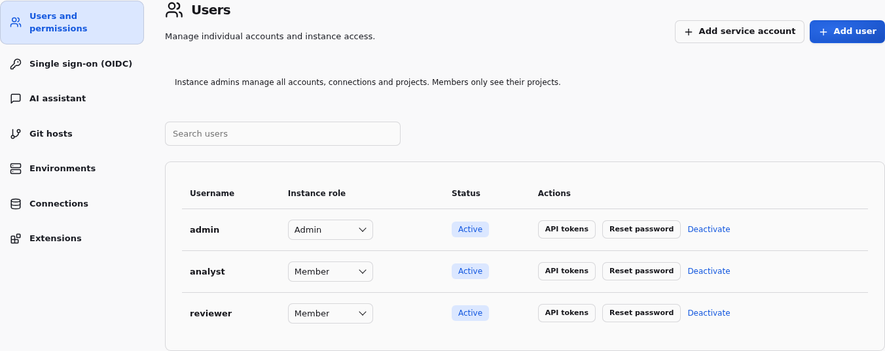
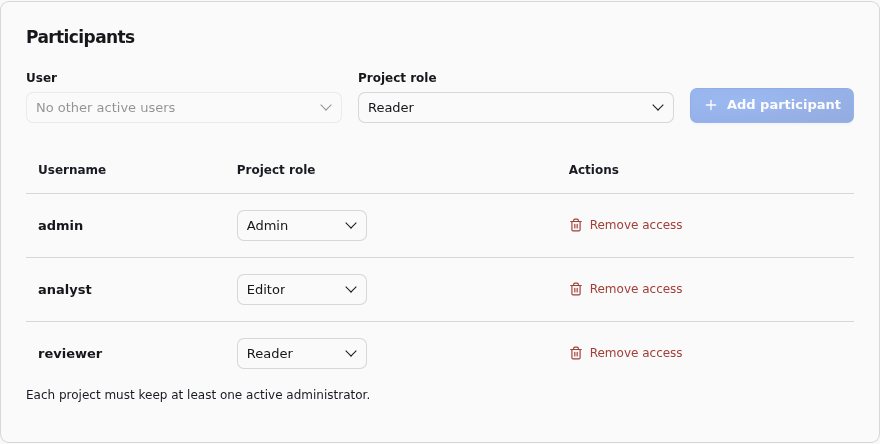
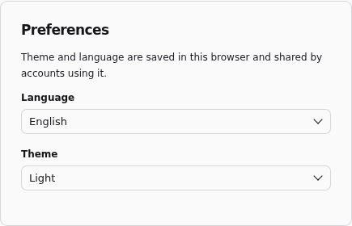

# Installation and accounts

## Start

Requires **Python 3.11+ and Git** on `PATH`. The default isolated SQL mode also requires **Linux with Landlock ABI 2 or later** (Linux 5.19+ with Landlock enabled); unsupported hosts refuse execution rather than automatically running without isolation. For a trusted Windows workstation, explicitly select [trusted local mode](#trusted-local-mode). Release wheels include the frontend, Monaco and its workers; Node.js is not needed to run the installed application.

```sh
pip install duckpad
duckpad start
```

The distribution is available on [PyPI](https://pypi.org/project/duckpad/).
Version tags also create a GitHub release with downloadable wheels. To install
a downloaded wheel, use `pip install <wheel-file>`. See the
[release guide](../docs/RELEASING.md) for publishing instructions.

If your Python installation is managed by the operating system, create and
activate a virtual environment first:

```sh
python3 -m venv .venv
source .venv/bin/activate
```

Open the localhost address printed in the terminal. Sign in as `admin` using the password printed **once** on the first launch. The same password remains valid after a restart. The default instance directory is `$XDG_DATA_HOME/duckpad`, or `~/.local/share/duckpad`. Authentication, connection settings and execution history are kept there, outside project repositories.

```sh
duckpad start --home /path/to/my-instance --port 8765 --no-browser
```

Only one backend may own an instance directory at a time. Use separate `--home` directories for independent instances. The default address is `127.0.0.1`.

If an older instance uses the legacy `records` document schema, startup exits with
an error asking you to choose a new `--home`. That schema is not migrated
automatically. Keep the old directory as a backup and start a fresh instance:

```sh
duckpad start --home /path/to/new-instance
```

The new instance creates a new administrator password. Reconfigure accounts and
connections and import your project Git repositories; the old instance's execution
history remains in its original database.

For air-gapped deployments, [download extensions on any connected computer and
import them into Duckpad](OFFLINE_EXTENSIONS.md) before running connectors that
need them.

Successful GET requests used for background polling (workspace, resources, worktree
snapshots, status, and generations) are logged at DEBUG. The default INFO level
still shows other requests, including failed polling requests. Use
`duckpad start --log-level debug` to include polling in the server logs.

## Reverse proxy

Behind an HTTPS reverse proxy, set `DUCKPAD_SECURE_COOKIES=1` so the session cookie is only sent over HTTPS.

Sign-in attempts are limited per client address: 12 per minute. Duckpad reads the
client address from the proxy's `X-Forwarded-For` header only when the request comes
from an address listed in `FORWARDED_ALLOW_IPS` (by default, `127.0.0.1`). When the
proxy runs on another host or container, set `FORWARDED_ALLOW_IPS` to the proxy's
address, or a comma-separated list of addresses or networks:

```sh
FORWARDED_ALLOW_IPS=172.18.0.2 duckpad start --host 0.0.0.0 --no-browser
```

Without it, every user appears to come from the proxy and shares one limit, so 12
failed sign-ins within a minute block everyone's sign-in. List only proxies: a client
that can reach Duckpad directly from a trusted address can choose its reported address.
Duckpad prints a reminder at startup when it listens on a non-loopback address and
`FORWARDED_ALLOW_IPS` is not set.

File uploads are limited to 1 GiB per file. Allow request bodies of that size in the
proxy, for example with `client_max_body_size` in nginx. For larger files, an
instance admin can grant a local connection whose root contains them.

## Trusted local mode

For your own trusted projects on a single-user Windows workstation, run:

```sh
duckpad start --trusted-local
```

This mode uses DuckDB directly in the application process, without Landlock or
the Linux SQL worker. It supports the normal pipeline, preview, lineage and
export workflow. The terminal prints a notice at startup. The option applies
only to that launch; include it again after restarting.

Authentication, API project permissions and connection grants still apply, but
SQL and extensions run with your operating-system permissions. There is no OS
isolation between SQL, your files, other projects and Duckpad's instance data.
Only run projects and extensions you trust. Do not share this instance or expose
it through a reverse proxy, tunnel or port forwarding.

The CLI accepts only `127.0.0.1` (the default), `localhost` or `::1` as `--host`
with this option. Keep the default isolated mode for shared deployments. A
missing sandbox never enables trusted mode automatically.

## Develop from source

Contributors also need [uv](https://docs.astral.sh/uv/) and Node.js 20+.
Setup provisions Python 3.12 and builds the interface:

```sh
git clone https://github.com/hugues31/duckpad.git
cd duckpad
bash scripts/setup.sh
uv run duckpad start --home .duckpad-dev --no-browser
```

See the [contributing guide](../CONTRIBUTING.md) for development checks.

## Accounts and project access

The initial `admin` account manages the instance. Open **Instance settings → Users and permissions** to create individual
accounts, reset passwords, change instance roles, or deactivate/reactivate accounts.
Passwords require at least 12 characters. Users can change their own password in
**Account menu → User settings**; resets and deactivations revoke existing sessions.



- **Instance Admin** manages accounts, configuration, connections and every project.
- **Instance Member** sees only their projects and can create private projects.
  The creator becomes the project's admin.
- **Project Reader** can inspect the flow, SQL, history and existing results.
- **Project Editor** can also edit content, run/cancel pipelines and export through
  authorized connections.
- **Project Admin** can also manage participants and delete the project.

Open a project and select **Project settings** to add participants, change roles or
remove access. Every instance and project must retain an active admin. Instance
admins choose the connections authorized for each project on this screen. A project
admin cannot grant connections or promote an instance admin. Readers can copy data
they can see; read access is not an extraction restriction.



Memberships, password hashes and connection grants remain in instance SQLite,
outside project Git.
See [authorization and execution isolation](ARCHITECTURE.md#authorization-and-execution-isolation)
for deployment requirements and file access boundaries.

## Preferences and result lifetime

Instance admins can monitor server CPU and RAM in the workspace toolbar. Click
either indicator for two minutes of history; samples refresh every two seconds.
Measurements include the API process and its active SQL workers, with visible CPU
affinity and Linux cgroup limits taken into account. Missing measurements appear
as unavailable. History resets on reload or sign-out.

Language defaults to the first supported language in your browser preferences
(English or French, with English as the fallback), and the theme defaults to your
system color scheme. Manual choices are saved in this browser and take priority
on subsequent visits. Open **Account menu → User settings** to choose your
language and theme.



Results live in memory per worktree and environment. After a backend restart, history remains available but previews and lineage require another manual run. Editing or changing an external source does not launch a run automatically.
