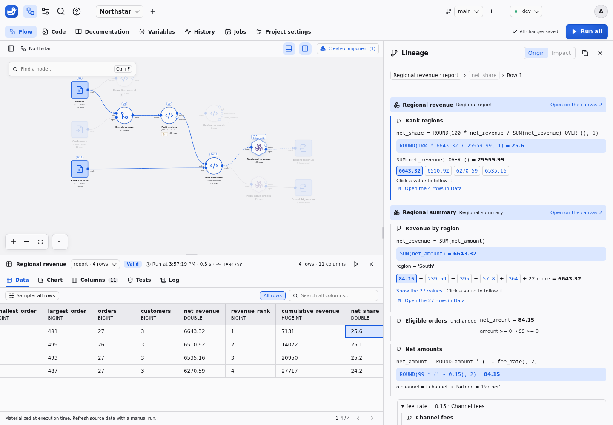

# Lineage coverage

Value lineage explains the materialized execution, not today's external resource. A result identifies its execution, dataset generation, column and stable storage row. Sorting, filtering or sampling the displayed rows does not change those identities or restrict the provenance search. Table and column lineage analyze saved definitions in the selected environment.

The **Lineage** side panel replaces the inspector while it is open. The canvas and Data grid remain usable; clicking another cell updates the explanation. Its table › column › value breadcrumb returns to either higher level. Column and value Impact are reserved for a later release.

**Table Origin** lists source files or tables and connections, followed by the upstream node tree. **Impact** lists downstream nodes and exports, including dependencies through computed variables. This analysis reads saved definitions and works before any run. Open it from a node's inspector actions or canvas context menu.

**Column Origin** opens from the table's column list, a **Lineage** button in **Columns**, or the column breadcrumb above a value. It separates value inputs from conditions that select rows: filters, joins, grouping, windows, ordering, DISTINCT and set membership. Every calculation and transport node remains visible, including nested components and side branches. Source steps include the column type, resource and description. Canvas badges show column names, with **ƒ** for calculations.

The analysis uses compiled saved SQL, with the selected environment's parameters and variables. It reuses retained schemas or describes code against empty typed relations in a database with external access disabled. It never reads source files or output rows, runs a node, or changes results. If a schema cannot be determined, the panel names the node to run. Analysis is cached by definitions, environment, computed variable metadata and schemas; configuration edits invalidate it.

Static coverage includes qualified joins, aliases, SELECT stars with EXCLUDE/REPLACE, CTEs, derived tables, scalar subqueries and positional UNION, INTERSECT and EXCEPT. Correlated or recursive queries, named windows, pivots, expanding UNNEST projections and set operations BY NAME are explicitly incomplete. Python is opaque and lists its input tables. These static limits are separate from the value replay limits below. The assistant's `explain_column` tool returns bounded pages of the same analysis, including when data reading is disabled.

**Value Origin** keeps every node on the path, including unchanged projections, filters and joins. Each calculation shows its formula, captured operands and result. A transport step also shows the condition selecting its row. Components and nested components have named headers; **Open on the canvas** opens their contents while retaining the trace. A trace started inside a component continues through its external inputs.

Aggregates initially show five contributing values and the full result. **Show the N values** loads further pages, and **Open the N rows in Data** opens the contributing rows in the upstream node's grid, with search and pagination. These rows are recomputed from captured witnesses, never stored or read again from an external source. Distinct groups first open the corresponding original cells.

Only one contributing value is followed after an aggregate, initially the first. Selecting another value replaces that path. Mixed expressions such as `net_revenue / SUM(net_revenue) OVER ()` show the scalar operand and the complete window total separately, each with its own contributions. Other branches with at most three nodes open automatically; longer branches load on demand. Shared ancestors appear once with links back to them.

The canvas highlights the path, dims unrelated nodes and shows captured values. Numbers are rounded for display; hover shows the exact value. **Copy** exports the explanation as text with exact values, run, commit and environment. The URL preserves the node, output, generation and selected cell, so it can be shared and navigated with browser Back. Reopening an invalidated generation asks for a new selection rather than explaining a different result row.

An output whose query reads an external resource, or no flow data at all, is a lineage source: explanations stop at its rows and never reread the resource. To trace a calculation through external rows joined with an input, load them into an earlier output first.

## Validated baseline

| Construct | Status | Behavior |
| --- | --- | --- |
| Selected columns, arithmetic and scalar projections | Supported | Captured witnesses distinguish equal output values from separate input rows |
| Filters | Supported | Returned values retain their source cells; condition columns appear as context |
| Inner, left, right and full joins | Supported | Contributing cells retain the identities of their joined inputs; unmatched rows do not invent source cells |
| Grouping; `SUM`, `AVG`, `COUNT`, `COUNT(*)` | Supported | All participating cells are searched, with null-exclusion rules and captured group keys |
| `MIN`, `MAX` | Supported | All tied extrema appear first; the full examined group remains accessible |
| `COUNT(DISTINCT expression)` | Supported | Counted value groups first, then every original cell in a chosen group; both levels are paginated |
| Aggregate `FILTER (WHERE ...)` | Supported | Predicate inputs are context and excluded rows are not counted as contributions |
| `SELECT DISTINCT` | Supported | All rows contributing to the surviving value remain traceable |
| `UNION`, `INTERSECT`, `EXCEPT` (distinct semantics) | Supported | Both operands are explainable stages; `EXCEPT` separates the compared right side as context |
| Window `SUM`, `AVG`, `MIN`, `MAX`, `COUNT` | Supported | Frame membership is replayed over materialized inputs; extrema retain ties and aggregate null rules |
| Mixed scalar expressions and independent aggregate/window operands | Supported | Every operand has its own complete value and contribution page |
| Window `COUNT(DISTINCT ...)` | Supported | Distinct groups preserve duplicate source identities |
| `ROW_NUMBER`, `RANK`, `DENSE_RANK`, `PERCENT_RANK`, `CUME_DIST`, `NTILE` | Supported | Ordering and partition inputs explain the ranking |
| `LAG`, `LEAD`, `FIRST_VALUE`, `LAST_VALUE`, `NTH_VALUE` | Supported | The selected neighboring/frame cell is traced |
| Aggregate followed by a window | Supported | Grouping becomes an explainable intermediate relation before window evaluation |
| Ordered outputs and nested component compositions | Supported | Each step links to the actual earlier output from the same execution |
| Nonrecursive CTEs and derived tables | Supported with the duplicate-occurrence limitation below | Deterministic intermediate steps are materialized on demand from retained data |

Native-equivalence tests compare values, types and multiplicities with
uninstrumented DuckDB. The matrix describes verified coverage, not all SQL.

## Explicit limitations

These constructs remain executable when they satisfy the template contract, but exact lineage is not claimed:

- `UNION ALL`, `INTERSECT ALL` and `EXCEPT ALL`: duplicate-occurrence assignment is not implemented.
- Recursive CTEs, `QUALIFY`, grouping sets, `ROLLUP` and `CUBE`.
- SEMI/ANTI join selection provenance. The built-in join form offers inner/left/right/full joins.
- Unsupported specialized windows or `IGNORE NULLS` wrappers.
- Window arguments that combine columns from multiple joined relations without an intermediate projection.
- Multi-expression distinct aggregates/windows.
- Volatile expressions such as random values, UUIDs or current timestamps: replay must not invent an explanation from a new evaluation.
- Projections that expand into several columns, such as `COLUMNS(...)`, `struct.*` or `UNNEST` of a struct: the step runs its native query without captured row witnesses, and lineage reports this limitation for its cells.
- Indistinguishable duplicate occurrences in a composed CTE/derived projection when no original row witness was captured. Use separate pipeline nodes to capture each stage's witnesses.

The response sets `complete: false` and identifies the unsupported step. The UI shows a coverage warning instead of presenting a partial search as complete. An unsupported construct does not modify the computed query values.

## Recalculation and stale results

A configuration edit or a manual recomputation invalidates the affected old generation. Pending lineage is interrupted, late responses are discarded, and further navigation is disabled. Recalculation does not automatically replay an explanation on the same row number. Select a cell explicitly after a valid replacement appears.

Failed recomputation retains the previous preview as stale, with its original SQL and execution metadata. It has no lineage.
