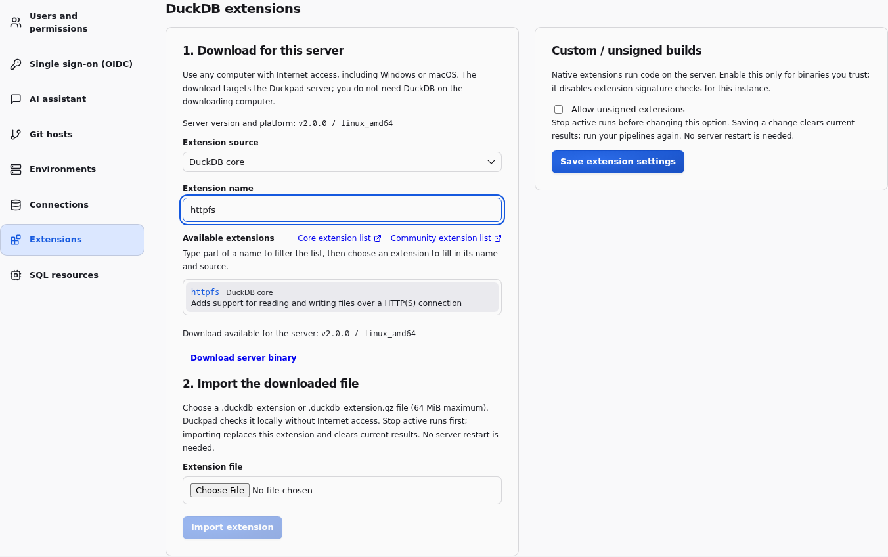
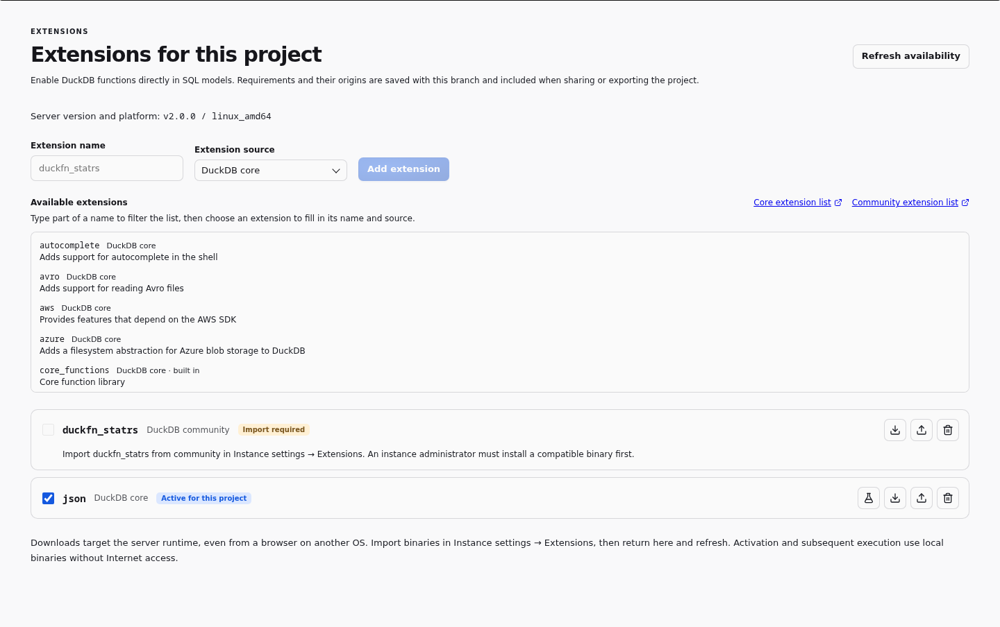

# DuckDB extensions without Internet access

**Download on any connected computer, then import the file into Duckpad.**
A Windows PC can download extensions for a Linux server. The downloading computer
does not need DuckDB, Python, Linux, or a prepared extension cache.

## Download, transfer, import

1. Open **Instance settings → Extensions** as an administrator.
   Pick the extension under **Available extensions**, or choose **DuckDB core**
   or **DuckDB community** and enter its exact name. Then click **Download
   server binary** on a computer with Internet access.
   The link uses the **server's version and platform**, not your PC's.
2. Transfer the downloaded file if necessary. In the same settings panel, choose
   the matching source, select the `.duckdb_extension.gz` or `.duckdb_extension`
   file, and click **Import extension**. Keep the original filename.
3. Open your project's **Extensions** tab. Add the same name and origin, then
   tick its **Activate for this project** checkbox once it shows
   **Ready to activate**.
   Its functions can now be used directly in SQL models. For a data-source
   connector, continue to configure its connection under
   **Instance settings → Connections** and grant it to the project; connector
   extensions still load automatically.



Duckpad decompresses the file, checks its version, platform and signature, and
installs it locally. **The server needs no Internet connection or restart.**
The browser must be able to reach Duckpad to upload the file.

For example, a Windows browser connected to a Linux x86-64 server running DuckDB
2.0.0 receives a link containing `v2.0.0/linux_amd64`, even though the browser runs
on Windows. Use this same process for each extension your connectors need.

## Find an extension name

**Available extensions** lists the core extensions known to the server's DuckDB,
even without Internet access, and marks those built into it: they need no
download or import. When your browser can reach duckdb.org, it also loads the
community list there; the Duckpad server never contacts it. Type part of a name
to filter the list, then choose an extension to fill in its name and source.
**Core extension list** and **Community extension list** open DuckDB's own pages.

For a selected core or community name, the browser also asks DuckDB's repository
whether it publishes a download for the server's version and platform. Not every
community extension is built for every DuckDB release. When the browser is
offline, the community list and this check are unavailable: choose the source and
enter the exact name, as before.

## Activate a project capability

The project's **Extensions** tab separates installing a server binary from
enabling it in a project. An editor can pick an extension under **Available
extensions**, or enter a name and select **DuckDB core**, **DuckDB community** or
**Custom / unsigned builds**, then enable an already installed binary. A reader can inspect the requirements. Only an
instance administrator can import binaries or change the signature policy.

Each extension fits on one row: the **Activate for this project** checkbox, its
name, origin and status, then icon buttons whose tooltips name them: **Check
loading** (flask), **Download server binary** (down arrow), **Open instance
import** (up arrow, administrators) and **Remove** (bin).



- **Import required**: use **Download server binary** and ask an administrator
  to import the file. Administrators can follow **Open instance import**, which
  preselects the name and origin. Return to the project and refresh availability.
- **Ready to activate**: tick **Activate for this project**. Duckpad checks
  loading in a disposable process and saves the requirement after success.
- **Loading failed**: the error identifies the missing binary, library, signature
  or CPU compatibility problem. Have an administrator correct it, then retry.
  **Check loading** also verifies an existing activation without changing it.
- **Compatible binary required** or **Blocked by instance trust policy**:
  retain the requirement, and ask an administrator to resolve it. Activation
  never enables unsigned extensions on its own.

Activation and subsequent execution load local binaries; they do not contact a
repository or catalog. With an online server, binaries already installed through
a connector are also available. Browser download followed by import works in
both connected and airgapped installations; the browser's requests to duckdb.org
only help find names and are not required.

For example, add **duckfn_statrs** with origin **DuckDB community**, import its
server binary, and activate it. Create this SQL model without a connection
parameter:

```sql
-- @label Statistical functions
-- @kind source
-- @output result
SELECT
  sr_normal_cdf(0.0, 0.0, 1.0) AS cdf_0,
  sr_normal_cdf(1.96, 0.0, 1.0) AS cdf_196,
  sr_normal_pdf(0.0, 0.0, 1.0) AS pdf_0,
  sr_normal_quantile(0.975, 0.0, 1.0) AS quantile_975;
```

The result is `0.5`, `0.9750021048529024`, `0.39894228040143265` and
`1.9599639845400538`. The final two arguments are the mean and standard deviation.

## Reopen, share and deactivate

Requirements live in `extensions.json` alongside the flow and SQL models:

```json
{
  "duckfn_statrs": { "source": "community", "enabled": true }
}
```

This file follows the project's Git branch, revisions, ZIP export/import and
sharing. Binary files and instance trust settings remain on the server and are
never exported with the project. On another instance, the requirement is retained
even when its binary is missing. The import dialog lists required extensions;
open **Extensions** to check availability before running.

Every new execution session loads the enabled requirements, including isolated
workers and runs started by an external scheduler through the execution API.
Duckpad does not add a scheduling service: the same execution entry point applies
to UI, API and externally scheduled runs. Reopening the project or restarting the
server does not require Internet access once compatible binaries are installed.

Unticking **Activate for this project** keeps the declaration with
`enabled: false`.
Removing the entry also disables it. Existing results become stale when enabled
requirements change, and the next execution recreates the database so disabled
functions are no longer retained in that session. Other projects are unaffected.
Built-in DuckDB functions and extensions required by a project's connectors remain
available independently of this list. Execution never loads or downloads any other
extension on demand, in embedded or isolated mode: a format, function or type from
an extension that is not enabled fails with an error naming the extension to enable.

## Before importing

- Stop active runs. A successful import replaces that extension for the instance
  and clears current results; run your pipelines again.
- Files may be up to **64 MiB** (256 MiB after decompression). A `.gz` file can be
  imported directly. For a `.tar.gz` or `.zip` release, extract it on any computer
  and select the binary for the server's version and platform.
- Import extension dependencies separately. Native client libraries and CPU
  compatibility still depend on the server; see [connector prerequisites](CONNECTORS.md).

Signed core and community imports keep signature verification enabled. Use
**Custom / unsigned builds** only for a trusted binary outside those signing
keys, after enabling **Allow unsigned extensions** in the same **Extensions** tab.
This setting is off by default.

See [download links, checks and troubleshooting](OFFLINE_EXTENSIONS_ADMIN.md)
for manual downloads, API use and installation details.
