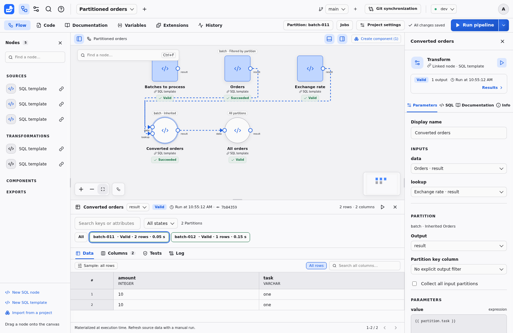
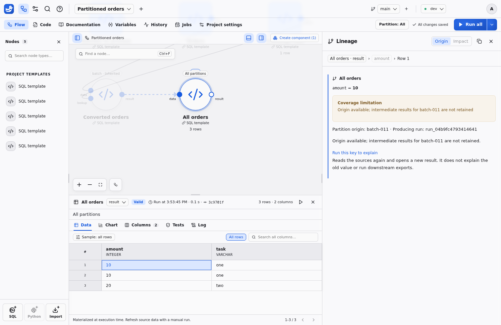

# Data partitions

Partitions run the same SQL pipeline once for each typed key from a control node.
Declare one dimension in `flow.json`, then filter a source output by its key column.
Downstream nodes inherit that key. Shared lookups run once.



## Configure a dimension

Open **Project settings → Partitions** to choose the control node, output, key
column, type and optional attribute columns. The control output is read in full
at launch; null or duplicate keys and incompatible types stop partition consumers.
Use text for numeric identifiers that cannot round-trip exactly through a browser.

In the node inspector, set **Partition key column** for each filtered output.
Use `{{ partition }}` or `{{ partition.attribute }}` in expression parameters;
use `{"$partition": true}` or `{"$partition": "attribute"}` for a whole typed
parameter. SQL values are bound parameters, including quoted keys. A filter
applies to the declared output's query, so place it at the source to benefit from
scan pushdown. The SQL tab shows the bound predicate for a selected key and a
parameterized plan for **All**.

### Example `flow.json`

This flow uses the templates `batches`, `orders` and `collect_orders`. The control
output contains `batch-011` and `batch-012`; `orders.result.batch` is filtered for
each key. The final node reads the complete ordered union.

```json
{
  "name": "Partitioned orders",
  "partitions": {
    "batch": {
      "type": "text",
      "values": {"node": "batches", "port": "result", "column": "batch"},
      "attributes": ["task"],
      "execution": {"parallelism": 1, "on_error": "continue"},
      "preview": {"keep": "last", "count": 1, "max_bytes": 1073741824}
    }
  },
  "nodes": [
    {"id": "batches", "template": "batches", "label": "Batches to process"},
    {
      "id": "orders",
      "template": "orders",
      "outputs": {"result": {"partition": {"by": "batch", "column": "batch"}}}
    },
    {"id": "all_orders", "template": "collect_orders", "partitions": "all"}
  ],
  "edges": [
    {"id": "collect", "source": "orders", "sourceHandle": "result",
     "target": "all_orders", "targetHandle": "data"}
  ]
}
```

For example, `templates/batches.sql` declares the list:

```sql
-- @output result
SELECT 'batch-011' AS batch, 'Previous day' AS task
UNION ALL SELECT 'batch-012', 'Current day';
```

The `orders` source must return a text `batch` column. A minimal
`templates/collect_orders.sql` is:

```sql
-- @input data
-- @output result
SELECT * FROM {{ data }};
```

## Collect the complete result

**Collect all input partitions** leaves the partitioned zone. Its inputs retain
the latest successful output for every required key on disk. Collection preserves
duplicates, manifest order and each output's observed row order. A missing, stale
or failed key prevents collection; Duckpad never silently executes a partial union.
An empty manifest produces typed empty inputs, so a collector's `count(*)` returns
zero without reading partition source rows.

## Inspect keys and retain previews

The global selector and the Results partition strip change inspection only.
A selected typed key stays selected after a manifest refresh if it still exists.
Search and page through keys and attributes, filter by validity, then select a key
to inspect Data, Columns, SQL and Log. Shared nodes and collectors retain their
global meaning. **All** inspects the available retained outputs and displays an
incomplete banner when some previews are unavailable. It does not refresh sources.

By default, intermediate previews keep the last executed key within a 1 GiB
budget. The settings also allow all keys within that budget, or no intermediate
previews. Mandatory collector inputs use separate retention. An evicted preview
still has run evidence; explicitly run that key when fresh inspection is needed.
Neither Git nor project ZIPs contain manifests, selected keys or retained data.
Each branch and environment has its own manifest and results. Deleting a
project removes its partition files; deleting a node releases its artifacts at
the next run.

## Launch and retry

**Run all** recalculates the list and runs every key. The arrow beside it opens **Run with options…**, which
offers **Failed**, **Missing** and **Selected keys**, plus a parallelism limit and
failure policy for this run. Targeted node runs reuse the retained list, or calculate
it first when none exists yet; selecting a key before running a node limits that
launch to the key. Protected environments
confirm the source, selection and policies before admission.

Parallel keys share one SQL session's thread scheduler, memory limit and spill
directory. The effective concurrency cannot exceed its thread budget. **Stop**
stops admitting new keys after an error and lets already active keys finish;
**Continue** attempts the remaining keys. File destinations must be distinct
across the whole manifest. Remote writes remain serial even with parallel keys.

Retrying **Failed** recalculates the list and shared inputs, then runs the currently
failed keys. Exports whose latest attempt succeeded with the same key and computation fingerprint are
skipped, including exports that succeeded earlier within a failed key. Unknown
write outcomes after cancellation or a crash need care: retrying a non-idempotent
external append can duplicate rows. A retry does not replay a past source snapshot.
New keys are **Missing**; stale keys remain visible and can be recomputed with
**Missing**, **All** or an explicit selection. History pages keep the original manifest, attempts and export outcomes.

## Jobs, API and CLI

Jobs accept the same options through `POST /api/v1/jobs/{slug}/runs`. The body is
part of the idempotency identity. Readers can page through
`GET /api/v1/runs/{id}/partitions` and filter the text log by opaque `partition_id`;
launch and retry require the Operator role.

```sh
duckpad run daily-orders --partitions failed
duckpad run daily-orders --partition-keys keys.json --partition-parallelism 2
```

`keys.json` contains a typed array such as `[{"type":"text","value":"batch-012"}]`.
The selector flags are mutually exclusive. Waiting, cancellation, `--detach`,
authentication and exit codes work as for any Job; partial failure returns exit
code 2. Progress reports the phase and completed/failed key counts.

## Explain a collected value

Select **Explain this value** on a collected row to see its typed partition key,
producing run and occurrence within that key. Duplicate business rows keep distinct
occurrences. A global aggregate lists the partitions that contributed to it.
Detailed calculations use only the immutable intermediate generations still retained;
they never substitute current inputs or read an external source during inspection.



When intermediates are unavailable, **Run this key to explain** targets the producing
node and its ancestors for that key, using the retained manifest. It rereads sources,
opens a new result and leaves downstream exports out of scope. The new execution is
not a reconstruction of the old cell's value. Protected-environment confirmation still
applies. The typed key and attributes appear as evidence beside the calculation.

## Maintain the dimension

Renaming an attribute in Partition settings updates its expression and whole-parameter
references in the same save. Remove its references before deleting an attribute;
remove all partition declarations and collectors before removing the dimension.
