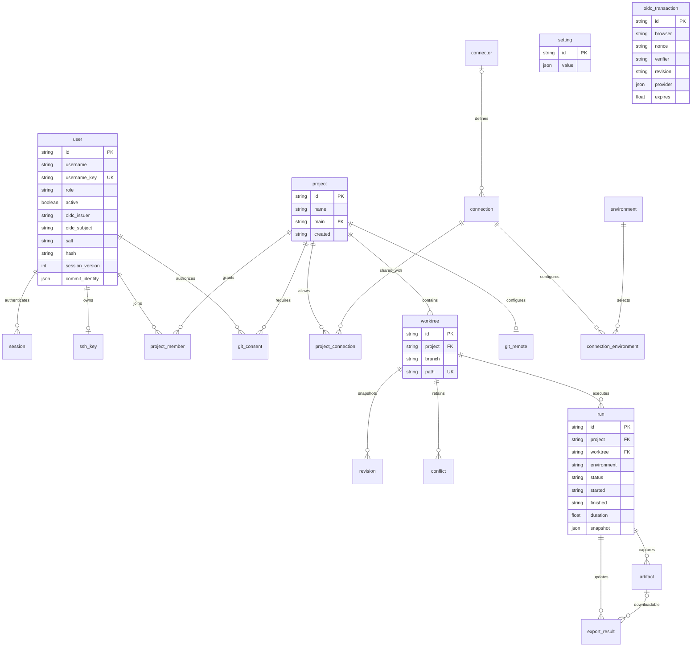

# Instance persistence

Duckpad stores instance metadata in SQLite through SQLModel. Alembic applies the
packaged revisions in `src/duckpad/migrations/versions/` before the application
starts serving requests. The initial revision creates 20 business tables and
seeds the default environments, but no connector or connection. It does not
import the former `records` document table. Use a fresh data directory for this
breaking change; an existing document database is rejected without deleting it.

Revision `0002_assistant` adds the twenty-first business table,
`assistant_conversation`, with private model messages, UI turns, author, project,
branch and title. Foreign keys cascade on author or project deletion; the
`setting` table retains write-only provider configuration. Neither is part of
project export.

Revision `0005_job_idempotency` adds `job_idempotency`, keyed by Job and the hash
of an idempotency key. It stores a canonical request hash, the accepted run and
its seven-day expiry. Admission serializes retries per Job, and the initial run
and key are persisted in the same transaction before starting the execution
thread. Expired entries are ignored on lookup and removed when another accepted
key is written. Deleting a Job removes its keys while retaining its run history.

Revision `0006_builtin_connectors` drops the foreign key from `connection` to
`connector`. Built-in connector definitions come with the release and are not
stored: the `connector` table holds custom connector types and administrators'
overrides of built-in ones, under the built-in identifier. A connection may
therefore name a built-in connector without a row. Rows seeded by earlier
versions are not converted; recreate such an instance.

## Data model



The project `main` reference is a deferred composite foreign key to a worktree
of that same project. Project and main worktree are inserted in one transaction.
The `(project, branch)` pair is unique. A run's `(worktree, project)` pair must
match its owning worktree. Membership and connection grants have composite
primary keys; membership roles are constrained to reader, editor or admin.
Usernames have a unique case-folded key, and `(oidc_issuer, oidc_subject)` is
unique. Local credentials and OIDC identities are mutually exclusive.

Project/worktree deletion cascades to owned metadata, including revisions,
conflicts, runs, artifacts, latest export results and access links. Project
deletion also removes its remote and consents. Shared connections and accounts
survive. Deleting a user cascades to sessions, keys, memberships and consents.
Updating a row uses ORM updates rather than SQLite `INSERT OR REPLACE`, which
would inadvertently cascade deletions. The catalog refuses to delete a custom
connector with connections until those connections have been removed; built-in
connectors cannot be deleted, only reset by deleting their override.

Environments and connection parameters are separate tables. Removing an
environment deletes its live connection parameters; historical run, artifact
and export environment names remain snapshots without foreign keys to live
environments. Recreating an environment starts with empty parameters.

An export result names only the latest run of its node in an environment. When a
new run replaces it, the download copy of the previous run and its artifact record
are deleted.

JSON columns hold variable connector definitions, connection parameters,
revision files, conflict/run snapshots, Git mappings, provider metadata and
settings. Secrets remain private instance configuration. Public responses are
assembled and redacted by the existing service/API schemas, never by returning
database models containing credentials.

## Transactions and queries

`Store.transaction()` defines a metadata unit of work; nested operations use
savepoints. Each unit owns a SQLModel session on the calling thread. Requests,
watchers and execution workers never share a session. An instance lock serializes
short metadata operations; WAL and a busy timeout are enabled. Foreign keys are
enabled on every application connection.

Project creation, environment creation and each run/export-state update commit
their rows together. Filesystem and Git actions are outside SQLite's guarantees;
their cleanup remains explicit in the project services. The dictionary-oriented
service boundary is retained, but entity kinds map to explicit models and
columns; there is no generic JSON fallback. Account lookup, expiration cleanup
and run visibility/filtering use SQL predicates and indexed columns.

## Evolving the schema

Use a stopped, disposable development instance. Production startup applies
pending revisions; never edit an already released migration. Back up a real
instance's database and files while stopped before upgrading.

```sh
uv run python -m duckpad.migrations current --home .duckpad-dev
uv run python -m duckpad.migrations check --home .duckpad-dev
# After editing models.py, generate and review a new revision:
uv run python -m duckpad.migrations revision --home .duckpad-dev --message "Add metadata field"
uv run python -m duckpad.migrations upgrade --home .duckpad-dev
```

Review generated operations, data transformations, defaults and downgrade
behavior. JSON transformations require explicit migration code. SQLite batch
rebuilds run inside an explicit transaction with foreign-key enforcement disabled
on that migration connection before `BEGIN`; `foreign_key_check` must pass before
commit, and enforcement is restored afterward. This prevents a parent-table
rebuild from cascading into its children. Failed DDL and data changes roll back
together. The migration runner serializes Alembic's process-global environment.

Tests compare the initial schema to SQLModel metadata and exercise rollback,
constraints, cascades, thread isolation and a failed batch rebuild with child
rows. Migration scripts and their template ship inside the wheel and sdist.
