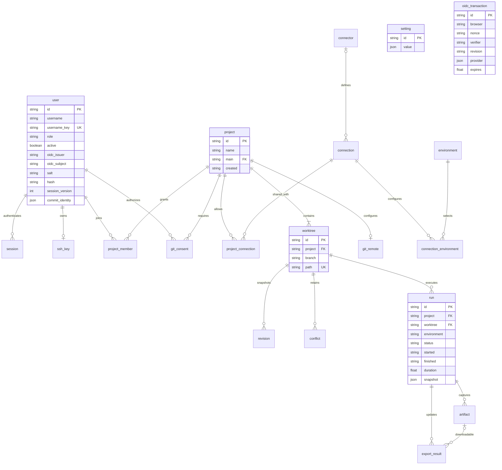

# Instance persistence

Duckpad stores instance metadata in SQLite through SQLModel. Alembic applies the
packaged revisions in `src/duckpad/migrations/versions/` before the application
starts serving requests. The single `0001_v0_baseline` revision creates the
business tables, including assistant conversations, API tokens, Jobs,
idempotency keys, partitions and explicit artifact storage locations. It seeds
the `dev` and `prod` environments, but no connector or connection.

Duckpad is in v0: earlier instance schemas are not upgraded. Startup rejects a
database with an unknown revision, or a nonempty one without a revision, without
changing it; start a new instance as described in
[Installation](INSTALLATION.md). Do not stamp an old database with the current
revision: its schema and data were never converted.

Private assistant conversations belong to their author and optionally a project.
Foreign keys cascade on author or project deletion; the `setting` table retains
write-only provider configuration. Neither is part of project export.

`job_idempotency`, keyed by Job and the hash of an idempotency key, stores a
canonical request hash, the accepted run and its seven-day expiry. Admission
serializes retries per Job, and the initial run and key are persisted in the
same transaction before starting the execution thread. Expired entries are
ignored on lookup and removed when another accepted key is written. Deleting
a Job removes its keys while retaining its run history.

Built-in connector definitions come with the release and are not stored: the
`connector` table holds custom connector types and administrators' overrides of
built-in ones. A connection can name a built-in connector without a stored row,
so its connector identifier has no database foreign key.

## Data model



The project `main` reference is a deferred composite foreign key to a worktree
of that same project. Project and main worktree are inserted in one transaction.
The `(project, branch)` pair is unique. A run's `(worktree, project)` pair must
match its owning worktree. Membership and connection grants have composite
primary keys; membership roles are constrained to reader, operator, editor or admin.
Usernames have a unique case-folded key, and `(oidc_issuer, oidc_subject)` is
unique. Local credentials and OIDC identities are mutually exclusive. Service
accounts have neither and must have the member role.

Project/worktree deletion cascades to owned metadata, including revisions,
conflicts, runs, artifacts, latest export results and access links. Project
deletion also removes its remote and consents. Shared connections and accounts
survive. Deleting a user cascades to sessions, keys, memberships and consents.
Updating a row uses ORM updates rather than SQLite `INSERT OR REPLACE`, which
would inadvertently cascade deletions. The catalog refuses to delete a custom
connector with connections until those connections have been removed; built-in
connectors cannot be deleted, only reset by deleting their override.

Environments and connection parameters are separate tables. Removing an
environment deletes its live connection parameters; historical run, artifact
and export environment names remain snapshots without foreign keys to live
environments. Recreating an environment starts with empty parameters.

An export result names only the latest run of its node in an environment. When a
new run replaces it, the download copy of the previous run and its artifact record
are deleted.

JSON columns hold variable connector definitions, connection parameters,
revision files, conflict/run snapshots, Git mappings, provider metadata and
settings. Secrets remain private instance configuration. `Store` encrypts them on
write and decrypts them on read: secret connection parameters, the `oidc` client
secret, `assistant` provider API keys and `ssh_key.private_key`. A sealed value
reads `dpenc:1:<key id>:<data>`. Public responses are
assembled and redacted by the existing service/API schemas, never by returning
database models containing credentials. Empty values and references to server
secrets are stored as is; startup rejects any other unencrypted value.

## Transactions and queries

`Store.transaction()` defines a metadata unit of work; nested operations use
savepoints. Each unit owns a SQLModel session on the calling thread. Requests,
watchers and execution workers never share a session. An instance lock serializes
short metadata operations; WAL and a busy timeout are enabled. Foreign keys are
enabled on every application connection.

Project creation, environment creation and each run/export-state update commit
their rows together. Filesystem and Git actions are outside SQLite's guarantees;
their cleanup remains explicit in the project services. The dictionary-oriented
service boundary is retained, but entity kinds map to explicit models and
columns; there is no generic JSON fallback. Account lookup, expiration cleanup
and run visibility/filtering use SQL predicates and indexed columns.

## Evolving the schema

Use a stopped, disposable development instance. During v0, keep a single baseline
for the current schema instead of adding conversions for earlier releases. A
schema change needs a new baseline revision identifier and a documented reset;
never silently reuse a revision identifier for a different schema. Back up an
instance's database and files while stopped before changing versions.

```sh
uv run python -m duckpad.migrations current --home .duckpad-dev
uv run python -m duckpad.migrations check --home .duckpad-dev
# Generate operations to review while preparing the replacement baseline:
uv run python -m duckpad.migrations revision --home .duckpad-dev --message "Add metadata field"
uv run python -m duckpad.migrations upgrade --home .duckpad-dev
```

Fold the reviewed schema changes into the replacement baseline, remove the old
revisions and verify initialization on an empty database. Do not retain data
transformations for discarded schemas. SQLite batch rebuilds run inside an
explicit transaction with foreign-key enforcement disabled on that migration
connection before `BEGIN`; `foreign_key_check` must pass before commit, and
enforcement is restored afterward. This prevents a parent-table
rebuild from cascading into its children. Failed DDL and data changes roll back
together. The migration runner serializes Alembic's process-global environment.

Tests compare the initial schema to SQLModel metadata and exercise rollback,
constraints, cascades, thread isolation, rejection of unsupported databases,
initialization failure recovery and a failed batch rebuild with child rows.
Migration scripts and their template ship inside the wheel and sdist.

## Execution history retention

Duckpad retains the newest 1,000 completed runs per working branch and environment.
Older runs expire in batches: when a run finishes and more than 1,100 completed runs
exist, the oldest beyond 1,000 are deleted. Active runs and evidence still referenced
by live results, exports, partition results, retained manifests or Job idempotency
keys are exempt, so the retained total can exceed 1,000. Deleting an expired run
also deletes its partition attempts and unreferenced manifests through the
database's ownership constraints. Retention runs outside the engine's admission lock.

A partition manifest is reused when its ordered typed keys, attributes, source,
schema and partition definition are unchanged. Its IDs and original provenance
remain immutable; each new run stores separate attempts against those IDs.
Changed values or ordering create a new manifest.

The internal `/api/runs` and `/api/jobs/{slug}/runs` lists return summaries without
captured project definitions, connection settings or node logs. They default to
50 records and accept `limit` from 1 to 100. When another page exists,
`X-Next-Cursor` contains the opaque value to pass as `cursor` on the next request,
with the same filters. Ordering uses start time and run ID, so equal timestamps
and concurrent new runs do not duplicate records. `/api/runs/{id}` retains the
complete record. The History and Jobs pages load older records explicitly and
fetch details when a run is opened. The public automation API keeps its existing
response contract.
