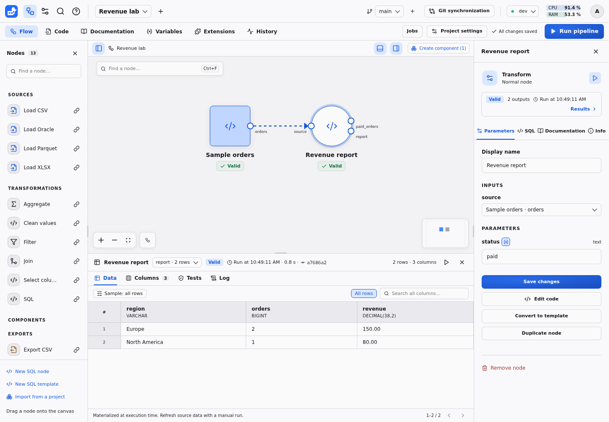
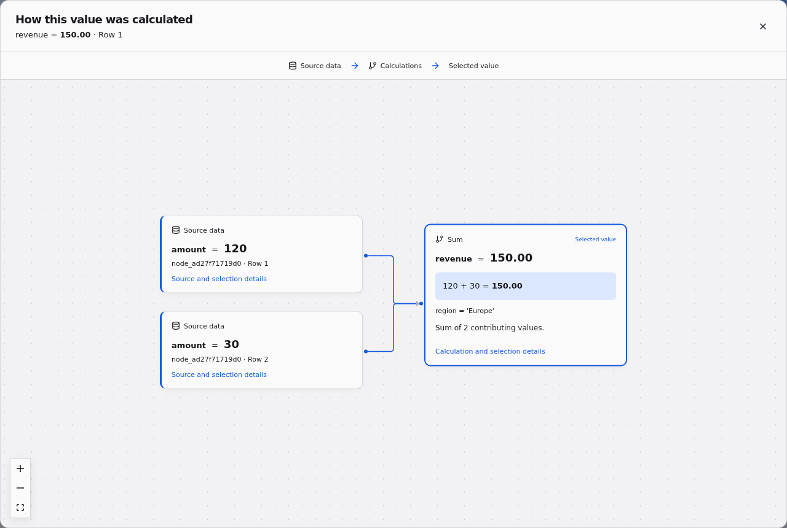

# Duckpad in 15 minutes

Build a pipeline from an empty project, write two SQL nodes, check their data and
explain a revenue total. You will use four sample orders; no files to download or
database account to configure. Allow extra time for the initial installation.

Prefer to explore an existing pipeline? Open the [Northstar tour](EXAMPLE.md).

## 1. Install and sign in · 2 minutes

With **Python 3.11+** and **Git** installed, run:

```sh
pip install duckpad
duckpad start
```

The default execution mode needs Linux with Landlock ABI 2+ (Linux 5.19+ with
Landlock enabled). On your own trusted Windows workstation, use
`duckpad start --trusted-local`; this mode runs with your user permissions and
must stay private to your computer. See [installation](INSTALLATION.md) for
platform requirements, virtual environments and instance options.

Open the local address printed in the terminal, normally `http://127.0.0.1:8765`.
Sign in as **admin** with the password printed once on first launch. Save that
password privately; it remains valid after a restart.

## 2. Create an empty project · 1 minute

On **Projects**, choose **New project**, name it **Revenue lab**, select
**Empty project**, then **Create**. Keep **dev** selected in the top bar.

You are in **Flow**, the visual canvas. A few concepts will help:

| Concept | What it means here |
| --- | --- |
| Project | Your graph, SQL and documentation, saved together in Git |
| Node | One step that reads, transforms or exports data |
| Port and edge | A named table input/output and the connection between two nodes |
| Parameter | A typed setting that changes a node without rewriting its SQL |
| Environment | The connection settings and variable values used for a run |
| Run | An explicit execution of the saved pipeline; editing does not run it |

## 3. Create your first SQL node · 3 minutes

Choose **New SQL node** in the palette. Select it, set its **Display name** to
**Sample orders**, then choose **Edit code** in the inspector. Replace the
entire default code, including its `-- @input source` line, with:

```sql
-- @label Sample orders
-- @kind source
-- @output orders
SELECT * FROM (VALUES
    (1, 'Europe',        'paid',    120.00),
    (2, 'Europe',        'paid',     30.00),
    (3, 'North America', 'paid',     80.00),
    (4, 'North America', 'pending', 50.00)
) AS sample(order_id, region, status, amount);
```

Choose **Save changes**, then **Run pipeline**. Select the node: its **Data** tab
under the canvas shows all four orders.

`-- @kind source` identifies a source node. `-- @output orders` names the table
it publishes. The rest is DuckDB SQL, ending in a semicolon. This source uses
inline data; later you can replace it with a **Load CSV** or **Load Parquet** node
from the palette and upload your own file.

## 4. Connect a transformation · 3 minutes

Choose **New SQL node** again and set its **Display name** to **Revenue report**.
Choose **Edit code**, replace the code with the following, then **Save changes**:

```sql
-- @label Revenue report
-- @input source
-- @param status: text = "paid"
-- @output paid_orders
SELECT * FROM {{ source }} WHERE status = {{ status }};
-- @output report
SELECT region, COUNT(*) AS orders, SUM(amount) AS revenue
FROM {{ paid_orders }}
GROUP BY region
ORDER BY region;
```

Connect **Sample orders → orders** to **Revenue report → source** by dragging
between the ports. Alternatively, select **Revenue report** and choose
**Sample orders · orders** in its **source** input selector. An unconnected input
is invalid until you make this connection.

The double braces refer to declared names. `{{ source }}` is the connected
table; `{{ status }}` is the parameter value. Write the placeholder without SQL
quotes: Duckpad binds the value for you. `{{ paid_orders }}` reads the earlier
output of this same node. Outputs must be declared before another output reads
them; the full rules are in [SQL syntax](SQL.md).

Run the pipeline. Select **Revenue report** and choose **report** in the results
output selector. You should see:

| region | orders | revenue |
| --- | ---: | ---: |
| Europe | 2 | 150.00 |
| North America | 1 | 80.00 |



Switch to **paid_orders** to see the three rows behind those totals. A node can
publish several outputs; downstream nodes choose which port to read.

## 5. Inspect and explain the result · 2 minutes

Switch back to **report** and click the **150.00** revenue cell. The lineage
view shows how `SUM(amount)` used **120** and **30**. Press Escape to return
to the table. An explanation uses the data captured by that run; it does not
silently reread a changed source.



In **Columns**, inspect types and choose **Compute statistics** to profile the
whole result. In **Data**, try a filter or sample; these controls change what
you inspect, not the pipeline output. The [results guide](RESULTS.md) covers
saved views, statistics and the execution log.

## 6. Add a test and a message · 2 minutes

Open **Revenue report → Edit code** and append these blocks after the queries:

```sql
-- @test amount_nonnegative
SELECT * FROM {{ paid_orders }} WHERE amount < 0;
-- @message
SELECT 'info' AS level, COUNT(*) || ' paid orders checked' AS message
FROM {{ paid_orders }};
```

Save and run again. **Tests** shows `amount_nonnegative` as **OK**, with zero
failing rows. **Log** shows **3 paid orders checked** alongside the execution.

A test returns the rows that violate a rule; zero rows passes. An error test
blocks publication when it finds failures. A message returns `level` and
`message` columns for business information, warnings or errors. See
[data tests](TESTS.md) and [execution messages](MESSAGES.md) for their contracts.

## 7. Change, rerun and keep your work · 2 minutes

In the **Revenue report** inspector, change **status** from `paid` to `pending`
and save the parameter change. The previous result becomes **Stale**. Run again:
**report** now contains one North America row with **orders = 1** and
**revenue = 50.00**. Set the parameter back to `paid`, save and rerun.

Completed saves create Git commits automatically. **Code** shows the SQL files,
and **History** records the executions. Before a larger experiment, create a
**New working branch**, then [compare and merge](GIT.md) the changes. Use
**Documentation** to explain the project to the next person.

You now have a source, a parameterized transformation, two outputs, a data test
and a message, with results you can explain.

## Where next?

- [Prepare columns and values](DATA_PREPARATION.md) with guided forms.
- [Read your own files and databases](CONNECTORS.md), then write an export with
  the [SQL guide](SQL.md#write-an-export).
- [Reuse a group of nodes](COMPONENTS.md) and configure it with
  [project variables](VARIABLES.md).
- [Create a Job](JOBS.md) and [launch it from a scheduler](AUTOMATION.md).
- [Explore Northstar](EXAMPLE.md) for joins, nested components and environments.
- [Ask the assistant](ASSISTANT.md) to explain code or make changes you can inspect and undo.

## If something gets in the way

- **Unsupported sandbox:** check the host requirements in
  [installation](INSTALLATION.md#start). Shared instances require isolation.
- **Missing source input:** connect the transformation's input; remove the
  default input declaration from the inline source node.
- **Unknown reference:** check the spelling inside `{{ }}` and declare an output
  before reading it from another output.
- **Stale or empty results:** save the changes and run again. Results live in
  memory and need a new run after a backend restart; history persists.
- **Instance already running:** stop the existing process or use a separate
  `--home` directory and `--port`.
