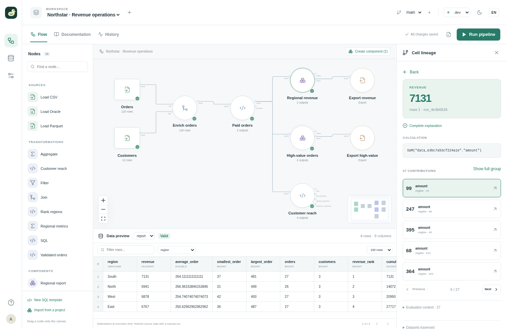

# Your first pipeline

Go from a fresh install to a result you can explain. The included **Northstar**
project provides synthetic CSV and Parquet data, reusable transformations and
exports. You do not need an external database account.

## 1. Start Duckpad

You need **Python 3.11+** and **Git**. The package includes the interface;
you do not need Node.js or a source checkout.
The default isolated SQL mode requires **Linux with Landlock ABI 2 or later**
(Linux 5.19+ with Landlock enabled). A Linux container or VM must also expose
this capability.

```sh
pip install duckpad
duckpad start
```

On a trusted, single-user Windows workstation, use `duckpad start --trusted-local`
instead. This explicit mode runs SQL without OS isolation, with your user
permissions. Use only trusted projects and keep the instance private to your
computer. See [trusted local mode](INSTALLATION.md#trusted-local-mode).

Open the local address printed in the terminal, normally `http://127.0.0.1:8765`.
Sign in as **admin** using the password printed once on first launch. Save it
somewhere private; the same password remains valid after a restart.

See [installation and accounts](INSTALLATION.md) for instance options,
virtual environments and development from source.

## 2. Open the example

Choose **New project** on the Projects page, enter a name, then choose
**Start from an example → Create**. Keep the **dev** environment selected and
click **Run pipeline**. Wait for the run to finish.
This reads 120 orders and 12 customers, joins them and writes two local CSV reports.


Select **Regional revenue** on the canvas and choose **report** in the output
selector. The table shows the calculated revenue for each region.

Use **Find a node…** to search the current graph by label, ID or
template. Choose a result with the mouse or the arrow keys and Enter to select
and center it. Inside a component, this searches that component's nodes.

**Search instance** in the top bar finds projects, open branches and placed nodes
across projects you can read, including nodes inside nested components. Results
show their project, branch and component path; selecting one opens that location.
Search uses saved project metadata, never SQL, parameter values, connection
secrets or result rows. It does not change the project or run a pipeline.

Press **Ctrl+F** (**⌘F** on macOS) to focus canvas search, or **Ctrl+K** (**⌘K**)
to open instance search. These shortcuts leave text editors, other form fields
and open dialogs in control of their keys.

## 3. Explain a number

Click a **revenue** cell in the result table. A large modal connects the original
**amount** cells to the sum that produced the selected revenue. Unchanged values
pass straight through, leaving only source cells and meaningful calculations.

The calculation shows `SUM(amount)`, its result and the full number of
contributing values. Use **Next** to display the next five inputs. Open a card's
details to inspect the SQL or the context that selected its rows. Pan and zoom
the graph as needed; press Escape to return to the result table.



An explanation describes the data captured by that run. It does not silently
read a changed source file. See [lineage coverage](LINEAGE.md) for supported SQL
and explicit limitations.

## 4. Make it yours

Select **Paid orders** and change its **status** parameter. The old preview
becomes **Stale**. Click **Run pipeline** again to compute the new result.
You choose when a run happens; editing never starts one automatically.

Try the **Code** tab to inspect the project files and SQL. Use **New working
branch** before experimenting with a shared definition, then compare your changes
before merging them. The [version control guide](GIT.md) explains the full review
workflow.

## Where next?

- Follow the [Northstar tour](EXAMPLE.md) for nested components and environment comparisons.
- Learn the [pipeline and SQL template contract](AUTHORING.md).
- Configure your own [connections](CONNECTORS.md).
- Invite your team with [accounts and project roles](INSTALLATION.md#accounts-and-project-access).

## If something gets in the way

- **An unsupported sandbox error:** check that the Linux kernel exposes Landlock
  ABI 2+. For your own trusted Windows workstation, restart with `--trusted-local`;
  shared instances must keep the isolation boundary.
- **An instance is already running:** stop the original process or use a different
  `--home` directory and `--port` for a second instance.
- **A blank or stale preview after restart:** run the pipeline again. Execution
  history persists; materialized results and lineage live in memory.
- **A build error on an older CPU:** the deployment guide describes the optional
  portable DuckDB runtime. Keep DuckDB 2.0; do not downgrade to bypass setup.
