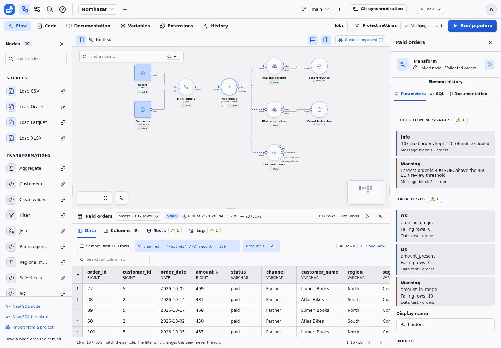
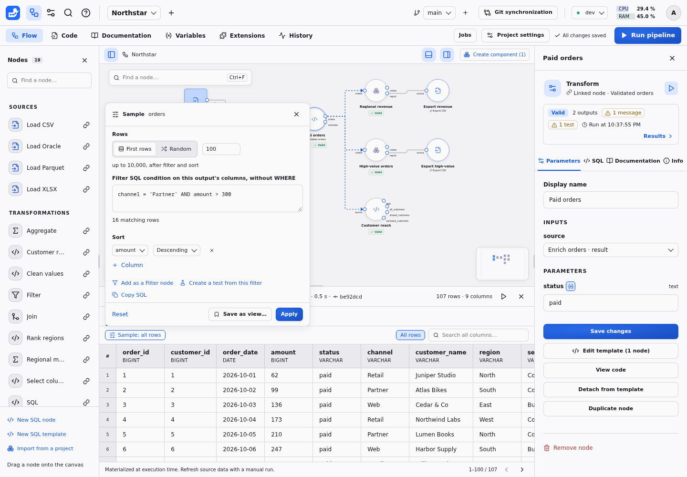
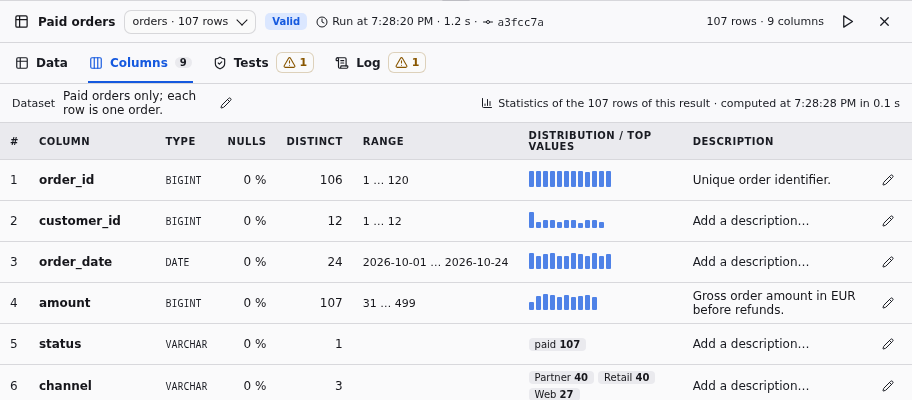
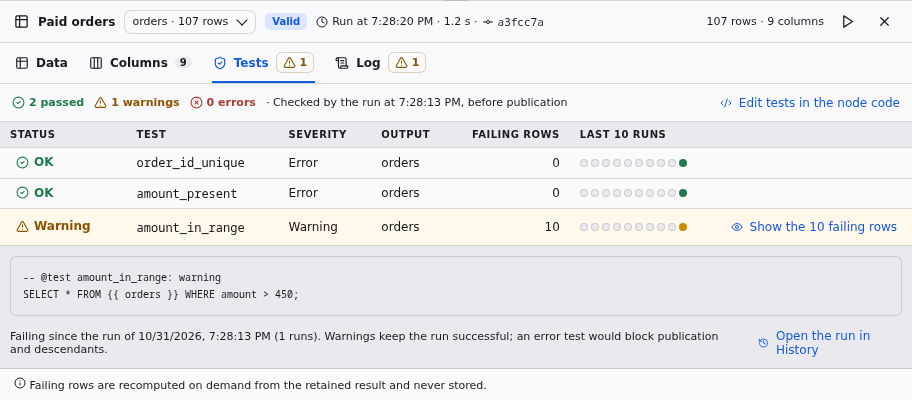
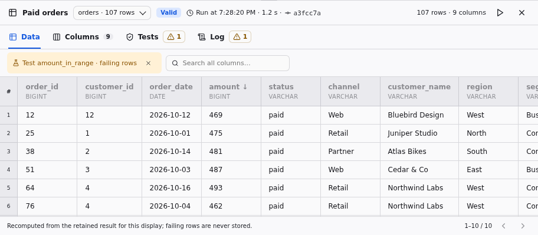
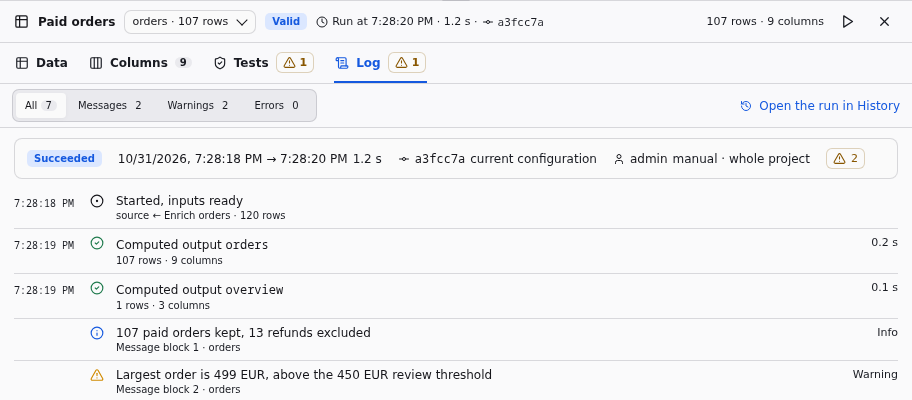

# Results, samples and logs

Inspect what actually ran, explore its data, and keep the run context alongside
the numbers.

Selecting a node opens two panels. The **inspector** on the right describes the
node: its parameters, compiled SQL, documentation and change history, the same
in every environment. The **results panel** under the canvas shows what the node
produced in the environment selected in the top bar: whatever changes when you
switch environment or run again is there.



The header names the node and the dataset shown, its **Valid** or **Stale**
badge, the time, duration and commit of the run that produced the rows, and the
row and column counts. With several outputs, or inputs, the selector lists the
node's outputs and, under **Inputs, to compare**, the datasets connected to its
inputs: showing an input keeps the current sample when its columns allow it, to
check an operation before and after. An export node has no rows: its panel opens
on **Log**, with **Tests**. A component instance shows its exposed outputs.

Under the node kind, the inspector keeps a one-line **result summary**: the
**Valid** or **Stale** badge, the number of outputs, warning badges for
messages and failing tests, **Last run failed** after a failure, the time of the
run and a **Results** link. Each part opens the results panel on the matching
tab: the badge and the outputs open **Data**, messages, the failure and the run
time open **Log**, failing tests open **Tests**. Like both panels, the summary
follows the environment selected in the top bar without repeating it.

## Data and samples

The **Data** tab pages through the retained result, 100 rows at a time. Select a
value to [explain it](LINEAGE.md); filtered, sorted and random rows keep their
identity, so lineage works on any cell of a valid result. **Search all columns**
finds text in every column. Clicking a column header sorts by that column.

**Sample** chooses which rows are displayed:

- **Rows:** all rows, the first rows, or a random sample with a seed, up to
  10,000 rows after the filter and sort. A seed always shows the same rows of the
  same result.
- **Filter:** a SQL condition on the dataset's columns, written without `WHERE`,
  such as `channel = 'Partner' AND amount > 300`. It is validated like a Filter
  node's condition: one expression, no query or statement, only this dataset's
  columns. `{{ var.name }}` references take the selected environment's value as a
  bound parameter. The number of matching rows updates as you type.
- **Sort:** one or more columns, ascending or descending.



Chips under the tabs show the active filter and sort; the cross removes one.
**A sample only changes the display:** runs always compute on all the data, and
descendants never read a sample. The sample is remembered in your browser for
each node output; it survives reruns and environment switches. A filter that no
longer applies, after a column was renamed for instance, is reported with
**Reset** instead of being dropped. Reading a sample stops after 30 seconds.

From the Sample popover:

- **Add as a Filter node** inserts a Filter node reading this output, with the
  same condition, when a check should become part of the pipeline.
- **Create a test from this filter** appends `-- @test <name>: <severity>` with
  `SELECT * FROM {{ output }} WHERE <filter>;` to the node code: rows matching
  the filter then fail the test. For a node linked to a template, the test goes
  into the template and checks every linked node, unless you detach this node
  first. Node code cannot reference project variables, so a filter using them
  must be rewritten with values.
- **Copy SQL** copies the query of the sample, written with `{{ port }}` rather
  than internal table names.

**Save as view…** names the current sample and saves it in `views.json`, so the
whole team finds "Large orders" or "Partner orders above 300" next to **All
rows** above the table. A view is a normal save: one commit, merged view by view
between branches, listed in comparisons and included in project ZIP archives.
Views never change results, so saving one makes nothing stale. Deleting a node
deletes its views in the same save. Readers and operators use views and their own
samples but cannot save views.

```json
{
  "validated:orders": [
    {
      "name": "Partner orders above 300",
      "rows": 100,
      "method": "first",
      "filter": "channel = 'Partner' AND amount > 300",
      "order": [["amount", "desc"]]
    }
  ]
}
```

Views are keyed by `node:port`, like dataset documentation. A view has a `name`,
unique for its output, and optionally `rows` (1 to 10,000), `method` (`first` or
`random`), `seed`, `filter` and `order` (`[column, "asc" | "desc"]` pairs).

## Columns and statistics



The **Columns** tab lists each column's position, name, type and description,
with the dataset description above, at once and without reading any rows.
Descriptions are edited in place with the pencil and saved in
`documentation.json`. Selecting a column name shows it in the Data tab. A chip
compares the columns with the previous successful run of the node in the same
environment: added, removed and retyped columns, or "Same columns as the previous
run".

**Compute statistics** scans the whole retained result once, never the displayed
sample: null percentage, approximate distinct values, range and distribution of
numbers and dates, and top values of text. The tab never starts this computation
by itself, since it competes with runs for the CPU on large results. Statistics
are kept for that result: reopening the tab, coming back to the node or another
user shows them at once with the time they were computed, and the run that
replaces the result discards them. The computation can be canceled and stops
after 30 seconds.

## Tests



The **Tests** tab summarizes the passed, warning and error tests of the latest
check, then lists each test with its severity, output, failing rows and its last
ten runs in this environment. Select a status to see the test's query and since
when it fails. **Show the failing rows** opens the Data tab on the rows the test
returns, recomputed from the retained result with the definitions recorded by
the run: they are paged like a sample and never stored. It needs a valid result.
**Edit tests in the node code** opens the code editor.



## Log



The **Log** tab tells the story of the latest run of the node: its status, start
and end, duration, commit and whether it matches the current configuration, who
launched it, its scope and warnings. The timeline lists the inputs, each output
with its row count and computing time, each `-- @message` result, the tests and
the publication, or the error that prevented it, with **Ask the assistant**. A
filter shows all entries, messages, warnings or errors. **Executed SQL** shows
the statements, bound values and variables of that run, with secrets masked.
**Open the run in History** opens its full record.

## API

- `GET /api/worktrees/{worktree}/preview/{node}` accepts `search` (all columns),
  `filter` (a SQL condition), `order` (a JSON list of `[column, direction]`),
  `method` (`first` or `random`), `rows` and `seed` besides `port`, `limit` and
  `offset`. `matched_count` counts the rows matching the filter and search;
  `filtered_count` the rows to page through.
- `GET /api/worktrees/{worktree}/statistics/{node}?environment&port` returns the
  columns, the statistics when they were computed for the current result, and
  the schema changes since the previous run. `POST` computes them; `DELETE`
  cancels a computation in progress. Readers may use all three.
- `GET /api/worktrees/{worktree}/test-rows/{node}/{test}?environment&limit&offset`
  returns a page of a test's failing rows for a valid result.
- Run records keep each output's `duration` in seconds.
