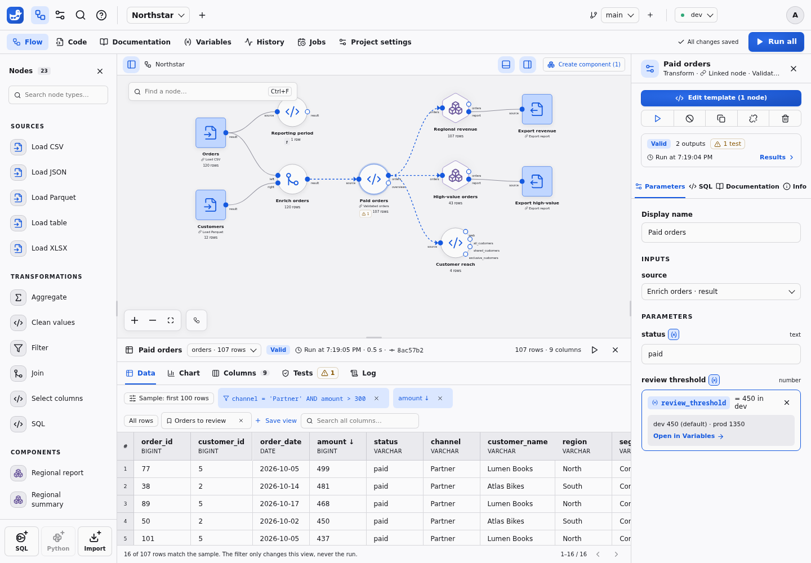
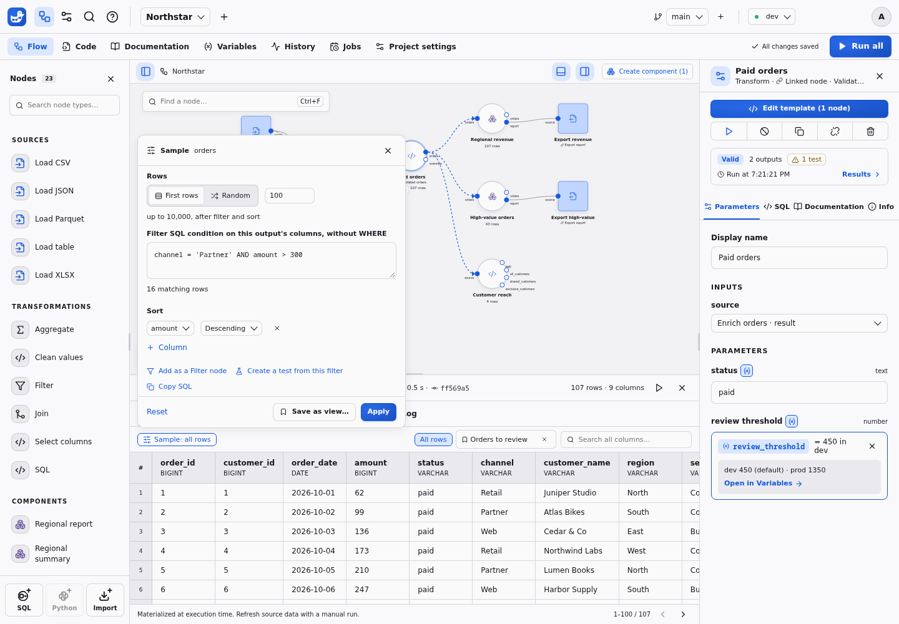
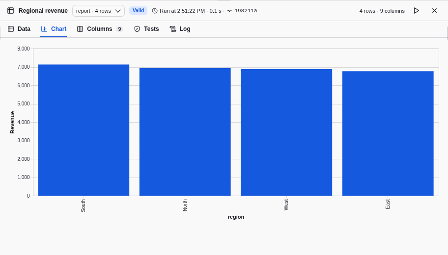
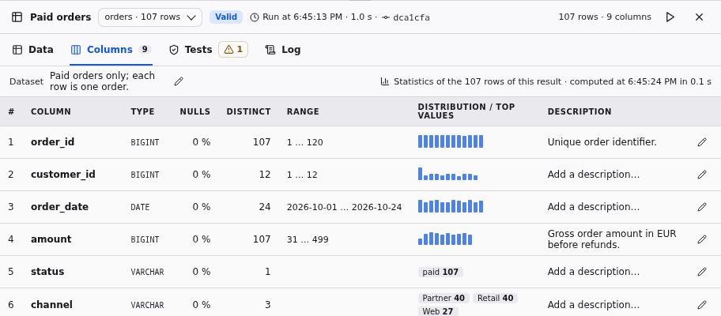
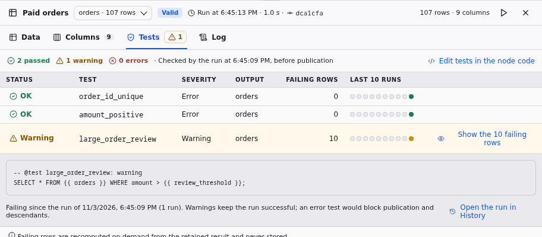
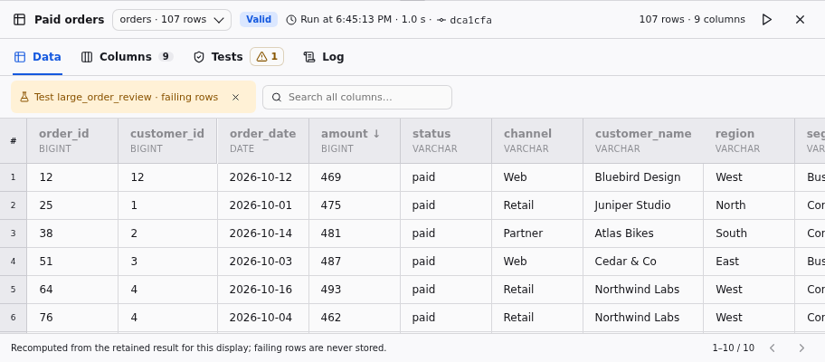
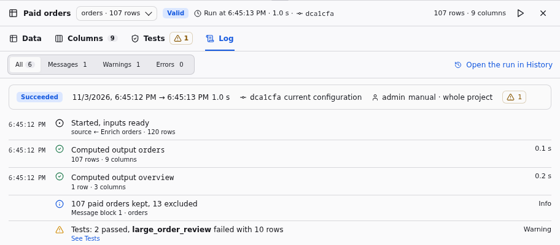

# Results, samples and logs

Selecting a node opens two panels. The **inspector** on the right describes the
node: its parameters, compiled SQL, documentation and change history. Resolved
variables and compiled SQL follow the selected environment. The **results panel**
under the canvas shows the data, charts, tests and logs for that environment.

The header names the node and the dataset shown, its **Valid** or **Stale**
badge, the time, duration and commit of the run that produced the rows, and the
row and column counts. With several outputs, or inputs, the selector lists the
node's outputs and, under **Inputs, to compare**, the datasets connected to its
inputs: showing an input keeps the current sample when its columns allow it, to
check an operation before and after. A sample filter is kept only when the other
dataset has every column of the current one; otherwise that dataset's own sample
is restored, as when opening failing rows from an input. An export node has no
rows: its panel opens on **Log**, with **Tests**. A component instance shows its
exposed outputs.

The inspector's result summary links to Data, Log and Tests, showing validity,
warnings and the latest failure for the selected environment.

A failed node shows its error above its results, with actions to open the code
at the failing line and the execution log. A blocked node, or a component with a
failure inside, names the node that failed and shows its error, however many
dependencies away, whether or not earlier rows remain. The error belongs to the
failed run and clears after a successful one.

While you edit a node's code, **Preview** adds a **Preview** tab with the outputs
computed from samples of its inputs. Nothing in it is saved or published; see
[previews](SQL.md#preview-while-you-edit).

## Result lifetime

Results belong to the branch and environment selected in the top bar. Switching
either can show different results or none at all; it never starts a run.

| State | What it means | What to do |
| --- | --- | --- |
| No result | This context has not run, or its in-memory data was cleared, for example by a backend restart | Run the node with its ancestors, or choose **Run all** |
| Valid | The retained data matches the saved processing configuration | Inspect, sample and explain cells |
| Stale | The retained data is from an earlier configuration or attempt | Inspect the old rows if useful; rerun before using them as current results or exploring lineage |
| Failed or canceled run | Nodes that finished before the failure published their results; the failed, blocked and canceled nodes did not | Inspect Log; their previous outputs can remain visible as stale |

SQL, parameter and upstream processing changes can invalidate results. Editing
layout or documentation does not. Saving never launches a run, and changing an
external source file does not refresh an existing result: run again to read it.

History keeps execution records, SQL and outcomes after a restart; it is not a
stored copy of every historical result table. Use an export when you need a
result file to keep or share. Job results follow the same context lifetime;
see [Jobs](JOBS.md#results-and-history).

## Data and samples

The **Data** tab pages through the retained result, 100 rows at a time. Select a
value to [explain it](LINEAGE.md); filtered, sorted and random rows keep their
identity, so lineage works on any cell of a valid result. **Search all columns**
finds text in every column. Clicking a column header sorts by that column.

**Sample** chooses which rows are displayed:

- **Rows:** all rows, the first rows, or a random sample with a seed, up to
  10,000 rows after the filter and sort. A seed always shows the same rows of the
  same result.
- **Filter:** a SQL condition on the dataset's columns, written without `WHERE`,
  such as `channel = 'Partner' AND amount > 300`. It is validated like a Filter
  node's condition: one expression, no query or statement, only this dataset's
  columns. `{{ var.name }}` references take the selected environment's value as a
  bound parameter. The number of matching rows updates as you type.
- **Sort:** one or more columns, ascending or descending.

Chips under the tabs show the active filter and sort; the cross removes one.
**A sample only changes the display:** runs always compute on all the data, and
descendants never read a sample. The sample is remembered in your browser for
each node output; it survives reruns and environment switches. A filter that no
longer applies, after a column was renamed for instance, is reported with
**Reset** instead of being dropped. Reading a sample stops after 30 seconds.

From the Sample popover:

- **Add as a Filter node** inserts a Filter node reading this output, with the
  same condition, when a check should become part of the pipeline.
- **Create a test from this filter** appends `-- @test <name>: <severity>` with
  `SELECT * FROM {{ output }} WHERE <filter>;` to the node code: rows matching
  the filter then fail the test. For a node linked to a template, the test goes
  into the template and checks every linked node, unless you detach this node
  first. Node code cannot reference project variables, so a filter using them
  must be rewritten with values.
- **Copy SQL** copies the query of the sample, written with `{{ port }}` rather
  than internal table names.

**Save as view…** names the current sample and saves it in `views.json`, so the
whole team finds "Large orders" or "Partner orders above 300" next to **All
rows** above the table. A view is a normal save: one commit, merged view by view
between branches, listed in comparisons and included in project ZIP archives.
Views never change results, so saving one makes nothing stale. Deleting a node
deletes its views in the same save. Readers and operators use views and their own
samples but cannot save views.

For external editing, see the [saved view file format](AUTHORING.md#saved-views).

## Chart

The **Chart** tab draws the shown dataset with the Vega-Lite charts declared for
it in `charts.json`. A chart plots the whole retained result, up to 5,000 rows,
never the displayed sample. Editors can choose **Add a chart** on an output
without one. See the [charts guide](CHARTS.md) for the format, the allowed specs,
value conversion and the security model.

## Columns and statistics

The **Columns** tab lists each column's position, name, type and description,
with the dataset description above, at once and without reading any rows.
Descriptions are edited in place with the pencil and saved in
`documentation.json`. Selecting a column name shows it in the Data tab. A chip
compares the columns with the previous successful run of the node in the same
environment: added, removed and retyped columns, or "Same columns as the previous
run".

**Compute statistics** scans the whole retained result once, never the displayed
sample: null percentage, approximate distinct values, range and distribution of
numbers and dates, and top values of text. The tab never starts this computation
by itself, since it competes with runs for the CPU on large results. Statistics
are kept for that result: reopening the tab, coming back to the node or another
user shows them at once with the time they were computed, and the run that
replaces the result discards them. The computation can be canceled and stops
after 30 seconds.

## Tests

The **Tests** tab summarizes the passed, warning and error tests of the latest
check, then lists each test with its severity, output, failing rows and its last
ten runs in this environment. Select a status to see the test's query and since
when it fails. **Show the failing rows** opens the Data tab on the rows the test
returns, recomputed from the retained result with the definitions recorded by
the run: they are paged like a sample and never stored. It needs a valid result.
**Edit tests in the node code** opens the code editor.

## Log

The **Log** tab shows the latest run of the node: its status, start
and end, duration, commit and whether it matches the current configuration, who
launched it, its scope and warnings. The timeline lists the inputs, each output
with its row count and computing time, each `-- @message` result, the tests and
the publication, or the error that prevented it, with **Ask the assistant**. A
filter shows all entries, messages, warnings or errors. **Executed SQL** shows
the statements, bound values and variables of that run, with secrets masked.
**Open the run in History** opens its full record.

## Download exported data

Use an **Export CSV** or **Export XLSX** node to write the full input table,
including the format options configured on that node. After a successful run,
select the export and choose **Log → Download exported data**. For a first
export, follow [Use your own data](YOUR_DATA.md#3-export-and-download).

Downloads apply to a single `COPY ... TO` statement using a `destination`
parameter and a local CSV/XLSX target. They use a saved copy of the exported
bytes, remain private to project members and survive a backend restart. Changed
inputs/settings, upstream reruns, a failed export or a missing download copy
require another successful export. A new export replaces the previous download.
Database and remote-storage destinations do not offer browser downloads.

**Code → Download project ZIP** shares the pipeline definitions, excluding data
and Git history. It does not download the displayed table. See
[project files and imports](AUTHORING.md#edit-and-share-project-files).
