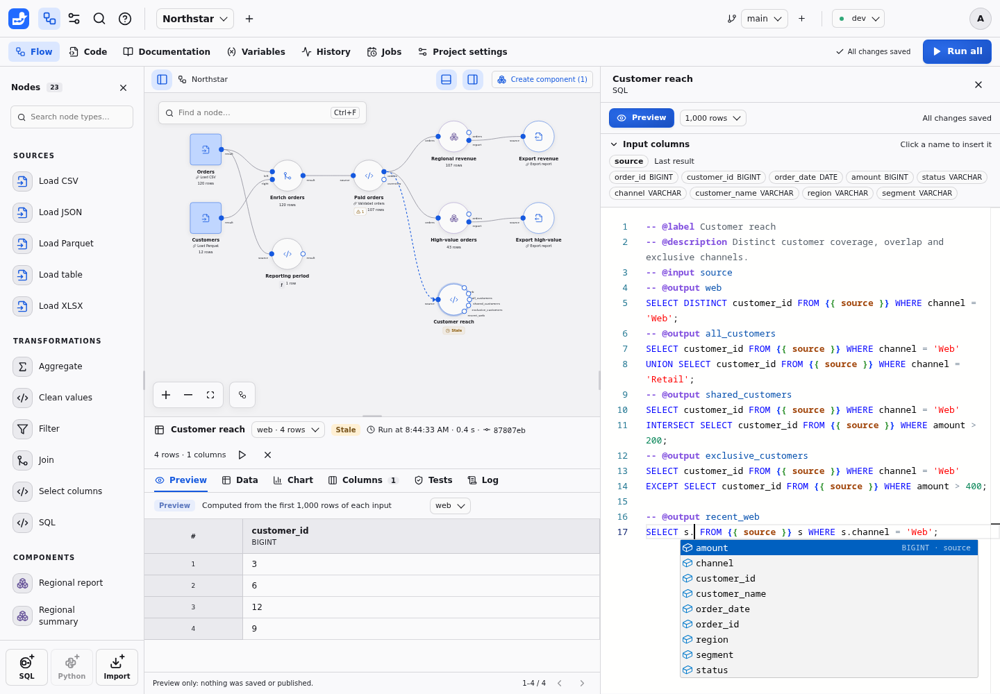
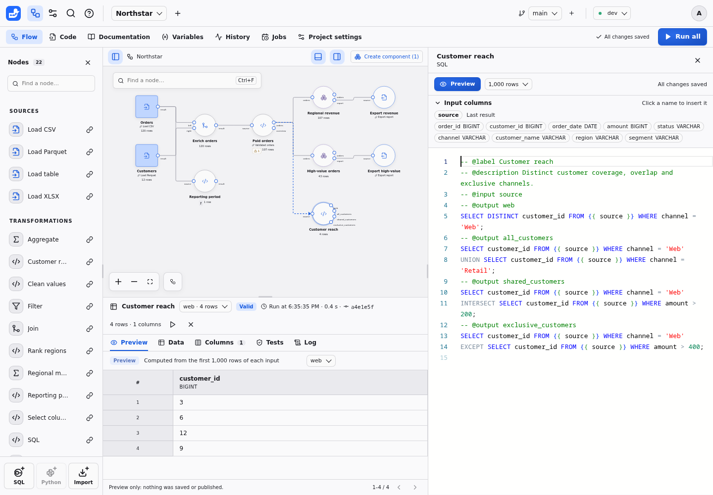

# SQL syntax and custom nodes

A Duckpad node contains ordinary DuckDB SQL with comment directives describing
its inputs, parameters, outputs and checks. The same contract applies to a
node's own code and a shared SQL template. Start with the
[15-minute tutorial](QUICKSTART.md) for an example you can run without files.

## Create and edit code

Drag **SQL** from the palette list onto the canvas, then use
**Edit code**. The code opens beside the canvas, in place of the inspector, and
saves as you type; select another node to edit its code, or close the editor to
return to the inspector. This changes only that node. To share code between
nodes, follow [code ownership and linked templates](AUTHORING.md#editing-node-code).

**Input columns**, above the code, list the name and type of each input's
columns: from the upstream node's last result or, when it has none but the branch
already ran in this environment, described from the upstream code. Click a column
or an input to insert its name at the cursor.

## Completion, hovers and problems

The editor suggests what fits where you type, or on **Ctrl+Space**. Press
**Tab** to insert a suggestion: in SQL, **Enter** always starts a new line.

- after `-- @`, the directives; after `-- @param name:`, the parameter types,
  with the declared connection parameters or inputs that a type needs; in a
  `connection` default, the connections granted to the project;
- inside `{{ }}`, the inputs, the parameters and the outputs that the block can
  read: outputs declared earlier, or every output in a check;
- the columns of the inputs, with their types, and after an alias such as
  `o.` in `FROM {{ orders }} o`, the columns of that input only;
- the functions, keywords and types of the server's DuckDB, the named options
  of table functions such as `read_csv`, and the types after `::`.

Typing a function's parenthesis shows its parameters. Hover a reference to see
what it holds on this node: an input's upstream node and columns, or a
parameter's type, default and value, including the variable it is bound to.
Hover a function for its description and an example.

Problems that the server would refuse are underlined as you type: unknown
directives, invalid declarations, references to undeclared names or to outputs
computed later, and quoted references, which bind no value. A saved problem the
editor cannot locate is shown on the first line. Hover it, press **F8** for the
next one, or **Ctrl+.** for quick fixes such as declaring a missing input or
parameter. The usual editing commands are available: **Ctrl+F** to find,
**Ctrl+H** to replace, **Ctrl+/** to comment lines, **Alt+↑/↓** to move them,
**Ctrl+D** to select the next occurrence, and **F1** for every command (**⌘**
instead of **Ctrl** on macOS).



## Preview while you edit

**Preview** (**Ctrl+Enter**, **⌘Enter** on macOS) computes the code you are
typing, saved or not, on the first 1,000 rows of each input's last result, and
shows its outputs in the **Preview** tab of the results panel. The editor's
selector reads 100 or 10,000 rows, or every row, instead. Fix an error at the line
it points to, then preview again.



A preview keeps nothing: it records no run in History, publishes no result,
leaves **Valid** and **Stale** unchanged and skips tests, messages and exports.
Its inputs need results: otherwise it lists the missing ones and offers **Run
ancestors**, which runs only the upstream nodes, then previews again. It says
when an input result is stale. Previews need edit access, wait for an active run
of the branch to finish, compute SQL nodes only, not Python or partitioned ones,
and stop after 30 seconds.

The inspector's **SQL** tab compiles the current configuration without running
it. After a run, **Results → Log → Executed SQL** shows what actually ran.
Saving code makes affected results stale; choose **Run all** to recompute.

## Declarations

Write each directive on its own line, starting with `-- @`:

| Directive | Purpose |
| --- | --- |
| `-- @label Paid orders` | Display label for the definition |
| `-- @description Keep paid orders.` | Short explanation |
| `-- @input source` | Declare an input port to connect on the canvas |
| `-- @param status: text = "paid"` | Typed parameter and optional default |
| `-- @output orders` | Name the query's output port |
| `-- @test amount_present: error` | Check for failing rows; severity defaults to `error` |
| `-- @message` | Query returning `level` and `message` columns |

Inputs, parameters and outputs share one namespace: use unique identifiers made
of letters, digits and underscores, starting with a letter or underscore.
Unknown directives are errors. Each output block contains exactly one query,
ending with a semicolon. Every query reads only declared inputs, earlier outputs,
resources and connections. A node with outputs cannot write; a node without
outputs can write data, or only run tests and messages.

## Reference inputs and earlier outputs

```sql
-- @label Paid orders
-- @input source
-- @param status: text = "paid"
-- @output orders
SELECT * FROM {{ source }} WHERE status = {{ status }};
-- @output summary
SELECT COUNT(*) AS orders, SUM(amount) AS revenue FROM {{ orders }};
```

Connect a node output to the `source` input. References such as `{{ source }}`
resolve to that table; `{{ status }}` becomes a bound value. Do not write
`'{{ status }}'` or substitute a canvas label for a declared port. A CTE or
subquery can read the same declared inputs.

An output can read earlier outputs in the same file. Self references and forward
references fail validation. All outputs publish together; a failed query or an
error check keeps the previous successful outputs stale and blocks descendants.

## Read a file

Use a **Load CSV** palette node, or put this complete definition in a new node:

```sql
-- @label Read orders
-- @param connection: connection = ""
-- @param path: file(connection)
-- @output orders
SELECT * FROM read_csv({{ path }}, header = true);
```

Set `path` through the node's file parameter: upload a CSV or select an allowed
file path. The empty `connection` selects project files: a relative path
resolves under the project's resources, where uploads land, with no connection
or grant. Choosing a granted connection as the node's **Location** resolves
relative paths against its root instead. File readers use
one declared file parameter (or a list) as their only positional argument, with
named options such as `header = true` or `delim = ';'` afterward.

For Parquet use `read_parquet({{ path }})`. A format provided by an extension,
such as XLSX, may need that extension enabled in the **Project settings → Extensions** section;
S3 and databases need a connection. Follow [Connections](CONNECTORS.md#file-formats-and-extensions).

## Read a database table

Use a **Load table** palette node. Its definition reads a table through the
attachment of a granted database connection:

```sql
-- @label Load table
-- @param connection: connection = ""
-- @param schema: schema_name(connection) = "public"
-- @param table: table_name(schema) = ""
-- @output result
SELECT * FROM {{ connection }}.{{ schema }}.{{ table }};
```

The `schema_name` and `table_name` types let the inspector suggest the schemas
and tables of the selected environment. Sources read tables only through a
declared connection. **Export table** writes with an explicit
`INSERT INTO {{ connection }}.{{ schema }}.{{ table }} BY NAME`; see
[Database tables](CONNECTORS.md#database-tables).

## Write an export

```sql
-- @label Export report
-- @input source
-- @param connection: connection = ""
-- @param destination: destination(connection) = "report.csv"
COPY (SELECT * FROM {{ source }})
TO {{ destination }} (FORMAT CSV, HEADER TRUE);
```

Connect `source` to the table you want to export. Exports write with an
explicit `COPY ... TO` or `INSERT` statement and have no `@output`. Their
connections need the `write` capability; other nodes' connections need `read`.
With project files, the relative destination resolves inside the branch and
environment's export directory. Run the node and open **Log →
Download exported data** to retrieve its CSV. See [export downloads](RESULTS.md#download-exported-data)
for download lifetime, XLSX and destination limits.

An export can also declare tests and messages. They run **before the external
write**, even when declared below `COPY`. A failing error check prevents it.

## Parameter values

Numeric and list fields preserve the text you type until you leave the field or
save. Clearing a numeric field removes its override, so the template, component,
or connector default applies. Without a default, the parameter remains required.
Comma-separated lists trim spaces around each item and preserve spaces within
items: `New York, Paris` becomes `["New York", "Paris"]`.

| Parameter declaration | Value contract |
| --- | --- |
| `text`, `number`, `boolean` | Scalar DuckDB bindings; do not quote the placeholder |
| `date` | A `YYYY-MM-DD` value bound as a DuckDB `DATE` |
| `choice(a\|b)` | Enumerated scalar binding |
| `keyword(inner\|left\|right\|full)` | Validated SQL keyword, for structural choices |
| `file(connection)`, `destination(connection)` | Explicit path or URI; relative local paths resolve against the connection root. With project files, relative files resolve under the project's resources (uploads) and destinations under the worktree/environment export directory |
| `connection` | Logical instance connection ID; resolves to a collision-free runtime alias. Empty (`""`) selects project files for the parameters that reference it; the inspector labels it **Location** |
| `secret(connection)` | Runtime secret name, for extension options; never a password |
| `identifier`, `column(source)` | Quoted identifiers; input column suggestions use resolved schemas |
| `schema_name(connection)`, `table_name(schema)` | One quoted schema or table name of a database connection; the inspector suggests those of the selected environment. `table_name` names the `schema_name` parameter whose schema lists its tables |
| `expression(source)` | Parsed scalar SQL expression; queries and side effects are rejected |
| `expressions` | Comma-separated or array expression list, for projections and aggregates |
| `list<text>`, `list<number>`, `list<boolean>`, `list<column>` | A typed list emitted as literals or identifiers |
| `schema` | JSON mapping of column names to DuckDB types, used for CSV overrides |

## Check data and report messages

Append checks to a node after its output queries:

```sql
-- @test amount_present
SELECT * FROM {{ orders }} WHERE amount IS NULL;
-- @message
SELECT 'info' AS level, COUNT(*) || ' orders checked' AS message
FROM {{ orders }};
```

These blocks assume the `orders` output from the transformation above. A test
returns failing rows, not a count row. Message levels are `info`, `warning` and
`error`; a zero-row message query emits nothing. Outputs compute first, then
checks run in declaration order before publication or export. Read the dedicated
[data tests](TESTS.md) and [execution messages](MESSAGES.md) guides for failure
behavior, history and limits.

## Reuse values across nodes

Declare a typed [project variable](VARIABLES.md), then bind an instance parameter
using its variable button. For a root flow's expression parameter, write a
reference such as `amount >= {{ var.minimum }}` in the parameter's value.
Variable references belong to root instances, not reusable SQL definitions or
template defaults. Expose a component parameter and bind it on the instance.

## Diagnose a node

| Symptom | Check |
| --- | --- |
| Missing input | Connect every declared input, or remove an unused declaration |
| Undeclared, self or forward reference | Match the name and move the required output earlier |
| More than one statement | Put each tabular query in its own output block |
| Undeclared table or file read | Use a declared input or a source with resource parameters |
| Invalid expression | Expression parameters accept scalar expressions, not queries |
| A test fails with count zero | Return failing rows; `SELECT COUNT(*)` itself returns a row |
| A successful result is stale | Save, then rerun after SQL or parameter changes |

Inspect the current compiled SQL for configuration errors and the
[execution log](RESULTS.md#log) for the statements and values of a particular run.
