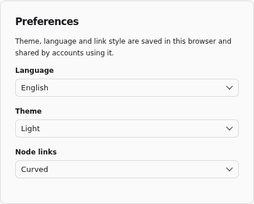

# Find your way around

Open a project from **Projects** to enter its working branch. **Flow** is the
canvas; **Code** edits its files; **Documentation** explains the project;
**Variables** configures shared values; **History** lists executions;
**Jobs** manages repeatable runs; **Project settings** contains access, connections,
Python, partitions, extensions and general settings. Partition and extension
settings apply to the branch shown in the top bar.

**Projects** shows the last modification date and latest run status. From seven
projects, search by project name, or sort by name, modification date or latest run.
**Code** opens the selected node's source, or the README without a selected node.
Its tree labels node files by display name, keeps file paths in tooltips, and
collapses built-in templates by default. **Filter files…** matches paths and node
display names, revealing matching files inside folders. Press Enter to open the
first match or Escape to clear the filter; filtering keeps your editor draft.
Markdown, JSON, Python, SQL and TOML files have distinct icons.

## Build and inspect

Add a palette item by clicking it or dragging it onto the canvas. While dragging,
the preview uses the node's shape and the canvas zoom, and is crossed out where
a drop does nothing; release to place the center of the shape at the pointer.
**Search node types…** filters the palette, and **Project templates** lists the
templates created in the project. Connect an output to an input, or choose the
upstream output in the node's inspector. Connected sockets are filled, unused
outputs stay hollow, and an input without a source is orange on the node until
you connect it. Point at a node or a link to highlight it. Click a link to select
it, then press Delete or Backspace to disconnect it. Shift-click selects multiple
links; Ctrl/Cmd+Z undoes a deletion. Select a node for
its parameters on the right and its [results](RESULTS.md) below. Double-click a
SQL or Python node to edit its code; a linked node opens its shared template.
**Edit code** at the top of the inspector does the same. The icons under it run
the node with its ancestors, mute it, duplicate it, link it to a template or
remove it; point at an icon for its name, or right-click the node for the same
actions in a menu. The removal button deletes the node in one click. Delete and
Backspace also keep ordinary removal. When reconnection is possible, the context
menu additionally offers **Remove and reconnect**, with **Ctrl/Cmd+Delete** as its
shortcut. For `A -> B -> C`, removing B normally disconnects A and C; reconnecting
makes A feed C directly. Reconnection is available for a single transformation in
the main flow with one input, one output and no declared external writes, one connected source
and at least one consumer. All consumers receive the upstream output; nodes stay
at their current positions. The action is hidden when unavailable, and its shortcut
does nothing in that case.
Check downstream column expectations after bypassing a step: links can be valid
while the data no longer fits its consumers. Removing a node and reconnecting its
links can be undone together with **Undo** in the
notification or Ctrl/Cmd+Z. Double-click a [component](COMPONENTS.md) to open
its contents; use the breadcrumbs to return. **Fit view** brings the graph into
view. **Auto-arrange nodes** places dependencies in columns, orders each column to
avoid crossing links, and lines up linked sockets. Drag a port onto empty space to
add a compatible connected node.

Select one or more nodes and press **M**, or choose **Mute node (M)** among a
node's actions, to bypass their code; repeat to restore it. A muted node is faded, with a
dashed outline and its links drawn through it, and its inspector offers **Unmute
node (M)**. Code, parameters and links are kept, the state is saved with the
project, and undo works as for other edits.

Each output receives the input in the same position; extra outputs reuse the first
input, and other inputs are ignored. A muted component bypasses its whole subgraph,
and a muted export writes nothing. Sources have no input to pass through, so they
cannot be muted. Muting or unmuting makes downstream results stale until the next
run, and downstream code must accept the passthrough columns. The code editor's
preview still computes the node's own code.

Node names come from **Display name**, then the SQL `-- @label` directive or
template name. Diagnostics, lineage, variable usage, conflict titles and new
Git commits use the same names. References inside a component include its parent
path; IDs remain available in file paths and tooltips.

## Find nodes and projects

Use **Find a node…** to search the current graph by label, ID or template.
Choose a result with the mouse or the arrow keys and Enter to select and center
it. Inside a component, this searches that component's nodes.

**Search instance** in the top bar finds projects, open branches and placed
nodes across projects you can read, including nested components. Results show
their project, branch and component path; selecting one opens that location.
Search uses saved project metadata, excluding SQL, parameter values and result rows.
It also offers **Run all**, **New working branch**, project tabs and settings
sections according to the current context and permissions. Actions appear before
typing; filter by their names or settings category.

Press **Ctrl+F** (**⌘F** on macOS) for canvas search or **Ctrl+K** (**⌘K**) for
instance search.

## Save and run

The flow has no Save button. The inspector saves a parameter, the guided forms
and the node documentation after a short pause in typing, or when you leave the
field; the code editor does the same, saves at once with **Ctrl+S** (**⌘S**), and
saves before it closes. The top bar shows **Saving…**, **All changes saved** or
**Unsaved changes**; a failed save shows its error where you typed and is retried
when you edit again or leave the field.

A save applies its project files and Git commit together: a failed save leaves
the previous files and branch commit in place.

Every run first saves pending editor changes and waits for saves already in
progress; a failed save stops the launch. **Run all** runs the whole flow;
a node's **Run with ancestors** runs a smaller scope. A run from the interface is
refused while an input in its scope has no source: the banner names the input
and the node is selected. **Stop execution** requests cancellation of active
SQL. A protected environment asks for confirmation.

While a run is active, the strip below the project tabs, and a running Job's
details, show its environment, completed nodes (or partitions, failed ones
counted separately) and an approximate time remaining. The estimate uses previous
successful node durations in the same worktree and environment.

Successful canvas nodes show the primary output's row count; stale, failed and
warning indicators remain visible. Results belong to a branch and environment;
see [result lifetime](RESULTS.md#result-lifetime) and
[environments](ENVIRONMENTS.md).

## Undo, copy and paste

On the canvas, **Ctrl+Z** (**⌘Z**) undoes your latest change of this session and
**Ctrl+Shift+Z** or **Ctrl+Y** (**⌘⇧Z**) redoes it, including parameters, code,
deleted nodes, groups, library imports, variable renames and conflict resolutions;
deleting nodes also offers **Undo** in its message. An undo saves the inverse of
that change as a new commit: later edits to other nodes, yours or a collaborator's,
are kept, and a conflicting one is reported like any concurrent edit. **Ctrl+C**
and **Ctrl+V** (**⌘C**, **⌘V**) copy the selected nodes and paste them, with the
connections between them, into this flow, a component or another branch opened in
the same browser tab; copies get new IDs and are offset. These shortcuts do nothing
while you type in a field or editor, or while a dialog is open.

## Preferences and access

Use the account menu for **User settings**. Its sections separate **Preferences**
(language, theme and link style), **Password**, **SSH key for Git** and **API tokens**.
Each section has its own URL for bookmarks and supports browser back and forward.
Duckpad supports English, French and Portuguese, with light and dark themes.
**Node links** are curved by default; **Right angles** draws them with vertical
segments, and links from different outputs never share one.
Preferences do not change project files. Available actions depend on your
[instance and project roles](INSTALLATION.md#accounts-and-project-access).

The initial language follows your browser's supported languages and the theme
follows your system. A manual choice is saved in this browser and takes priority
on later visits.

For your first working pipeline, follow [Duckpad in 15 minutes](QUICKSTART.md).
Then [use your own data](YOUR_DATA.md), or consult
[troubleshooting](TROUBLESHOOTING.md) when an action or result is unexpected.
