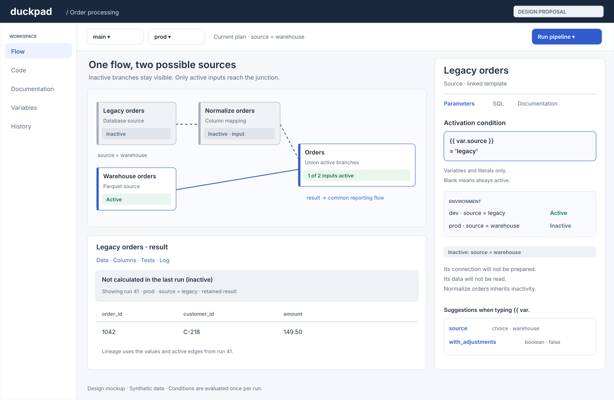
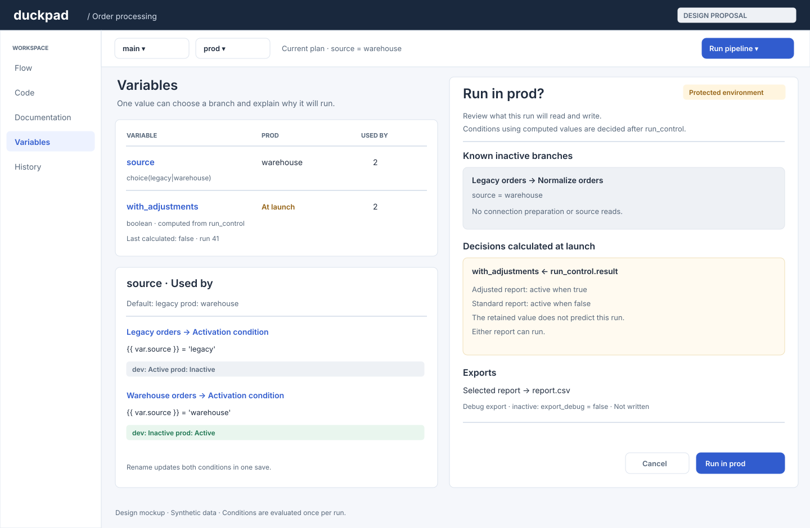
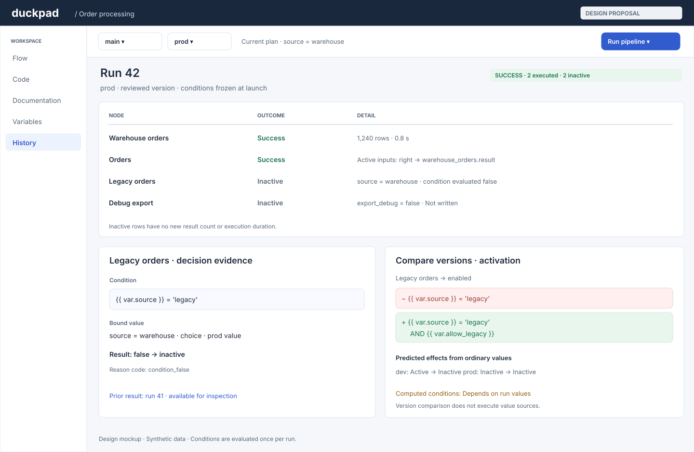

# Conditional branches (design proposal)

**Status: accepted on 2 November 2026 (see [Decisions](#decisions)), not implemented yet.** This document defines the first version; the mockups illustrate the proposed interface.

## Summary

Give a node or component instance an optional `enabled` condition. Resolve it once from the run's frozen variables, before preparing that branch's resources. A false condition makes the node **inactive**: no source preparation, reads, tests or writes. Inactivity propagates through ordinary data edges. A dedicated **Union active branches** node ignores inactive inputs and resumes the common part of the flow.

For example, `source = 'warehouse'` selects a Parquet source while an unconfigured legacy database branch stays untouched. Both branches remain in the same versioned flow. A downstream export writes the selected result, and run history explains which branch was inactive and why.

## Problems and inspirations

A false SQL `WHERE` predicate can still bind a missing table or open a file. An ordinary union includes both inputs, and separate projects or Job scopes duplicate the shared graph. Conditions must therefore change execution planning, rather than filtering rows after sources have been prepared.

Conditions affect execution planning. A generic setting to ignore missing inputs
cannot define meaningful behavior for every join, export or SQL node.

## Decisions

Accepted on 2 November 2026:

1. `enabled` belongs to a node, including component instances, never to an output port in v1. Omission means active; there is no implicit environment predicate.
2. Conditions use a restricted boolean expression over typed variables and literals. They cannot query data, call functions or refer to columns or partitions.
3. Evaluate each needed condition once, after its variables are frozen. Establish the active data graph before preparing consumer connections or fingerprints.
4. Use a dedicated junction with explicit executable identity, not a generic trigger rule or an editable template name that changes scheduler behavior.
5. Warn when ordinary variables prove a junction has no active inputs in an environment. Do not reject it: an intentionally empty run is a valid outcome.
6. Keep previous inactive results and their own validity; show their producing run. They never become substitute inputs for the current run.
7. Compare versions shows condition definitions and potential environment effects; compare runs shows the actual frozen decisions.

## Versioned model

### Root nodes

Add optional `enabled` to nodes in `flow.json`. It accepts a JSON boolean or a nonempty expression string. A removed/blank UI field removes the property; an externally supplied empty string, `null`, number or object is invalid. The same property applies to normal SQL nodes, linked nodes, exports and component instances. It remains instance configuration when code is linked, detached or duplicated.

The following proposed flow fragment uses existing source templates. Referenced templates and variables must exist in the project:

```json
{
  "nodes": [
    {
      "id": "legacy_orders",
      "template": "load_table",
      "enabled": "{{ var.source }} = 'legacy'",
      "params": {"connection": "legacy", "schema": "public", "table": "orders"}
    },
    {
      "id": "warehouse_orders",
      "template": "load_parquet",
      "enabled": "{{ var.source }} = 'warehouse'",
      "params": {"file": "orders.parquet"}
    },
    {"id": "orders", "operation": "union_active_branches", "params": {"mode": "all"}}
  ],
  "edges": [
    {"id": "legacy", "source": "legacy_orders", "sourceHandle": "result", "target": "orders", "targetHandle": "left"},
    {"id": "warehouse", "source": "warehouse_orders", "sourceHandle": "result", "target": "orders", "targetHandle": "right"}
  ]
}
```

`operation` is a **new engine-managed node kind**, mutually exclusive with `template`, `component` and node-owned SQL. A template cannot carry this behavior: built-in templates are copied into each project as editable files, and the engine must generate the SQL over whichever inputs are active. Its palette label is **Union active branches**. Reserve `union_active_branches` in the model and validate its interface; do not infer behavior from `label`, `preset`, `origin` or a user template's name. Those fields do not currently select executable code. The inspector shows generated SQL read-only. Duplication, component grouping and project import preserve this operation; converting it to editable SQL requires an explicit warning that its inactive-input semantics would be lost. No automatic conversion in v1.

### Condition language and evaluation

Use the existing `{{ var.name }}` reference parser and scalar binding types: boolean, text/choice, finite number and date. Identifier and list variables are rejected. No textual expansion of a value into SQL is permitted.

| Allowed | Examples and constraints |
| --- | --- |
| Boolean constants and references | `true`, `false`, `{{ var.with_adjustments }}` |
| Scalar literals | SQL strings with escaped quotes, finite numbers, `DATE '2026-10-01'` |
| Comparisons | `=`, `<>`, `!=`, `<`, `<=`, `>`, `>=`; operands must have compatible declared types |
| Boolean composition | `AND`, `OR`, `NOT`, parentheses; operands must be booleans |
| Literal membership | `{{ var.source }} IN ('legacy', 'warehouse')`, and `NOT IN`; scalar literals only |

Reject columns, `SELECT`, subqueries, table references, functions (including clock, random and environment access), arbitrary casts, comments, statement separators, other namespaces and `{{ partition }}` / `{{ partition.attribute }}`. Dates compare with dates; boolean truthiness, text-to-number coercion and a bare string such as `'false'` are not accepted. A missing/unavailable variable or a nonboolean/NULL result is an error, never silently false.

Parse the expression with sqlglot after substituting reference tokens, as the sample filter already does (`sample_condition` in `execution/samples.py`, with `check_variables` and `variable_values`); then validate a closed AST allowlist and operand types. Evaluate only that validated scalar expression with bound values on a restricted connection with no project catalogs, extensions or external access. Type-check all references even if a boolean branch could short-circuit. Never use Python `eval`, Jinja execution or a general project SQL connection. An evaluation failure blocks the affected node and its consumers while independent branches can run.

### Components and exposed boolean controls

An instance's `enabled` gates its entire expanded subtree, including exports and value sources. If false, no child is prepared and all its outputs are inactive. Ordinary component boundary inputs remain required: an inactive boundary input makes that instance inactive. To merge alternatives, put the junction before that boundary or entirely inside the component. There is no implicit optional port.

A definition cannot reference `var.*`. Extend the existing exposed-parameter target descriptor with `field: "enabled"`, mutually exclusive with `param`. It accepts only an exposed **boolean** parameter and replaces the child's effective `enabled` value. Two parameters targeting the same activation field are invalid. An untargeted internal activation field may be a boolean literal; project-dependent expression strings stay on root instances. Nested definitions forward boolean parameters via the existing `param` targets until the final `field: "enabled"` target.

```json
{
  "parameters": {
    "apply_adjustments": {
      "type": "boolean",
      "default": true,
      "targets": [{"node": "adjustments", "field": "enabled"}]
    }
  }
}
```

A root instance sets that parameter with the same values as `enabled`: a boolean, the existing `{"$var": "with_adjustments"}` binding, or a condition string such as `"{{ var.source }} = 'legacy'"`, evaluated with the restricted evaluator above before expansion. The instance holds the expression, as it already does for the grouped expression parameters of `expose_variables`, so no new binding form is needed. A parameter is an activation control only when all its targets, including nested forwarding, end at `field: "enabled"`; mixing SQL-parameter and activation targets is rejected in v1. Missing required controls diagnose their affected subtree.

**Group into component** moves each selected node's `enabled` value to one such instance parameter, creates its activation target, and leaves no project references in the definition. Unchanged controls preserve effective activation and result validity. Import copies the boolean interface but never captures variables from the source project. Ungrouping restores equivalent root conditions; comparison, rename, usage search and ZIP handling cover activation parameter values as well as `enabled`.

## Planning and execution

### Phase order and computed variables

The current runner already separates computed-value sources from consumers. Extend that boundary; do not simply add a condition check inside `_run_node`.

1. Capture the committed bundle, requested scope, environment and ordinary values. Expand structure without preparing source connections, binding table schemas or reading files. Read-only catalog settings may be captured as an immutable snapshot, but missing settings must remain deferred diagnostics until a node is known to be active; targeted launches cannot reject a disabled connection.
2. Validate control dependencies. The computed-value phase's producers, their ancestors and enclosing component gates may depend **only on ordinary values**, including their activation controls. Evaluate those controls first and record the decisions. Reject a computed-value control in this closure, with the actual dependency path (`value_dependency_cycle` for a cycle, `value_chain` otherwise). Thus a control file cannot decide whether to read itself, even indirectly.
3. Run the included, active value-source closure once. Existing scope semantics apply: an out-of-scope producer is not silently added; use its retained value frozen at launch, or report `value_not_calculated`. An included producer that becomes inactive yields `value_source_inactive` for its declarations in this run; do not reuse its previous scalar as a fallback. Successful extraction freezes typed values and provenance. An unused unavailable value does not create a failure by itself; an active consumer needing it is blocked.
4. Evaluate remaining consumer conditions once, propagate inactivity, and freeze the active input lists. Do not reevaluate early ordinary-only decisions. Conditions inside an already inactive component, or behind an inactive required input, need no evaluation: record the inherited reason instead. No value-source data dependency is allowed to come from this later phase. Shared value/data producers execute only once.
5. Compute fingerprints and prepare only active consumer resources. Resolve paths, connection validation, probes, schema binding, SQL compilation and export authorization only for executable nodes. Run active nodes in dependency order; preserve inactive nodes as terminal records with reasons. Late variable edits affect future plans and current-result validity, never this frozen run.

Launch scope does not change: whole-flow and targeted launches select nodes as today, then run the active ones. Inactivity only propagates downstream, as in KNIME, so a condition on a transformation does not stop its upstream source from running; place the gate on the source or on a component containing that branch. Targeting an inactive node never overrides its gate.

Future [partitions](PARTITIONS.md) consume this frozen plan: one activation decision per run, shared by every partition. No per-partition reevaluation or references. Partition enumeration needed by active work follows the same source dependency rules; an inactive partitioned branch cannot trigger its data reads or exports.

### Propagation and failures

An inactive output is absence from this run's graph, **not an empty table**. An active zero-row source remains active. Every output of a node has the same activation state; multi-output selective gating is deferred.

| Situation | Effective behavior |
| --- | --- |
| Own condition false, or enclosing component inactive | Inactive; no resource preparation; reason points to the condition or parent |
| Ordinary node has at least one inactive connected input | Inactive; propagate input identities and their original causes |
| Junction has inactive inputs and at least one active input | Ignore only inactive inputs; wait for every active input |
| Junction has no active inputs | Inactive; no output schema fabrication and no SQL |
| Needed condition invalid or unresolved | Blocked with a condition diagnostic; never treated as inactive by a junction |
| Active predecessor fails, is blocked or is canceled | Dependent active node does not run; existing failure/cancellation semantics apply |
| Required input disconnected, unknown port or invalid edge | Definition error, not an inactive input |

Determine inactivity before running data nodes. An established false parent/own gate or inactive required input takes precedence over that node's runtime parameter errors and later sibling failures because that node needs no data. Editor diagnostics remain visible. A malformed condition required to decide activation blocks that decision; downstream junctions must not treat it as false. Structural corruption that prevents identifying nodes/edges still prevents a coherent plan. At the run level, independent active failures count even if another path is inactive.

`inactive` is a terminal **node** status, distinct from `blocked`, `canceled` and `interrupted`. It does not contribute to failure, successful-row counts or data-test counts. The existing aggregate result remains `success`, `failed`, `partial_failure`, `canceled` or `interrupted`. All-inactive work is `success` with zero executed nodes and a visible **No active nodes** summary. A failing control producer is still an active failure. Cancellation never rewrites an already recorded inactive decision as a completed execution.

### Union active branches

V1 has two ordered input ports, `left` then `right`, and one `result` output. Each port must be connected; chain junctions for more alternatives. This matches the existing one-edge-per-input model. Both branches may be active; this is not an exclusive-choice assertion.

- Default `mode: "all"` uses positional SQL `UNION ALL` over active inputs; optional `mode: "distinct"` uses `UNION`. Use existing DuckDB union rules for column count, positional alignment, common types, nulls and duplicate elimination. No automatic name alignment, column padding or new schema coercion policy.
- One active input in `all` mode is an identity projection preserving its values, SQL types, column names and observed row ordinals. In `distinct` mode it applies the explicitly requested duplicate elimination to that input.
- With two active inputs, names come from the first active input and common types are derived only from those inputs. An incompatible active schema fails normally. Never inspect the schema of an inactive source, even if it has a retained result.
- Preserve active input port order and each input's row order in `all` mode, for example by ordering on the port index and the input's storage `rowid`. No such machinery exists yet: `materialize.py` gives set operations no row witnesses, so the junction adds this order itself. General SQL and `distinct` do not acquire a guaranteed total order. Exact native-order comparisons require an explicit total `ORDER BY`; otherwise compare multisets and test recorded input/row ordering separately. Removing inactive inputs must give the same result as the equivalent active-only operation.
- Zero active inputs means inactive, not a typed empty result. A later branch switch may change the output schema; downstream schema errors are real errors, not a reason to probe the inactive branch for a hypothetical common schema.

An optional transformation needs two paths: adjusted input gated by `with_adjustments`, bypass gated by `NOT with_adjustments`, then a junction. Merely disabling the transformation does not pass its input through automatically.

## Validity, retained results and lineage

Keep three independent facts: **activation in the current plan**, **outcome in the last requested run**, and **validity/availability of a retained result**. The current runner marks candidate results stale at admission; it must instead wait for effective activation and avoid marking an inactive result stale just because this run did not execute it. Do not erase preexisting staleness.

Use an activation signature for dependency planning, separate from the content fingerprint of the retained result. A changed boolean decision invalidates affected active descendants, even when an inactive node's old content remains valid as a historical snapshot. Reactivation requires a fresh run before that result is eligible as current output; an old valid snapshot is not proof of current input freshness. No automatic cache-skipping scheduler is introduced.

| Change | Result effect |
| --- | --- |
| Run skips a node already inactive | Keep its dataset, fingerprint, validity and producing-run identity; record last attempt as inactive |
| Node changes active → inactive | Preserve old result validity; mark activation changed and invalidate affected active descendants |
| Node changes inactive → active | Mark its current output as needing computation and invalidate affected descendants |
| Condition-only variable changes but boolean decisions stay identical | Keep computational validity; update explanatory evidence for the next run |
| Variable also changes SQL/path/parameter values | Apply existing typed-value fingerprint rules in addition to activation changes |
| Inactive source's SQL/configuration changes | Do not bless its previous result as current; retain existing definition-change staleness |
| Junction's active input list changes | Invalidate junction and its data descendants, even if both branches contain equal rows |
| Variable rename, formatting or description changes without semantic change | Preserve validity when evaluated decisions and computation inputs match |

The junction fingerprint includes its operation version and mode plus the ordered list `(target port, source node, source port, source fingerprint)` for **active** inputs. Exclude inactive data fingerprints and connection settings from that list. Do not include timestamps, producing run IDs or the spelling of a condition-only variable as computational identity. Ordinary edits can recompute activation without I/O for each affected environment. A newly calculated value updates affected consumers, including those outside launch scope, once the value freezes; unchanged decisions do not invalidate unrelated branches or other environments.

The Results panel says **Not calculated in the last run (inactive)**, with the reason, producing run and producing environment. If no result exists, show an inactive empty state; never issue a source preview to fill it. Keep any separate stale badge. Columns, statistics, tests and export downloads refer to that same retained generation; inactive exports create no new artifact and perform no write.

Lineage for retained data uses the producing run's condition values and active edges, never today's plan. Junction lineage preserves the active input/row identity, including duplicate rows; distinct unions use the existing set-operation explanation. If required generations have been evicted, explain the unavailable evidence without rerunning a source. After restart, durable history still explains inactivity but does not restore live data or computed values.

## Interface

All images below are **design mockups**, not screenshots of implemented behavior. Implementation requires accessible English, French and Portuguese strings and actual user-guide screenshots.

### Canvas, inspector and retained preview



Inactive nodes and edges are grey with a labeled **Inactive** badge, not color alone. Hover or keyboard focus reveals the reason and originating node; selecting one keeps its inspector and retained results available. Component badges summarize their subtree and offer **Open component**. Show the selected environment and whether badges describe the current plan or a selected historical run.

The inspector adds **Activation condition** for every node type. Blank means **Always active**. `{{ var.` offers scalar variables with type, per-environment value and computed provenance. Show **Active**, **Inactive**, **Calculated at launch** or the specific error for each environment below the field. Checking conditions never runs a value producer. When the producer belongs to the requested launch, its old retained value cannot masquerade as the next decision; it may be shown separately as **Last calculated value**.

Inside a definition, offer **Always active**, **Always inactive** and an exposed boolean control instead of project-variable suggestions. A junction inspector lists both input ports, their activation reasons, current schema availability and union mode. Existing read-only roles and Job result restrictions apply.

### Variables and protected environments



**Used by** includes **Activation condition** and exposed activation controls, linking to the root instance or expanded child. Rename updates declarations, conditions and `$condition` values atomically; deletion is blocked while any reference remains, including on inactive nodes. The impact preview separates activation changes from value changes in SQL parameters.

Protected-environment confirmation lists known inactive branches, their reasons and disabled exports, from the same prediction as `variables/scope`. For conditions depending on included computed sources, show **Calculated at launch** and the possible branches, not a decision based on a retained value. The confirmation flow itself does not change: one confirmation before launch, none during the run, and normal access checks on the resources that are actually active.

### History and Compare versions



History displays executed/inactive/failed counts separately. Inactive rows have no duration or new row count and expand to the expression, typed values and causal chain. An inactive export reads **Not written**. A scope with no executable nodes shows **Success · No active nodes**. The log and CLI use the same reason codes.

**Compare versions** shows additions/removals and before/after `enabled`, exposed activation targets and junction mode/input changes. Evaluate ordinary-only conditions for known environments without I/O, labeling the result as a prediction. For computed values show **Depends on run values** and source changes. Runtime decisions never appear as Git changes. Merge `enabled` as one atomic field: concurrent incompatible edits conflict; unrelated position/documentation edits merge. Deleting a referenced variable or breaking a control target is diagnosed. ZIPs carry definitions and operation identity, never retained decisions or results.

## API, Jobs and evidence

Proposed additions use the same runner, sandbox, authorization and admission rules as interactive runs. No caller can override a condition or supply computed values through these additions. Jobs resolve their own pinned/branch commit and scope; they cannot borrow a worktree's retained scalars or results.

| Surface | Proposed change |
| --- | --- |
| Worktree bundle/save/ZIP | Round-trip `enabled`, activation targets, `$condition` and the reserved junction operation; diagnose unsupported/invalid definitions |
| `GET /api/worktrees/{worktree}/variables/scope` | Add `activation` predictions with `active`, `inactive`, `pending` or `blocked`, reasons and candidate resources; never execute producers |
| Worktree run launch and `POST /api/v1/jobs/{slug}/runs` | Existing request bodies; record immutable condition decisions server-side |
| Worktree state and run details | Current activation separate from retained result validity and last attempt; component summaries plus expanded node records |
| `GET /api/v1/runs/{id}` | Preserve existing `nodes` **count object**; add `nodes.inactive` and an `activation` map keyed by expanded node ID with decisions/reasons and junction active inputs |
| `GET /api/v1/runs/{id}/log` | Inactive lines with a readable reason and no fabricated SQL, duration, row count or export outcome |
| Compile/preview/lineage | Inactive diagnostic or explicitly retained generation; no SQL preparation on inactive sources; unresolved computed conditions remain pending |

In the existing public API, `nodes` is counts, not a node dictionary. The additive `activation` map supplies individual decisions without changing that contract. Counts include inactive nodes in `total`; the sum of all status counts equals `total`. Component boundaries have their own activation summary, but do not double-count expanded leaves.

Example excerpt of a completed public run (illustrative IDs):

```json
{
  "status": "success",
  "nodes": {"total": 3, "success": 2, "inactive": 1, "failed": 0, "running": 0, "pending": 0, "blocked": 0, "canceled": 0, "interrupted": 0},
  "activation": {
    "legacy_orders": {
      "state": "inactive",
      "condition": "{{ var.source }} = 'legacy'",
      "value": false,
      "reason": {"code": "condition_false", "variables": ["source"], "causes": []}
    },
    "warehouse_orders": {"state": "active", "condition": "{{ var.source }} = 'warehouse'", "value": true},
    "orders": {
      "state": "active",
      "active_inputs": [{"port": "right", "node": "warehouse_orders", "output": "result"}]
    }
  },
  "variables": {"source": {"type": "choice(legacy|warehouse)", "value": "warehouse", "source": "default"}}
}
```

`value` is the condition's result, present only when it was evaluated; an inherited decision omits it. Reason codes are `condition_false`, `component_inactive`, `input_inactive` and `all_inputs_inactive`; `causes` contains node/port references, preserving the originating decision. Use `condition_syntax`, `condition_type`, `condition_reference`, `condition_unavailable` and `condition_evaluation` for blocked decisions, plus existing value dependency codes. The run's `variables` map supplies typed values and computed provenance. Store original expressions, values used, decisions and ordered active inputs durably; never recalculate historical reasons from current definitions. Unavailable values remain error entries, not `null` constants.

`duckpad run` prints inactive counts and reasons, and includes the additive fields in JSON output. No new CLI flag is required. Preserve exit codes: success 0, failed 1, partial failure 2, canceled/interrupted 3, busy 4, invalid/refused 5, timeout 6, unreachable 7. An all-inactive successful run exits 0. Existing wait, detach, cancel, Job idempotency and trigger audit behavior remain unchanged.

## Validation and implementation boundaries

Invalid saves follow existing rules: preserve editable definitions and report precise diagnostics; block only affected executable scope when a coherent plan can be built. A false branch does not require valid connection configuration, existing files or a source schema. It still must have enough valid structural information to identify its nodes, ports and enclosing components. Activation is not an authorization mechanism; active paths always undergo normal permission and resource checks. Values in conditions are ordinary nonsecret variables and may be visible in history, while connection secrets remain masked.

Ordinary-only environment analysis can warn **No active input in prod** or **Both inputs active in dev**. Neither is a hard error: a union may intentionally combine both branches, and a project may intentionally do no work in one environment. Do not claim coverage for unknown future environments or computed values.

The implementation touches these existing seams:

- `variables.py`, `value_sources.py`, `components.py`: reference/usage analysis, boolean controls, portability, grouped-node rewriting and value/control cycles.
- `execution/runs.py`: split structural admission from active resource preparation, defer targeted connection errors, freeze decisions, schedule active edges and aggregate inactive status correctly.
- `execution/fingerprints.py`, execution contexts and exports: remove inactive connections from planning fingerprints, avoid blanket admission staleness, retain inactive generations and make branch membership part of junction identity.
- Bundle/schema/merge and template compilation: reserved operation validation, active-only SQL, stable port order and backwards-compatible absent `enabled`.
- `automation.py`, CLI and frontend: additive public counts/evidence, status unions, inspector completion, Variables usages, confirmation, history and comparison.

No ordinary SQL template should gain scheduling privileges from its name. No frontend-only condition evaluator may decide a launch independently of the server.

## Delivery and acceptance

Step 0, this document and its mockups, was accepted on 2 November 2026. A dedicated implementation issue delivers these steps in order:

| Step | Deliverable | Required evidence |
| --- | --- | --- |
| A. Model and safe conditions | `enabled`, boolean component targets, restricted evaluator, reserved operation, usages/grouping/import/merge | Parser/type/injection tests, old-flow compatibility and component round trips |
| B. Active planning and execution | Value/control phases, pruning, active-only preparation, propagation, junction compilation, failures/cancellation | Instrumented no-touch tests and active-only output equivalence |
| C. Validity and evidence | Activation signatures, active-edge fingerprints, retained generations, exports/lineage, Jobs/API/CLI | Exact affected-node assertions, durable history and API/CLI outcome checks |
| D. Interface and documentation | Canvas/inspector/Variables, confirmation/history/comparison, all three languages and guide screenshots | Vitest, focused Playwright including protected runs and retained previews; verified implementation preview |

### Acceptance matrix for the implementation

1. **Inactive sources are never touched.** Set `source = 'warehouse'` with both an absent legacy file and an unconfigured legacy connection. Instrument capture validation, prepare/probe, schema bind, compile, filesystem/network reads, tests and writes: inactive paths perform none. Cover whole-flow, targeted and Job runs, disabled exports and a disabled component with nested sources. A shared resource needed by an active node is prepared only for that active use.
2. **Junction equivalence.** Compare with the same operation after physically removing inactive inputs: one/both/neither active, empty active tables, nulls, duplicate rows, different inactive schemas, compatible and incompatible active types, chained junctions and components. Compare values/types/column names and explicit total order; separately verify retained ordinals and union lineage.
3. **States and failures.** Test direct and propagated reasons, nested false component dominance, disconnected inputs, unresolved/invalid conditions, active failures beside inactive branches, canceled runs and all-inactive success. Assert no inactive export writes or newly published artifacts, and counts agree across worktree history, Jobs, API and CLI.
4. **Computed controls.** A control file chooses the branch once. Cover ordinary controls in the value closure, forbidden self/indirect control cycles, inactive included producers, missing retained values, out-of-scope retained provenance, producer failure, shared producers and edits during a run. Independent valid branches still complete; failed refresh never substitutes old values.
5. **Exact invalidation.** Toggle legacy/warehouse and assert only changed activation nodes and their affected descendants need computation. A junction changes fingerprint with its ordered active-input list. A condition-only value change with the same boolean outcome preserves validity; a simultaneous SQL binding change follows normal invalidation. Cover reactivation, other environments, inactive results already stale and excluded consumers.
6. **Retention and portability.** Retained preview/lineage shows its producing run's branch and values after switching branches. No preview or compile request executes a source. Eviction/restart shows unavailable data honestly. Group, nested expose, duplicate, import, ZIP, rename/delete and three-way merge preserve controls without leaking root variable references into definitions.
7. **User workflow.** Type `{{ var.`, inspect environment decisions, follow a Variables usage, confirm a protected run with known/pending branches, inspect an inactive result, then compare a condition edit. Verify keyboard access and English/French/Portuguese resources. Add real guide screenshots after the UI exists.
8. **Checks.** Relevant pytest, Vitest, `ty check`, Ruff, ESLint and the conditional branch Playwright spec pass. Deploy and verify the exact implementation commit, sign-in and changed behavior before human review. These are future feature acceptance criteria, not checks claimed by this documentation-only delivery.

Out of scope: per-output gates, an N-output Switch, row-dependent decisions, per-partition conditions, dynamic decisions during a run, automatic bypass, arbitrary missing-input tolerance, caller-supplied variable overrides and automatic execution on edit/preview. None is needed for explicit conditional branches.
