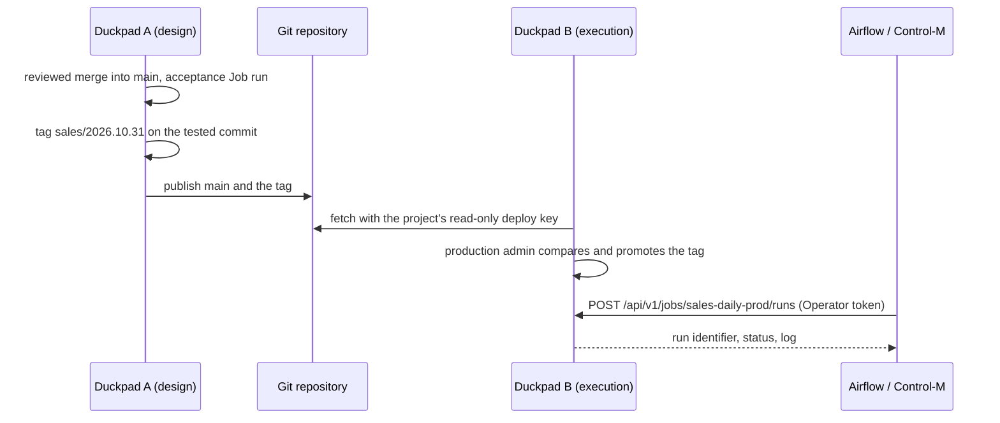

# Job automation: decisions and remaining proposals

Single-instance Jobs are implemented: API tokens, service accounts, Operator
access, annotated tags, pinned versions, reviewed promotion, read-only results,
API v1 and `duckpad run`. Use [Jobs](../JOBS.md), [automation](../AUTOMATION.md)
and [Git](../GIT.md) for those features.

## Decisions

- Jobs are instance metadata with stable slugs. Putting them in project Git would
  let a code publication alter another instance's execution configuration.
- Tag targets pin the reviewed commit; branch targets resolve their head at launch
  for acceptance runs. Editors create tags; project admins promote Jobs.
- Operators can execute reviewed Jobs without editing projects. Service accounts
  are limited to Reader and Operator roles.
- A Job owns a read-only worktree. Running an editable worktree would collide
  with development runs and execute whichever edits were saved last.
- Busy launches return 409 without queuing. Restart marks unfinished runs
  interrupted and does not retry exports.
- External orchestrators control timing. A headless `duckpad run ./project` mode
  would bypass instance connections, authorization, history and lineage.

## Proposed deployment between instances

### Two instances: design and execution

Proposed: run separate design and execution instances, exchanging reviewed versions through Git. Deployed projects, project deploy keys and tag transport are not implemented.

1. **On A (design)**: development, acceptance and tagging as on a single instance, then publication of `main` and the tag.
2. **On B (execution)**: a project admin creates the project once **from the repository URL**, as a **deployed project**. Nobody can edit a deployed project: saves, branches and merges are refused, and the Editor role is not offered. B fetches with a read-only deploy key that belongs to the project. The production team are Operators, with a production admin. Connections are recreated on B with the same identifiers, since projects store only references to them, and only their `prod` settings are filled in: production secrets exist only on B.
3. The production admin creates the Job `sales-daily-prod` on the tag `sales/2026.10.31` in `prod`.
4. Orchestrators call B's API with a service account token.
5. **Next version**: a new tag is created and published on A. B lists it after the next fetch; the production admin compares and promotes it. Rolling back means promoting the previous tag.

**What travels with a tag**: the flow, SQL, templates, components, documentation, the list of required extensions and `variables.json` with every environment's values, so changed `prod` values appear in the comparison before promotion.

**What does not travel**: connections and their secrets, environments, members, Jobs, extension binaries (install them on B, or import them offline) and uploaded files. `data/` is not versioned, so production sources must be connections rather than uploaded files.

**Why not project export and import.** An archive contains only the current files of one worktree, without history or tags, and importing always creates a new project with a single commit. Every delivery would create another project on B, with its Jobs, members, connection grants and run history to recreate; the commit running in production would have no relation to the tagged commit; and the imported history is unrelated to A's, so connecting it to the origin later is refused. Export and import remain useful for one-off copies.

Two instances add machine isolation (a large preview on A cannot slow down or block production), production secrets absent from A, network segmentation and strict separation of roles. A single instance remains a supported setup.

## Delivery plan

Step 1 is complete. The following work remains proposed, not available:

2. **Two instances.** Projects created from a Git URL, the deployed project mode, per-project read-only deploy keys, publishing and fetching tags, new versions listed for promotion.
3. **Run-time values and notifications.** Variables marked `"runtime": true` in `variables.json` and allowed by a Job can be set at launch (typed, validated, bound, captured and fingerprinted, as deferred by [project variables](PROJECT_VARIABLES.md#alternatives-considered)); signed outgoing webhooks when a run ends; a History filter by trigger.
4. **Ready-made integrations.** An Airflow provider in a separate repository (operator, hook, sensor, deferrable mode, OpenLineage events), a Control-M Application Integrator template, then an internal scheduler and an inbound webhook once time zones, missed occurrences and rejected triggers are specified.

Steps 2 and 3 can swap if orchestrators need business dates before a dedicated execution instance.
