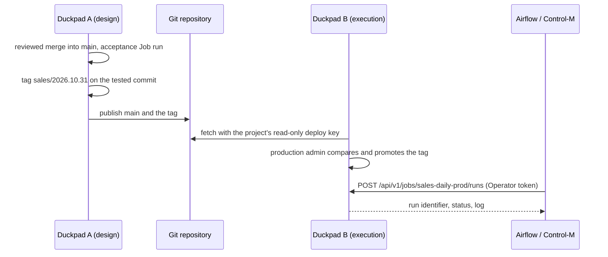

# Job automation (design proposal)

**Status: delivery step 1.1 implemented (API tokens, service accounts restricted to Reader, and run requesters). The remaining steps are proposed; the decisions below were agreed in review.**

## Summary

External orchestrators such as Airflow and Control-M should be able to run a Duckpad pipeline, wait for it, cancel it and read its outcome, without a human password and without running whatever someone saved last. This proposal adds an execution contract for them, in the way Alteryx Server, Dataiku and dbt Cloud do:

1. **An Operator project role, service accounts and API tokens.** Production teams and machines can run pipelines without being able to change them.
2. **Tags.** An editor tags the commit that passed acceptance testing. Production runs that tag, never a branch someone is editing.
3. **Jobs.** A Job is a named, stable target (project, tag or branch, environment, scope) that runs in its own read-only worktree. Jobs are instance metadata, outside Git.
4. **A stable automation API (`/api/v1`) and a `duckpad run` command** with idempotent launches, waiting, cancellation, text logs, typed errors and exit codes.

The same contract supports two deployments: a single instance, or a design instance and a dedicated execution instance that receives tagged versions through the Git repository.

## Problems this solves

- **Machine authentication.** The only credential is a seven-day session obtained with a password, returned in a cookie. SSO accounts cannot obtain one outside the browser. Launching a run requires the Editor role, so an orchestrator would also be able to change the flow.
- **Addressing.** A worktree has an opaque identifier. An orchestrator cannot name "the sales pipeline in production".
- **Mutable target.** A run starts from the current state of the worktree where people work. A nightly production run picks up whatever was saved last.
- **Collisions.** A busy worktree refuses new runs with a 409 response whatever the environment, so a preview run in `dev` on `main` makes the scheduled `prod` run fail.
- **Contract.** There is no server-side wait, no text log and no error code, the OpenAPI schema is disabled, and every run records `trigger: "manual"`. The only command is `duckpad start`.

## What other tools do

| | Alteryx | Dataiku DSS | KNIME Hub | dbt Cloud | This proposal |
| --- | --- | --- | --- | --- | --- |
| What runs | Workflow published to the Gallery | Scenario on an Automation node | Deployment | Job | Job |
| Version that runs | Published version, not the Designer draft | Bundle deployed to the Automation node | Workflow version required to deploy | Environment branch, can be overridden | Tag pinned to its commit, or a branch head for acceptance Jobs |
| Machine credentials | OAuth2 client credentials | Personal, project or global API keys | Application passwords | Service tokens | Personal and service account tokens |
| API | Start a job, poll it, delete it | Run a scenario, `run_and_wait()` | Call the REST service | Trigger a run, poll it | Start, wait, cancel, read the log |
| Command line | `AlteryxEngineCmd.exe` exit codes | Python client | Batch executor | `dbt build` exit codes | `duckpad run` exit codes |
| Orchestrators | Script or API; Control-M plugin for Designer Cloud | Official Control-M plugin; Airflow through the API client | REST | Official deferrable Airflow provider | CLI or API first, then an Airflow provider and a Control-M template |

The common points we keep: the space people edit is never what production runs; orchestrators call a named, stable object; the contract is asynchronous (start, identifier, status, cancellation, output) and plugins are thin layers over it; machine credentials are separate from human accounts.

## Principles

1. **Git stays the source of truth for definitions.** A Job runs a commit, and the run records it. Jobs themselves, like connections, environments and memberships, belong to the instance.
2. **One execution service.** Jobs submit runs through the same service as the interface and the API, with the same validation, launch capture, admission, cancellation and history.
3. **No hidden behavior.** No queued runs, no automatic retries and no replay of exports. A refused launch returns an error the orchestrator can act on.
4. **Least privilege.** Running a pipeline does not require the right to change it.
5. **Every run explains itself.** The run record says which Job, tag, commit, account, token and external trigger produced it.

## Roles and rights

A fourth project role, **Operator**, sits between Reader and Editor. It is meant for production teams and service accounts: Operators see everything a Reader sees and can run Jobs, but they cannot change the project or run arbitrary versions.

| Action | Reader | Operator | Editor | Project admin |
| --- | :-: | :-: | :-: | :-: |
| View the flow, SQL, documentation, history, run logs, results and lineage, including Job results | ✓ | ✓ | ✓ | ✓ |
| Run, cancel or rerun a Job, pass the run-time values it allows | – | ✓ | ✓ | ✓ |
| Run ad hoc on a branch, for the whole project or one node | – | – | ✓ | ✓ |
| Edit, create branches, merge, publish, create tags | – | – | ✓ | ✓ |
| Create Jobs, change their version, manage members and the origin | – | – | – | ✓ |

- Operators run tagged versions through Jobs only; they never run a branch directly.
- The hierarchy stays linear (Reader < Operator < Editor < Project admin), so it fits the existing role levels and route authorization. On a single instance, an Editor can therefore also run a production Job. Strict separation comes from the two-instance deployment, where developers have no account on the execution instance or are only Readers there.
- Instance administrators keep every project right, as today.
- Run-time values arrive in delivery step 3.
- The installation guide shows this matrix instead of its current list of project roles.

## Accounts and API tokens

**Personal API tokens.** Any account, local or SSO, can create tokens in **User settings → API tokens**. A token has a name and an optional expiry date (the form proposes 90 days). It is shown once, as `dpk_` followed by a random secret, and only its hash is stored, like sessions. The list shows its creation date, expiry and last use, and a token can be revoked at any time. A token authenticates as its account with the same rights, through `Authorization: Bearer dpk_…`; it is never accepted from a cookie and never used for Git.

**Service accounts.** Instance administrators create them in **Instance settings → Users and permissions**. A service account has a name and a description, no password and no SSO identity, and cannot sign in to the interface. It authenticates only with tokens, which instance administrators create and revoke on its page. Its instance role is always Member, and its project roles are limited to Reader and Operator (Reader only until the Operator role exists).

**Requesters.** Every run records the account that requested it, and the token name when a token was used. Run details show them.

**Revocation.** Deactivating an account rejects all its tokens, and they stay rejected after reactivation, like its SSH key. SSO accounts' tokens work only while SSO is enabled. Changing a password does not revoke tokens: revoke them explicitly. Instance administrators can list and revoke any account's tokens.

## Tags

Tags mark the versions that passed acceptance testing.

- **Creating a tag.** Editors create annotated tags from **History** (on any commit) or from a run's details (**Tag this run's commit**). Since a run records its commit, the tag designates exactly what was tested. The tag records its name, a message for the acceptance notes, and the authenticated user's commit identity as tagger. Names follow Git rules, for example `sales/2026.10.31` or `v1.4`.
- **Immutable tags.** Duckpad neither moves nor deletes tags. To correct a version, create a new tag.
- **Visibility.** **History** shows tags next to their commits, and **Compare versions** accepts them as source or destination.
- **Remote tags** (delivery step 2). Publishing can push a tag, and fetching retrieves new tags. A fetched tag that conflicts with an existing local tag of the same name never replaces it; Duckpad reports the difference.

## Jobs

A Job is a named execution target stored in instance metadata. Project admins create and change Jobs; Readers and above can see them.

```json
{
  "slug": "sales-daily-prod",
  "name": "Daily sales",
  "description": "Nightly refresh of the sales marts and exports.",
  "project": "proj_…",
  "target": {"kind": "tag", "tag": "sales/2026.10.31", "commit": "9f3c…"},
  "environment": "prod",
  "scope": null,
  "runtime_variables": []
}
```

- **`slug`** is unique on the instance and stable: orchestrators call it. Lowercase letters, digits and hyphens.
- **`target`** is either a tag, pinned to its commit when the Job is created or promoted, or a branch (`{"kind": "branch", "branch": "main"}`), resolved to its head at each launch. Branch targets are meant for acceptance Jobs, for example `sales-acceptance` on `main` in an acceptance environment.
- **`scope`** is `null` for the whole project, or a node whose launch scope the Job runs, as in a manual run.
- **`runtime_variables`** lists the variables an orchestrator may set at launch (delivery step 3).

**Pinned commits.** A tag Job always runs the commit recorded when it was promoted. If the tag later points elsewhere, for example after a fetch, Duckpad shows a warning on the Job and keeps running the recorded commit.

**Promotion and rollback.** To change a Job's version, a project admin chooses another tag. Duckpad first shows **Compare versions** between the running commit and the new one, including changed `variables.json` values, then records the change (who, when, from which tag and commit to which). Rolling back means choosing an earlier tag from that list.

**Job worktrees.** Each Job has an internal worktree, detached at its commit and read-only for everyone. Before each launch, Duckpad moves it to the Job's commit (the pinned commit, or the branch head) and starts the run through the execution service. As a result:

- people editing the project can no longer block a Job with a 409 response;
- each run is reproducible from its recorded commit;
- the results of the last run stay inspectable, with previews and cell-level lineage of production results, from **Open results** on the Job;
- the usual fingerprints decide which results become stale when the commit changes.

**Admission.** A Job runs one execution at a time. Launching a Job that is already running is refused with a 409 response that names the active run; nothing is queued. Different Jobs run in parallel, each in its own worktree. Orchestrators limit concurrency on their side, for example with `max_active_runs=1` in Airflow.

**Run records.** A Job run records `trigger: "job"`, the Job, its tag and commit, the account and token name that requested it, and the orchestrator's declared source and reference, for example `{"source": "airflow", "reference": "sales_daily/scheduled__2026-10-30"}`. **History** and the Job page show them.

## Automation API v1

The `/api/v1` routes form a stable, versioned contract. Their OpenAPI schema is served at `/api/v1/openapi.json` and documented in a new automation guide. Other routes stay internal to the interface.

```http
POST /api/v1/jobs/sales-daily-prod/runs
Authorization: Bearer dpk_…
Idempotency-Key: airflow:sales_daily:scheduled__2026-10-30:1
Content-Type: application/json

{"trigger": {"source": "airflow", "reference": "sales_daily/scheduled__2026-10-30"}}
```

```http
HTTP/1.1 202 Accepted

{
  "id": "run_…",
  "job": "sales-daily-prod",
  "status": "preparing",
  "tag": "sales/2026.10.31",
  "commit": "9f3c…",
  "environment": "prod",
  "started": "2026-10-31T02:00:04Z",
  "finished": null,
  "nodes": {"total": 12, "success": 0, "failed": 0, "running": 0},
  "links": {"self": "/api/v1/runs/run_…", "log": "/api/v1/runs/run_…/log", "cancel": "/api/v1/runs/run_…/cancel"}
}
```

| Route | Purpose |
| --- | --- |
| `GET /api/v1/jobs` | Jobs the caller can see |
| `GET /api/v1/jobs/{slug}` | Target, environment and last run of a Job |
| `POST /api/v1/jobs/{slug}/runs` | Launch; returns 202 with the run |
| `GET /api/v1/runs/{id}?wait=30` | Run status; with `wait` (at most 60 seconds), answers as soon as the run finishes |
| `POST /api/v1/runs/{id}/cancel` | Request cancellation; repeating it is harmless |
| `GET /api/v1/runs/{id}/log` | Plain-text log: node progress, messages, errors and the outcome |

**Statuses.** Runs use the existing statuses: `preparing`, `running` and `canceling` while active, then `success`, `failed`, `partial_failure`, `canceled` or `interrupted` (the instance stopped during the run).

**Idempotency.** A launch can carry an `Idempotency-Key`. Within seven days, the same key with the same body on the same Job returns the original run instead of starting another one; the same key with a different body is rejected. Refused launches are not remembered, so a key can be retried after a 409 response. This matters because exports write to external systems: a network timeout must never cause a second write. An orchestrator retry that should start a new run uses a new key, for example with Airflow's attempt number.

**Errors.** Errors keep the existing `{"error", "detail"}` format and add `detail.code`:

| Status | Code | Meaning |
| --- | --- | --- |
| 401 | `unauthenticated` | Missing, unknown, expired or revoked token |
| 403 | `forbidden` | The account is not an Operator (or above) on the project |
| 404 | `job_not_found`, `run_not_found` | Unknown or invisible Job or run |
| 409 | `job_busy` | The Job is already running; `detail.run` names the active run |
| 409 | `target_unavailable` | The Job's tag, commit or branch no longer exists |
| 422 | `invalid_project` | The project files at the Job's commit are invalid |
| 422 | `invalid_request` | Malformed body, or an idempotency key reused with a different body |

**Waiting.** `wait` does not hold a server worker thread, so many orchestrator tasks can wait at once.

## Command line

```bash
export DUCKPAD_SERVER=https://duckpad.example.com
export DUCKPAD_TOKEN=dpk_…
duckpad run --job sales-daily-prod --timeout 2h
```

- `duckpad run` launches the Job, prints node progress to standard output, waits for the outcome and exits with a code orchestrators can act on. `--detach` returns as soon as the run is accepted and prints its identifier.
- Credentials come from `DUCKPAD_TOKEN` or `--token-file`, never from a command-line argument visible in process lists.
- `--source` and `--reference` fill the run's trigger (`cli` and no reference by default).
- `--idempotency-key` sets the key; by default the command generates one per invocation and reuses it when it retries a launch after a network error.
- On SIGTERM or SIGINT (a Control-M kill, an Airflow timeout), the command requests cancellation, waits for the run to stop and exits with code 3. When `--timeout` expires, it does the same and exits with code 6.
- The command uses only the standard library and does not load DuckDB or the server, so it starts quickly and can move to a separate lightweight package later.

| Exit code | Meaning |
| --- | --- |
| 0 | Success |
| 1 | Failed |
| 2 | Partial failure |
| 3 | Canceled or interrupted |
| 4 | Refused because the Job is already running; retrying later is safe |
| 5 | Request refused: authentication, permission, unknown Job or invalid input |
| 6 | Timeout reached; the run was canceled |
| 7 | Server unreachable |

It works as is in a Control-M OS job, an Airflow `BashOperator`, cron, CI pipelines or the Windows Task Scheduler.

```python
BashOperator(
    task_id="sales_daily",
    bash_command=(
        "duckpad run --job sales-daily-prod --source airflow"
        " --reference '{{ dag.dag_id }}/{{ run_id }}'"
        " --idempotency-key '{{ dag.dag_id }}:{{ task.task_id }}:{{ run_id }}:{{ ti.try_number }}'"
    ),
    env={"DUCKPAD_SERVER": "https://duckpad.example.com", "DUCKPAD_TOKEN": "{{ conn.duckpad_prod.password }}"},
    append_env=True,
)
```

In Control-M, an OS job runs the same command with the agent's token file. Exit code 4 can drive an `On Do` rerun action (`COMPSTAT=4`); other non-zero codes end the job as Not OK.

## User experience

- **Jobs page.** A **Jobs** entry in the project toolbar lists the project's Jobs with their version, environment, last run and status. Operators and above get **Run** and **Cancel**; a protected environment asks for confirmation as for manual runs. Each Job shows its recent runs, logs and **Open results**. Project admins also get **New Job**, **Change version** (with comparison), **Edit** and **Delete**, and see the version changes.
- **History.** Tags appear next to commits. Editors get **Create tag** on a commit and **Tag this run's commit** in run details. Run details show the Job, tag, account, token name and external trigger.
- **User settings → API tokens** for personal tokens, and **Instance settings → Users and permissions** for service accounts and their tokens.
- **Project settings** offers the Operator role, and only Reader or Operator for service accounts.

## Deployments

### A single instance

1. Editors work on branches and merge reviewed changes into `main`.
2. The acceptance Job `sales-acceptance` runs `main` in the acceptance environment. Once its results are validated, an editor tags that run's commit `sales/2026.10.31`.
3. A project admin points `sales-daily-prod` (environment `prod`) to the new tag after comparing it with the running version.
4. Airflow or Control-M launches `sales-daily-prod` with the token of a service account that is Operator on the project.

### Two instances: design and execution

As with Dataiku's Design and Automation nodes, the same software is installed twice, and the execution instance runs on a dedicated machine. The difference is the transport: Dataiku deploys bundles, while Duckpad uses the project's Git repository and its tags.



1. **On A (design)**: development, acceptance and tagging as on a single instance, then publication of `main` and the tag.
2. **On B (execution)**: a project admin creates the project once **from the repository URL**, as a **deployed project**. Nobody can edit a deployed project: saves, branches and merges are refused, and the Editor role is not offered. B fetches with a read-only deploy key that belongs to the project. The production team are Operators, with a production admin. Connections are recreated on B with the same identifiers, since projects store only references to them, and only their `prod` settings are filled in: production secrets exist only on B.
3. The production admin creates the Job `sales-daily-prod` on the tag `sales/2026.10.31` in `prod`.
4. Orchestrators call B's API with a service account token.
5. **Next version**: a new tag is created and published on A. B lists it after the next fetch; the production admin compares and promotes it. Rolling back means promoting the previous tag.

**What travels with a tag**: the flow, SQL, templates, components, documentation, the list of required extensions and `variables.json` with every environment's values, so changed `prod` values appear in the comparison before promotion.

**What does not travel**: connections and their secrets, environments, members, Jobs, extension binaries (install them on B, or import them offline) and uploaded files. `data/` is not versioned, so production sources must be connections rather than uploaded files.

**Why not project export and import.** An archive contains only the current files of one worktree, without history or tags, and importing always creates a new project with a single commit. Every delivery would create another project on B, with its Jobs, members, connection grants and run history to recreate; the commit running in production would have no relation to the tagged commit; and the imported history is unrelated to A's, so connecting it to the origin later is refused. Export and import remain useful for one-off copies.

Two instances add machine isolation (a large preview on A cannot slow down or block production), production secrets absent from A, network segmentation and strict separation of roles. A single instance remains a supported setup.

## Execution and failure semantics

- **Launch capture.** A Job launch resolves the Job's commit, then follows the usual capture rules: definitions, variables and connection settings at launch time, recorded in the run.
- **Busy Jobs.** Refused with `job_busy`, never queued. A refused launch creates no run record; the caller receives the error and the server log records it.
- **Restarts.** Runs interrupted by a restart become `interrupted`, as today. Nothing is retried or resumed automatically; the orchestrator decides.
- **Cancellation.** Cancelling follows the existing rules, including the unknown outcome of an export that was writing when the run stopped.
- **Environment confirmation.** Creating or promoting a Job is the confirmation for API launches. A launch from the Jobs page asks for confirmation when the environment requires it.

## Security

- Tokens are random, stored as hashes, shown once, revocable, optionally expiring, and recorded on every run they start.
- Service accounts cannot sign in interactively, cannot become instance administrators and cannot edit projects.
- Operators cannot run arbitrary versions: only the commits that project admins promoted.
- Job worktrees are read-only for everyone, including instance administrators.
- Deploy keys are per project and read-only on the Git host; fetching with them requires no personal key or consent.
- Trigger payloads carry no SQL, connection settings or secrets; trigger references are stored as plain text and shown escaped.

## Alternatives considered

- **Running the editable worktree through the existing endpoint.** Rejected: production would run whatever was saved last and would collide with people's runs.
- **A `ref` parameter on the existing run endpoint, with temporary worktrees.** Rejected: no stable name for orchestrators, no place for rights or allowed values, and results would not stay inspectable.
- **Jobs versioned in Git**, like Dataiku scenarios. Rejected: publishing from the design instance would change the execution instance's configuration, and targets, environments and accounts differ per instance.
- **Project export and import between instances.** Rejected, see [above](#two-instances-design-and-execution).
- **Reusing the Editor role for orchestrators.** Rejected: an orchestrator's credentials could change the flow.
- **Queueing a launch while the Job runs.** Not in this proposal: the 409 response keeps behavior explicit. To revisit if orchestrators need it.
- **An internal scheduler first.** Deferred: target users already have an orchestrator, and a schedule becomes one more trigger once Jobs exist.
- **A headless mode** (`duckpad run ./project`, like `dbt build`). Not planned: it would bypass the instance's connections, rights, history and lineage.
- **A run-as account per Job.** Not needed: connections are authorized per project, so the requesting account is recorded but does not change what a run can access.
- **Importing signed version bundles**, for an execution instance that cannot reach the Git repository. Later, if needed.

## Delivery plan

Each item is a separate issue and pull request, with tests and documentation.

1. **Single instance.**
   1. Service accounts and API tokens, and the requester recorded on every run.
   2. Annotated tags: creation from history and runs, display, comparison; no move or delete.
   3. The Operator role and Jobs: instance metadata, read-only Job worktrees, tag or branch targets, promotion with comparison and rollback, the Jobs page, Job run records, and the rights matrix in the installation guide. The role ships with Jobs because running Jobs is its only additional right.
   4. Automation API v1: routes, idempotency, waiting, text logs, error codes, OpenAPI schema and an automation guide.
   5. `duckpad run`: exit codes, signals, token file, Airflow and Control-M examples in the guide.

   Steps 1.1 and 1.2 are independent; 1.3 needs both, then 1.4 and 1.5 follow in order.
2. **Two instances.** Projects created from a Git URL, the deployed project mode, per-project read-only deploy keys, publishing and fetching tags, new versions listed for promotion.
3. **Run-time values and notifications.** Variables marked `"runtime": true` in `variables.json` and allowed by a Job can be set at launch (typed, validated, bound, captured and fingerprinted, as deferred by [project variables](PROJECT_VARIABLES.md#alternatives-considered)); signed outgoing webhooks when a run ends; a History filter by trigger.
4. **Ready-made integrations.** An Airflow provider in a separate repository (operator, hook, sensor, deferrable mode, OpenLineage events), a Control-M Application Integrator template, then an internal scheduler and an inbound webhook once time zones, missed occurrences and rejected triggers are specified.

Steps 2 and 3 can swap if orchestrators need business dates before a dedicated execution instance.

## Decisions

- The orchestrator-facing object is called a **Job**.
- Jobs are stored in instance metadata, not in Git.
- A fourth project role, **Operator**, can run Jobs without editing; service accounts are limited to Reader and Operator.
- Production Jobs run immutable tags pinned to their commit; branch targets serve acceptance Jobs.
- Editors create tags; project admins promote them.
- The design and execution instances exchange versions through Git, and the execution instance holds deployed, read-only projects.
- A launch on a running Job is refused with a 409 response, without queueing.
- No headless mode for now.

## Sources

- Alteryx: [running workflows from the command line](https://help.alteryx.com/current/en/designer/workflows/run-workflows-via-command-line.html), [Server API v3 job triggers](https://docs.getorchestra.io/docs/integrations/alteryx_server/alteryx_server_trigger_workflow)
- Dataiku: [scenarios API](https://developer.dataiku.com/13/api-reference/python/scenarios.html), [API keys](https://knowledge.dataiku.com/latest/courses/apis/dss-apis.html)
- BMC Control-M: [Control-M for Dataiku](https://documents.bmc.com/supportu/API/Helix/en-US/Documentation/Dataiku.htm), [Control-M for Alteryx Trifacta](https://documents.bmc.com/supportu/controlm-saas/en-US/Documentation/Alteryx_Trifacta.htm)
- KNIME: [Business Hub deployments](https://docs.knime.com/latest/business_hub_deployments_guide/index.html)
- dbt Cloud: [Airflow operators](https://airflow.apache.org/docs/apache-airflow-providers-dbt-cloud/stable/operators.html)
