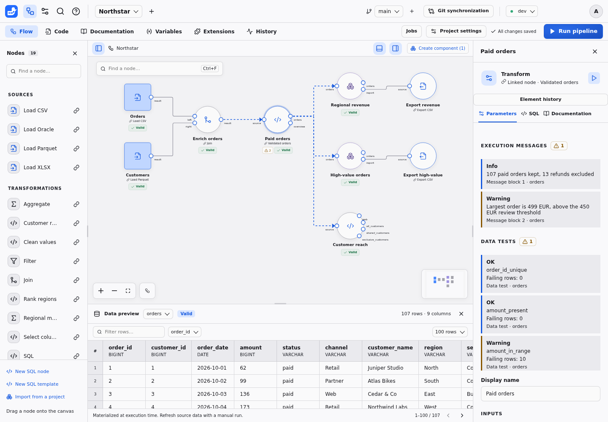
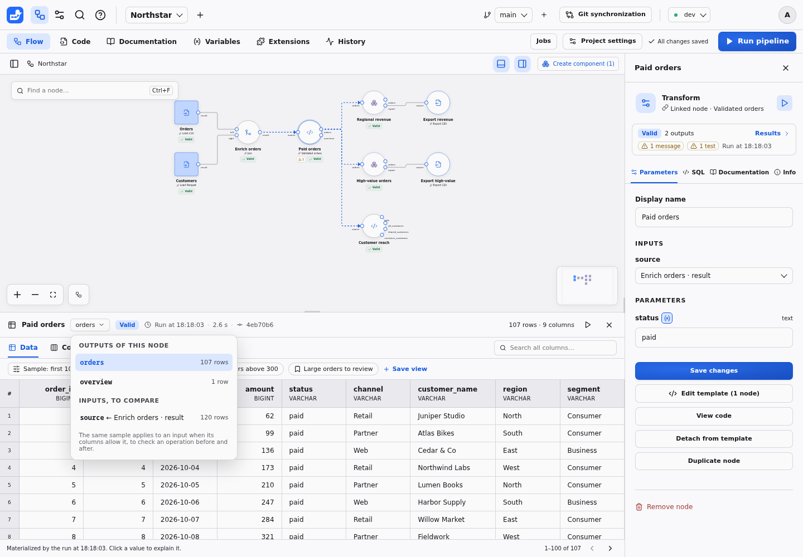
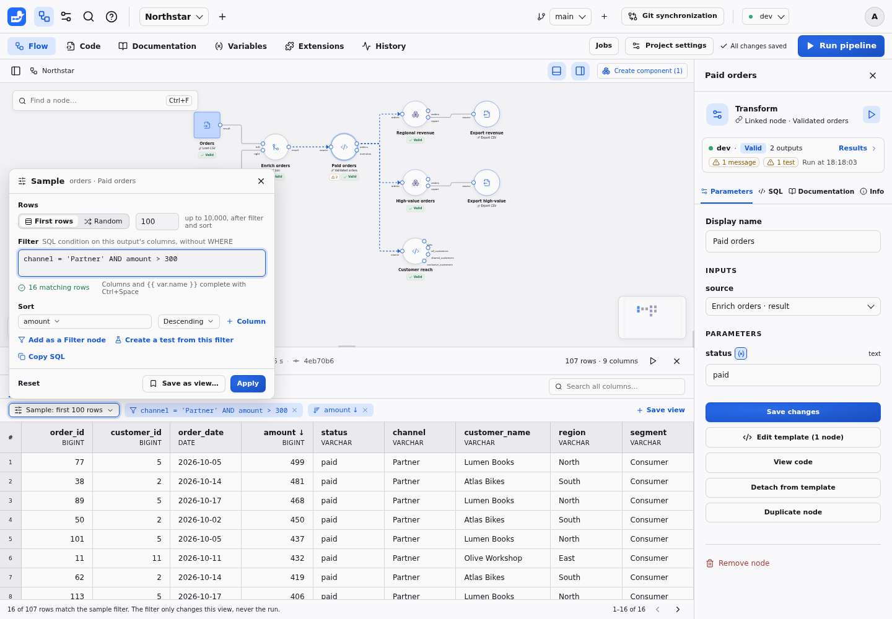
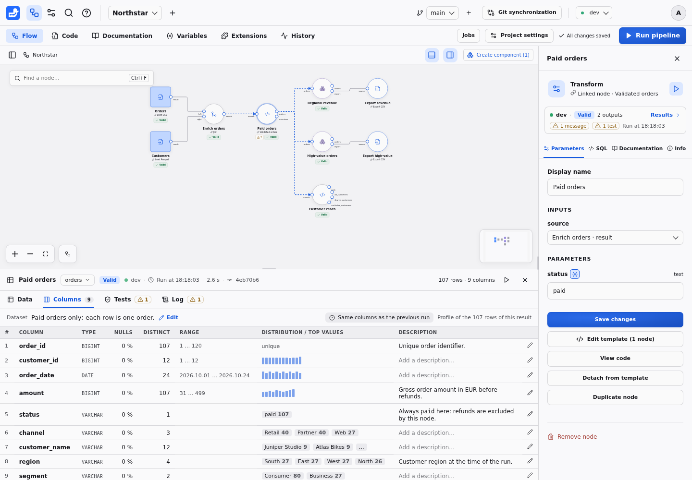
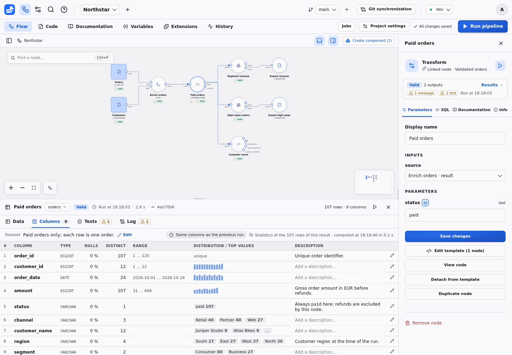
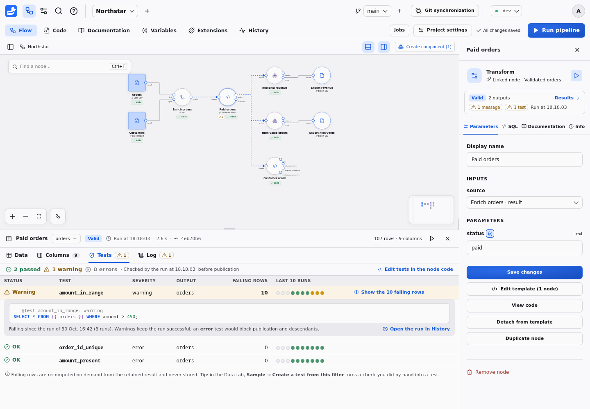
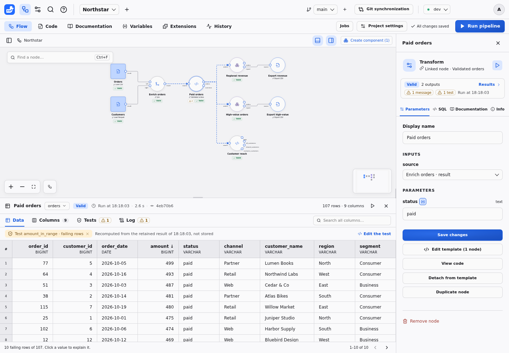
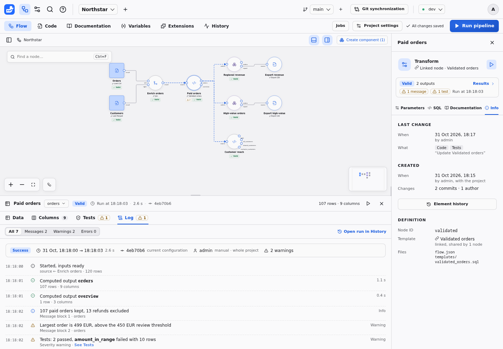

# Node results panel (design proposal)

**Status: accepted on 31 October 2026 (see [Decisions](#decisions)) and implemented, all four delivery steps.** The inspector keeps the node's definition with its one-line result summary, and the results panel shows the **Data**, **Columns**, **Tests** and **Log** tabs with custom samples, views shared in `views.json`, failing rows on demand, column statistics on request and per-output durations; see [Results, samples & logs](../RESULTS.md). The screenshots in this proposal are mockups drawn before the implementation over the Northstar example, where the Paid orders node declares two `-- @message` blocks and three `-- @test` blocks; the user guide shows the actual interface.

## Summary

Selecting a node opens two panels that both describe it: the **inspector** on the right and the **data preview** at the bottom. Today their content overlaps and neither has a clear job. This proposal gives each panel one question to answer:

- **The inspector describes the node.** It holds what the node is and how it is configured: parameters, compiled SQL, documentation, and its change history. All of it is versioned in Git and is the same in every environment.
- **The results panel shows what the node produced.** The bottom panel becomes **Results**, with four tabs: **Data**, **Columns**, **Tests** and **Log**. All of it depends on the environment and on the run that produced the result.

The rule fits in one sentence: *if it changes when you switch environment or run again, it is in the results panel; if it only changes when the project changes, it is in the inspector.*

The results panel also adds what the current preview lacks:

1. **Custom samples:** first or random rows, a SQL filter, a multi-column sort, and saved views shared with the project.
2. **Column list:** each column's name, type and description at once and, on request, its nulls, distinct values, range or top values.
3. **Log:** the run that produced the result, the node's `-- @message` results and the SQL it executed.
4. **Tests:** each `-- @test` with its recent history and, on demand, the failing rows.

## Problems this solves



- **The inspector mixes configuration and outcomes.** Execution messages and data tests appear above the parameters on every inspector tab. A node with a few messages and tests pushes its own settings below the fold (above: two messages and three tests take the whole visible inspector).
- **Run outcomes are split across both panels.** The status badge and rows are at the bottom; messages, tests, the error, the executed SQL (**SQL › Displayed result**) and export downloads are on the right. Dataset and column documentation are edited in the inspector, but the columns are only visible at the bottom.
- **The sample cannot be chosen.** The preview shows rows in materialization order, pages through them, and filters one column with a "contains" match. To check an operation ("refunds", "partner orders above 300", "rows where the join found no customer"), users have to page through or add a temporary Filter node.
- **The schema is only visible in column headers.** There is no list of columns with their types, null rates or value ranges, and column documentation is hidden behind a selector in the inspector.
- **Tests report counts without rows.** A failing test says "10 failing rows", without a way to see which ones.
- **Exports have no results panel.** An export node has no output port, so its messages, tests and outcome only appear in the inspector.

## What other tools do

| | Alteryx Designer | Dataiku DSS | Power Query | dbt | This proposal |
| --- | --- | --- | --- | --- | --- |
| Rows shown | Results window per tool output, capped in size | Explore tab on a configurable sample (first 10,000 rows by default) | Preview of the first rows | `dbt show` | Retained result of the last run, paged |
| Choosing the sample | Browse tool, filters in the grid | Sampling settings saved with the dataset: first records, random, stratified… | Filters become applied steps | SQL | First or random rows, SQL filter, sort; personal or saved views |
| Columns and types | Metadata view: name, type, size, source, description | Schema; column analysis on the sample, on the whole dataset on request | Column quality, distribution and profile, on the first 1,000 rows unless switched | YAML documentation | Columns tab: type and description at once, statistics of the whole result on request |
| Messages | Messages view with information, warnings and errors per tool | Job log | Errors per step | Run log | Log tab: run summary, `-- @message` results, executed SQL |
| Tests | Test tool, messages | Metrics and checks on the dataset | — | Tests are queries returning failing rows; `--store-failures` saves them | Tests tab with history; failing rows recomputed on demand, never stored |

What we keep: a sample that users choose and can share (Dataiku), a column view with type and quality indicators next to the data (Alteryx, Power Query), and tests expressed as "rows that fail" (dbt). What we change: statistics cover the whole result rather than the first rows, because Duckpad results are already materialized in DuckDB, but only on request; failing rows are recomputed rather than stored.

## Principles

1. **One panel per question.** The inspector answers "what is this node?", the results panel "what did it produce here?". No information is shown in both, except the inspector's one-line summary linking to the results.
2. **A sample is a view, never a computation.** Changing the sample never changes what runs compute, what descendants read, or whether a result is valid. It only changes which retained rows are displayed.
3. **Every displayed row stays explainable.** Filters, sorts and random samples keep the row identity, so **Explain this value** works on any cell of a valid result, as today.
4. **The panel always says which run produced the rows:** run time, duration and commit, in the header, next to the Valid or Stale badge. Neither panel repeats the environment: both always show the one selected in the top bar, and switching it there reloads them.
5. **Bridges, not duplicates.** A check done by hand in the sample can become a Filter node or a test; a failing test opens its rows in the Data tab; the inspector summary opens the right results tab.

## Two panels, two roles

| Content | Today | Proposed | Why |
| --- | --- | --- | --- |
| Label, inputs, parameters, variables | Inspector · Parameters | Inspector · Parameters | Definition |
| SQL compiled from the current configuration | Inspector · SQL | Inspector · SQL | Definition |
| SQL executed for the displayed result | Inspector · SQL · Displayed result | Results · Log | Depends on the run |
| Node documentation | Inspector · Documentation | Inspector · Documentation | Describes the node |
| Dataset and column documentation | Inspector · Documentation (selector) | Results · Columns | Describes the outputs, edited where the columns are visible |
| Created, last changed, change history | Inspector · Element history button | Inspector · Info (separate change in progress) | Definition, from Git |
| Execution messages | Inspector, above every tab | Results · Log | Depends on the run |
| Data tests and their history | Inspector, above every tab | Results · Tests | Depends on the run |
| Latest execution error | Inspector, above every tab | Results header and Log | Depends on the run |
| Export download | Inspector | Results · Log (export nodes) | Depends on the environment and run |
| Rows, status, row count | Data preview | Results · Data and header | Depends on the run |
| Run with ancestors | Inspector and empty preview | Both | Action on the node |

The inspector keeps a compact **result summary** under the node kind: Valid or Stale badge, number of outputs, warning badges for messages and tests, and a **Results** link. Each badge opens the results panel on the matching tab. Canvas warning badges do the same.

## The results panel

### Header

The header names the node and the dataset shown, then which run produced the rows: `Paid orders · orders ▾ · Valid · Run at 18:18:03 · 2.6 s · 4eb70b6`, the row and column counts, **Run with ancestors** and **Hide**.

The dataset selector lists the node's outputs with their row counts and, under **Inputs, to compare**, the datasets connected to its inputs. Showing an input keeps the current sample when its columns allow it, so the same rows can be checked before and after an operation.



### Data tab and custom samples

The Data tab keeps the current table, paging and cell lineage, and adds:

- **Search all columns:** a quick text search across every column, replacing the one-column "contains" filter.
- **Sample:** a popover with:
  - **Rows:** first rows or a random sample (reproducible, with a seed), and the number of rows, up to the current 10,000-row page limit;
  - **Filter:** a SQL condition on the dataset's columns, written without `WHERE`, with column and `{{ var.name }}` completion and the number of matching rows as you type;
  - **Sort:** one or more columns, ascending or descending. Clicking a column header still sorts by that column.
- **Chips** under the tabs show the active filter and sort; the cross removes one.
- **Add as a Filter node** inserts a Filter node after this one with the same condition, for a check that should become part of the pipeline.
- **Create a test from this filter** appends `-- @test <name>: warning` with `SELECT * FROM {{ output }} WHERE <filter>;` to the node's code, after confirming the name and severity. For a node linked to a template, the test goes into the template: the dialog says how many linked nodes it affects and offers to detach this node first instead.
- **Copy SQL** copies the query of the current sample, written with `{{ output }}` rather than internal table names.



The footer says how many rows match (`16 of 107 rows match the sample filter`) and repeats that the filter only changes the view.

The sample is remembered per user, node and output in the browser, like panel sizes. It survives reruns and environment switches; a filter that no longer compiles (a renamed column, for example) is shown in error with a **Reset** action instead of being dropped silently.

### Shared views

**Save as view…** names the current sample (rows, filter, sort) and saves it in the project, so the whole team sees "Partner orders above 300" or "Large orders to review" as chips above the table. **All rows** is always the first view.

Views are stored in a new `views.json` file at the project root, keyed like dataset documentation:

```json
{
  "validated:orders": [
    {
      "name": "Partner orders above 300",
      "rows": 100,
      "method": "first",
      "filter": "channel = 'Partner' AND amount > 300",
      "order": [["amount", "desc"]]
    }
  ]
}
```

- Saving a view is a normal save: one commit, branches, merges (view by view), comparisons and ZIP archives, like `variables.json`.
- Views never change results, so saving one makes nothing stale.
- Deleting a node deletes its views in the same save. A view whose filter no longer compiles stays listed with an error.
- Readers and Operators use views and personal samples but cannot save views.

### Columns tab



One row per column of the selected dataset: position, name, type and description, with the dataset description above the table. All of it shows at once: names and types come from the result's schema and descriptions from `documentation.json`, without reading any rows.

- **Statistics on request.** **Compute statistics** adds each column's null percentage, distinct values, range (numbers and dates) or top values (text), and a small distribution. They come from DuckDB's `SUMMARIZE` and a top-values query on the whole retained dataset, not on the displayed sample. On an 8-core server under load, `SUMMARIZE` takes 2.5 s on 10 million rows and 9 columns, plus 0.5 s for the top values, and the cost grows with the number of columns. The tab never starts this on its own: opening it is often only about a type, and the computation shares the CPU with runs.
- **Computed once per result.** Statistics are cached for that result generation (results are immutable until replaced): reopening the tab, coming back to the node or another user sees them at once, with the time they were computed. The run that replaces the result discards them. The computation can be cancelled and stops after the same timeout as samples.



- **Descriptions are edited inline** (pencil), saved in `documentation.json` as today. The inspector's Documentation tab keeps only the node documentation, without the node/dataset/column selector.
- **Schema changes.** A chip compares the columns with the previous successful run of the node in the same environment, from run records: added, removed or retyped columns are listed; otherwise "Same columns as the previous run".
- Selecting a column name scrolls the Data tab to it.

### Tests tab



A summary line (`2 passed · 1 warning · 0 errors`, checked by which run), then one row per test: status, name, severity, output, failing rows, and a strip of the last ten runs in this environment, from the existing test history. Selecting a test shows its query and since when it fails.

- **Show the failing rows** opens the Data tab with a temporary sample "Test amount_in_range · failing rows". The test query is compiled from the run's recorded definitions and executed against the retained datasets. It is offered only for valid results whose test reads the node's inputs and outputs, not external resources. Rows are paged like any sample and never stored, consistent with the current rule that Duckpad saves no failing-row samples.
- **Edit tests in the node code** opens the code editor on the test block.
- A node without tests shows how to declare one and the **Create a test from this filter** shortcut.



### Log tab



The Log tab tells the story of the run that produced the displayed result:

- **Run summary:** status, start and end times, duration, commit (and whether it matches the current configuration), who or which Job launched it, the scope (node or project), and the warning count. **Open run in History** opens the full run.
- **Timeline:** inputs ready, each output computed with its row count, each `-- @message` result in declaration order with its level and block, the tests summary (detailed in the Tests tab), then publication, or the error that prevented it. A filter shows all entries, messages, warnings or errors. The 100-message limit and its "… and N more" summary apply as today.
- **Executed SQL:** the statements, bound values and variables of that run, with secrets masked, moved from the inspector's SQL tab.
- **Errors:** after a failed run, the error and **Ask the assistant** appear at the top of the Log, and the header shows the retained result as Stale with "Last run failed at …".
- **Exports:** the Log shows the observed outcome of the write and the **Download** action for downloadable exports.

Per-output durations are new: run records keep each node's duration today, not each statement's. Recording them is part of delivery step 4.

### States

- **No result yet:** the Data tab shows today's empty state with **Run with ancestors**; Columns lists documented columns only; Tests and Log say that the node has not run in this environment.
- **Stale:** all tabs show the retained result and the run that produced it, with the Stale badge and the reason. Cell lineage and **Show the failing rows** are disabled, as lineage is today.
- **Running:** the header shows the run in progress; the tabs keep the previous result until publication.
- **Export nodes:** the panel opens on **Log**, with **Tests**; there is no Data or Columns tab.
- **Components:** an instance shows its exposed outputs; inside a component, results belong to the inspected instance, as today.

## The inspector

The inspector keeps the node's identity and definition, in four tabs:

- **Parameters:** label, inputs, parameters and variable bindings, Save, template and code actions, Duplicate, Remove. Nothing above them but the result summary.
- **SQL:** the SQL compiled from the current configuration, with bindings and variables. The **Displayed result** mode moves to the Log tab.
- **Documentation:** the node documentation only.
- **Info:** creation, last change, number of changes and authors, and **Element history**, as designed in the separate change in progress for this tab. Its **Element history** button replaces the one above the tabs.

Four tabs need compact labels at the default inspector width (320 px at 1,440 px wide); the mockups use smaller icons and gaps.

## API and storage

- `GET /api/worktrees/{id}/preview/{node}` accepts `search` (all columns), `filter` (SQL condition), `order` (list of column and direction), `method` (`first` or `random`) and `seed`. The current `filters` and `sort` parameters keep working.
- `POST /api/worktrees/{id}/statistics/{node}?environment&port` computes column statistics on request; `GET` on the same path returns them when they were already computed for the current result generation.
- `GET /api/worktrees/{id}/test-rows/{node}/{test}?environment&limit&offset` returns the failing rows of a test for a valid result, paged.
- `views.json` joins the bundle, validation, merge, comparison and ZIP archives, like `variables.json`.
- Run records add per-output durations.

## Validation and security

- **Sample filters** are validated like Filter conditions: one SQL expression, no query, DDL, DML or command; column references must belong to the dataset; `{{ var.name }}` references are bound, never pasted. The query runs on a cursor of the execution context against the retained relation only, with the existing row cap, and is interrupted after a timeout.
- **Random samples** use DuckDB's reservoir sampling with a seed on the filtered relation, so a seed always shows the same rows of the same result, and each row keeps its identity for lineage.
- **Failing rows** use the definitions recorded with the run, not the current files, so they match the displayed result. They require the same permission as reading results and are never stored or logged.
- **Column statistics** are computed only on request, read only the retained dataset, can be cancelled, stop after the sample timeout, and are released with the result.
- Readers, Operators and Job results (read-only worktrees) can use samples, column statistics and failing rows; saving views, editing descriptions, adding a Filter node or creating a test require edit rights.

## Alternatives considered

- **Keep run outcomes in the inspector and add tabs there.** Rejected: the inspector is narrow (260 to 560 px), rows and logs need width, and it would keep mixing definition and outcome.
- **Samples that also drive downstream computations** (in the reference mockup that prompted this proposal, sample settings also apply to downstream preview computations). Rejected (decision 1): results computed from a sample would not match the saved configuration, so under Duckpad's validity rules they would be stale at once and without lineage. Smaller data for development already comes from the `dev` connections. To revisit with a separate "sampled development run" design if large sources make full runs too slow.
- **Column statistics computed when the Columns tab opens**, or only below a size threshold. Rejected (decision 3): the cost grows with the result's size and width and competes with runs, while names, types and descriptions, the common need, cost nothing.
- **Storing failing rows** (dbt `--store-failures`). Rejected: memory and privacy costs, and stored rows go out of date; retained results already allow an exact recomputation.
- **A free SQL console in the panel.** Deferred: **Copy SQL**, **Add as a Filter node** and a SQL node on a branch cover the need with lineage and history.
- **Views in `documentation.json`.** Rejected: views are not documentation; a dedicated file keeps diffs and merges readable.

## Delivery plan

The steps are implemented in this order under a single implementation issue. Each comes with tests (API and Playwright), English, French and Portuguese strings, and the user guide updated.

1. **Two roles.** Results panel with the Data, Columns (name, type, description), Tests and Log tabs; move messages, tests, errors, executed SQL, dataset and column documentation and export downloads out of the inspector; inspector result summary; results panel for export nodes. Frontend only. Lands after the inspector's Info tab to avoid conflicts in the same component.
2. **Custom samples.** Search across columns, Sample popover (first or random rows, filter, multi-column sort), chips, inputs in the dataset selector, per-user persistence, **Add as a Filter node** and **Copy SQL**.
3. **Shared views and test bridges.** `views.json`, views bar, **Create a test from this filter**, **Show the failing rows**.
4. **Statistics and timings.** **Compute statistics** (column statistics and top values, cached per result), schema changes against the previous run, per-output durations in the Log.

## Decisions

Decided on 31 October 2026:

1. **A sample acts only on the display.** Runs always compute on full data; a sampled development run, if needed, gets its own design.
2. **Shared views in the project** (`views.json`), in addition to personal samples remembered in the browser.
3. **Dataset and column descriptions are edited from the Columns tab.** Names, types and descriptions show at once; column statistics are computed only with **Compute statistics**.

## Sources

- Alteryx Designer: [Results window](https://help.alteryx.com/2021.3/Getting_Started/Output.htm), [interactive results grid](https://help.alteryx.com/aac/en/designer-experience/workflows/interactive-results-grid.html)
- Dataiku DSS: [sampling in Explore](https://doc.dataiku.com/dss/13/explore/sampling.html), [column analysis](https://knowledge.dataiku.com/9.0/courses/basics/explore-data/concept-analyze.html)
- Power Query: [data profiling tools](https://learn.microsoft.com/en-us/power-query/data-profiling-tools)
- dbt: [data tests](https://docs.getdbt.com/docs/build/data-tests), [`store_failures`](https://docs.getdbt.com/reference/resource-configs/store_failures)
- Duckpad: [execution messages](../MESSAGES.md) and [data tests](../TESTS.md), [specification](../SPEC.md)
