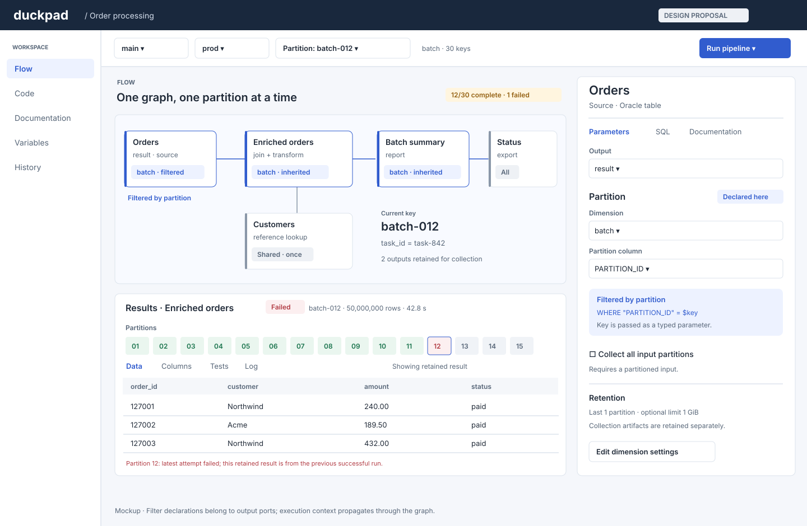
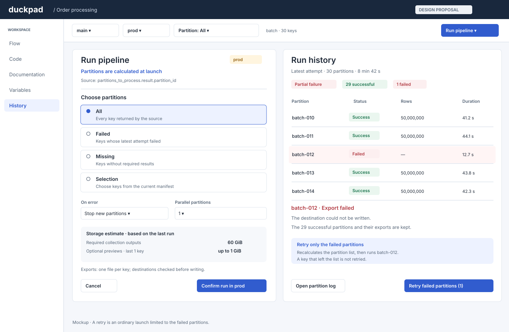
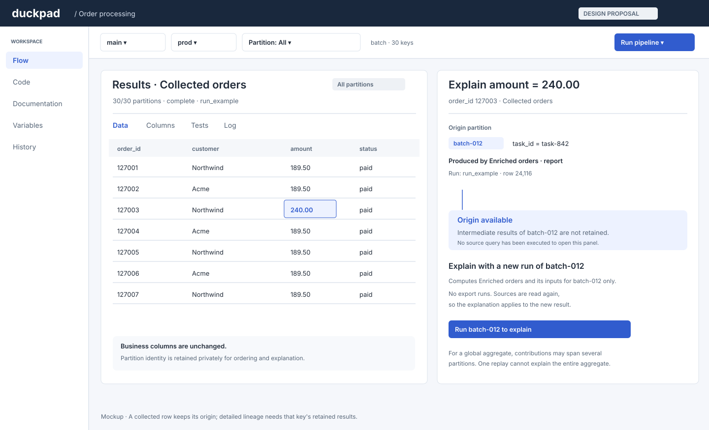

# Data partitions (design proposal)

**Status: accepted on 1 November 2026 (see [Decisions](#decisions)), not implemented yet.** This document defines the first version; the mockups illustrate the proposed interface.

## Summary

Declare one partition dimension, obtain its ordered values from a node output, and mark the datasets that depend on it. Duckpad runs the affected graph once per value, inside one run. Shared inputs run once. An explicit **All partitions** node reads the union and resumes ordinary execution. Results, validity, errors and retries belong to each partition, without copying the graph.

For example, an Oracle `ORDERS` table contains 30 partitions of 50 million rows: 1.5 billion rows per execution. Processing one partition at a time bounds the partitioned working set, pushes the key predicate into eligible source scans, and lets a failed partition be retried without rewriting successful exports. This does not make a global aggregate after collection fit in one partition's memory: the collector is an ordinary query with its own resource cost.

This design reuses [Computed variables](PROJECT_VARIABLES.md#computed-variables), including the shared `{node, port?, column}` value source, two execution phases, typed reference rendering, authorized paths and recorded value provenance. That foundation is implemented. Partitions add N-row extraction, execution contexts, storage and selection; they never mutate project variables in a loop.

## Problem and alternatives

The SQL for one entity or processing batch should remain ordinary SQL. A user should not have to carry `partition_id` through every join, grouping and window just to prevent data from different batches mixing silently.

| Approach | Benefit | Why it is not the execution model |
| --- | --- | --- |
| One global query, key in every join and grouping | Existing SQL works without a new concept | The entire input participates; one omitted key can mix partitions. It does not establish a per-partition working set or retry boundary. |
| Correlated SQL or `LATERAL` | Compact SQL describing repeated logic | Correlation is not a scheduler. DuckDB decorrelates subqueries into a global plan, so this cannot promise sequential materialization and release. |
| Generate a copy of the graph for every key | Each copy is easy to understand | Graph size follows the data, dynamic values require regeneration, and shared inputs and changes become difficult to manage. |
| One externally launched Job per supplied value | Existing orchestration can iterate | Splits one operation across runs, moves collection outside Duckpad, and requires the separately planned launch-value API. |
| Repeat a component for every control row | Familiar, compact migration path from batch macros | A useful complementary feature, but repetition alone supplies no project-wide partition selector, validity model or incremental retry contract. |
| Declared partitions, this proposal | One graph and run, explicit filtering, collection and per-key state | Adds a dimension, execution scope and retention policy; those concepts must be visible. |

The `LATERAL` conclusion is a design inference from DuckDB's documented [decorrelation](https://duckdb.org/2023/05/26/correlated-subqueries-in-sql), not a claim that a particular SQL spelling is always slow.

### Inspirations

| Tool | Relevant behavior | What Duckpad takes |
| --- | --- | --- |
| [Dataiku partition dependencies](https://doc.dataiku.com/dss/latest/partitions/dependencies.html) | Recipes describe same-partition and all-available input dependencies | Declare partitioned datasets, propagate the same key, make collection explicit. |
| [Dagster partitions](https://dagster.io/docs/guides/build/partitions-and-backfills/partitioning-assets) and [partition mappings](https://docs.dagster.io/api/dagster/partitions#dagster.AllPartitionMapping) | Dynamic categories and mappings, including all upstream partitions | Dynamic keys, a partition state strip and an explicit all-partitions boundary. |
| [dbt microbatch](https://docs.getdbt.com/docs/build/incremental-microbatch) | Configured `event_time` enables automatic filtering of upstream inputs into time batches | An explicit column declaration supplies an automatic source predicate; v1 uses equality on arbitrary declared keys, not generated time ranges. |
| [Alteryx batch macros](https://help.alteryx.com/current/en/designer/apps-and-macros/macros/batch-macro.html) | A macro runs per incoming record or group and produces outputs per iteration | Preserve the familiar single-batch logic and per-batch exports, while making partition state a property of the flow. |

## Principles and vocabulary

- A **dimension** is the single named set of typed keys and attributes.
- A **manifest** is its ordered list of keys and attributes, frozen for one run.
- A **partitioned output** belongs to one key. A **zone** is the connected part of the expanded graph executed with that key bound.
- A **collector** is a node with `"partitions": "all"`. It ends propagation and consumes complete input manifests. The UI's **All** selection only changes inspection; it never inserts a collector or changes what a run executes.
- Definitions live in Git; manifests, artifacts and run evidence stay in instance storage. Editing, switching selectors, compiling or previewing never runs SQL that refreshes sources or launches a partition.
- Public datasets keep exactly their SQL columns. Partition identity and row order are private metadata, not an injected business column.

## Versioned model

### Dimension and output declarations

Put the optional `partitions` map in `flow.json`, beside `nodes` and `edges`. There may be zero or one entry in v1. A separate file would add another merge and import boundary for a declaration whose references and consumers are all in the flow. Keep the map form so adding dimensions later does not require renaming it.

The following excerpt shows the proposed fields; ordinary node parameters and edges are omitted:

```json
{
  "partitions": {
    "batch": {
      "type": "text",
      "description": "Processing batches in control-file order.",
      "values": {
        "node": "partitions_to_process",
        "port": "result",
        "column": "partition_id"
      },
      "attributes": ["task_id"],
      "execution": {"parallelism": 1, "on_error": "stop"},
      "preview": {"keep": "last", "count": 1, "max_bytes": 1073741824}
    }
  },
  "nodes": [
    {"id": "partitions_to_process", "template": "batch_control"},
    {
      "id": "orders",
      "template": "oracle_source",
      "outputs": {
        "result": {"partition": {"by": "batch", "column": "partition_id"}}
      }
    },
    {"id": "customers", "template": "customer_reference"},
    {"id": "enriched_orders", "template": "enrich_orders"},
    {
      "id": "batch_export",
      "template": "csv_export",
      "params": {"destination": "exports/{{ partition }}/{{ partition.task_id }}.csv"}
    },
    {"id": "batch_status", "template": "status_export", "partitions": "all"}
  ]
}
```

`outputs` is proposed instance metadata keyed by an existing output port; it does not declare SQL outputs. A partition declaration belongs to the output because different outputs can expose different key columns. There is no ambiguous node-level shorthand. SQL, template and component output definitions remain the source of port names. The inspector always shows the selected port.

The dimension name follows variable naming rules. `type` uses `text`, `number`, `date` or `boolean`, with the computed-variable lossless conversion rules. Numeric keys must round-trip through the API and browser without precision loss; otherwise the producer must explicitly cast them to text. No coercion equates the text `"01"` with the number `1`. Non-finite numbers and nested/list keys are rejected. The source column's type is checked even when it returns no rows.

`values` is exactly the shared source descriptor, with `port` optional only for a single-output root node. A component's exposed output is allowed; an internal node path is not. `attributes` lists additional columns from the **same row**; unlisted columns are ignored. Infer each attribute's scalar type from the output schema and record its canonical type/value with its own normalized source. V1 accepts the same four scalar types and rejects null or unsupported attributes with a column-specific diagnostic; cast explicitly in the producer when needed. Attribute names must be valid reference names, distinct, and different from the key column. An empty attribute list is allowed.

Extract the complete published output, never a preview or sample. Preserve its materialization order as ordinal `0..N-1`; duplicate canonical keys or null keys invalidate the manifest before any partition starts. Diagnose both offending row ordinals. A producer with an explicit total `ORDER BY` makes this order repeatable across runs. Without it, Duckpad preserves that run's observed order, not a promise that a remote scan or join will produce the same order next time.

### Defaults and settings

| Field | Default and meaning |
| --- | --- |
| `execution.parallelism` | Positive integer, `1`; maximum concurrently active partitions, subject to session admission below |
| `execution.on_error` | `stop`; either `stop` or `continue` |
| `preview.keep` | `last`; `none`, `last` or `all`; retained outputs also allow a detailed lineage explanation |
| `preview.count` | `1`; positive integer, legal only for `last` |
| `preview.max_bytes` | `1073741824` (1 GiB); positive byte budget across optional preview artifacts for this worktree/environment |

Omitted settings take these defaults. Unknown fields are errors. Instance storage limits can further restrict retention and are shown before launch. These settings are versioned preferences; an operator cannot raise instance resource or storage limits through a project file. A dimension without any consumer is a warning.

### Propagation and components

Analyze the expanded data graph, with value-dependency edges for validation:

1. A node with an explicitly partitioned output starts a zone and executes per key. Its declared output is filtered; its other outputs also belong to that execution's key but receive no automatic filter unless declared themselves. The inspector makes this distinction explicit for multi-output sources.
2. A node with any partitioned data input executes per key and all its outputs inherit the dimension. Partitioned inputs always have the same key; shared inputs are immutable results computed once per run. A parameter reference alone does not turn a shared node into a partitioned one.
3. A node marked `partitions: all` receives complete unions of its partitioned inputs and ordinary shared inputs. It runs once and its outputs are shared. It must have at least one partitioned input. It cannot also declare an output partition or reference the current partition.
4. A downstream output can explicitly begin another zone after a collector. Plan successive zones and barriers in dependency order. Complete the preceding zone and required collector before admitting the next one; no inter-key dependency or feedback cycle is allowed.

Component input/output mappings carry partition context across their boundaries. Propagation inside a component follows real internal dependencies, so an internal lookup with no partitioned ancestor stays shared. An output declaration on a root component instance resolves to its expanded producer. Marking the instance `partitions: all` collects its partitioned exposed inputs before expanding its ordinary execution. An explicit declaration inside a portable component must use an exposed output mapping on the root instance, not a project dimension name.

As for variables, expressions and path references live on root instances and exposed parameters, not in template SQL or component definitions. Grouping nodes must expose referenced parameters and partitioned outputs, remap the declarations and value sources atomically, and preserve the expanded partition plan. If grouping would hide a collector or partition boundary that the component interface cannot represent, reject that grouping with a diagnostic; never erase the boundary. Imported components contain no implicit dimension from their source project.

## SQL and references

`{{ partition }}` denotes the current typed key. `{{ partition.task_id }}` denotes an attribute. Both are legal in expression parameters, including expressions passed through exposed component parameters, and in `file`/`destination` path parameters. For compatible whole scalar parameters, add the binding objects `{"$partition": true}` (key) and `{"$partition": "task_id"}` (attribute); reject objects mixed with `$var` or literal fields. References cannot supply SQL, identifiers, connection names or arbitrary text substitution.

Reuse the variable reference parser, collision-free binding allocator and path renderer. SQL references become typed DuckDB parameters. Paths are rendered once, authorized after normalization using the captured connection permissions, then passed through the existing resource compiler and escaped SQL literal renderer where the SQL grammar requires a path literal. A quote in a key stays data. No raw key or attribute is concatenated into SQL or used as a storage path.

For a declared source output, add the equality predicate to its compiled query before materialization. For example, the generated Oracle query has this shape:

```sql
SELECT *
FROM "orders_connection"."SALES"."ORDERS"
WHERE "PARTITION_ID" = $dp_partition_key;
```

The bindings panel separately shows `dp_partition_key: VARCHAR = "batch-012"` and its source. Quote validated column identifiers; never bind a column name as a value. Cast the bound value losslessly to the column type when required, rather than wrapping the scanned column in a cast that defeats predicate pushdown.

For any other declared output, the semantic boundary is `SELECT <public columns> FROM (<original output query>) WHERE <column> = $key`. Do not move the predicate through an aggregate, window, limit or other operation when that would change the output's meaning. Shared data ancestors still run once; declaring a late output cannot retroactively partition those ancestors. The UI warns that a late boundary may compute a large shared input or an expensive output before filtering. Put the boundary on the source for the large-volume guarantee.

For supported Parquet and OraDuck scans, verify physical pushdown, not merely the presence of a `WHERE` clause. OraDuck documents [filter pushdown on attached tables and views](https://raw.githubusercontent.com/hugues31/oraduck/main/README.md). The implementation must demonstrate the bound predicate in the Parquet scan plan and in the Oracle integration evidence. An unsupported custom source remains correctly filtered, but reports **Output filter; source pushdown unavailable**; it must not claim bounded source I/O. Built-in supported-source regressions fail acceptance rather than silently fetching the whole source.

Compile requires a concrete selected key and a resolved manifest to show bound SQL. With **All**, show the parameterized per-partition plan and a bindings list, not one enormous generated query. With no manifest, show an unresolved diagnostic and the source to run. Conditional branches, when introduced, evaluate once per run after values resolve and cannot reference `partition` in v1.

## Execution and memory

### One run, two phases

Retain the computed-variable launch semantics: a whole-flow launch includes value producers; a targeted launch includes its data ancestors but does not secretly add producers referenced only as values. An out-of-scope partition producer needs a retained successful manifest in this worktree/environment. No manifest means **Partition values not calculated; run partitions_to_process**. A fresh Job cannot borrow an editor's manifest. A normal Job recalculates included value nodes.

1. **Capture.** Reserve the worktree, freeze commit, environment, connections, ordinary values, resource settings and candidate scope. Capture retained out-of-scope values/manifests. Validate combined data/value dependencies.
2. **Value phase.** Run included value producers and their ancestors once, publish their tests/messages, then extract computed scalars and the ordered manifest. A partition producer and its ancestors may use ordinary variables only: no computed-variable chains, partition references or partitioned data. A producer used for both scalars and a manifest executes once, with each extraction's own cardinality rules. An invalid scalar need not invalidate a valid manifest.
3. **Consumer phase.** Freeze values, membership, attributes and ordinals, apply the launch selection, and compute fingerprints. Evaluate future run conditions once here. Calculate needed shared nodes once, then execute each zone in topological order for key 1, release it, and proceed to key 2. Complete barriers before dependent zones. Partition parallelism is an optional extension of this schedule, not a separate run per key.
4. **Publish and finish.** Publish successful node outputs atomically per key after their tests. Persist selected Parquet artifacts and manifest entries before making them reusable. Execute collectors whose required input versions are complete. Persist outcomes, counters, errors and export evidence under one run.

An in-scope producer refresh failure never falls back to an older manifest in that run. The previous manifest can remain visible as historical/retained data, as for computed values. Changing declarations invalidates its association. A partition key list, scalar value or environment selection cannot change mid-run.

```mermaid
flowchart LR
    V[Value nodes and their ancestors] --> M[Freeze keys, attributes and variables]
    M --> S[Shared inputs: compute once]
    S --> P1[Key 1: source filter, transform, export]
    P1 --> D1[Persist required outputs; release tables]
    D1 --> P2[Key 2: same graph]
    P2 --> DN[Continue through selected keys]
    DN --> A[All: complete ordered input manifests]
    A --> G[Ordinary downstream work]
```



### Table lifetime and parallelism

Count consumers per `(expanded node, output, key, generation)`, including tests, messages, export statements and artifact writers. Drop private/public relations and lineage state immediately after the last consumer releases them. End-of-key cleanup removes remaining scratch tables, even on failure or cancellation. Preview requests pin disk generations, not tables that force earlier partitions to remain resident. Shared inputs survive until their last partition consumer; ordinary retained-result policy applies outside the zone.

At parallelism 1 the intended bound is **shared working set + one partition's peak working set + bounded scan/write buffers**, independent of the number of data rows in other partitions. Manifest metadata is O(number of keys); page it from instance storage rather than keeping all per-node logs in memory. Collector queries and very large shared inputs have separate costs and may spill. Disk artifacts grow with retained data; partitioning trades memory for storage and I/O.

Use the existing worktree/environment worker and one DuckDB database with separate cursors and uniquely named scratch relations per active key. They share the session's total threads and memory limit from [SQL resources](../INSTALLATION.md#sql-resources); do not create P workers each with the full session allowance. DuckDB's shared scheduler bounds SQL threads; the partition admission queue bounds active keys and is clamped to the effective thread count. Automatic limits are resolved and captured once at launch. Connector sessions also count against that captured execution budget. Isolation, read permissions and cancellation remain enforced in the worker.

Parallelism P permits up to P partition working sets within the same total SQL budget; it does not preserve the single-partition peak. Persist completion out of order if necessary, but expose/collect in manifest order. Cancel interrupts all active partition cursors. A worker crash ends active keys as interrupted; completed durable artifacts remain reusable after validation. DuckDB memory limits are not an OS RSS guarantee; the performance test must measure actual peak memory, including connector and artifact-writing buffers.

### Empty manifests

Zero keys is a successful empty partition execution. Do not scan partitioned sources, run their exports or compute shared data used only by that empty zone. Propagate typed zero-row relations using SQL binding and source schema metadata; binding may read Parquet footers or remote catalog metadata, but never fetch data rows. A dynamic-schema source requiring data to discover columns needs an explicit schema and otherwise reports `partition_schema_unavailable`.

Collectors see typed empty inputs and execute their ordinary SQL: a pass-through returns no rows; `COUNT(*)` correctly returns one row containing zero. A collector export may write an empty report. This distinction preserves native SQL semantics.

## Collection, storage and retention

### Complete, ordered collection

For each partitioned collector input, retain one schema-consistent immutable artifact generation per required key. The collector reads those artifacts lazily as a `UNION ALL` relation: preserve duplicates and column types; reject schema drift rather than coercing columns or unioning by name. Its required key set is the entire frozen manifest, including valid reused keys on a selective run. It never silently reads only the successful or selected subset.

If any required input is missing, stale or failed, block that collector and its descendants with the specific missing keys. Independent collectors with complete inputs may proceed. A UI **All** preview may show available partitions with an explicit **Incomplete: 11 of 30** banner; that inspection is not an executable complete collector input. Previous successful collector results remain stale and inspectable after a failed refresh.

Collection order is `(manifest ordinal, row ordinal within that output)`, not completion order, directory listing order or the order of a Parquet filename list. Persist private row ordinals and use a bounded ordered reader/merge over the artifact manifest. Pass-through materialization and exports preserve this order; operators that reorder rows obey native SQL semantics. Joins and aggregates do not acquire a deterministic output order by implication. For repeatable results, use an explicit total `ORDER BY`, as explained by DuckDB's [order rules](https://duckdb.org/docs/2.0/sql/dialect/order_preservation).

A collector may join two collected inputs across keys, because it is explicitly outside the zone. The UI explains that distinction. Within a zone, the engine never combines inputs from different keys, even if the key column was dropped.

### Artifact classes and cost

Only outputs read across an **All partitions** boundary and outputs retained for inspection are durably stored as Parquet. A retained output is one full logical dataset, possibly split into row groups/files; it is not a first-row sample. Other intermediate outputs disappear after use. DuckDB spill files are transient execution storage and are removed with the context.

| Artifact | Lifetime and eviction |
| --- | --- |
| Collector input | Mandatory: the latest successful artifact of each key in the current manifest, kept until a newer success replaces it or the key leaves the manifest; never evicted by the preview budget |
| Optional preview | Selected by `none`, last N keys, or all keys; constrained by `max_bytes` and the instance storage limits |
| Run manifest, schema, counts, timing, diagnostics and export outcomes per key | Durable history under the existing run-retention policy; no full intermediate data |
| Export files or remote writes | Existing export retention/ownership rules; not a substitute for intermediate results |

Preview retention is per output: `last` keeps the most recently executed successful keys, the highest manifest ordinals first within one run, independent of parallel completion order. A run of one selected key therefore retains that key. Prefer the most recent keys when the byte cap requires eviction. A single dataset larger than the cap is not partially advertised as retained: stop its optional write, remove the temporary artifact, retain metadata and show **Preview not retained: size limit**. `all` is still capped and the UI names missing keys. No failure of optional retention turns a successful computation into a failed data result.

Mandatory artifacts count against the instance storage limits. Estimate bytes from available prior runs and show **Unknown** before the first run. If storage cannot accommodate a required output, fail that partition explicitly; never delete an input in use or silently skip collection.

For 30 partitions, retaining a 2 GiB collector output per partition costs about 60 GiB, plus optional previews, spill, and a replaced artifact still read by an open preview. Collection is a logical union, not a second 60 GiB copy. The Run dialog shows mandatory and optional bytes separately. Changing retention affects availability, not computation fingerprints, and never triggers a run.

Use generated artifact IDs, partition IDs and generation IDs inside sandboxed instance-managed storage, never raw keys as filenames. Atomically commit an artifact manifest only after its files and schema are complete. Checksums and schema/version metadata detect missing, partial or incompatible artifacts after a restart. Remove uncommitted temporary files; mark unfinished attempts interrupted. Garbage collection respects readers and active runs. This adds durable partition artifacts; it does not promise persistence of all existing unpartitioned in-memory results or computed-value caches.

## Validity, failure and retry

### Fingerprints and visible states

Extend the current node fingerprint to `(expanded node, canonical typed key)`. It includes executable SQL, resolved parameters, connection/extension fingerprints, filter declaration, that key, attributes actually used by the node, and the fingerprints of its inputs for that same key or of its shared inputs. Scalar variables retain their existing type/value identity. Provenance, timestamps, labels, retention settings and producing run IDs are evidence, not computation identity.

A collector fingerprint includes the ordered manifest and its input fingerprints for every key, plus its ordinary dependencies. Reordering keys therefore invalidates collectors, but not per-key calculations. Changing an unused attribute does not invalidate nodes; changing a used one invalidates that key's consumers and descendants. Added keys are missing; removed keys leave the active manifest but remain in historical runs until retention expires. Changing a shared input invalidates every affected key.

Separate latest-attempt outcome from retained-result validity:

| State | Meaning |
| --- | --- |
| `valid` | Successful result matches current inputs; required data or export outcome is available |
| `stale` | A successful older result exists but its computation fingerprint differs |
| `failed` | Latest attempt failed; an older result, if present, is labeled separately |
| `missing` | No reusable result exists, including required data evicted from storage |

Successful intermediate nodes may have `preview_available: false` after release while their execution evidence stays successful. For retry, an evicted dependency is missing if its rows are required; an export recorded as successful for that key does not need intermediate rows simply to remain successful. A failed attempt never makes another key stale. Saving a bad definition blocks only affected consumers, and keeps their prior results visible with an explicit reason.

### Failure policies

`stop` stops admitting new keys after the first partition error. Finish or fail already admitted keys, and mark unstarted keys `not_started`, never success. `continue` attempts every selected key. Under both policies, the run ends in `partial_failure` when at least one selected key succeeded and another failed or did not start, and in `failed` when none succeeded. Invalid manifests or shared/value-phase failures use existing run aggregation; they are not invented successful keys. Cancellation and worker loss retain `canceled`/`interrupted` precedence.

Within a key, a failed node blocks its dependents; independent branches may finish. Error-level tests prevent publication; warnings do not. Collection requiring an unpublished output stays blocked under either policy. A successful collector input may remain usable even if a different export in that key failed. Partition summary status reflects all nodes in the requested scope, with node detail below.

### Launch selections

Normal launches first resolve the current manifest, then apply one selector:

| Mode | Selection |
| --- | --- |
| `all` | Every current key; explicit recomputation follows ordinary launch semantics |
| `failed` | Keys whose latest attempt in the requested scope failed, in this worktree and environment |
| `missing` | Keys lacking required results/artifacts in the requested scope; interrupted/not-started results count as missing, stale results do not |
| `selected` | Supplied typed keys must belong to the resolved manifest; process them in manifest order |

Selections choose existing keys, not launch-time overrides of values or attributes. A newly calculated manifest can remove a selected key: report that mismatch after the value phase and before data writes. Empty selections are successful no-ops, with an explicit reason. Stale keys are visible and can be selected or refreshed with `all`; **missing** must not hide a stale-result problem.

**Retry failed partitions**, in History and in the Results strip, is a launch with `failed`. Like any launch, it recalculates the manifest and the shared inputs: a failed key that left the list is no longer retried, and a new key is reported as missing, not run. Unselected keys do not execute; their collector inputs and exports stay as they are. Within a selected key, nodes run again, except exports already recorded as successful for that key with the same fingerprint: they are skipped and reported as such. Collectors in scope are rebuilt from the retained artifacts of the unselected keys plus the newly successful keys, in manifest order.

Remote source data is not snapshotted by Git or by a fingerprint. A retry reads its sources again, as any run does, so retained and retried keys can reflect source states read at different times. No automatic cross-partition database transaction is promised.

### Exports

Exports in a zone run once per key, and resolve destinations after binding its key/attributes. Preflight all file destinations against the frozen manifest, including normalization, permissions and collisions, before the first write. Distinct keys resolving to one destination are an error, even with parallelism 1; put the export after an **All partitions** node for a single combined file.

Remote append/load targets may intentionally be shared across keys. V1 runs them one key at a time, even with parallelism above 1, and records the outcome per node and key. A retry never repeats a write recorded as successful. A write interrupted by a crash or a cancellation has an unknown outcome: it counts as failed, and its retry can duplicate rows unless the export is idempotent, for example by deleting the key's rows before inserting them. Cancellation is not proof of rollback. Exactly-once and parallel remote writes are out of scope.

## Interface and mockups

The following SVGs are documentation mockups, with synthetic data. They introduce no application behavior and can be opened independently for review.

### Workspace, canvas and inspector



Add **Partition: batch-012** beside branch and environment. Its searchable menu shows key, attributes and state, plus **All**. On a fresh worktree it says **Not calculated** with a link to the value node. A selector change reloads previews, result logs and lineage in that context, without execution. Shared nodes say **Shared across partitions**. An **All** collector result remains a global result; selecting a key does not pretend its global aggregate is per-key.

Partitioned canvas nodes show a dimension badge; explicitly filtered outputs show **Filtered by partition**; inherited nodes show **batch · inherited**. Collectors have a distinct **All partitions** badge. Progress shows **12/30 complete · 1 failed** and active keys; expanded components expose the same state internally.

The inspector's **Partition** section shows the selected output, dimension and key column, with origin **Declared here** or **Inherited from Orders**. It offers **Collect all input partitions** at node level with a warning about leaving the partitioned zone. The dimension editor opens from the global selector and edits source, column, type, attributes and execution/retention defaults in `flow.json`. Readers may inspect; editors save through existing conflict/commit handling.

Results gains a **Partitions** strip above Data/Columns/Tests/Log for partitioned nodes. Every segment has a text label and keyboard focus, not color alone. It shows state, row count and duration; clicking it selects that key globally. The table and Log always name the producing run/attempt and selected partition. Large manifests use search, status filters and pagination rather than thousands of DOM segments. Evicted data shows metadata and a run action, never an automatic scan.

### Launch, retention and history



**Run pipeline** still runs every partition in one click. Its menu adds **Run failed partitions**, **Run missing partitions** and **Run with options…**, the dialog shown above: the four selections **All**, **Failed**, **Missing** and **Selection**, the failure policy and parallelism for this run, and the storage estimate. It displays whether the list will be calculated at launch or taken from a retained manifest. For protected environments, the existing confirmation also lists the source, scope, failure policy, parallelism, storage estimate and exports; unknown dynamic keys are explicitly unknown. Runtime validation still applies after enumeration.

History adds a partition overview with complete/failed/not-started counters, per-key rows and durations, logs and export outcomes. **Retry failed partitions** launches the **Failed** selection; the new run's overview shows which keys ran and which exports were skipped. Inspection **All** shows an incomplete banner whenever retained data is partial.

### Lineage



Collection preserves the private identity `(input generation, typed key, row ordinal)`. Explaining a union cell first shows its origin key and producing run, then follows that partition's datasets with the recorded variable/attribute values. Duplicate business rows remain distinct. A global aggregate can have contributions from several keys: show those groups, not one fabricated origin. Existing unsupported-SQL limitations still apply.

Explaining a cell beyond its origin key needs that key's intermediate outputs. Only the keys kept for preview (`preview.keep`) retain them, in Jobs too; other intermediate outputs are dropped after use. Otherwise the panel says **Origin available; intermediate results of batch-012 not retained** and offers **Run batch-012 to explain**: a launch targeted at the collector's partitioned input, with that single key selected. Like any targeted launch, it computes only that node and its ancestors, so no export runs, and `last` retention keeps the key it executed. Ordinary unpartitioned runs keep their current behavior.

That run reads its sources again: the explanation applies to the new result, shown as such, never attached to the old cell. A full explanation of a past global aggregate needs the retained outputs of every contributing key; one-key replay cannot reconstruct it. Preview and lineage requests never launch this run themselves.

All implementation strings and diagnostics require English, French and Portuguese resources, accessible controls, and a user guide with actual screenshots. This proposal keeps mockup labels in English.

## API, CLI and run evidence

These are proposed additive contracts, implemented through the same Runner and permissions as the UI. Existing nonpartitioned requests retain their behavior.

| Surface | Addition |
| --- | --- |
| `GET /api/worktrees/{worktree}` | Dimension definition, normalized source, effective settings and per-environment manifest state; values are separate from the Git bundle |
| `GET /api/worktrees/{worktree}/partitions` | Cursor-paged keys, attributes, per-node validity, preview availability and retained producer evidence; required `environment`, optional node/port/status filters |
| `GET /api/worktrees/{worktree}/variables/scope` | Include partition source state (`pending`, retained `ready`, `unavailable`) without executing it |
| `POST /api/worktrees/{worktree}/runs` and `POST /api/v1/jobs/{slug}/runs` | Optional `partitions` selector; policies default to versioned settings, with validated per-run overrides recorded in the run |
| `GET /api/v1/runs/{id}` | Dimension/source, manifest ID, selected/total/completed/failed counts, effective policy and phase; do not inline millions of node/key records |
| `GET /api/v1/runs/{id}/partitions` | Cursor-paged immutable manifest entries with state, rows, duration, typed evidence, node outcomes and artifact availability |
| `GET /api/v1/runs/{id}/log` | Optional opaque `partition_id` filter; same text log, permissions and secret masking |
| Existing preview, compile, sample, tests, statistics, exports and lineage routes | Explicit partition selection and generation/manifest identity alongside required environment; `all` is a distinct mode, never a magic business key |

A retry is an ordinary launch with the `failed` selection and needs the same permission: Editor in a worktree, Operator for a Job. Exports and lineage verify the requested artifact belongs to that visible project, environment and generation. An unavailable partition is a diagnostic, never a fallback to the last displayed partition. Existing generation pins reject late UI responses.

For read routes, use `manifest=<id>&partition_id=<opaque-id>` for one key or `manifest=<id>&partition_mode=all` for collection; reject a request mixing both. POST bodies use the equivalent `partition_context` object. Omission remains legal for shared results; partitioned results require an explicit context. Raw business keys are never interpreted as route paths. The per-run overrides are `parallelism` and `on_error`.

Example selection for a normal launch (the keys must exist after enumeration):

```json
{
  "partitions": {
    "mode": "selected",
    "keys": [{"type": "text", "value": "batch-012"}]
  },
  "partition_execution": {"parallelism": 1, "on_error": "continue"}
}
```

`failed` and `missing` use the current per-key state of the worktree and environment; a Job has its own worktree. Default mode is `all`. Reject unknown modes, malformed or duplicate keys, incompatible types and partition options on a nonpartitioned flow. All request bodies, including selection, belong to the idempotency digest. A repeated key/body retrieves the same run; a different body conflicts under the existing API contract.

A paged manifest entry reuses the computed-value evidence envelope:

```json
{
  "partition_id": "part_example_12",
  "ordinal": 11,
  "key": {
    "type": "text",
    "state": "ready",
    "value": "batch-012",
    "source": "node",
    "from": {"node": "partitions_to_process", "port": "result", "column": "partition_id"},
    "resolution": "calculated",
    "producer_run": "run_example",
    "producer_commit": "example-commit"
  },
  "attributes": {
    "task_id": {
      "type": "text",
      "state": "ready",
      "value": "task-842",
      "source": "node",
      "from": {"node": "partitions_to_process", "port": "result", "column": "task_id"},
      "resolution": "calculated",
      "producer_run": "run_example",
      "producer_commit": "example-commit"
    }
  },
  "status": "success",
  "rows": 50000000,
  "duration": 42.8
}
```

Rows/duration in summaries refer to the selected node/output, or the requested terminal outputs in run history; never sum every intermediate and call it input volume. Records distinguish `pending`, `running`, `success`, `failed`, `blocked`, `not_started`, `canceled` and `interrupted` attempts from retained-result validity. Keys/attributes are not secrets; readers can see them like computed values.

Extend `duckpad run` with `--partitions all|failed|missing` and `--partition-keys FILE` for a typed JSON key array (mutually exclusive with the selector flag). Retrying a Job's failed partitions is `duckpad run <job> --partitions failed`. Progress prints phase and key counts; JSON output keeps typed values. Preserve existing exit codes: success 0, failed 1, `partial_failure` 2, canceled/interrupted 3, busy 4, invalid/refused 5, timeout 6, unreachable 7. Existing wait/cancel/detach and authentication behavior stays consistent.

## Validation and versioning

Save invalid content under existing invalid-save rules and attach diagnostics to the definition/parameter that caused them. Block affected descendants, not unrelated branches. Manifest-wide errors block its partition consumers; a data error for one key blocks only that key's affected path.

| Invalid case | Diagnostic and behavior |
| --- | --- |
| Multiple dimensions, unknown `by`, malformed settings | `partition_definition`; affected dimension consumers blocked |
| Unknown/ambiguous node, port or column | `invalid_value_source` for the manifest; `partition_column` for an output boundary |
| Duplicate/null key, null attribute, incompatible type | `partition_duplicate`, `partition_null`, `partition_type`; name source column and row ordinal; no key starts |
| Partition column missing, ambiguous or not losslessly comparable | `partition_column`; block that output's consumers before reading data where schema binding permits |
| `all` with no partitioned input, or mixed with explicit output declarations | `partition_collect`; block that node and descendants |
| Unknown attribute or `partition` reference outside a zone | `partition_reference`; point to the parameter and required scope |
| Partition reference in an activation condition | `partition_condition`; conditions are evaluated once per run |
| Value source depends on its consumers, partitioned data or computed values | Shared cycle/value-chain diagnostics with the expanded dependency path |
| Schema drift between keys | `partition_schema`; do not publish an incompatible artifact or coerce the union |
| Collection lacks a required valid key | `partition_incomplete`; list keys and available recovery actions |
| Colliding file destinations or unsafe resolved path | `partition_destination`; fail preflight before any export writes |
| Missing retained manifest or artifacts | `partition_not_calculated` or `partition_not_retained`; no implicit refresh |

Comparison shows dimension source/type/attributes, output declarations, collector mode and changed references. Merge a value-source descriptor atomically, as for computed variables, and merge output declarations by node/port. Competing mode changes conflict instead of producing a collector with an output partition. Renaming a dimension or attribute updates references in one save; deleting a used dimension is refused by the UI and diagnosed for external edits. Rename labels without changing source identity or typed values preserves computation validity.

ZIPs and Git contain declarations only, never manifests, run selection, keys, artifact paths or retained results. Branches/worktrees and environments have independent manifests/caches. A new branch requires its own value phase. Retained scalar behavior remains as defined in PROJECT_VARIABLES; historical partition evidence does not silently seed the live computed-value cache. Compare runs to compare actual keys and attributes; compare versions to compare declarations.

## Delivery and acceptance

**Step 0, this proposal and its mockups, was accepted on 1 November 2026.** One implementation ticket covers steps A to E in order, with one commit per step and its checks, and a verified preview.

| Step | Deliverable | Required evidence |
| --- | --- | --- |
| A. Model, validation and compilation | Dimension/output schema, source resolution, component propagation, typed references, merge/ZIP support and visible compiled predicates | Unit tests for validation, same-key propagation, component boundaries and injection-safe bindings; preserve nonpartitioned compatibility |
| B. Serial engine, storage and validity | One run/two phases, partition-major execution, reference-counted cleanup, disk artifacts, ordered collection, empty manifests and node/key fingerprints | Native equivalence, shared-node execution counts, memory bound, storage lifecycle, failure isolation and source pushdown |
| C. Interface | Global selector, badges, inspector, Results strip, logs, retention/launch controls and error states | Vitest and focused Playwright flows, accessibility, English/French/Portuguese strings, user guide and actual screenshots |
| D. Parallelism, selection, retries and automation | Shared session resource admission, failed/missing/selected launches, per-key export outcomes, Jobs, paged API and CLI/history | Parallel order/budget tests, retry without successful export rewrites, cancellation/restart, authorization/idempotency and all terminal exit codes |
| E. Lineage | Origin through collection, explanations from retained key outputs and the single-key run to explain | Duplicate-row provenance, multi-key aggregate contributions, immutable generations and honest unavailable explanations |

Parts B and D must share the final artifact and export-outcome model from the start; do not ship B with a temporary full-result in-memory cache. UI rollout must not present partially implemented retry or lineage controls as available.

### End-to-end acceptance matrix

1. **Native equivalence.** For k partitions, compare the partitioned flow to k independent native DuckDB executions with every declared source manually filtered by a bound key. Compare values, SQL types, duplicates and explicit total order. Cover joins with repeated business keys across partitions, aggregates, windows, null data, empty outputs, multiple ports, components, shared lookups, parallel completion and collection. For unordered SQL compare multisets, and separately assert preservation of the observed per-key row ordinals in collection; do not assert a nonexistent native order.
2. **Memory.** Measure peak worker/process RSS and DuckDB memory/spill for 1, 10 and 30 equally sized partitions at parallelism 1, including shared inputs and an ordered collector pass-through. Assert a fixed buffer/measurement tolerance over the one-partition baseline, not growth proportional to N. Record rows, bytes, resources and tolerance; do not mistake spill or preview eviction for correct lifetime management. Benchmark a global aggregate separately.
3. **Pushdown.** `EXPLAIN` with bound parameters shows the key filter inside the Parquet scan. The OraDuck integration proves the Oracle scan received the predicate and did not fetch every partition. Include quoted/text/date keys, compatible casts and a deliberately unsupported late boundary diagnostic.
4. **Shared and empty work.** Count each shared/value node once per normal run, including a producer used by both scalar and partition declarations. Zero keys produce typed empties without partition source reads or per-key exports; collector aggregates follow native empty-input semantics.
5. **Failure and retry.** Fail one key after another has exported, then retry it. Successful keys and successful exports within that failed key are not rewritten. Collection uses all required generations in manifest order. Test both policies, active-key completion after stop, not-started/missing selection, unknown write outcomes, and keys added to or removed from the manifest before the retry.
6. **Lifecycle and isolation.** Test storage exhaustion, optional preview caps, checksum failures, worker loss and restart, concurrent readers, generation cleanup, distinct environments/worktrees, revoked permissions and malicious keys/paths. Retained data must not escape the existing worker sandbox.
7. **UI/API consistency.** Selection, progress, validity, history, log filtering, pagination and lineage agree on the same manifest/key/generation. Invalid definitions block only affected nodes. Old API callers remain valid, and `duckpad run` reports `partial_failure` with exit code 2.
8. **Delivery checks.** Relevant pytest, Vitest, `ty check`, Ruff, ESLint and Playwright scenarios pass at each implementation step. Update translations, user documentation and screenshots. Deploy and verify the exact delivered commit before requesting human review. These implementation tests are future acceptance criteria, not claims of functionality delivered by this proposal.

## Decisions

Accepted on 1 November 2026: a single `flow.json` dimension; per-output filter declarations with node execution inheritance; strict typed keys and attributes; preview retention of the last executed key with a 1 GiB cap; complete rather than partial executable collection; serial execution by default; collector inputs kept for the latest successful attempt of each key; detailed lineage only for retained keys, with a single-key run to explain the others; retry as an ordinary launch of the failed keys. The storage and lineage defaults are product choices, not existing behavior.

Out of scope: multiple dimensions; dependencies from key P to P-1; generated time ranges; automatic discovery beyond the resolved manifest and **Missing** selection; repeated components; caller-supplied values from [Job automation step 3](JOB_AUTOMATION.md#delivery-plan); Python nodes; automatic retry; distributed workers; exactly-once arbitrary remote writes; frozen retries replaying a past run's manifest and shared data; and automatic external-source snapshots. None is required to deliver the declared-partition model above.
