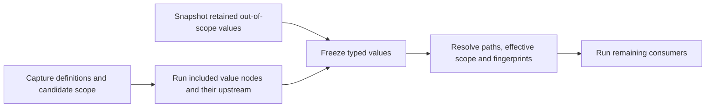

# Project variables (design proposal)

**Status: delivery steps 1 (model and engine), 2 (interface) and 3 (expressions) implemented; step 4 (computed variables and path references) accepted on 1 November 2026 (see [Decisions](#decisions)), not implemented yet.** `variables.json`, the `date` parameter type, whole-parameter binding, fingerprints, run records, the API, ZIP archives, merge, comparison and grouping work as described below, and so do the **Variables** tab, the inspector's variable button and chip, stale reasons, run confirmations and run details, and `{{ var.name }}` references in expressions with their suggestions, value hints, guided Filter values and lineage labels; see [Project variables](../VARIABLES.md). The screenshots in this proposal are mockups drawn before the implementation; the user guide shows the actual interface. The [Computed variables](#computed-variables) section describes accepted behavior that a separate issue will implement.

## Summary

A **project variable** is a named, typed and documented value declared once in a project, for example `high_value_threshold = 300`. Node parameters can be bound to it, and SQL expressions can reference it. An ordinary variable has a default value and can take a different value in each environment, so `dev` and `prod` can use different thresholds, dates or schema names without changing the flow.

Variable declarations are ordinary project content: they live in a versioned `variables.json` file, change through the normal save and commit cycle, and follow branches and merges. Ordinary values are versioned there too; computed values (step 4) come from a node output and are captured in run records, never written back to that file. Variables are never secrets and never pasted into SQL as text.

## Problems this solves

- **Repeated constants.** The same threshold, status or start date is typed into several nodes. Changing it means finding every copy.
- **Values that differ per environment.** Connections already switch credentials and roots between `dev` and `prod`, but business values do not: an Oracle schema name, a sampling date or a threshold scaled to production volumes has to be edited by hand before running in another environment.
- **Explaining a result.** A reviewer reading a run or a lineage step sees `amount >= 900` without knowing that 900 is the production value of a business rule.

## What other tools do

| | Dataiku DSS | Alteryx Designer | Alteryx Designer Cloud | This proposal |
| --- | --- | --- | --- | --- |
| Levels | Instance; project (standard values exported in bundles, local values kept on the instance); temporary scenario variables | Workflow constants | Workspace environment parameters; flow parameters | Project, with an optional value per environment |
| Reference | Textual `${name}` expansion in SQL, paths and formulas; `dataiku.get_custom_variables()` in Python | `%User.Name%` in tool settings, `[User.Name]` in formulas | Parameters in paths and recipes | Typed binding of a whole parameter; `{{ var.name }}` inside SQL expressions |
| Typing | JSON values; quoting is up to the user | Text unless marked numeric | Variable or selector parameters | Declared type, validated before running |
| Run-time values | Scenario steps define or update variables | Analytic App interface tools | Flow-level and per-run overrides | Computed node values (step 4); caller-supplied overrides deferred |
| Versioning | Standard values travel in bundles | Saved in the workflow file | Saved with the flow | Git: every change is a commit, branches and merges included |

What we keep: one place to declare and document values, per-environment values (the main reason Dataiku users rely on local variables), and a clear precedence rule. What we leave out: textual substitution, which makes quoting and SQL injection the user's problem and hides types from validation and lineage.

## Principles

The design follows the existing Duckpad invariants rather than adding a second configuration system:

1. **Git remains the source of truth for definitions.** Ordinary values and computed-value sources are versioned, reviewable and mergeable. Computed values are run inputs with recorded provenance, like source data.
2. **Typed binding, never text concatenation.** Values reach DuckDB as bound parameters, quoted identifiers or escaped literals, exactly like template parameters.
3. **No hidden computation.** Editing a variable invalidates the affected results in the affected environment; nothing runs automatically.
4. **Each run is self-explaining.** Ordinary values are captured at launch. Computed values are frozen after their source nodes run, before their consumers execute. Run history records the values actually used.
5. **Portable definitions.** SQL templates and components stay independent of a particular project's variables, so imports and ZIP archives keep working.
6. **Secrets stay in connections.** Declarations and ordinary values are visible in Git; all resolved values are visible with executed SQL and history by design.

## Model

### Declaration file

Variables are declared in an optional `variables.json` at the project root, next to `flow.json`. Keys are variable names (lowercase letters, digits and underscores, starting with a letter).

```json
{
  "high_value_threshold": {
    "type": "number",
    "description": "Minimum order amount kept by the high-value report.",
    "default": 300,
    "environments": {"prod": 900}
  },
  "order_status": {
    "type": "choice(paid|refunded|pending)",
    "description": "Order status counted as revenue.",
    "default": "paid"
  },
  "report_start": {
    "type": "date",
    "description": "First order date included in the reports.",
    "default": "2026-10-01",
    "environments": {"prod": "2026-01-01"}
  }
}
```

The description is documentation: changing it never invalidates results. An environment key that the instance does not know produces a warning, not an error, because projects travel between instances through Git and ZIP archives.

### Types

| Variable type | JSON value | Can be bound to parameters of type | Inside an expression |
| --- | --- | --- | --- |
| `text` | string | `text`, `file`, `destination` | `VARCHAR` parameter |
| `number` | number | `number` | numeric parameter |
| `boolean` | boolean | `boolean` | `BOOLEAN` parameter |
| `date` | `"YYYY-MM-DD"` | `date` (a new template parameter type) | `DATE` parameter |
| `choice(a\|b)` | one of the options | `text`, and `choice` or `keyword` parameters offering every option | `VARCHAR` parameter |
| `identifier` | string | `identifier`, `column` | not allowed |
| `list<text>`, `list<number>` | array | the same list type | not allowed in the first version |

Connections, secrets, schemas, SQL expressions and structured column settings cannot be variables: connections are already environment-aware, secrets belong to connections, and the others are code rather than values.

### Resolution

For an ordinary variable in the selected environment, its value is its environment value if one is set, otherwise its default. A variable with neither has no value in that environment: nodes that use it cannot run there and show an explicit error, while unrelated nodes still run. Unused variables never block anything. Computed variables (step 4) use the separate resolution rules below.

### Usage

**Whole-parameter binding.** Any compatible node parameter can take its value from a variable. `flow.json` stores the reference instead of a literal:

```json
{"id": "validated", "template": "validated_orders", "params": {"status": {"$var": "order_status"}}}
```

**References inside expressions.** `expression` and `expressions` parameters can contain `{{ var.name }}`, for example `order_date >= {{ var.report_start }}`. The compiler replaces the reference with a named DuckDB parameter before validating the expression, so the value is bound with its type and never inserted into the SQL text. The guided Filter form offers the same variables in its value field.

**Where references are allowed.** In the first version, references live only in the root flow, including the values of exposed component parameters. Templates (`templates/*.sql`) and component definitions (`components/*.json`) cannot reference project variables, so they remain portable between projects. To use a variable inside a component, expose the parameter and bind the exposed parameter on the component instance. **Group into component** does this automatically: each bound parameter of the grouped nodes, and each expression that references variables, becomes an exposed parameter of the new instance, which keeps the same binding or expression, in one save.

## User experience

### The Variables tab

Variables get a workspace tab between **Documentation** and **History** (`/worktrees/:worktreeId/variables`). They belong to the branch, like the flow and its documentation, rather than to **Project settings**, which holds branch-independent access settings.


- The table shows each variable with its type, default, one column per environment and the number of nodes using it. The active environment's column is highlighted; inherited values are shown as *default*.
- Selecting a row opens the editor: name, type, description, default, and a value per environment with a **Default** switch. Before saving, an impact note lists the nodes that will become stale and in which environment.
- **Used by** lists each usage with its parameter; selecting one opens the node in the flow.
- **Rename…** updates the declaration and every reference in one commit. **Delete** is disabled while the variable is used.
- **New variable** opens the same editor. Readers can browse the tab; editors and project administrators can change it.

### Binding a parameter in the inspector

Each compatible parameter shows a variable button next to its name. It lists the compatible variables with their values, explains why incompatible ones are disabled, and offers **Create a variable from "paid"…**, which declares a variable initialized with the current value and binds the parameter in the same save. Promoting a value this way does not change any result.


A bound parameter shows the variable as a chip with its value in the active environment. The cross restores a fixed value, initialized with the current value.


### Variables in expressions and stale results

Typing `{{ var.` in an expression field suggests variables. Below the field, a hint shows the value of each referenced variable per environment. When a variable change makes a result stale, the preview says which variable changed, in which environment, and its previous and current values.


The **SQL** tab lists the bound value next to the variable name. Lineage explanations show the value that was used, labeled with its variable, for example `amount >= 900 (high_value_threshold)`.

### Running, confirming and auditing

When an environment requires confirmation, the dialog lists the variables used by the requested scope, their values and whether each comes from the default or the environment.


Each run record stores the same list. The run details in **History** show it in a **Variables** section, and Git history shows who changed which value and when.

### Files, comparison and merge

`variables.json` appears in the **Code** tab and can be edited there or in an external editor, with the usual batching, validation and conflict handling. **Compare versions** shows changed variables and the nodes they affect. Three-way merge works per variable and per field: changing the `prod` value on one branch and the description on another merges cleanly, while two different `prod` values are a conflict resolved in the interface. Project ZIP export and import include the file.

## Workflows

1. **Promote a constant.** In Paid orders, open the variable button on `status` and choose **Create a variable from "paid"…**. Name it `order_status`. One commit adds the declaration and the binding; results stay valid because the value is unchanged.
2. **Reuse it.** On another node, open the variable button and pick `order_status`.
3. **Use a production value.** In **Variables**, select `high_value_threshold`, turn off **Default** for `prod` and enter 900. Saving commits the change; results that use it become stale in `prod` only. Switch to `prod`, run, and check the values in the confirmation dialog.
4. **Filter on a period.** In a Filter node, write `order_date >= {{ var.report_start }}`, or choose the variable in the guided form.
5. **Try another value safely.** Create a branch, change the value there, run, then **Compare versions** and merge or discard the branch. `main` is unchanged until the merge.
6. **Explain a result.** Open the run in **History** to see the values used, or follow a cell's lineage to the filter step and its labeled value.

## Execution, invalidation and lineage

- **Capture.** A launch resolves ordinary variables used by the requested scope from the captured commit and the selected environment. Step 4 adds a value-node phase before resolving computed variables. Changing a variable or the environment selector during a run does not affect that run.
- **Fingerprints.** A node's computation fingerprint includes the type and resolved value of each variable it uses, directly or through exposed component parameters. Changing the `prod` value invalidates `prod` results of those nodes and their descendants only; unrelated nodes and other environments keep valid results. References are resolved before fingerprinting, so a rename that keeps every value does not invalidate results.
- **History.** The run record lists, for each variable used, its type, value and source (`default` or `environment`, extended with node provenance in step 4). Variables cannot hold secrets; their values are intended to be readable in history.
- **Lineage.** Lineage keeps working on the executed SQL and its bound values; the interface only adds the variable name to explanations.
- **Historical revisions.** Opening an older revision uses the declarations and ordinary values of that revision, like any other project file. Computed values belong to a worktree and environment, or to a recorded run; opening a revision does not recover live results from history.

## Validation

Errors follow the existing invalid-save rules: invalid content is saved and committed, diagnosed, and blocks only the affected execution scope.

| Problem | Diagnostic and scope |
| --- | --- |
| Malformed `variables.json`, invalid name or unknown type | File error; nodes that reference variables are blocked |
| Default or environment value not matching the type | Error on the variable; nodes using it are blocked in the affected environments |
| Reference to an undeclared variable | Error on the node and its descendants |
| Variable type incompatible with the parameter | Error on the node |
| No value in the selected environment | Error on the nodes using it, in that environment only |
| Reference inside a template or component definition | Error on the definition, suggesting an exposed parameter |
| Value for an environment the instance does not have | Warning only |
| Name suggesting a credential, such as `password` or `token` | Warning recommending a connection secret |

## Security and privacy

Variables are not a secret store. Ordinary values are stored in Git and ZIP exports; computed values are recorded outside Git in run history. Both are shown with executed SQL and readable by every project reader. Credentials stay in connections, which keep secrets outside Git and mask them. Binding never builds SQL from text: scalar values become DuckDB parameters, identifiers are quoted, and paths are escaped literals.

## Computed variables

**Accepted, not implemented yet.** A control file or table can supply the reporting date, processing mode or options for each execution. Committing a different `variables.json` for every run is unnecessary, and joining the control table to every query does not supply a scalar for file paths or activation conditions. Resolve its output once, then pass typed constants to consumers so the query engine can push eligible predicates into source scans.

This extends the existing variable model, not a project-variable mutation API. A run never edits `variables.json`. Reproduction requires the recorded commit, catalog configuration and source inputs, including the control input; the commit alone cannot reproduce changing external data. The run also records the exact values used, even when it reused an earlier value-node result.

Comparable features exist elsewhere: Dataiku's **Set project variables** scenario step writes project variables before a build, Azure Data Factory's Lookup activity returns its first row by default (`firstRowOnly`) for later activities to read as `output.firstRow`, and dbt's `run_query` queries the warehouse whenever the project compiles with a live connection. This proposal keeps the lookup but leaves project variables unchanged, requires exactly one row instead of taking the first, and never runs a node to compile or preview.

### Declaration and source

```json
{
  "report_date": {
    "type": "date",
    "description": "Reporting date read from the control file.",
    "from": {"node": "run_control", "port": "result", "column": "report_date"}
  },
  "mode": {
    "type": "choice(standard|adjusted)",
    "from": {"node": "run_control", "column": "mode"}
  },
  "with_adjustments": {
    "type": "boolean",
    "from": {"node": "run_control", "column": "with_adjustments"}
  }
}
```

An ordinary declaration keeps its current fields. A computed declaration has `type`, optional `description`, and `from`; `default` and `environments` are forbidden, including empty objects or nulls. There is **no fallback default** in v1: a missing control value must not silently select a business behavior. Environment-specific inputs come from the producer's normal connection and ordinary parameter bindings.

The shared **value source** is `{node, port?, column}`. `node` is the stable ID of a root flow node, including a component instance with an exposed output; it is not its label or an internal component path. `port` names that output and may be omitted only when the node exposes exactly one output. Resolution records the actual port even when omitted. `column` names one unambiguous output column, not an expression or a column index. Unknown fields, missing nodes, missing or ambiguous ports and missing or ambiguous columns are diagnostics on the variable. Output schema checks that require execution happen after the producer runs. An export without an output cannot supply a value.

A **value node** is any node referenced by `from`. All references to the same output read the same published result, and each producer executes at most once per run. A component's exposed output resolves to its expanded producing node; the component's unrelated outputs are not extra value dependencies. Renaming a label changes nothing. Changing an ID must update the references or diagnose them; grouping a producer must expose its output and update `from` atomically. Grouping consumers exposes bound parameters, expressions and path parameters as today, preserving project references on the root instance only.

### Cardinality and conversion

The entire referenced output must contain **exactly one row**. Extraction can stop after observing a second row; it must not use a paginated preview, sample, first-row shortcut or implicit aggregate. Multiple columns may feed different variables. Validate each selected cell independently after the node's outputs, tests and messages have successfully published. A failing error-level data test therefore prevents value publication; a warning follows existing node semantics.

Use explicit, lossless conversions to the existing canonical variable types. Apply them to the column's DuckDB type from the result description, not to the Python value: the isolated SQL worker returns `DATE`, `DECIMAL` and timestamps as text.

| Declared type | Accepted cell and canonical value |
| --- | --- |
| `text` | A string, unchanged; no automatic formatting of other types |
| `choice(a\|b)` | A string exactly matching an option |
| `identifier` | A non-empty string under the existing identifier rules; quote at binding |
| `boolean` | A Boolean only; reject `0`, `1` and strings such as `"true"` |
| `number` | A finite numeric cell, excluding Boolean; preserve integers exactly; accept a `DECIMAL` only when the JSON number recorded for the variable reads back as the same decimal (`1234.56` passes, a 20-digit fraction does not), otherwise request an explicit cast in the producer |
| `date` | A DuckDB `DATE`, or a valid ISO `YYYY-MM-DD` string, normalized to that string; reject timestamps and locale-dependent strings |
| `list<text>`, `list<number>` | A list cell whose elements all satisfy the corresponding scalar rules, so a `NULL` element is an error as in `variables.json`; no splitting strings or collecting rows |

Zero rows, two or more rows, `NULL`, incompatible types and unsupported loss of precision are errors, never missing values with an implicit fallback. Diagnostics name the variable, source and expected type/cardinality, for example `report_date: run_control.result must return exactly one row; found at least 2` or `report_date: run_control.result.report_date is NULL; expected date`. Only consumers of the failed variable and their dependent nodes are blocked; a different valid column from the same successful output remains usable. A SQL failure of the producer blocks all variables supplied by that failed node.

### Dependency validation and execution in two phases

Add value-dependency edges from producers to consumers alongside ordinary data edges, so a failed value source blocks its consumers like a failed input. These edges are not joins or dataset inputs. They cover whole bindings, expressions, paths and exposed component parameters, and later activation conditions. A value node and its data ancestors may use ordinary variables only: a computed variable referenced in the value phase is a validation error on that node, which keeps the run to exactly two phases. When the variable comes from the same producer, the diagnostic reports a cycle with its dependency chain, for example `run_control -> var.report_date -> filtered_orders -> run_control`. Check this on the expanded graph and block only that node and its dependents, not independent branches. Chained value nodes can be added later, for example if partition lists need computed values, without changing the declaration format.

Preserve the existing meaning of a launch: the whole project, or a selected node or component and its data ancestors. A value reference alone **does not add its producer to a targeted launch**. Otherwise a consumer-only run would secretly refresh the control file instead of using the retained value.

1. **Capture and plan.** Reserve the worktree using existing admission rules. Capture the commit, declarations, environment, connection configuration and ordinary values. Build a structural candidate scope using data edges, before value-dependent filtering. Identify its value nodes and their data ancestors; validate the combined dependency graph. Capture retained values needed from producers outside this scope. Capture connection settings for both phases now, so later editing cannot change an accepted run.
2. **Compute values.** Run included value nodes and their upstream dependencies in dependency order. Publish and extract their values, recording success or a per-variable error. Nodes shared by this phase and the rest execute once. Producers in scope are recomputed even when their previous result is valid: an external control file may have changed without a Git change. A failed refresh never falls back to a previous value within this run.
3. **Bind and execute the remainder.** Freeze the resolved value map, including retained out-of-scope values and errors. Resolve parameters and paths, then compute the final effective scope and fingerprints, and execute remaining nodes under existing run rules. A future activation-condition feature must evaluate conditions here, not use retained values to skip an included producer. It cannot expand beyond the captured candidate scope without a separate design. Failures block affected consumers; independent nodes run.

These are two execution phases within one run ID and one admission lock, not child runs. Existing cancellation and terminal statuses apply. Persist the value phase before starting consumers; a canceled or interrupted phase cannot publish a half-extracted value as ready. A successfully published value survives a later consumer failure, just as the producer's successful result does.



### Retained values, previews and validity

The current value is the **last successfully extracted value of the producer in this worktree and environment**. Store it with the execution context, keyed by the resolved source and declared type, with its producing run and commit. It has the same lifetime as node results: new worktrees, Job worktrees and historical revision worktrees have no shared value cache; eviction or a backend restart requires another calculation. Durable run history remains readable and is not silently rehydrated as a live value cache.

| Situation | Resolution |
| --- | --- |
| Producer in launch scope | Calculate it and use this run's value, or block its consumers on extraction failure |
| Producer outside scope, retained value available | Freeze that value at launch, record its producing run and label it retained |
| Producer outside scope, no value yet | Block consumers with `report_date: value not calculated; run run_control` |
| Producer SQL, input or ordinary binding edited, same source and declared type | Keep the last successful scalar for out-of-scope use and show that its source result is stale; recompute only when the producer runs |
| Resolved `from` or declared type changed | Invalidate that declaration's retained association; require a successful calculation for the new declaration; spelling out an already inferred port is not a source change |
| Producer/extraction fails on refresh | Keep the previous successful value visible, with the latest error; it is usable only in a later launch that excludes the producer |

Preview, compile, sample-filter and scope-inspection requests never run a value node. They use the retained map or return a diagnostic for affected nodes. On a new branch, the diagnostic tells the user to run the producer or the whole flow. Compilation cannot invent a placeholder date or imply that an unresolved consumer is executable. An existing stale preview remains inspectable under the usual result rules; its SQL and lineage refer to its recorded values.

Consumer fingerprints include the **declared type and canonical value**, including values used in paths. They do not include the producing run ID, timestamp, variable name or source node fingerprint merely because it supplies a scalar. Changing a value invalidates its consumers and their data descendants in this environment only, including results outside the current launch. Recomputing the same value leaves those results valid. A real data edge still carries its normal fingerprint dependency. Renames and description edits preserve validity. Changing a source declaration makes its value unavailable until resolved; if it then produces the same typed value, existing consumer fingerprints still match. Explicit launches retain their existing recomputation semantics; this design does not introduce a general cache-skipping scheduler.

### References in file and destination parameters

Step 4 introduces `{{ var.name }}` in `file`, `destination`, `file(connection)` and `destination(connection)` parameters, for **both ordinary and computed variables**. Whole-parameter `{"$var": "name"}` keeps its existing compatibility rules. A date may be formatted inside a path without becoming a text variable:

```json
{"id": "summary_export", "template": "csv_export", "params": {"destination": "exports/{{ var.report_date }}_summary.csv"}}
```

Use a shared reference parser with separate rendering contexts: SQL expressions produce typed bindings; paths produce a single string passed to the existing resource compiler. Path fragments accept text, choices, dates, finite numbers and booleans. Dates use ISO format, booleans `true`/`false`, and numbers a stable locale-independent representation; identifier and list fragments are rejected. Unknown variables, malformed tokens and unresolved values diagnose the parameter. There are no functions, arbitrary expressions, recursive expansion, shell expansion or interpolation in general `text` fields. Quotes in a value are data.

Resolve fragments first, then apply the connection root or default directory, normalize the final resource, and enforce the existing allowed directories and connection read/write permissions on that final path. Neither an absolute path, `..`, a symlink escape nor a changed URI scheme or authority may enlarge the resource access granted by the captured configuration. Apply checks before reading or writing, including export artifact capture. Keep existing permitted glob behavior subject to the same access restrictions. Do not authorize the unresolved template or create new allowed roots from a variable value.

Finally render the validated path with the existing escaped SQL literal function where DuckDB resource syntax requires a literal; ordinary scalar parameters stay bound. Never splice an unescaped value into SQL. Keep the original path template, variable values and resolved resource in the run evidence so SQL, history and lineage can explain the actual input or destination. Rename, **Used by**, comparison, grouping and editor suggestions include path references.

### Run evidence, API and lineage

Extend existing read contracts, rather than adding a setter for current values. `bundle.variables` stays the versioned declaration. The runtime summary and run records carry the separately resolved values. The additions are:

| Surface | Addition |
| --- | --- |
| `GET /api/worktrees/{worktree}` | Each computed declaration's `from`, per-environment state/value/provenance, last attempt error, and usages including paths |
| `GET /api/worktrees/{worktree}/variables/scope` | Distinguish `pending` (producer included: calculated at launch), `ready` with `resolution: retained`, and `unavailable`; list source nodes without executing them |
| Existing run launch routes | Accept the same request bodies; schedule the value phase server-side; do not accept supplied overrides for computed declarations |
| Run records and `GET /api/v1/runs/{id}` | Add computed entries to `variables`, with `state`, `from`, `producer_run`, `producer_commit`, `resolution` and either `value` or `error`; preserve ordinary entries and existing run statuses |
| Compile and executed SQL | Include resolved values and source labels next to bindings; unresolved compile requests diagnose only affected nodes |
| Rename, save, compare and merge | Include declarations and all reference locations; never include retained runtime values in Git operations |

A resolved entry in the existing run `variables` map uses this shape (IDs and commits here are illustrative):

```json
{
  "report_date": {
    "type": "date",
    "state": "ready",
    "value": "2026-06-30",
    "source": "node",
    "from": {"node": "run_control", "port": "result", "column": "report_date"},
    "resolution": "calculated",
    "producer_run": "run_example",
    "producer_commit": "example-commit"
  }
}
```

`resolution` is `calculated` or `retained`; in the latter case provenance points to the earlier run. Pending entries have no value yet. Unavailable entries keep the `error` message of ordinary entries and add a stable `code`, never `value: null` as a usable constant. Codes distinguish `value_not_calculated`, `invalid_value_source`, `value_cardinality`, `value_null`, `value_type`, `value_dependency_cycle`, `value_chain` and `value_source_failed`. Each node keeps its usage mapping. Retain evidence for every variable extracted in the value phase, even if no consumer ultimately executes, and for retained values actually used.

The SQL tab, **History → Variables** and lineage show, for example, `report_date = 2026-06-30 (run_control)`, with the output/column and producing run available as details. A retained value explicitly says which earlier run supplied it. Explanations use the consumer result's immutable evidence, not today's value. Where the source dataset still exists, provenance can open its single source cell; after eviction, the recorded value and source remain visible without claiming live cell-level lineage. A filter still uses a scalar DuckDB parameter, not a join to the control relation. Check source predicate pushdown with `EXPLAIN` on Parquet in the implementation tests.

### Interface, Jobs and version comparison

- **Variables.** Choose an ordinary value or **Computed from node** in the declaration editor. Computed mode selects a node, output and column instead of default/environment value fields. The table shows **Computed by run_control.report_date**, the current value in each environment, its retained state or error, and **Used by**. The output name disambiguates multiple ports. Offer **Run run_control** only to users already allowed to run that worktree; Job results retain the existing read-only and Job launch rules.
- **Inspector.** The variable button includes compatible computed variables even before calculation, labeled **Not calculated**. Expression and path suggestions show their source and current state. Restoring a fixed value from a chip requires an available value; it cannot fabricate one when unresolved.
- **Canvas.** A value-node badge identifies producers and lists the variables they supply. Progress distinguishes calculating values from running consumers. Diagnostics identify the consumer parameter and the failed value source.
- **Protected environments.** Before execution, confirmation lists included computed sources as **Calculated at launch**, even if a retained value exists. An excluded producer shows the exact retained value and its producing run. Confirmation authorizes the captured scope and sources, not an unknown future scalar. Execution still enforces resource access after resolution.
- **Jobs.** Every launch recalculates all value nodes in the Job's scope before its consumers; valid retained results cannot skip that phase. A scoped Job follows the same out-of-scope rule and cannot borrow values from an editor's worktree or another Job. A fresh scoped Job without the required retained values reports the missing producer; configure a scope that includes it. Cancellation, admission, idempotency and CLI exit codes remain unchanged.
- **Compare and merge.** Compare `type`, `description` and `from` as versioned definition fields and list potentially affected consumers. Merge `from` as one source descriptor: competing source changes conflict rather than combining one branch's node with another's column. Switching between ordinary and computed modes conflicts with edits to the old value/source fields; the result must validate as one mode. Runtime values never appear as Git changes, merge conflicts or ZIP content. Compare runs to compare calculated values.

All new interface labels and diagnostics require English, French and Portuguese translations in the implementation, plus an updated variable guide and screenshots. Activation conditions and values supplied by an orchestrator remain separate features; the former will consume this resolved map. Templates, node SQL and component definitions continue to use exposed parameters, not project references. Python nodes are outside this proposal.

### Shared foundation for partitions

A future partition design should reuse four contracts from this work:

1. **Source resolution.** `{node, port?, column}` identifies a published output column. Separate locating the output from cardinality policy: a computed variable requires one row; a partition dimension reads N ordered rows and attributes from those same rows. Partition uniqueness, null-key rules and empty-set behavior belong to the partition design, not this extractor.
2. **Execution phases.** Compute included value sources and their dependencies before planning value-dependent work. Share admission, cancellation, source failures and cycle detection. Partition enumeration adds its own selection and iteration rules after this phase; it must not be implemented as repeated scalar-variable mutations.
3. **Reference contexts.** Share parsing, type-aware rendering and final path authorization. Reserve a separate namespace for `{{ partition }}` and `{{ partition.attribute }}`; they are not accepted by this implementation until partition scope validation exists.
4. **Evidence and fingerprints.** Reuse the typed value, normalized `from`, producing run/commit and resolution provenance envelope. A partition adds its key and attributes to the execution context and node fingerprint; provenance stays separate from computational identity. Both SQL annotations and lineage read the values attached to the executed result.

Implement and validate this foundation before partition execution. This step does not decide partition storage, retention limits, parallelism or collection.

### Delivery and acceptance

A dedicated implementation issue covers model/validation, value-phase execution and retained state, path references, API/evidence, interface/translations and the user guide. Acceptance for that implementation includes:

- A one-row `run_control.csv` with `report_date;mode;with_adjustments` supplies bound variables; `EXPLAIN` shows the eligible date predicate in the Parquet scan, and returned rows match a literal-parameter reference query.
- Zero/multiple rows, nulls, missing source/port/column, incompatible values, unsafe conversions, failing producer tests and direct/indirect cycles give explicit diagnostics while an independent branch still completes.
- A fresh worktree's compile/preview does not execute anything; a consumer-only launch needs a retained value. Exercise component outputs, rejected value chains, shared producers, environment/worktree isolation, restart/eviction, failed refresh and cancellation without silently reusing a failed refresh.
- A changed control value invalidates exactly its consumers and their data descendants in that environment. An unchanged value keeps out-of-scope consumer results valid. Consumer runs freeze values throughout execution.
- Ordinary and computed path references resolve for reads and exports. Test quotes, multiple fragments, dates, booleans, unknown tokens, traversal, absolute paths, symlinks, permitted globs and connection-scoped URIs against final resource authorization, with no unescaped SQL insertion.
- Jobs recalculate included producers; protected confirmation, variables, inspector, badges, history, executed SQL and lineage agree on pending, calculated and retained values. No run changes `variables.json`; version comparison, ZIPs and merge contain declarations only.
- Relevant pytest, Vitest, `ty check`, Ruff, ESLint and Playwright checks pass; English, French and Portuguese strings and the user guide are updated. A preview of the implementation commit is verified for human review.

## Alternatives considered

- **Textual `${name}` substitution anywhere** (Dataiku, Alteryx constants). Rejected: users must handle quoting, values can inject SQL, and types are invisible to validation and lineage.
- **Instance-wide variables** (Dataiku instance variables, Designer Cloud environment parameters). Not in the first version: infrastructure values that differ per environment already belong to connections, and business values should be versioned with the project that uses them. To revisit if several projects need to share business constants.
- **Unversioned instance-local overrides** (Dataiku local variables). Rejected: invisible in Git and impossible to review or merge. Computed variables instead have a versioned source declaration and record the actual source values with the run.
- **References in templates and components.** Deferred: an imported template or component would depend on variables of its original project. Exposed parameters already provide this indirection.
- **Values supplied at launch** ("Run with values…", Alteryx Analytic Apps, Designer Cloud run overrides). Deferred to Job automation step 3; they need their own precedence, authorization and validity rules. Computed variables in step 4 derive from a declared node output and retain run provenance instead of changing project values through an API.

## Delivery plan

Each step is a separate issue and pull request, with tests and documentation.

1. **Model and engine.** Parse and validate `variables.json`; add the `date` parameter type; resolve whole-parameter bindings in the root flow; include variables in fingerprints, launch capture and run records; expose them in the bundle, compile and run APIs; include the file in ZIP export/import and per-variable merge; auto-expose bindings when grouping into a component.
2. **Interface.** Variables tab and editor, usage list, rename and delete rules, inspector picker and chip, **Create a variable from…**, stale reasons, confirmation dialog, run details, English and French strings, Playwright scenarios and guide screenshots.
3. **Expressions.** `{{ var.name }}` in expression parameters, suggestions and value hints, guided Filter support and lineage labels.
4. **Computed variables and path references (accepted).** Implement the [Computed variables](#computed-variables) design in a dedicated issue: `from` declarations, dependency validation, two execution phases, retained values, fingerprints and run evidence; `{{ var.name }}` in `file` and `destination` parameters for ordinary and computed variables; API, interface, translations and user guide. Deliver the shared value-source and path-resolution contracts before the partition implementation.
5. **Later, on demand.** Interpolation in general text parameters, instance-wide variables and read-only built-in values such as the environment name. Values supplied when a Job is launched remain [Job automation](JOB_AUTOMATION.md) step 3, separate from computed variables.

## Decisions

- Steps 1–3 use versioned ordinary values. Step 4, accepted on 1 November 2026, adds computed values with no fallback default, lossless conversions (including ISO text to date), value nodes limited to ordinary variables, retained results per worktree/environment, and no automatic execution for compilation or preview.
- Values supplied by schedules and webhooks remain Job automation step 3; they do not override a computed declaration.
- References stay limited to the root flow; components use exposed parameters.
- Ordinary per-environment values are versioned in the project; computed values belong to execution contexts and run history.
- The entry point is a **Variables** workspace tab rather than a section of **Project settings**.

## Sources

- Dataiku: [custom variables](https://doc.dataiku.com/dss/latest/variables/index.html), [scenario variables](https://doc.dataiku.com/dss/latest/scenarios/variables.html), [global and project variables](https://knowledge.dataiku.com/latest/mlops-o16n/variables/concept-global-vs-project.html), [scenario steps](https://doc.dataiku.com/dss/latest/scenarios/steps.html)
- Alteryx Designer: [workflow constants](https://help.alteryx.com/2018.1/Constants.htm)
- Alteryx Designer Cloud: [flow parameter overrides discussion](https://community.alteryx.com/t5/Alteryx-Designer-Cloud-Discussions/I-have-a-flow-parameter-called-clientName-I-also-have/m-p/1128240)
- Azure Data Factory: [Lookup activity](https://learn.microsoft.com/en-us/azure/data-factory/control-flow-lookup-activity)
- dbt: [`run_query`](https://docs.getdbt.com/reference/dbt-jinja-functions/run_query)
