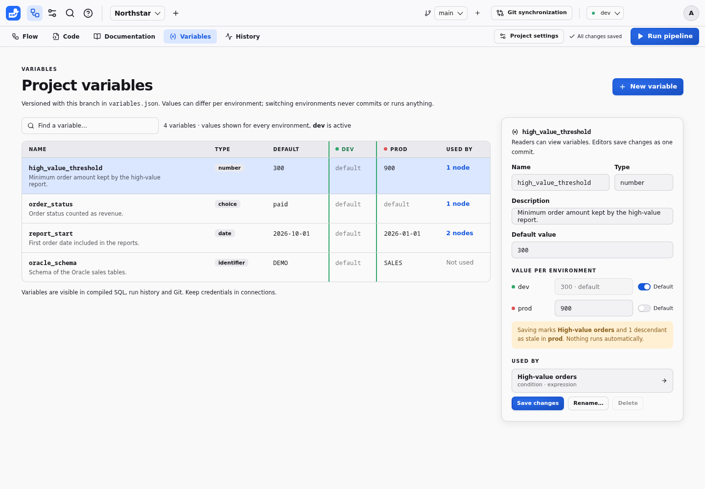
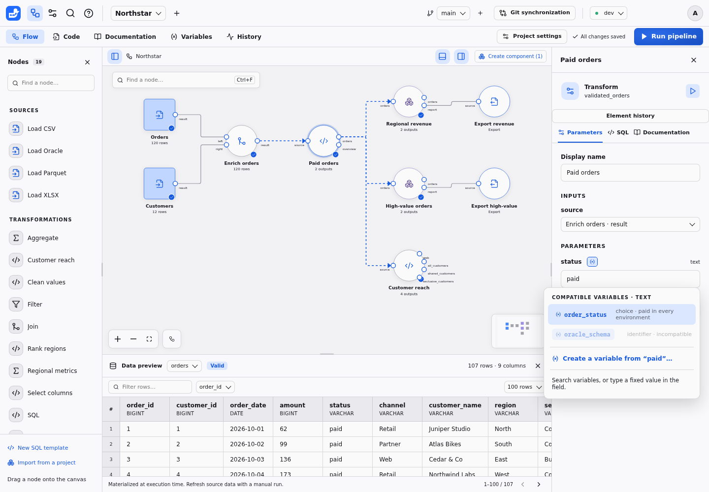
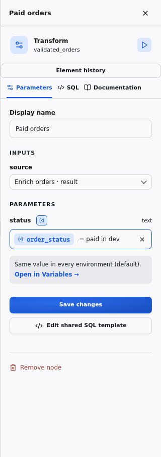
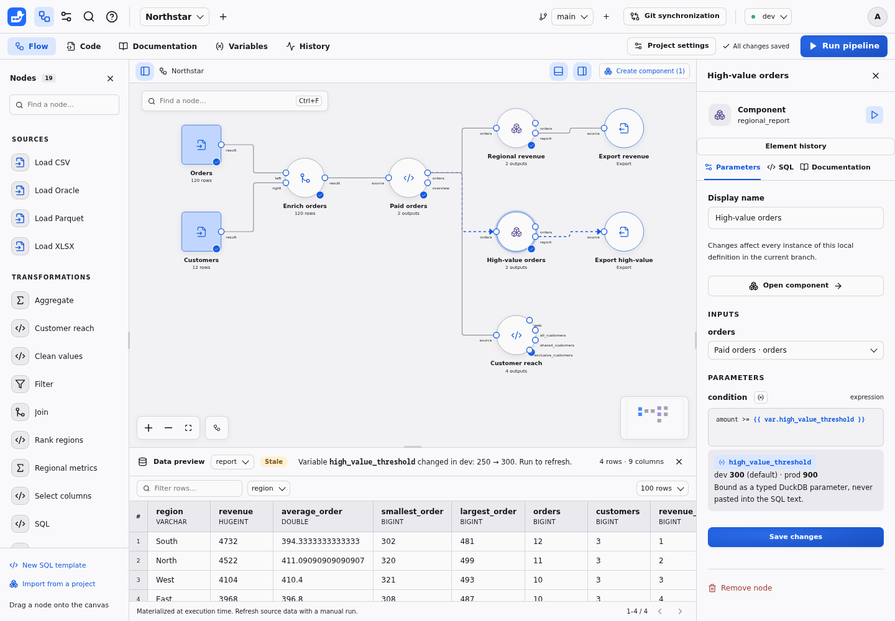
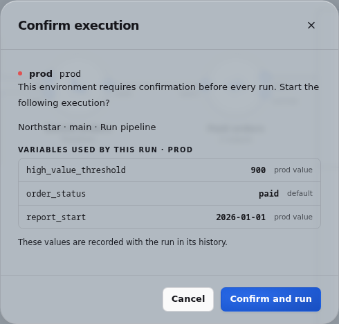

# Project variables (design proposal)

**Status: delivery steps 1 (model and engine), 2 (interface) and 3 (expressions) implemented; step 4 proposed.** `variables.json`, the `date` parameter type, whole-parameter binding, fingerprints, run records, the API, ZIP archives, merge, comparison and grouping work as described below, and so do the **Variables** tab, the inspector's variable button and chip, stale reasons, run confirmations and run details, and `{{ var.name }}` references in expressions with their suggestions, value hints, guided Filter values and lineage labels; see [Project variables](../VARIABLES.md). The screenshots in this proposal are mockups drawn before the implementation; the user guide shows the actual interface.

## Summary

A **project variable** is a named, typed and documented value declared once in a project, for example `high_value_threshold = 300`. Node parameters can be bound to it, and SQL expressions can reference it. A variable has a default value and can take a different value in each environment, so `dev` and `prod` can use different thresholds, dates or schema names without changing the flow.

Variables are ordinary project content: they live in a versioned `variables.json` file, change through the normal save and commit cycle, follow branches and merges, and are captured with every run. They are never secrets and never pasted into SQL as text.

## Problems this solves

- **Repeated constants.** The same threshold, status or start date is typed into several nodes. Changing it means finding every copy.
- **Values that differ per environment.** Connections already switch credentials and roots between `dev` and `prod`, but business values do not: an Oracle schema name, a sampling date or a threshold scaled to production volumes has to be edited by hand before running in another environment.
- **Explaining a result.** A reviewer reading a run or a lineage step sees `amount >= 900` without knowing that 900 is the production value of a business rule.

## What other tools do

| | Dataiku DSS | Alteryx Designer | Alteryx Designer Cloud | This proposal |
| --- | --- | --- | --- | --- |
| Levels | Instance; project (standard values exported in bundles, local values kept on the instance); temporary scenario variables | Workflow constants | Workspace environment parameters; flow parameters | Project, with an optional value per environment |
| Reference | Textual `${name}` expansion in SQL, paths and formulas; `dataiku.get_custom_variables()` in Python | `%User.Name%` in tool settings, `[User.Name]` in formulas | Parameters in paths and recipes | Typed binding of a whole parameter; `{{ var.name }}` inside SQL expressions |
| Typing | JSON values; quoting is up to the user | Text unless marked numeric | Variable or selector parameters | Declared type, validated before running |
| Run-time values | Scenario steps define or update variables | Analytic App interface tools | Flow-level and per-run overrides | Not in the first version (see [alternatives](#alternatives-considered)) |
| Versioning | Standard values travel in bundles | Saved in the workflow file | Saved with the flow | Git: every change is a commit, branches and merges included |

What we keep: one place to declare and document values, per-environment values (the main reason Dataiku users rely on local variables), and a clear precedence rule. What we leave out: textual substitution, which makes quoting and SQL injection the user's problem and hides types from validation and lineage.

## Principles

The design follows the existing Duckpad invariants rather than adding a second configuration system:

1. **Git remains the source of truth.** Every value that can change a result is versioned, reviewable and mergeable, like parameters today.
2. **Typed binding, never text concatenation.** Values reach DuckDB as bound parameters, quoted identifiers or escaped literals, exactly like template parameters.
3. **No hidden computation.** Editing a variable invalidates the affected results in the affected environment; nothing runs automatically.
4. **Each run is self-explaining.** The values actually used are captured at launch and recorded in the run history.
5. **Portable definitions.** SQL templates and components stay independent of a particular project's variables, so imports and ZIP archives keep working.
6. **Secrets stay in connections.** Variables are visible in Git, compiled SQL and history by design.

## Model

### Declaration file

Variables are declared in an optional `variables.json` at the project root, next to `flow.json`. Keys are variable names (lowercase letters, digits and underscores, starting with a letter).

```json
{
  "high_value_threshold": {
    "type": "number",
    "description": "Minimum order amount kept by the high-value report.",
    "default": 300,
    "environments": {"prod": 900}
  },
  "order_status": {
    "type": "choice(paid|refunded|pending)",
    "description": "Order status counted as revenue.",
    "default": "paid"
  },
  "report_start": {
    "type": "date",
    "description": "First order date included in the reports.",
    "default": "2026-10-01",
    "environments": {"prod": "2026-01-01"}
  }
}
```

The description is documentation: changing it never invalidates results. An environment key that the instance does not know produces a warning, not an error, because projects travel between instances through Git and ZIP archives.

### Types

| Variable type | JSON value | Can be bound to parameters of type | Inside an expression |
| --- | --- | --- | --- |
| `text` | string | `text`, `file`, `destination` | `VARCHAR` parameter |
| `number` | number | `number` | numeric parameter |
| `boolean` | boolean | `boolean` | `BOOLEAN` parameter |
| `date` | `"YYYY-MM-DD"` | `date` (a new template parameter type) | `DATE` parameter |
| `choice(a\|b)` | one of the options | `text`, and `choice` or `keyword` parameters offering every option | `VARCHAR` parameter |
| `identifier` | string | `identifier`, `column` | not allowed |
| `list<text>`, `list<number>` | array | the same list type | not allowed in the first version |

Connections, secrets, schemas, SQL expressions and structured column settings cannot be variables: connections are already environment-aware, secrets belong to connections, and the others are code rather than values.

### Resolution

For the selected environment, a variable's value is its environment value if one is set, otherwise its default. A variable with neither has no value in that environment: nodes that use it cannot run there and show an explicit error, while unrelated nodes still run. Unused variables never block anything.

### Usage

**Whole-parameter binding.** Any compatible node parameter can take its value from a variable. `flow.json` stores the reference instead of a literal:

```json
{"id": "validated", "template": "validated_orders", "params": {"status": {"$var": "order_status"}}}
```

**References inside expressions.** `expression` and `expressions` parameters can contain `{{ var.name }}`, for example `order_date >= {{ var.report_start }}`. The compiler replaces the reference with a named DuckDB parameter before validating the expression, so the value is bound with its type and never inserted into the SQL text. The guided Filter form offers the same variables in its value field.

**Where references are allowed.** In the first version, references live only in the root flow, including the values of exposed component parameters. Templates (`templates/*.sql`) and component definitions (`components/*.json`) cannot reference project variables, so they remain portable between projects. To use a variable inside a component, expose the parameter and bind the exposed parameter on the component instance. **Group into component** does this automatically: each bound parameter of the grouped nodes, and each expression that references variables, becomes an exposed parameter of the new instance, which keeps the same binding or expression, in one save.

## User experience

### The Variables tab

Variables get a workspace tab between **Documentation** and **History** (`/worktrees/:worktreeId/variables`). They belong to the branch, like the flow and its documentation, rather than to **Project settings**, which holds branch-independent access settings.



- The table shows each variable with its type, default, one column per environment and the number of nodes using it. The active environment's column is highlighted; inherited values are shown as *default*.
- Selecting a row opens the editor: name, type, description, default, and a value per environment with a **Default** switch. Before saving, an impact note lists the nodes that will become stale and in which environment.
- **Used by** lists each usage with its parameter; selecting one opens the node in the flow.
- **Rename…** updates the declaration and every reference in one commit. **Delete** is disabled while the variable is used.
- **New variable** opens the same editor. Readers can browse the tab; editors and project administrators can change it.

### Binding a parameter in the inspector

Each compatible parameter shows a variable button next to its name. It lists the compatible variables with their values, explains why incompatible ones are disabled, and offers **Create a variable from "paid"…**, which declares a variable initialized with the current value and binds the parameter in the same save. Promoting a value this way does not change any result.



A bound parameter shows the variable as a chip with its value in the active environment. The cross restores a fixed value, initialized with the current value.



### Variables in expressions and stale results

Typing `{{ var.` in an expression field suggests variables. Below the field, a hint shows the value of each referenced variable per environment. When a variable change makes a result stale, the preview says which variable changed, in which environment, and its previous and current values.



The **SQL** tab lists the bound value next to the variable name. Lineage explanations show the value that was used, labeled with its variable, for example `amount >= 900 (high_value_threshold)`.

### Running, confirming and auditing

When an environment requires confirmation, the dialog lists the variables used by the requested scope, their values and whether each comes from the default or the environment.



Each run record stores the same list. The run details in **History** show it in a **Variables** section, and Git history shows who changed which value and when.

### Files, comparison and merge

`variables.json` appears in the **Code** tab and can be edited there or in an external editor, with the usual batching, validation and conflict handling. **Compare versions** shows changed variables and the nodes they affect. Three-way merge works per variable and per field: changing the `prod` value on one branch and the description on another merges cleanly, while two different `prod` values are a conflict resolved in the interface. Project ZIP export and import include the file.

## Workflows

1. **Promote a constant.** In Paid orders, open the variable button on `status` and choose **Create a variable from "paid"…**. Name it `order_status`. One commit adds the declaration and the binding; results stay valid because the value is unchanged.
2. **Reuse it.** On another node, open the variable button and pick `order_status`.
3. **Use a production value.** In **Variables**, select `high_value_threshold`, turn off **Default** for `prod` and enter 900. Saving commits the change; results that use it become stale in `prod` only. Switch to `prod`, run, and check the values in the confirmation dialog.
4. **Filter on a period.** In a Filter node, write `order_date >= {{ var.report_start }}`, or choose the variable in the guided form.
5. **Try another value safely.** Create a branch, change the value there, run, then **Compare versions** and merge or discard the branch. `main` is unchanged until the merge.
6. **Explain a result.** Open the run in **History** to see the values used, or follow a cell's lineage to the filter step and its labeled value.

## Execution, invalidation and lineage

- **Capture.** A launch resolves the variables used by the requested scope from the captured commit and the selected environment. Changing a variable or the environment selector during a run does not affect that run.
- **Fingerprints.** A node's computation fingerprint includes the type and resolved value of each variable it uses, directly or through exposed component parameters. Changing the `prod` value invalidates `prod` results of those nodes and their descendants only; unrelated nodes and other environments keep valid results. References are resolved before fingerprinting, so a rename that keeps every value does not invalidate results.
- **History.** The run record lists, for each variable used, its type, value and source (`default` or `environment`). Values are never redacted because variables cannot hold secrets.
- **Lineage.** Lineage keeps working on the executed SQL and its bound values; the interface only adds the variable name to explanations.
- **Historical revisions.** Opening an older revision uses the variables of that revision, like any other project file.

## Validation

Errors follow the existing invalid-save rules: invalid content is saved and committed, diagnosed, and blocks only the affected execution scope.

| Problem | Diagnostic and scope |
| --- | --- |
| Malformed `variables.json`, invalid name or unknown type | File error; nodes that reference variables are blocked |
| Default or environment value not matching the type | Error on the variable; nodes using it are blocked in the affected environments |
| Reference to an undeclared variable | Error on the node and its descendants |
| Variable type incompatible with the parameter | Error on the node |
| No value in the selected environment | Error on the nodes using it, in that environment only |
| Reference inside a template or component definition | Error on the definition, suggesting an exposed parameter |
| Value for an environment the instance does not have | Warning only |
| Name suggesting a credential, such as `password` or `token` | Warning recommending a connection secret |

## Security and privacy

Variables are not a secret store. Their values are stored in Git, shown in compiled SQL, run history and ZIP exports, and readable by every project reader. Credentials stay in connections, which keep secrets outside Git and mask them. Binding never builds SQL from text: scalar values become DuckDB parameters, identifiers are quoted, and paths are escaped literals.

## Alternatives considered

- **Textual `${name}` substitution anywhere** (Dataiku, Alteryx constants). Rejected: users must handle quoting, values can inject SQL, and types are invisible to validation and lineage.
- **Instance-wide variables** (Dataiku instance variables, Designer Cloud environment parameters). Not in the first version: infrastructure values that differ per environment already belong to connections, and business values should be versioned with the project that uses them. To revisit if several projects need to share business constants.
- **Unversioned instance-local overrides** (Dataiku local variables). Rejected: invisible in Git, impossible to review or merge, and results could no longer be reproduced from a commit and the catalog.
- **References in templates and components.** Deferred: an imported template or component would depend on variables of its original project. Exposed parameters already provide this indirection.
- **Run-time values** ("Run with values…", Alteryx Analytic Apps, Dataiku scenario variables, Designer Cloud run overrides). Deferred: results computed with values that differ from the saved configuration would be stale immediately under Duckpad's validity rules, without lineage. Branches already offer safe experiments. Values supplied by schedules and webhooks should be designed with that automation.

## Delivery plan

Each step is a separate issue and pull request, with tests and documentation.

1. **Model and engine.** Parse and validate `variables.json`; add the `date` parameter type; resolve whole-parameter bindings in the root flow; include variables in fingerprints, launch capture and run records; expose them in the bundle, compile and run APIs; include the file in ZIP export/import and per-variable merge; auto-expose bindings when grouping into a component.
2. **Interface.** Variables tab and editor, usage list, rename and delete rules, inspector picker and chip, **Create a variable from…**, stale reasons, confirmation dialog, run details, English and French strings, Playwright scenarios and guide screenshots.
3. **Expressions.** `{{ var.name }}` in expression parameters, suggestions and value hints, guided Filter support and lineage labels.
4. **Later, on demand.** Variables inside text and path parameters (for example `sales_{{ var.year }}.csv`), values supplied when a Job is launched (see [Job automation](JOB_AUTOMATION.md)), instance-wide variables, and read-only built-in values such as the environment name.

## Decisions

- The first version has no run-time values: to try another value, change the variable on a branch, run and compare. Values supplied by schedules and webhooks come later (delivery step 4).
- References stay limited to the root flow; components use exposed parameters.
- Per-environment values are versioned in the project rather than stored per instance.
- The entry point is a **Variables** workspace tab rather than a section of **Project settings**.

## Sources

- Dataiku: [custom variables](https://doc.dataiku.com/dss/latest/variables/index.html), [scenario variables](https://doc.dataiku.com/dss/latest/scenarios/variables.html), [global and project variables](https://knowledge.dataiku.com/latest/mlops-o16n/variables/concept-global-vs-project.html)
- Alteryx Designer: [workflow constants](https://help.alteryx.com/2018.1/Constants.htm)
- Alteryx Designer Cloud: [flow parameter overrides discussion](https://community.alteryx.com/t5/Alteryx-Designer-Cloud-Discussions/I-have-a-flow-parameter-called-clientName-I-also-have/m-p/1128240)
